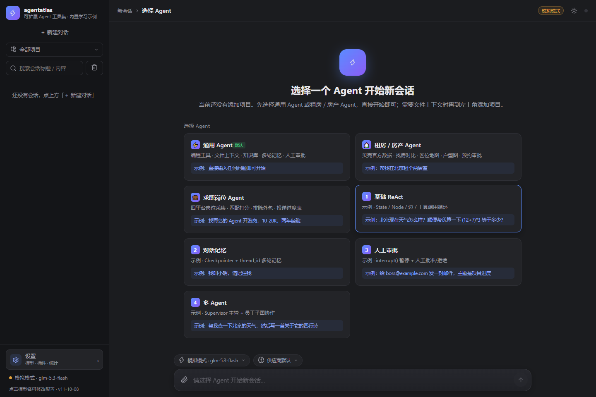
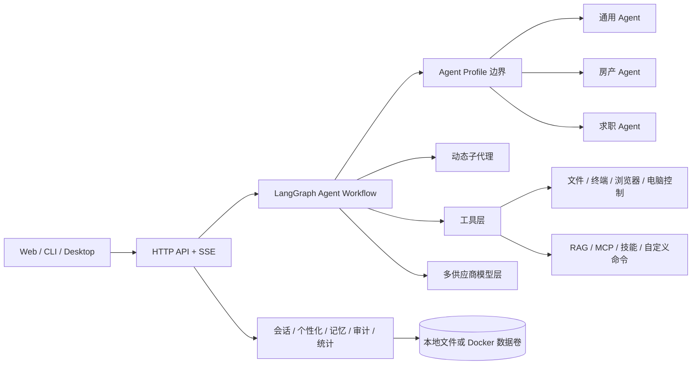

<h1 align="center">agentatlas</h1>

<p align="center">
  <strong>本地优先、可扩展的多 Agent 工作台</strong><br>
  把模型、工具、审批、记忆与领域 Agent 放进同一个可审计的工作空间。
</p>

<p align="center">
  
  
  
  
  
</p>

<p align="center">
  <a href="#快速开始">快速开始</a> ·
  <a href="#核心能力">核心能力</a> ·
  <a href="#界面预览">界面预览</a> ·
  <a href="#系统架构">系统架构</a> ·
  <a href="#开发与测试">开发与测试</a> ·
  <a href="#文档">文档</a>
</p>

## 项目简介

agentatlas 是一个基于 **LangGraph.js + TypeScript** 构建的本地优先 Agent 工作台，提供 Web、CLI 和 Electron 三种入口。

它面向需要长期使用、可审计、可扩展 Agent 能力的开发者与专业用户：既可以在不配置模型密钥的情况下体验完整交互，也可以接入 OpenAI、Anthropic、Gemini 兼容网关、外部 MCP Server、RAG 和 HTTP 记忆服务。

- **Agent 隔离**：通用、房产、求职 Agent 使用独立工具集、审批边界与记忆作用域。
- **人工可控**：只读、审批、自主、自动四种权限模式，高风险操作在执行前拦截。
- **本地优先**：会话、检查点、记忆、审计与备份默认写入本地文件。
- **按需扩展**：插件、技能、自定义命令、MCP 与子代理均可在设置页管理。

## 核心能力

| 能力 | 说明 |
|---|---|
| Agent 编排 | 需求分析、自主流程、澄清、ReAct 工具循环与结果反思；复杂任务会生成可追踪的执行步骤，并在上下文条上方以默认折叠窗体展示 |
| 多 Agent | 通用、房产、求职三类独立 Agent；主 Agent 可向子代理动态授予模型、提示词和工具子集 |
| 工具系统 | 文件读写、终端、代码检索、RAG、Browser Use、Computer Use、MCP 与业务工具 |
| 模型供应商 | 多供应商、多模型配置，支持 OpenAI Chat、Responses、Anthropic 与 Gemini 协议 |
| 会话与记忆 | 个性化默认上下文、SSE 流式输出、多会话并行、刷新恢复、上下文压缩、检查点和本地 / HTTP 长期记忆 |
| 安全与运维 | 高风险审批、审计日志、登录认证、配置加密、用量统计、备份恢复与 Prometheus 指标 |

## 界面预览

<p align="center">
  
</p>

界面将 Agent 选择、会话管理、模型切换、权限控制与设置中心整合在同一工作台中。左下角设置页集中管理模型与供应商、插件、子代理、路由、记忆与个性化、统计、命令、技能和 MCP。

## 快速开始

### 环境要求

- Node.js 24 推荐
- npm 11+
- 可选：Docker 24+、Chrome / Edge

### 本地启动

```bash
npm install
npm run web
```

打开 <http://127.0.0.1:3000>。

未配置模型时，应用会自动使用本地 mock。你仍然可以体验会话、流式输出、工具调用、执行流程和人工审批。

### 接入真实模型

推荐在页面左下角进入 **设置 → 模型与供应商**，添加供应商和模型后再回到会话。

也可以复制环境变量模板并填写网关信息：

```bash
# macOS / Linux
cp .env.example .env

# Windows PowerShell
Copy-Item .env.example .env
```

```dotenv
BASE_URL=https://your-gateway.example/v1
API_KEY=your-api-key
MODEL=your-model
AI_PROTOCOL=openai
```

`AI_PROTOCOL` 支持 `openai`、`openai-responses`、`anthropic` 和 `gemini`。查看网关支持的模型：

```bash
npm run models
```

## 使用方式

1. 点击 **新建对话**，选择通用、房产或求职 Agent。
2. 在输入框附加项目文件、本地文件或远程文件夹，或使用 `@` 搜索项目文件。
3. 根据任务风险切换会话权限：**只读 / 审批 / 自主 / 自动**。
4. 长任务使用 `/goal <任务描述>` 进入连续执行模式。
5. 鼠标移到消息上会显示纯图标复制按钮，可复制用户输入、AI 总结或压缩摘要。
6. 打开左下角设置，管理模型、插件、子代理、记忆与个性化、技能、MCP 与使用统计。
7. 房产 Agent 首次使用时，在「设置 → 插件 → 找房数据源」手动打开一次官方登录页；扫码成功后点页面 Key 右侧的「复制」，再点「从剪贴板读取」并保存。登录链接与 CLI 共用宿主真实提供的 `BEIKE_SOURCE`，未设置时回退官方 `unknown`；服务端会用官方 MCP `tools/list` 做业务校验。鉴权失败会展开登录卡并给出下一步说明，不会静默中断。贝壳目前会按调用方 User-Agent 限制部分 Key：WorkBuddy 签发的 Key 需在 WorkBuddy 内使用，不能直接拿到独立 agentatlas 复用。
8. 房源详情返回小区经纬度时，聊天中的工具卡会直接渲染地图与高德 / 腾讯 / 百度 / OSM 核对入口；户型图返回真实图片 URL 时直接显示图片网格，不再只给裸链接。

## 系统架构



设计原则：

- Agent Profile 决定可调用工具和审批项，通用 Agent 与业务 Agent 不共享越界能力。
- 只读工具直接执行，会改变外部状态的工具必须经过权限策略或人工审批。
- 模型、工具、审批结果和关键副作用进入会话回放、journal 或审计链路。
- 服务端保持零 Web 框架，核心运行只依赖 Node.js、LangGraph 与文件型持久化。

## 技术栈

| 层级 | 技术选型 |
|---|---|
| Agent Runtime | LangGraph.js、TypeScript strict、NodeNext |
| Service | `node:http`、SSE、零 Web 框架 |
| Frontend | 原生 TypeScript、按职责拆分的 CSS、无 UI 框架 |
| Desktop | Electron 桌面壳 |
| Storage | JSONL journal / checkpoint、长期记忆目录、加密配置、备份 |
| Test | Node Test、Playwright、故障注入、安全与负载测试 |
| Deploy | Docker Compose、TLS 反向代理、Prometheus 指标 |

## 项目结构

```text
src/
  agent/          LangGraph 图、Agent Profile、权限与工具边界
  client/         Web 前端源码
  server/         HTTP / SSE、配置、会话、持久化与运维接口
  tools-*.ts      各领域工具集
  llm.ts          多协议模型工厂
  config.ts       运行时配置
  cli.ts          CLI 入口

desktop/          Electron 主进程与 preload
docs/             架构、部署、记忆、安全与运维文档
tests/            单元、集成、安全、E2E、故障与负载测试
scripts/          构建、检查、备份与发布辅助脚本
```

## 配置说明

常用环境变量：

| 变量 | 说明 |
|---|---|
| `BASE_URL` / `API_KEY` / `MODEL` | 模型网关地址、密钥与默认模型 |
| `AI_PROTOCOL` | `openai` / `openai-responses` / `anthropic` / `gemini` |
| `HOST` / `PORT` | 监听地址与端口，默认 `127.0.0.1:3000` |
| `AUTH_TOKEN` | 开启登录认证；对外监听时必须设置 |
| `PRODUCTION` | 设为 `1` 时启用生产启动门禁 |
| `SESSION_SECRET` / `DATA_KEY` | 生产会话签名与配置加密密钥 |
| `METRICS_TOKEN` | Prometheus 指标端点的只读令牌 |
| `MODEL_REQUEST_TIMEOUT_MS` | 单次模型请求超时，默认 90 秒 |
| `MODEL_REQUEST_RETRIES` | 可重试模型错误的自动重试次数，默认 10 |
| `BROWSER_USE_EXECUTABLE_PATH` | 指定 Browser Use 使用的 Chrome / Edge |

完整样例见 [.env.example](.env.example) 和 [production.env.example](production.env.example)。

## Docker 部署

本机构建验收：

```powershell
$env:AUTH_TOKEN = "replace-with-a-long-random-token"
docker compose up -d --build
```

正式部署、TLS、密钥生成、监控和回滚流程参见：

- [自托管指南](docs/self-hosting.md)
- [生产检查单](docs/production-checklist.md)
- [安全与 TLS](docs/security-and-tls.md)
- [备份与恢复](docs/backup-restore.md)

## 开发与测试

```bash
npm run typecheck       # 后端、前端与桌面端三套 TypeScript 检查
npm test                # 单元、集成、安全、故障与负载测试
npm run e2e             # Playwright 浏览器主流程
npm run build:client    # 构建前端浏览器产物
npm run build:desktop   # 构建 Electron 主进程、启动原语与 preload
npm run desktop         # 启动桌面端；自动处理端口冲突与退出清理
npm run audit:prod      # 检查生产依赖高危漏洞
npm run data:check      # 校验配置、journal、checkpoint 与备份
```

提交前至少执行：

```bash
npm run typecheck
npm test
npm run build:client
```

## 文档

| 文档 | 内容 |
|---|---|
| [Agent Wiki](docs/agent-wiki.md) | 模块职责、调用链、架构约束与踩坑记录 |
| [能力路线](docs/agentatlas-roadmap.md) | Hook、电脑操作、岗位获取与简历投递规划 |
| [请求编排](docs/agent-orchestration.md) | Agent、子代理与路由编排设计 |
| [记忆与个性化](docs/memory-slot.md) | 个性化默认上下文、本地 / HTTP Provider、作用域与故障排查 |
| [部署与运维](docs/deployment.md) | 自托管、监控、升级与运行手册 |
| [支持边界](docs/support.md) | 支持范围、安全报告与维护责任 |

## 贡献

1. 修改前阅读 [AGENTS.md](AGENTS.md) 中的架构与提交约束。
2. 一个提交只处理一个主题，提交信息保持单行中文格式。
3. 新功能同步补充类型、审批边界、测试与用户文档。
4. 不提交 `.env`、`.web-config.json`、`.setting/`、`data/` 或任何真实密钥。

## License

MIT
