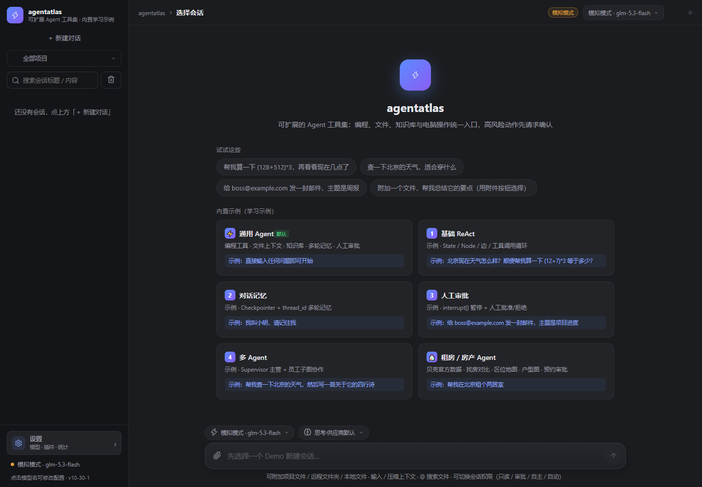

# LangGraph Agent 工作台

> **当前状态：`0.9.0-beta.1` 开发预览版。**
> 项目仍有很多功能在完善，接口、数据格式和交互可能继续调整；暂不提供正式版本、Git tag、生产 SLA 或稳定兼容承诺。

一个基于 **LangGraph.js + TypeScript** 的 Agent 工作台，包含 Web、CLI 和 Electron 桌面壳。它既用于验证 Agent 编排、工具调用和人工审批，也可以在本机作为日常开发助手使用。



## 快速开始

环境要求：

- Node.js 24 推荐
- npm 11+
- 可选：Docker 24+、Chrome / Edge

```bash
npm install
cp .env.example .env      # Windows: Copy-Item .env.example .env
npm run web               # http://127.0.0.1:3000
```

不配置模型也能启动。此时使用本地 mock，工具调用、流式输出和审批流程仍可体验。

配置真实模型：

```dotenv
BASE_URL=https://your-gateway.example/v1
API_KEY=your-key
MODEL=your-model
AI_PROTOCOL=openai
```

也可以在页面左下角 **设置 → 模型与供应商** 中配置。修改模型列表前可先运行：

```bash
npm run models
```

其他入口：

```bash
npm run desktop    # Electron 桌面壳
npm start          # CLI 菜单
npm run demo:1     # 运行内置示例
docker compose up -d --build   # 本机 Docker 验收，需设置 AUTH_TOKEN
```

## 当前能力

| 模块 | 当前状态 |
|---|---|
| 通用 Agent | 需求理解、澄清、ReAct 工具循环、结果反思；逻辑任务跨审批/澄清/继续累计工作台账，不限制任务时长与工具/模型调用次数 |
| 模型韧性 | 408/429/5xx/超时/网络错误自动重试（默认 10 次），重试进度默认折叠并展示失败原因 |
| 租房 / 房产 Agent | 与通用 Agent 独立工具集、权限和审批边界 |
| 模型供应商 | 多供应商、多模型，支持 OpenAI / Responses / Anthropic / Gemini 协议 |
| 会话 | 新建会话独立开始、SSE 流式输出、多会话并行生成与分别停止、刷新恢复、导出、搜索与清理 |
| 审批与权限 | 人工审批、只读、自主风险评估、自动执行 |
| 记忆 | LangGraph checkpoint、可插拔长期记忆（本地 / HTTP）、Agent scope 隔离、相关性注入、上下文压缩 |
| 文件与项目 | 附件、项目目录、远程文件夹、文件搜索与读取 |
| 扩展 | RAG、MCP、技能库、自定义命令、第三方 Agent |
| 数据 | 本地 journal（usage 归并、截断可审计）、备份恢复、数据检查、使用统计 |
| 桌面端 | 本机便利壳，不是正式桌面发行版 |

这些能力仍有未完成项，尤其是真实供应商兼容、复杂会话恢复、房产 Agent 数据链路和桌面端发行流程。输入框上方的上下文容量条参考 ZCode：保留当前会话最近一次主模型请求的 input+output 用量，分母跟随当前目标模型的窗口容量；切换模型不清空历史，下一轮请求返回 usage 后再校正。若旧上下文超过目标模型扣除输出预留后的可用输入，会先压缩当前上下文，完整聊天记录仍保留。

## Agent 隔离

项目刻意保留两套独立的 Agent 能力边界：

| Profile | 入口 | 工具与审批 |
|---|---|---|
| 通用 Agent | 新建对话 → 通用 Agent | 开发工具、文件、RAG、MCP、`general` scope 记忆与协作 |
| 房产 Agent | 新建对话 → 房产 Agent | 贝壳找房工具及对应审批，不加载开发工具；记忆使用独立 `estate` scope，默认不挂记忆工具 |

隔离规则由 `src/agent/profile.ts`、各 profile 的工具 allowlist、审批登记和测试共同维护。通用 Agent 不能调用房产工具，房产 Agent 也不能调用终端、写文件等通用工具。

## 技术栈与结构

- `node:http` + SSE，无 Express / Fastify
- 原生 TypeScript 前端，无 React / Vue、无整体打包器
- LangGraph.js 管理 Agent 图与持久检查点
- Electron 仅作为桌面便利壳
- 文件型持久化：配置、journal、checkpoint、记忆和审计

```text
src/
  agent/       LangGraph 图、profile、权限和审批边界
  tools*.ts    基础、开发、RAG、房产、电脑控制和协作工具
  server/      HTTP/SSE、配置、会话、持久化、观测与运维
  client/      原生 TypeScript 前端
  cli.ts       CLI 入口
desktop/       Electron 主进程与 preload
tests/         单元、集成、安全、E2E、故障和负载测试
docs/          用户文档与运维参考
```

详细模块说明见 [docs/agent-wiki.md](docs/agent-wiki.md)。

## 配置与数据

配置来源优先级：

```text
.env  <  .web-config.json  <  运行中内存设置
```

本地默认数据目录：

```text
.setting/
  sessions.ndjson       会话 journal
  checkpoints.ndjson    LangGraph 检查点
  memories.json         长期记忆（schema v2，可导出 / 导入）
  skills/               技能文档
  audit.ndjson          安全审计
```

容器默认使用 `/data`。

常用环境变量：

| 变量 | 说明 |
|---|---|
| `BASE_URL` / `API_KEY` / `MODEL` | 模型网关配置 |
| `AI_PROTOCOL` | `openai` / `openai-responses` / `anthropic` / `gemini` |
| `HOST` / `PORT` | 默认 `127.0.0.1:3000` |
| `AUTH_TOKEN` | 开启登录认证 |
| `PRODUCTION` | 设为 `1` 时启用更严格的生产环境门禁 |
| `SESSION_SECRET` | 生产模式所需的会话签名密钥 |
| `DATA_KEY` | 生产模式所需的配置加密主密钥 |
| `METRICS_TOKEN` | 仅用于 `/metrics` 的只读抓取令牌 |
| `AGENT_IDLE_TIMEOUT_MS` | SSE 停滞超时，默认 120 秒；不是任务总时长上限 |
| `MODEL_REQUEST_TIMEOUT_MS` | 单次模型 HTTP 请求超时，默认 90 秒 |
| `MODEL_REQUEST_RETRIES` | 可重试模型错误（408/429/5xx/超时/网络）自动重试次数，默认 10 |

`.env`、`.web-config.json`、`.setting/` 和 `data/` 已加入 gitignore，不要提交。

## 开发与测试

```bash
npm run typecheck       # 三套 TypeScript 配置
npm test                # 单元 / 集成 / 安全 / 故障 / 负载
npm run e2e             # Playwright 浏览器主流程
npm run build:client    # 前端 TS → 浏览器 ESM
npm run build:desktop   # Electron 主进程与 preload
npm run audit:prod      # 生产依赖 high / critical 阻断
npm run data:check      # 配置、journal、checkpoint 与备份检查
```

CI 还包含覆盖率门禁、SBOM、依赖审查和镜像 smoke。当前自动化通过不代表产品功能已经完整，也不构成正式发布承诺。

## 已知限制

- 项目仍是 `pre-1.0` 开发版，暂不打正式 tag。
- API、配置字段、数据 schema 和前端交互仍可能变化。
- 单实例、单写者，不支持多副本或共享数据卷。
- 没有多用户账号、RBAC、租户隔离和配额体系。
- 外部模型、MCP、RAG、HTTP 记忆、贝壳 CLI 的可用性取决于第三方服务；HTTP 记忆故障会降级但不阻断聊天。
- 真实供应商、复杂长会话、移动端和桌面安装包仍有待持续完善。
- Electron 桌面壳未完成代码签名、自动更新和崩溃收集。
- 生产相关脚本和文档是“部署前准备”，不是正式生产支持承诺。

## 文档

- [Agent Wiki](docs/agent-wiki.md) —— 架构、模块、调用链与踩坑
- [长期记忆插槽](docs/memory-slot.md) —— 本地 / HTTP Provider、Generic 与 Hindsight 契约、导入导出和故障排查
- [部署与运维总览](docs/deployment.md) —— 自托管、TLS、监控和运维入口
- [开发预览验证快照](docs/readiness-snapshot.md) —— 当前自动化与基础设施验证记录
- [备份与恢复](docs/backup-restore.md)
- [升级与回滚](docs/upgrade-rollback.md)
- [故障排查](docs/troubleshooting.md)
- [支持边界](docs/support.md)
- [请求编排](docs/agent-orchestration.md) / [与 ZCode 对比](docs/agent-orchestration-vs-zcode.md)

## License

MIT
