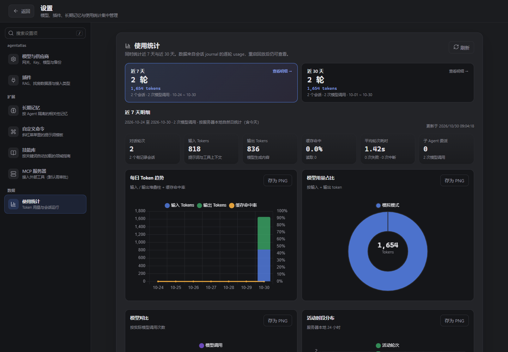

# LangGraph Agent 工作台

一个用 **LangGraph.js**（TypeScript）写的 Agent 应用，网页版和桌面版（Electron）都有：
多轮对话、📎 文件上下文、多供应商模型切换、🧠 长期记忆、高风险操作人工审批、📚 外部知识库。

定位是 **生产可自托管的单实例 Agent 工作台**，同时保留带详细中文注释的 LangGraph 教材属性。
安全、数据恢复、镜像发布与运维按 Level 2 标准执行；不包含多租户、RBAC 或多副本 SaaS 能力。




## 快速开始

```bash
npm install
cp .env.example .env        # 填入你的 BASE_URL / API_KEY / MODEL
npm run models              # 查一下网关支持哪些模型（防 400）
npm run web                 # 启动网页版 → http://localhost:3000
npm run desktop             # 或桌面版（Electron，默认端口 3123）
npm test                    # 全部 Node 测试（mock，不耗真实配额）
npm run e2e                 # Playwright 浏览器主流程

# 生产自托管：见 docs/self-hosting.md（固定镜像 digest + TLS + 密钥）
docker compose up -d --build   # 仅本机构建验收
```

> 💡 **没有 API Key 也能跑**：不配 Key 会自动进入**模拟模式** —— 回答由本地脚本生成，
> 但工具调用、流式输出、人工审批这些交互全部是真的，足够把整个界面玩熟。
> 也可以不建 `.env`，启动后在侧栏左下角 **⚙ 设置** 里添加供应商和 Key。

> **浏览器要求**：Chrome 89+、Safari 16.4+、Firefox 108+。旧浏览器仍可打开核心会话，
> 但图表、线性图标与 Markdown 增强会降级；页面顶部会给出明确升级提示。
## 功能速览

| 想做什么 | 去哪 |
|---|---|
| 和 Agent 对话、让它干活 | 「＋ 新建对话」→ 选「通用 Agent」 |
| 给消息带文件 / 图片 | 输入框 📎、拖拽或粘贴；`@` 搜项目文件 |
| 换模型 / 添加供应商 | 输入框上方模型 ▾，或侧栏左下 ⚙ 设置 |
| 让它记住长期偏好 | 侧栏左下 ⚙ 设置 → 长期记忆 |
| 看用量统计 | 侧栏左下 ⚙ 设置 → 使用统计 |
| 搜 / 导出 / 批量清理会话 | 侧栏顶部搜索框 |
| 备份与恢复全部数据 | 侧栏左下 ⚙ 设置 → 模型与供应商 |
| 接外部知识库（RAG） | 侧栏左下 ⚙ 设置 → 插件 → 知识库（RAG） |
| 找房（贝壳） | ⚙ 设置 → 插件 → 找房数据源；新建对话选「房产 Agent」 |
| 接第三方 Agent 仓库 | 新建对话弹窗底部 🔌 |
| 接入 MCP 工具服务器 | ⚙ 设置 → MCP 服务器 |
| 让 Agent 读网页内容 | 直接说「帮我看看这个链接」 |
| 自定义斜杠命令 | ⚙ 设置 → 自定义命令 |
| 给 Agent 加领域指南 | ⚙ 设置 → 技能库 |

> ⚙ 设置是独立整页：左侧按「工作台 / 扩展 / 数据」分组，并提供设置项搜索（按 `/` 聚焦）。
> 左上角「← 返回」或 `Esc` 回到工作台；`API Key` 只显示密码框，编辑时留空表示不修改。

## 日常使用

### 对话

- 回答逐字流式输出（打字机效果），支持 Markdown 表格、代码块、引用；
- Markdown 由 marked 解析、DOMPurify 按标签/属性白名单净化；危险链接、事件属性和 http 图片会被移除；
- 代码块在流式结束后按需高亮，带语言标签与一键复制；高亮或 Markdown 库加载失败时自动退回安全纯文本/基础解析；
- 模型调用工具时显示工具卡片：参数逐字生成，完成后可展开看结果；
- 同一批工具调用保持真实发生顺序：1–2 个时逐张平铺；超过 2 个时自动收进当前
  「🔧 tools」分组。分组摘要直接列出工具名、重复次数、总调用数和状态，展开后仍能看到
  每张工具卡的参数与结果，不会像旧版那样合并成一个看不出调用内容的全局汇总条；
- 审批 / 澄清恢复会并回当前回答，一个用户回合始终只有一个头像；
  审批参数里的超长命令、URL 和 JSON 会自动换行，不会撑破消息容器；
- 顶部的节点徽章（🧭 需求理解 → 🔧 工具 → 🔎 反思）显示 Agent 内部走到哪一步；
- 供应商返回原生思考内容（`reasoning_content` / `thinking` block）时，显示为「💭 思考过程」折叠卡：
  默认收起，只占用一行摘要，点击即可展开查看并再次收起；不会把普通回答伪造成思考内容；
- 输入框上方实时显示上下文用量与缓存命中率（取本轮主 Agent 峰值，审查/分析等内部小调用只计统计，不会把容量条打回小值）；上下文窗口可在设置里手动填，
  留空先自动从网关读取，仍无法获取时默认按 **200k** 计算；
- 生成中随时点「停止」中断。
- 空会话会显示三个可点击的起步建议；点击只填入输入框，不会替你自动发送；
- 顶栏面包屑显示「项目 › 会话」，向上阅读历史后可用右下角按钮回到最新消息。

### 附件：给消息带文件（📎）

三种来源任选：

1. **项目文件** —— 浏览项目目录树勾选；
2. **远程文件夹** —— 授权服务器上的任意目录（服务部署在云端时尤其有用）；
3. **本地上传 / 拖拽 / 粘贴** —— 文本文件和图片都支持。

发送时服务端读取文件内容拼进消息（带授权校验、防路径穿越、超长截断），
模型直接基于内容回答。另外两个快捷方式：

- 输入框打 **`@`**：直接搜项目和已授权目录里的文件，选中即加入附件（最多 20 条）；
- 输入框打 **`/`**：命令菜单，目前有「压缩上下文」—— 把旧对话压成摘要再继续，省上下文。

图片以缩略图展示、随消息发给模型。前提是当前模型开了「多模态」，
纯文本模型带图片会得到明确提示。

### 项目（侧栏「项目 ▾」）

会话按项目分组。项目分两种：

- 💻 **本地**：服务器上的一个目录；
- ☁️ **云端**：填 Git 仓库地址，自动浅克隆到本地缓存，支持一键 pull 刷新，删除时清理缓存。

### 权限：Agent 能自作主张到什么程度

输入框上方的盾牌 🛡 切换当前会话的权限，四档：

| 档位 | 行为 |
|---|---|
| 只读 | 读文件、搜索可以；写文件、执行命令、发消息、控制电脑一律拒绝 |
| 审批（默认） | 高风险操作先弹卡片问你，点「同意」才执行 |
| 自动 | 所有工具直接执行，不再询问 |

只对之后新发的消息生效，随时可以切回。自主模式只审查已登记的高风险工具；审查超时、异常或输出不明确时默认按高风险处理，不会静默放行。每次审查会增加一次分类模型调用，该调用的 token 用量也会进入统计。

### 控制电脑（Computer Use，仅 Windows）

通用 Agent 可以截屏「看」屏幕（需要多模态模型），然后按坐标点击、输入文字、
发送组合键、滚动页面。操作类动作按当前权限档执行或拒绝。

### 多智能体

通用 Agent 可以用 `delegate_agent` 把独立子任务交给子 Agent 后台执行
（有通用 / 房产两个候选），跑完把结果汇总回主回答。两条安全规矩：子 Agent
只能读不能写、不能再委派（防套娃）。委派本身算高风险操作，会先弹审批卡。

### 需求澄清与自查

通用 / 房产 Agent 收到消息先判断信息够不够：缺关键信息时给 2–4 个选项
（也可以自己输入），选完才动手；回答完还会自查一遍，发现明显遗漏会带反馈
重答（最多三次）。模拟模式不走这套流程。

### 长期记忆（🧠）

Agent 会把值得跨会话记住的事存进长期记忆，新会话自动带上：

- 你说「以后回答都结论先行」「记住：测试用 npm test」这类话时，它会自己调
  `memory_save` 记下来（界面上能看到工具卡）；同主题再记一次就是更新；
- 每轮对话自动带上最近 30 条记忆，重启也不丢；和你刚说的话冲突时，以你为准；
- 记忆多了它可以用 `memory_recall` 按关键词翻旧账；
- 侧栏左下 ⚙ 设置 →「长期记忆」可手动查看 / 添加 / 删除；子 Agent 无权读写记忆；
- 数据在本地 `.setting/memories.json`，上限 200 条、单条 500 字。

### 用量统计（📊）

侧栏左下 ⚙ 设置 →「使用统计」：同时计算 **近 7 天** 与 **近 30 天** 两个自然日窗口。
页面先用两张区间卡展示轮次 / token 总量，点任一区间可查看输入 / 输出 / 缓存 token、
平均轮次耗时、失败与中断次数、子 Agent 委派；下方用 Chart.js 展示每日 Token 趋势、
模型占比、模型调用对比、24 小时活动分布、缓存命中率和工具调用 Top，另保留可排序的
Top 会话与工具明细表。每张图都能导出 PNG；图表库加载失败时自动降级为数据表，
无数据日期会补齐为 0，Token 数自动切到 k / M 紧凑单位。
模型调用次数按真实 API 调用统计，流式累计 usage 快照不会被重复计数。

接口为 `GET /api/stats`。下面的响应示例为便于阅读省略了部分零值日期；实际 `byDay` 分别固定返回 7 / 30 个自然日桶：

```json
{
  "generatedAt": 1792988059117,
  "ranges": [
    {
      "id": "7d",
      "label": "近 7 天",
      "days": 7,
      "startDate": "2026-10-20",
      "endDate": "2026-10-26",
      "totals": {
        "turns": 2,
        "inputTokens": 804,
        "outputTokens": 858,
        "cacheReadTokens": 0,
        "sessions": 2,
        "delegateCalls": 0,
        "modelCalls": 2
      },
      "byDay": [
        { "date": "2026-10-26", "turns": 2, "inputTokens": 804, "outputTokens": 858, "cacheReadTokens": 0 }
      ],
      "byModel": [
        { "model": "模拟模式", "calls": 2, "inputTokens": 804, "outputTokens": 858, "cacheReadTokens": 0 }
      ],
      "byModelShare": [
        { "model": "模拟模式", "calls": 2, "inputTokens": 804, "outputTokens": 858, "cacheReadTokens": 0 }
      ],
      "byHour": [
        { "hour": 10, "turns": 2, "tokens": 1662 }
      ],
      "toolCalls": [],
      "health": { "avgTurnMs": 1200, "cacheHitRate": 0, "failedTurns": 0, "interruptedTurns": 0 },
      "topSessions": [
        { "sessionId": "session-id", "title": "示例会话", "turns": 2, "tokens": 1662 }
      ]
    },
    {
      "id": "30d",
      "label": "近 30 天",
      "days": 30,
      "startDate": "2026-09-27",
      "endDate": "2026-10-26",
      "totals": {
        "turns": 2,
        "inputTokens": 804,
        "outputTokens": 858,
        "cacheReadTokens": 0,
        "sessions": 2,
        "delegateCalls": 0,
        "modelCalls": 2
      },
      "byDay": [
        { "date": "2026-10-26", "turns": 2, "inputTokens": 804, "outputTokens": 858, "cacheReadTokens": 0 }
      ],
      "byModel": [
        { "model": "模拟模式", "calls": 2, "inputTokens": 804, "outputTokens": 858, "cacheReadTokens": 0 }
      ],
      "byModelShare": [
        { "model": "模拟模式", "calls": 2, "inputTokens": 804, "outputTokens": 858, "cacheReadTokens": 0 }
      ],
      "byHour": [
        { "hour": 10, "turns": 2, "tokens": 1662 }
      ],
      "toolCalls": [],
      "health": { "avgTurnMs": 1200, "cacheHitRate": 0, "failedTurns": 0, "interruptedTurns": 0 },
      "topSessions": [
        { "sessionId": "session-id", "title": "示例会话", "turns": 2, "tokens": 1662 }
      ]
    }
  ]
}
```

### 会话管理（侧栏）

- **搜索**：按标题和本浏览器缓存的消息内容实时过滤（纯前端，不发请求）；
- **会话操作**：悬停或键盘聚焦会话项时，右侧并排显示 ⬇ 导出与 ✕ 删除；触屏设备常显，不会互相遮挡；导出使用 Blob 下载，浏览器和 Electron 都不会再打开空白新窗口；
- **批量清理**：🧹 按钮输入天数（默认 30），确认后删掉创建超过 N 天的会话。

### 备份与恢复（设置 → 模型与供应商）

换机、误删、升级前，一键把全部本地状态（会话、检查点、记忆、供应商配置、审计日志）
快照到 `.setting/backups/backup-<时间戳>/`。恢复任意备份前会自动先做一份当前状态的
快照（防误恢复），写回后重启服务生效。

> ⚠ **备份目录里有 API Key 明文**：妥善保管，不要随项目外发或上传。

## 模型配置：多供应商 × 多模型

点侧栏左下 **⚙ 设置**（或输入框上方模型 ▾），不用改 `.env`、不用重启。
「模型与供应商」采用左右主从布局：**左侧先选供应商，右侧立即显示它配置的模型与操作**。

- **加供应商**：左栏 `＋` 打开独立弹窗，填名称 + 网关地址 + API Key + 协议，并在弹窗内
  先添加至少一个初始模型；可点关闭、取消、遮罩或按 `Esc` 退出，不再占用或锁死右侧详情；
- **编辑连接**：选中供应商后点「编辑连接」打开同一个弹窗，Key 留空表示保持不变；
- **一个供应商挂多个模型**：一个 Key 往往能用好几个模型。保存后可在右侧「已配置模型」
  继续逐个添加，每个模型单独配显示名 / 是否多模态 / 上下文窗口 / 思考档位；
- **切换**：顶栏 ▾ 列出所有供应商的所有模型，点一行即切。新会话立即生效，
  旧会话下一条消息自动跟上；
- **从网关拉列表**：「获取列表 / 测试连接」把网关的模型平铺成可点的 chips，
  点一下添加；Key 错了 / 地址不对会直接告诉你原因；
- **Key 安全**：只存本地 `.web-config.json`（已 gitignore），界面永远只显示掩码；
  编辑时留空 = 保持不变，清空保存 = 回到模拟模式；
- 至少保留一个供应商；删掉正在用的会自动切到列表第一个；
- **协议**：OpenAI Chat（默认）/ OpenAI Responses / Anthropic 原生 / Gemini 原生，
  中转站的多协议路由都能接；
- **OpenCode Go**：使用 `https://opencode.ai/...` 网关时自动按会话 `threadId`
  发送 `x-opencode-session`，并带本项目 User-Agent，不需要手写请求头。

### 思考等级（让模型「想多久」）

这件事每家供应商的参数都不一样，这里统一成「划分方式 + 档位」：档位存在模型上，
顶栏 ▾ 随时切，设置里改划分方式。

| 划分方式 | 适用 | 档位 |
|---|---|---|
| OpenAI 思考强度 | GPT-5 / o 系列 | none / minimal / low / medium / high / xhigh / max |
| 智谱思考开关 | GLM-4.5+ | 开 / 关 |
| DeepSeek 开关 + 强度 | DeepSeek 官方 | 关 / 开 / minimal→max 五档 |
| Anthropic 思考预算 | Claude 经典 | 2k / 8k / 16k / 32k / 自适应 |
| Anthropic 强度档 | Claude 新版 | low / medium / high / xhigh / max |
| Gemini 思考预算 | Gemini 2.5 | 关 / 动态 / 1024 / 8192 / 24576 |
| Gemini 思考等级 | Gemini 3 | LOW / MEDIUM / HIGH |
| 通义千问 | Qwen3 | 开 / 关 / 1k / 8k / 32k |
| 不设置（通用兼容） | 任意 | 不发任何思考参数 |
| 自定义 JSON | 中转站私有字段 | 手写，如 `{"reasoning":{"effort":"high"}}` |

- 默认**自动识别**：按网关域名、模型名、协议猜划分方式，设置页会显示猜的结果；
- 档位默认「供应商默认」= 不发任何思考参数，不认识这些字段的中转站不会被塞奇怪东西；
- 协议和手动配的划分方式不匹配时会有 ⚠ 提示，并做近似换算而不是丢掉参数。

## 通用 Agent 的内置工具

基础工具（计算器 / 时间 / 天气 / 邮件）之外，通用 Agent 还有一套编程助手工具：

| 工具 | 作用 | 审批 |
|---|---|---|
| `terminal` | 在项目根目录执行命令（构建 / 测试 / git），输出限量、120s 超时 | ✅ |
| `write_file` | 创建或覆盖项目内文件 | ✅ |
| `read_file` | 读项目内文本文件 | — |
| `list_dir` | 列目录（跳过 node_modules / .git） | — |
| `grep_search` | 正则搜索项目文本 | — |
| `computer_screenshot` | 截屏（多模态模型看图用） | — |
| `computer_click` 等 | 鼠标点击 / 输入文字 / 组合键 / 滚动 | ✅ |
| `delegate_agent` | 委派子 Agent 干独立子任务 | ✅ |

接上 RAG 服务后还会自动获得 `retrieve_docs`；记忆启用后有 `memory_save` / `memory_recall`；
配了 MCP 服务器后会把它的工具以 `mcp__服务器__工具` 挂进来。

### 读网页（`browser_fetch`）

直接说「帮我看看 https://... 这个页面讲了什么」即可。它是纯 HTTP 抓取 + 剥标签，
只拿静态 HTML 正文，**读不到纯 JS 渲染的页面**（那种情况会如实说明，不会编造）。

出于 SSRF 防护，**默认拒绝访问内网/本机地址**（含 `127.0.0.1`、`192.168.*`、
云元数据 `169.254.169.254`）；确实要读本地服务时才让它显式放行。重定向会逐跳复查
目标地址，避免「公网地址 302 到内网」这类绕过。

### 自定义命令（`/` 菜单）

设置 → 自定义命令里建一条（如 `review`），之后输入框敲 `/` 就能选到。

- 选中**只会把模板填进输入框，不会自动发送** —— 你能先看清要发什么再改；
- 模板里可用 `{{selection}}`（当前输入框已有内容）与 `{{date}}`（今天日期）；
- 命令名不能占用内置命令名（`compact`），只允许字母数字下划线短横线。

### 技能库（`.setting/skills/*.md`）

技能是「这类任务该怎么做」的 markdown 指南，**按关键词命中才加载**，
没命中完全不用（不占上下文），每轮最多加载 2 个。

```markdown
---
name: 写提交信息
description: 本仓库约定的提交格式
triggers: 提交信息, commit, 提交说明
---

# 写提交信息
- 一行中文短句，不加 feat: 之类前缀
- 修 bug 时用「：」补原因
```

- 设置 → 技能库可在线编辑/删除，也可以直接把 `.md` 丢进 `.setting/skills/`；
- 仓库里有两份打样：`scripts/example-skills/`（写提交信息、排查端口占用）；
- 技能只是**文档**，永不执行 —— 这是它敢让你随便写的原因。

### MCP 服务器（外部工具生态）

设置 → MCP 服务器填一个启动命令即可接入，例如
`npx -y @modelcontextprotocol/server-filesystem C:\data`。

- 工具以 **`mcp__服务器__工具`** 命名出现在通用 Agent 里，与内置工具不会撞名；
- **默认每一次调用都需要你审批**（MCP 工具做什么无法预知，宁严勿松）；
  某个服务器你完全信任时可在配置里关掉审批；
- 服务端重启会重新连接；单个服务器连不上只跳过它，不影响其它工具；
- 客户端是本项目自实现的 JSON-RPC over stdio，没有引入 MCP SDK。

> ⚠ 接入 MCP = 在本机运行第三方程序，请只添加可信来源。

安全边界：读写和搜索只能碰项目根与已授权目录；表里标 ✅ 的「改世界」操作统一受
会话权限档管控。每个 Agent 只能用自己的工具集，模型就算点错也不会执行别的域的工具。

## 插件管理（设置 → 插件）

设置页的「插件」分区集中管理外部能力，并按真实接入方式分类：

| 类型 | 当前插件 | 管理方式 |
|---|---|---|
| HTTP 插件 | 知识库（RAG） | 使用插件自己的 `/ingest`、`/search`、`/reset` REST 契约 |
| CLI 插件 | 找房数据源（贝壳） | 检测 / 安装官方 `beike` CLI，再保存授权 |
| MCP 插件 | 暂无内置项 | 后续插件若声明为 MCP，使用 MCP server 配置，不复用 HTTP 表单 |

当前 RAG **不是 MCP**，因此不会强行套 MCP；以后接入真正的 MCP 插件时再走 MCP 通道。
`src/client/modules/plugin-registry.ts` 是插件目录与类型标签的唯一来源。

## 知识库（外部 RAG）

工作台不内置向量库 —— 检索交给外部 RAG 服务，接上后通用 Agent 自动获得
`retrieve_docs` 工具。打开方式：**⚙ 设置 → 插件 → 知识库（RAG）→ 配置 RAG**。

外部服务按下面的契约实现即可，无需改造本工作台：

| 动作 | 请求 | 说明 |
|---|---|---|
| 入库 | `POST {RAG_URL}/ingest` | `{collection, documents:[{id, name, text, meta}]}`，切块 / embedding 由服务完成 |
| 检索 | `POST {RAG_URL}/search` | `{collection, query, topK}` → `{hits:[{text, score, name?}]}`（字段名宽松解析） |
| 清空 | `POST {RAG_URL}/reset` | `{collection}` |
| 删除（可选） | `POST {RAG_URL}/delete` | `{collection, ids}` |
| 鉴权 | `Authorization: Bearer <key>` | Key 可留空 |

- **入库**：面板里选项目 / 文件夹全量入库（自动跳过 node_modules、密钥、锁文件，
  单次 ≤300 文件），或直接粘贴文本；发消息带的 📎 文本附件也会顺手入库（失败不影响对话）；
- **检索**：聊天里问到知识库相关内容时 Agent 自动查（回答会标注来源）；面板里也有检索测试框；
- 本地只存「送进去过什么」的花名册和地址配置，真实索引在外部服务侧。

## 找房（贝壳官方数据）

在 **⚙ 设置 → 插件 → 找房数据源（贝壳）** 管理数据源；新建对话选「房产 Agent」，
得到一个贝壳顾问式 Agent —— 搜房、详情、行情、区位地图、经纪人都有对应工具。

**首次使用两步**（面板里都有引导）：

1. **装 CLI**：面板一键从贝壳官方 GitHub 下载并校验安装；
2. **存授权 Key**：浏览器打开 <https://building.ke.com/?action=get-key&source=beike_skill>，
   登录后复制凭证粘进面板（Key 只存贝壳自己的本地凭证，工作台不落盘）。

工具集一览：`house_search` 搜房、`house_lookup` 详情 / 口语描述转 ID、`house_market`
行情 / 成交 / 政策 / 学区、`house_map` 区位地图（OSM 地图 + 高德 / 腾讯 / 百度直链，免 key）、
`house_agents` 经纪人、`house_appoint` 预约带看与 `house_contact` 经纪人加微
（这两个是高风险操作，必须人工审批）。

几个实用提醒：

- 查地图时地址尽量用「小区名」而不是方言简称，命中率高很多；
- 贝壳的房价 / 行情不是实时数据，Agent 回答时会说明统计口径；
- 真找房会消耗贝壳侧配额；模拟模式用内置演示数据，不会调贝壳。

## 接第三方 Agent（只需要一个 Git 地址）

「＋ 新建对话」弹窗底部 **🔌 外部 Agent**：粘贴任意 Git 仓库地址 → 服务端克隆 →
自动识别启动方式 → 变成一个可选的会话类型。

识别顺序：① 仓库根 `agent.json`（推荐）→ ② package.json 的 bin / main →
③ 常见入口文件（cli.js / agent.py…），都没有就接入时让你补一条启动命令。

`agent.json` 格式（放在你自己的仓库根即可）：

```json
{
  "name": "my-agent",
  "description": "一句话介绍",
  "command": "node",
  "args": ["cli.js", "--prompt", "{{prompt}}"],
  "passCredentials": false
}
```

- `{{prompt}}` 替换成用户消息；没有占位符时消息以一行 JSON 从 stdin 传入；
- 子进程的输出逐块转发到聊天界面；每条消息启动一次子进程（180s 超时），
  上下文由外部工具自己管；
- `passCredentials: true` 才会把网关 Key 注入子进程环境（默认不传，只对可信仓库开启）；
- ⚠ 接入 = 在服务器上运行第三方代码，请只添加可信仓库；
- 支持 `https://` / `git@` / `file:///`（本地测试）地址。

## 桌面端（Electron）

```bash
npm run desktop             # 默认端口 3123（DESKTOP_PORT 可换）
```

就是给网页版套了个原生窗口：隐藏系统标题栏、外部链接交给系统浏览器、
单实例（重复启动自动聚焦已有窗口）、退出时清理子进程不残留。
前端 / 服务端逻辑与网页版完全同一套。

## 内置学习示例（5 个 Demo）

每个示例是一张刻意保持教学形态的图，代码带详细中文注释：

| # | 文件 | 学什么 | 运行 |
|---|------|--------|------|
| 1 | `src/agent/basic.ts` | 基础 ReAct：State / Node / Edge / 工具循环 | `npm run demo:1` |
| 2 | `src/agent/memory.ts` | 多轮记忆：Checkpointer + thread_id | `npm run demo:2` |
| 3 | `src/agent/hitl.ts` | 人工审批：interrupt() + 恢复 | `npm run demo:3` |
| 4 | `src/agent/multi.ts` | 多 Agent：Supervisor 分派任务 | `npm run demo:4` |
| 5 | `src/agent/parallel.ts` | 并行 map-reduce：Send API + 自定义 State | `npm run demo:5` |

示例 1–4 也可在网页里选；CLI 跑法支持自定义问题，如
`npx tsx src/cli.ts 5 "咖啡, 露营, 极光"`。通用 Agent（`src/agent/general.ts`）
就是把示例 1/2/3 的能力按产品逻辑组合后的形态。

## 学习路线建议

1. 跑**示例 1**，对着 `basic.ts` 的注释理解「节点 = 步骤，边 = 顺序，状态 = 传递的数据」；
2. 跑**示例 2**，体会加 checkpointer 前后同一张图的行为差异；
3. **示例 3** 看「人工把关」怎么落地（Agent 落地必学）；
4. **示例 4** 看子图怎么把多个 Agent 组成团队；
5. **示例 5** 掌握 Send 并行分发与 reducer 汇聚 —— 多 Agent 之外的另一种扩展方向。

## 项目结构

```
src/
  config.ts        # 统一读 .env（网关 / Key / 模型）
  llm.ts           # 模型工厂：四种协议接入任意网关
  reasoning.ts     # 思考等级适配层（各家方言 → 统一档位）
  tools*.ts        # 工具集：基础 / 编程 / 记忆 / RAG / 房产 / 委派
  memory-store.ts  # 长期记忆存取
  checkpoint.ts    # 检查点持久化（重启不丢上下文）
  agent/           # 全部 LangGraph 图：workflow 编排 / profile / 5 个示例
  cli.ts           # CLI 入口（demo:1~5）
  server/          # Web 服务：index 路由分发 + routes/ 各域 + public/（前端构建产物）
  client/          # 前端源码（TypeScript）：main + core/modules/ui/render/stream/views/actions/vendor/styles
desktop/           # Electron 桌面端（main.ts / preload.ts → build/）
tests/             # unit / integration / security 三档（node:test）
docs/              # 学习与部署文档
```

后端按「入口 + 路由 + 域模块」分层，`node:http` 直写无框架。

**前端是 TypeScript，没有打包器**：源码在 `src/client/`，`npm run build:client`
用 `tsc` 一比一编译成浏览器原生 ESM（`src/server/public/`，构建产物已 gitignore），
import 路径保持 `.js` 后缀原样加载，没有 webpack/vite。第三方前端库（图表、图标、
语法高亮、Markdown）允许引入，但走「esbuild 打成自包含 ESM → `public/vendor/` → import map
解析裸名」的方式，同样不需要打包器；候选库的许可证与实测体积登记在 `AGENTS.md §2.1`。

```bash
npm run typecheck      # 后端 + 前端 + 桌面端三套 tsconfig
npm run build:client   # 前端 TS → 浏览器 ESM（npm run web / test 前置自动执行）
npm test               # 单测 / 集成 / 故障注入 / 负载基线（mock，不耗真实配额）
npm run e2e            # Playwright 浏览器主链路（登录 / 对话 / 审批 / 刷新恢复）
npm run audit:prod     # 生产依赖 high/critical 漏洞阻断
npm run image:smoke    # 多阶段生产镜像 + 健康 / 登录 / 优雅停止验收
```

CI（`.github/workflows/ci.yml`）在 push / PR 时自动跑三套类型检查、全部测试、安全 / 持久化 / 认证路由覆盖率、浏览器 E2E、SBOM、生产依赖审计与镜像 smoke。

## 安全与可靠性（默认已做好）

单机本地用不用管这些；要开放到局域网 / 云端前值得过一眼：

- **默认只监听本机**（127.0.0.1）。要开放改 `HOST`，同时强烈建议设 `AUTH_TOKEN`
  （在 `.env` 里写一串自己的口令即可开启，之后所有请求都要带）；
- **未认证的开放网络只读**：开放了但没设口令时，所有「会改东西」的请求直接拒绝；
- **跨站防护**：别的恶意网站就算借浏览器带上你的口令，跨站请求也会被拒；
- **写操作有审计**：改配置、装外部 Agent 等动作记进 `.setting/audit.ndjson`，事后可查；
- **请求体限量**：单次请求 2MB（文件上传 12MB），防恶意大包；
- **配置原子写入**：写一半断电也不会坏，坏了还有 `.bak` 自动抢救；
- **重启不丢数据**：对话记录、模型记忆（检查点）、长期记忆全部落盘，重启原样回来；
  删掉的对话不会复活；重启前「等审批」的卡片不会偷偷执行，会提示重发一次指令；
- **生产认证与密钥**：短期 HttpOnly 会话、失败限流、AES-256-GCM 敏感配置加密、`METRICS_TOKEN` 独立指标抓取；
- **Docker 部署**：提供 Dockerfile 与 compose（`docs/deployment.md`），带健康探针与优雅退出。

完整的治理清单（认证细节、子进程限额、审计、反向代理）见
[Wiki §9 架构治理与生产化路线](docs/agent-wiki.md#9-架构治理与生产化路线结论摘要)。

## 常见问题：网关返回 400

最常见原因是**模型名不在网关支持列表里**。三步排查：

1. `npm run models` 看网关实际支持哪些模型；
2. 把 `.env` 里的 `MODEL` 改成列表里的 id；
3. 重跑。

如果 OpenCode Go 返回 `Request is missing x-opencode-session`，先重启到最新版本；
本项目会对 `opencode.ai` 网关自动注入稳定会话头。若你通过自建反向代理转发且代理
改写了 Host/BASE_URL，则需要让代理保留该请求头。

`.env` 里有真实 Key，已被 `.gitignore` 排除，不会提交。

## 更多文档

- [docs/agent-wiki.md](docs/agent-wiki.md) —— 核心概念、生产模块、示例调用链与踩坑表；
- [docs/agent-orchestration.md](docs/agent-orchestration.md) —— 一次请求从进门到回答的完整编排；
- [docs/agent-orchestration-vs-zcode.md](docs/agent-orchestration-vs-zcode.md) —— 与 ZCode / DSH 的编排对比；
- [docs/deployment.md](docs/deployment.md) —— 部署与运维文档总览；
- [docs/self-hosting.md](docs/self-hosting.md) —— 快速自托管；
- [docs/production-checklist.md](docs/production-checklist.md) —— 上线 Checklist；
- [docs/security-and-tls.md](docs/security-and-tls.md) / [docs/monitoring.md](docs/monitoring.md) —— TLS、Cookie、指标与告警；
- [docs/backup-restore.md](docs/backup-restore.md) / [docs/upgrade-rollback.md](docs/upgrade-rollback.md) —— 备份恢复与升级回滚；
- [docs/runbook.md](docs/runbook.md) / [docs/troubleshooting.md](docs/troubleshooting.md) / [docs/support.md](docs/support.md) —— 现场处置、故障排查与支持边界；
