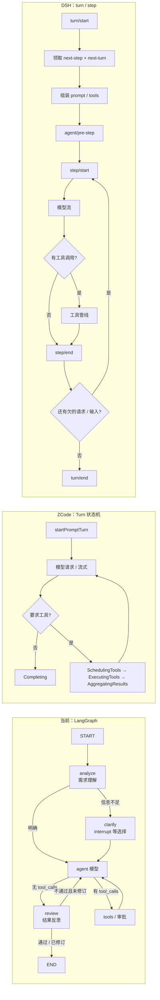
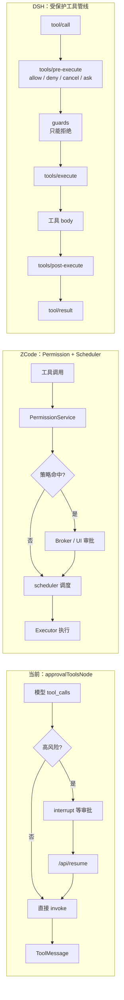

# agent-tools、ZCode 与 DeepSeek Harness 流程编排对比

> 对比对象：
>
> - **agent-tools**：`docs/agent-orchestration.md`（本仓库，LangGraph.js）
> - **ZCode**：`apps/zcode-cli`（外部参考实现）
> - **DeepSeek Harness（DSH）**：`dsh`（外部参考实现）
>
> 三者不是同一量级的产品：agent-tools 是单进程的 Agent 工具集；ZCode 是带
> CLI / Electron / Web 和多进程 Host 的编码 Agent；DeepSeek Harness 是
> 基于 Cordis 的可组合 Agent harness。下面的对比重点看流程与机制，
> 不追求功能逐项对齐。

## 1. 三句话定位

| 系统 | 定位 | 编排核心 | 最适合观察什么 |
|---|---|---|---|
| agent-tools | 可运行的学习型 Agent 工具集 | LangGraph `StateGraph` | 需求理解 / 澄清、ReAct、工具审批、结果反思、SSE |
| ZCode | 完整编码 Agent 产品 | 自研 `AgentRuntime` + Turn 状态机 | 多客户端协议、命令队列、抢占、子代理 |
| DeepSeek Harness | 可组合 Agent harness | Cordis 插件 + `agent-loop` | 事件溯源、turn/step、工具管线、能力 seam |

一句话概括三者的架构重心：

- **agent-tools是「图优先」**：编排逻辑写在 LangGraph 的节点和边里；
- **ZCode 是「运行时优先」**：命令网关和 Turn 状态机掌握调度权；
- **DSH 是「事实日志优先」**：Session 事件日志是唯一事实来源，UI 和历史都是投影。

## 2. 端到端流程总览

```mermaid
flowchart TB
  subgraph CUR["agent-tools"]
    direction LR
    C1["Web / Electron"] --> C2["HTTP /api/chat<br/>SSE 回包"]
    C2 --> C3["LangGraph<br/>analyze → clarify? → agent ⇄ tools → review"]
    C3 --> C4["MemorySaver<br/>JSONL journal"]
  end

  subgraph ZC["ZCode"]
    direction LR
    Z1["TUI / Desktop / Web"] --> Z2["v4 command<br/>CommandInbox"]
    Z2 --> Z3["AgentRuntime<br/>Turn 状态机"]
    Z3 --> Z4["SQLite<br/>Host / Renderer"]
  end

  subgraph DSH["DeepSeek Harness"]
    direction LR
    D1["Web / SDK / Desktop"] --> D2["Agent Inbox<br/>next-turn / next-step"]
    D2 --> D3["agent-loop<br/>turn → step*"]
    D3 --> D4["Session JSONL<br/>事件投影"]
  end
```



### 2.1 agent-tools

```text
浏览器 / Electron
  → POST /api/chat
  → index.ts（认证 / 同源 / 路由）
  → routes/chat.ts（会话检查 / 节流 / 附件 / 分流）
  → 会话自己的 LangGraph 图（workflow.ts）
      → analyze：需求理解
          → 信息不足：clarify interrupt 等用户选择
      → agent 节点
      → toolsCondition
          → 无工具调用：review
          → 有工具调用：approvalToolsNode
              → 普通工具直接执行
              → 高风险工具 interrupt 等审批
              → ToolMessage 回填
      → 回到 agent
      → review：不通过且未达修订上限：带反馈回炉；否则结束
  → runGraphEvents（AgentEvent）
  → SSE data: {json}
  → TurnRecord + journal
```

关键点：一次 `/api/chat` 就是一轮图执行；进入 ReAct 前先做需求理解，必要时用
`interrupt` 请求澄清；工具循环由 `agent ⇄ tools` 条件边完成；最终回答再经过一次
轻量反思，不通过时最多回炉三次。前端只消费规范化后的 `AgentEvent`。

### 2.2 ZCode

```text
TUI / 桌面 / Web
  → v4/command
  → CommandInbox（revision/epoch CAS 串行准入）
  → V4CommandExecutor（按域分发）
  → sendText / startPromptTurn
  → AgentRuntime Turn 状态机
      ProcessingInput
      → AwaitingModelResponse
      → Streaming
      → 无工具：Completing
      → 有工具：SchedulingTools → ExecutingTools → AggregatingResults
      → 回到模型
  → ConversationTopicPublisher（批量事件）
  → Host / Renderer
```

关键点：命令先进入网关，由 CommandInbox 串行化；执行由 Turn 状态机驱动；
事件通过 Publisher 批量下发，Host 和 Renderer 只消费事实。

### 2.3 DeepSeek Harness

```text
Web / SDK / Desktop
  → Agent.send / followup / steer / inject
  → Inbox（next-turn / next-step）
  → agent-loop
      turn/start
      → 领取 next-step + 一条 next-turn
      → 组装 prompt sections / runtime context / tool schemas
      → agent/pre-step
      → step/start
      → agent/request → 模型流
      → 工具调用管线
      → step/end
      → 还有欠的请求 / next-step 输入：下一个 step
      → turn/end
  → SessionEvent 日志（append-only）
  → projection / UI
```

关键点：DSH 把 **turn** 和 **step** 明确分开；turn 可以有多个 step，
step 是一次模型请求及其工具调用。所有模型可见内容都必须能从 Session 日志重建。

## 3. 三种 Turn / Step 循环



概念对照：

| 概念 | agent-tools | ZCode | DeepSeek Harness |
|---|---|---|---|
| 一次用户输入 | 一次 `/api/chat` 流；澄清时再接 `/api/resume` | `sendText` → `startPromptTurn` | 一个 turn（可含 0..N 个 step） |
| 一次模型调用 | `agent` 节点一次执行；另有 analyze / review 内部调用 | Turn 中的 model step | 一个 step |
| 工具循环 | `tools → agent` 条件边 | Turn 状态机循环 | step 结束后欠请求则开下一个 step |
| 中途输入 | 同会话第二条流直接拒绝；澄清通过 `interrupt` 暂停 | 队列 / 抢占 / 前台租约 | `followup` / `steer` / `inject` |
| 结束条件 | 无 `tool_calls` 且 review 通过（或达修订上限三次） | Turn 进入 `Completing` | 不再欠工作，`turn/end` |

## 4. 逐阶段对比

| 阶段 | agent-tools | ZCode | DeepSeek Harness | 关键差异 |
|---|---|---|---|---|
| 接入协议 | HTTP + SSE | v4 command + NDJSON stdio | Agent API + 事件 | 当前最简单；ZCode 面向多客户端；DSH 面向 harness |
| 命令准入 | 同会话流槽 + 1.5s 节流 | CommandInbox CAS + 队列 | Agent Inbox（next-turn / next-step） | ZCode 解决并发命令；DSH 解决输入排队与插话 |
| 忙碌处理 | 拒绝第二条流 | 前台租约、抢占或入队 | `steer` 在下一 step 消费 | 当前没有抢占；DSH 可在 step 边界插入 |
| 执行核心 | LangGraph 图（analyze / clarify / agent / tools / review） | AgentRuntime 状态机 | agent-loop + 插件 | 图 / 状态机 / harness 三种范式 |
| 模型调用 | LangChain 模型 | `streamText` / `generateText` | `agent/request` + LLM adapter | 都支持流式；ZCode/DSH 有更细的失败记录 |
| 工具循环 | `agent ⇄ tools` | `SchedulingTools → ExecutingTools → AggregatingResults` | `tool/call → 管线 → tool/result` | 当前顺序执行；ZCode/DSH 有调度与并发策略 |
| 工具并发 | 无全局调度器 | scheduler 默认 10 | 仅显式并发安全工具，默认最多 10 | DSH 的并发判定最保守、最可审计 |
| 工具注册 | `tools-*.ts` + zod | registry + riskLevel / capability | `ctx.tools` + `ToolDefinition` | DSH 是插件注册表；ZCode 是工具注册表 |
| 工具审批 | `APPROVAL_TOOLS` + `interrupt()` | PermissionService + Broker | `tools/pre-execute` + approval + sandbox | 当前按工具名；ZCode 按策略；DSH 是分层强制 |
| 子代理 | Demo 4；子图在进程内；外部 Agent 独立子进程 | `Task` 派生独立 AgentRuntime | `subagent` / `subagent_fork` + 控制面 | ZCode/DSH 是产品能力；当前多 Agent 是 Demo |
| 流式事件 | `AgentEvent` → SSE | v4 event → TopicPublisher | Session 事件 + 投影 | 当前单页消费；ZCode/DSH 面向多客户端和重放 |
| 会话记忆 | MemorySaver + `threadId` | SqliteSessionStore | append-only Session 日志 | 当前进程内；DSH 是事件溯源 |
| 重启恢复 | journal + 一次性文本摘录 | SQLite + execution_state | JSONL 恢复 + 中断 turn 收口 | 当前不能恢复原图状态 |
| 上下文压缩 | 手动 `/compact` | microcompact + auto + manual | compaction + pruner + spill + image offload | DSH 的治理层次最多 |
| 系统提示词 | 每张图固定 prompt | ContextBuilder 分区 + 缓存提示 | Prompt sections + runtime context + tool schema | DSH 把 prompt 也变成可重放事件 |
| 配置方式 | `.env` + `.web-config.json` | user/env/project 合并 | Cordis profile / bundle / preset / patch | DSH 的装配能力最强 |
| 部署形态 | 单进程 Web / Docker | Electron Main → Host → agent 子进程 | Host / Web / SDK / 多客户端 | ZCode/DSH 都有进程或客户端分层 |

> agent-tools新增的 `analyze / clarify / review` 是图内显式节点；ZCode / DSH 的
> 对应能力分散在 prompt、权限审批与工具/任务流程中，本文不做逐行对齐。

## 5. 工具执行与审批流程



三种审批模式的差异：

| 维度 | agent-tools | ZCode | DeepSeek Harness |
|---|---|---|---|
| 判断依据 | 工具名是否在 `APPROVAL_TOOLS` | riskLevel、mode、input、workdir | `pre-execute` 策略 + 审批 seam |
| 暂停方式 | LangGraph `interrupt()` | Broker 事件等待 UI | `ask` 决策等待审批 |
| 恢复方式 | `/api/resume` + `Command` | 审批结果回写 | `allowed-once` 后继续 |
| 拒绝后果 | 返回拒绝 `ToolMessage` | 拒绝/不执行 | 结构化拒绝，fail-closed |
| 强制层 | 文件授权 + HITL | 权限模式（plan 只读等） | sandbox + approval + OS/容器 |

> 注意：agent-tools的「外部 Agent」不等于 ZCode 的 Subagent，也不等于 DSH 的
> `subagent`。外部 Agent 是独立通道；Subagent 是同一 runtime 体系内的子执行单元。

## 6. 工具系统对比

| 能力 | agent-tools | ZCode | DeepSeek Harness |
|---|---|---|---|
| 工具来源 | 本仓库 `tools-*.ts` | handlers + registry | 插件注册到 `ctx.tools` |
| schema | zod | 工具注册元数据 | `ToolDefinition` / JSON Schema |
| 并发 | 无全局调度 | `scheduler` 默认 10 | 仅 `isConcurrencySafe` 可并行，最多 10 |
| 后台任务 | 无 | 后台 Bash | `job_*` 通用后台任务 |
| Shell | `terminal` 单次执行 | Bash 增强、后台化 | `bash` / `pwsh` + 沙箱 + job |
| 文件 | read/list/grep + 授权根 | 文件工具 + 权限 | `ctx.fs` seam，本地/沙箱/SSH |
| Web | 天气工具内置 | WebFetch 白名单 | `web_search` / `web_fetch` provider |
| MCP | 无 | 文档未展开 | MCP tools + resources |
| Skills | 无 | 文档未展开 | SKILL.md 渐进加载 |
| 代码编排 | LangGraph 子图 | 无 | Workflow / PTC `run_code` |

当前工具系统最短路径：「写一个 LangChain tool → 绑进图 → 高风险登记」。
ZCode 和 DSH 都把工具当作平台能力：注册、权限、并发、事件、执行管线分层处理。

## 7. 子 Agent 对比

| 维度 | agent-tools | ZCode | DeepSeek Harness |
|---|---|---|---|
| 产品地位 | Demo 4 / Demo 5（CLI） | 一等 `Task` 子代理 | 一等 `subagent` 工具 |
| 启动方式 | 子图 `invoke` | 独立 AgentRuntime | spawn / fork |
| 上下文 | 子图内部消息 | 共享 eventStore/sessionStore，权限回父会话 | spawn 全新；fork 继承父历史 |
| 权限 | 复用图内审批 | Explore 只读；general-purpose 继承父 | 子代理走同一权限/审批体系 |
| 控制面 | 无 | 父会话事件镜像、完成通知 | `list_agents` / `send_message` / `interrupt_agent` |
| 团队协作 | Demo 4 supervisor | 文档未展开 | Agent Teams（实验性） |

关键区别：

- **当前 Demo 4** 是「一张图里调另一张图」，教学上很清楚，但不是独立 runtime；
- **ZCode Task** 是独立 `AgentRuntime`，有独立的权限、事件和父子会话路由；
- **DSH subagent** 是工具化能力，spawn 与 fork 语义明确，还带控制面和实验性 Agent Teams。

## 8. 持久化与恢复

| 维度 | agent-tools | ZCode | DeepSeek Harness |
|---|---|---|---|
| 事实来源 | 内存 Session + JSONL journal | SQLite session store | append-only Session 事件日志 |
| 消息历史 | `MemorySaver` + `turnHistory` | SQLite 恢复 | `deriveMessages()` 投影 |
| 崩溃恢复 | 回放历史 + 文本摘录 | execution_state + 冷恢复 | 中断 turn 补 `turn/end`，日志迁移 |
| 审批 / 澄清中断 | 重启后不可恢复 | 记录 execution state | 事件与审批状态可重放 |
| 审计 | journal + transcript | 会话/审批持久化 | 全事件可审计，模型可见即记录 |
| 分支 / fork | 无 | 文档未展开 | 从日志 fork / 冷恢复 |

DSH 的核心约束是「**模型可见即已记录**」：进入模型请求的内容必须能从日志重建。
agent-tools更轻：`MemorySaver` 是主记忆，`turnHistory` 主要服务于回放和重启摘要。

## 9. 上下文压缩对比

| 机制 | agent-tools | ZCode | DeepSeek Harness |
|---|---|---|---|
| 手动压缩 | `/compact` | `executeManualCompact` | `/compact` |
| 自动压缩 | 无 | token 压力触发 `autoCompact` | 上下文压力 / 溢出触发 `compaction-basic` |
| 每轮微压缩 | 无 | `microcompactIfNeeded`（可清旧工具结果） | 无同名机制，但有工具结果裁剪 |
| 工具结果治理 | 仅工具自身截断 | 上下文压缩时清理 | `tool-result-pruner`、spill、image offload |
| 历史处理 | 重建图 + 新 threadId | 摘要替换历史，循环继续 | 摘要 + `replace` surface op 遮蔽旧区间 |
| 是否删除历史 | 不删除 transcript | 文档未强调 | 不删除，原事件保留 |

当前 `/compact` 是显式操作：最近 40 轮 / 80k 字符 → 摘要或本地摘录 → 新线程。
ZCode 和 DSH 都把压缩纳入持续上下文治理，只是 DSH 更强调「压缩也必须是可审计事件」。

## 10. Prompt、配置与扩展

| 维度 | agent-tools | ZCode | DeepSeek Harness |
|---|---|---|---|
| Prompt 组装 | 每张图固定 system prompt | ContextBuilder：system / meta_user / dynamic | sections + runtime context + tool schema |
| 缓存设计 | 无显式 prompt cache 分层 | stable / dynamic cacheHint | in-history / KV cache 前缀优化 |
| 指令文件 | 无多级 AGENTS 合并 | 项目 AGENTS.md > 用户全局 | profile / preset / project 组合 |
| 配置 | `.env` + `.web-config.json` | user/env/project 合并 | Cordis profile / bundle / patch |
| 扩展方式 | 新增 tool / graph | 新增 handler / command / profile | 插件、service seam、ToolDefinition、prompt section |
| 运行期隔离 | 单进程内存 | Host + agent 子进程 | Cordis scope + plugin realm |

## 11. 安全模型对比

| 层次 | agent-tools | ZCode | DeepSeek Harness |
|---|---|---|---|
| 入口 | 认证 / 同源 / CSRF | 命令协议 + 客户端 | Agent API / Host |
| 权限判断 | 工具名名单 | riskLevel × mode × input | `tools/pre-execute` 策略 |
| 人工审批 | `interrupt()` | PermissionBroker | Approval seam |
| 文件边界 | `files.ts` 授权前缀 | workspace / 权限模式 | `ctx.fs` + sandbox |
| 进程/命令 | 项目根 + 超时 | Bash 权限 + 白名单 | sandbox 模式 + subprocess |
| 强制层 | HITL + 文件校验 | 权限模式（如 plan 只读） | read-only / workspace-write / danger-full-access |
| 失败策略 | 拒绝并提示 | 拒绝/审批 | fail-closed，拒绝后不换路径重试 |

DSH 的安全模型最完整：prompt 约束只是软层，策略层之后还有 sandbox 和 OS/容器边界。
agent-tools主要依赖「工具名单 + 人工审批 + 文件授权」，适合学习和小规模使用。

## 12. 相同点

1. **ReAct 循环**：模型请求工具 → 执行 → 结果回填 → 再请求模型；
2. **高风险暂停**：执行前等待人工批准；
3. **流式反馈**：token、工具进度、审批状态实时展示；
4. **会话隔离**：每个会话有自己的上下文和执行状态；
5. **上下文压缩**：长会话需要摘要，避免无限增长；
6. **扩展工具**：都支持新增工具，只是注册与治理方式不同；
7. **子进程/子执行单元**：当前用于外部 Agent，ZCode/DSH 用于子代理或隔离执行。

## 13. 关键差异总结

按对「流程」的影响排序：

1. **控制面**：当前只有 HTTP 路由和会话闸门；ZCode 有命令队列与抢占；
   DSH 有 Inbox 和 turn/step 边界。
2. **编排内核**：LangGraph 图（analyze → clarify → ReAct → review）
   vs ZCode Turn 状态机 vs DSH agent-loop。
3. **事实来源**：当前是内存图 + journal；ZCode 是 SQLite；DSH 是 append-only 事件日志。
4. **并发与取消**：当前只有单会话流闸；ZCode 有前台租约；DSH 有协作式取消与静止语义。
5. **工具管线**：当前是节点内顺序执行；ZCode 有 scheduler；DSH 有 pre/guards/execute/post 全管线。
6. **多 Agent**：当前是 Demo；ZCode/DSH 是产品级子代理。
7. **上下文治理**：当前手动压缩；ZCode 自动 + 微压缩；DSH 压缩 + 裁剪 + spill + image offload。
8. **安全强制**：当前 HITL + 文件授权；ZCode 权限模式；DSH sandbox + approval 分层。

## 14. 选型/学习建议

- **想理解最小 Agent 编排**：先看agent-tools，链路最短，LangGraph 的
  `analyze → clarify → agent ⇄ tools → review`、`interrupt` 和 `Command.resume`
  一眼能看懂。
- **想看多客户端编码 Agent 的控制面**：看 ZCode，重点看 CommandInbox、
  Turn 状态机、子代理和 SQLite 恢复。
- **想看可组合 harness 与事件溯源**：看 DSH，重点看 turn/step、Session 日志、
  工具管线、approval + sandbox。
- **不要直接横向比较功能数量**：当前项目是教学/轻量产品，ZCode 和 DSH 是
  完整运行时；先比较「控制权在哪、事实存在哪、失败如何恢复」。

## 15. 术语对照

| agent-tools | ZCode | DeepSeek Harness |
|---|---|---|
| LangGraph 图 | AgentRuntime / Turn | agent-loop |
| `analyze` 节点 | 前置 prompt / 规划 | pre-step prompt 组装 |
| `clarify` interrupt | 权限/问题审批 | approval / 用户输入等待 |
| `agent` 节点 | AwaitingModelResponse / model step | step 的模型请求 |
| `tools` 节点 | SchedulingTools / ExecutingTools | tool pipeline |
| `review` 节点 | 结果校验 / completing | post-step 校验 |
| `interrupt()` | PermissionBroker | `tools/pre-execute` ask + approval |
| `/api/resume` | 审批回写 | approval outcome 继续 |
| `MemorySaver` | SqliteSessionStore | Session 日志 + projection |
| `/compact` | autoCompact / microcompact | compaction / pruner / spill |
| Demo 4 子图 | Task 子代理 | `subagent` / `subagent_fork` |
| 外部 Agent | 远程 agent | 外部 provider |
| SSE `AgentEvent` | v4 event | Session 事件 + 投影 |
