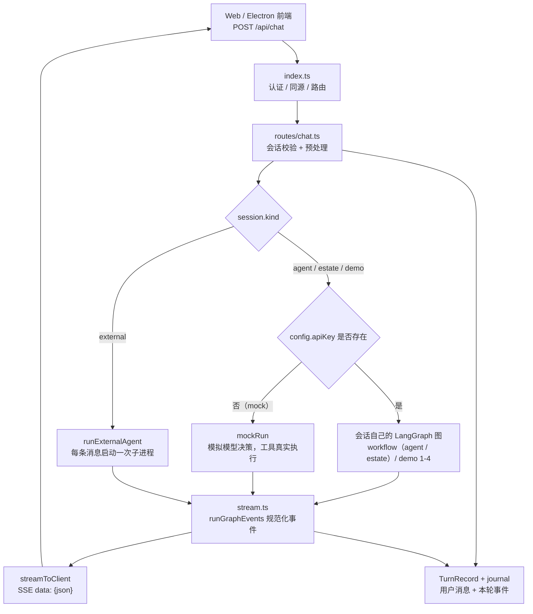
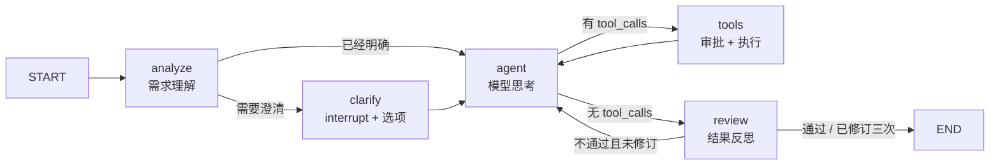
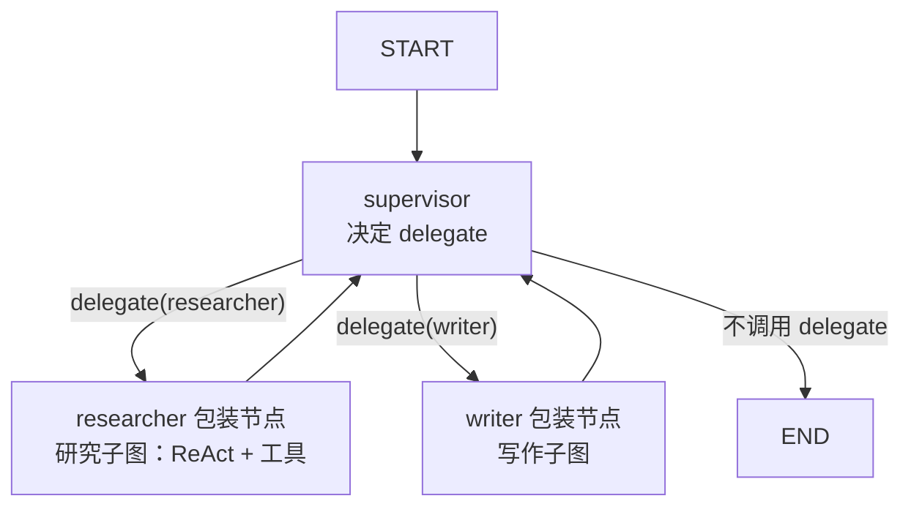
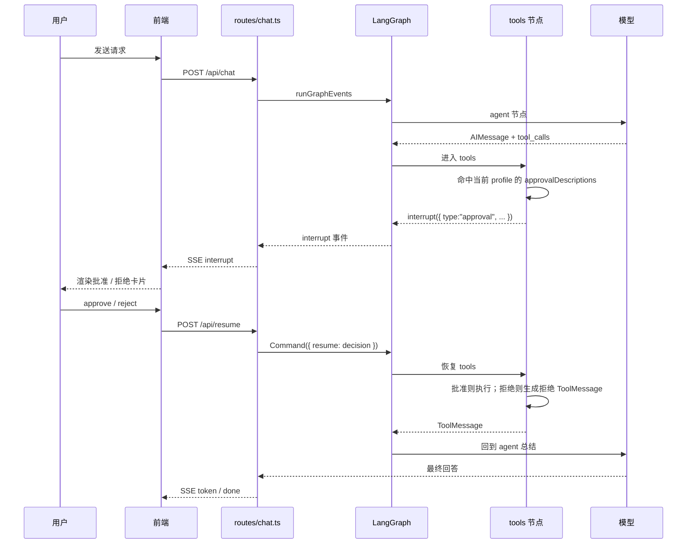
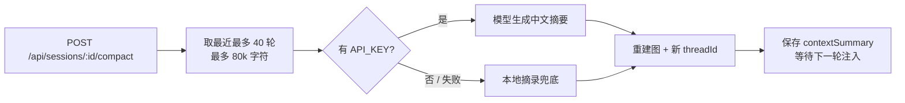

# Agent 流程编排说明

> 本文描述当前工作区的实际实现：从浏览器发出消息，到 LangGraph 执行、工具调用、
> 人工审批、SSE 回传、会话持久化与上下文压缩的完整链路。
>
> 结论先说：**默认产品路径是「单 Agent ReAct + 需求理解 / 澄清 / 反思」，
> 不是自动多 Agent 规划。**
> Supervisor 多 Agent 和并行 map-reduce 目前是 Demo；外部 Agent 则完全不走 LangGraph。
>
> 与 ZCode、DeepSeek Harness 的逐阶段对比见
> [`agent-orchestration-vs-zcode.md`](agent-orchestration-vs-zcode.md)。

## 1. 一张图看清端到端流程



这里有三个执行通道：

| 通道 | 触发条件 | 是否经过 LangGraph | 说明 |
|---|---|---|---|
| 真实图 | 配置了 `API_KEY` 且不是外部会话 | 是 | 默认产品路径 |
| Mock | 未配置 `API_KEY` | 否 | 用脚本模拟模型决策，事件协议与真实图一致 |
| 外部 Agent | `session.kind === "external"` | 否 | 每条消息启动一次第三方子进程 |

## 2. 会话与图的对应关系

创建会话时，`sessions.ts` 会立即为该会话构建图实例，并生成独立的
`threadId = web-<uuid>`。之后这个会话的多轮消息复用同一张图。

| 会话类型 | 选择方式 | 使用的图 | Checkpointer | 备注 |
|---|---|---|---|---|
| `agent` | 默认「通用 Agent」 | `agent/workflow.ts`（general profile） | 有 | 默认产品形态 |
| `estate` | 「房产 Agent」 | `agent/workflow.ts`（estate profile） | 有 | 贝壳工具集，独立审批策略 |
| `demo` 1 | 新建对话选「基础 ReAct」 | `agent/basic.ts` | 无 | 教学用，无多轮记忆 |
| `demo` 2 | 「对话记忆」 | `agent/memory.ts` | 有 | 演示 `thread_id` 记忆 |
| `demo` 3 | 「人工审批」 | `agent/hitl.ts` | 有 | 演示 `interrupt()` |
| `demo` 4 | 「多 Agent」 | `agent/multi.ts` | 无 | Supervisor + 子图 |
| `external` | 接入第三方 Agent | 无 | 无 | 每条消息起子进程 |
| Demo 5 | 仅 CLI | `agent/parallel.ts` | 无 | Web 新建对话目前不提供 |

> Demo 5 的并行 map-reduce 只在 `src/cli.ts` 中运行；Web 端 `DEMOS` 列表只包含 1-4。

每个 `Session` 还保存：

- `agentProfileId`：`general` / `estate`；demo 与 external 为 `null`，用于隔离工具、审批与观测；
- `graph`：编译后的图实例；
- `threadId`：同一会话多轮记忆的键；
- `configVersion`：建图时的模型配置版本；
- `pendingApproval`：当前是否在等待人工审批或需求澄清；
- `turnHistory`：服务端保存的逐轮用户消息、事件、稳定 `turnId`、耗时与 `continuation` 标记，用于回放和重启后的摘要注入；
- `contextSummary` / `contextSummaryInjected`：压缩上下文后的摘要及其注入状态。

## 3. 一次 `/api/chat` 请求的固定编排

### 3.1 接入层

`src/server/index.ts` 负责：

1. 认证、同源/CSRF、安全响应头；
2. 读取并解析 JSON 请求体；
3. 把 `/api/chat` 交给 `handleChat`，把 `/api/resume` 交给 `handleResume`；
4. 统一处理 400 / 413 / 500、静态资源和 404。

业务逻辑不写在 `index.ts`，一律进入 `server/routes/*.ts`。

### 3.2 聊天预处理

`src/server/routes/chat.ts` 按固定顺序执行：

```text
校验 sessionId / 会话存在
  → 消息非空校验
  → rebuildIfStale(session)            # 模型配置变了就重建图
  → assertChatInterval(sessionId)      # 同会话 1.5s 发送节流
  → acquireSessionSlot(sessionId)      # 同会话同时只允许一个流
  → 解析附件引用
  → 读取附件内容 + 组装消息
  → beginTurnRecord()                  # 先登记本轮
  → 按会话类型分流
```

附件处理在进入图之前完成：

- 前端只传文件引用（路径 / `uploadId`），不传文件内容；
- 服务端经 `files.ts` 做授权前缀校验、二进制检测、长度截断；
- 文本附件拼成带 `--- 附件 N: 名称 ---` 边界的用户消息；
- 图片附件在模型为多模态时组装成 `image_url` 内容块；
- 文本附件会 fire-and-forget 送外部 RAG 入库，失败只记日志，不影响本轮对话。

### 3.3 分流

```text
external 会话
  → runExternalAgent(agent, message, signal)
  → 子进程 stdout 逐块转成 token 事件
  → completeTurnRecord()

estate 会话
  → 先 fire-and-forget 上报贝壳 analyzeEstateTurn（用户原话 + 最近用户消息）
  → 再走真实图 / mock

普通会话
  → 无 API_KEY：mockRun()
  → 有 API_KEY：runGraphEvents(session.graph, ...)
```

### 3.4 真实图的输入

真实图不是每次把完整历史重新塞进图，而是依赖 `MemorySaver` + `thread_id`。
`handleChatInner` 只组装本轮新增消息：

```ts
const preNote = buildPrehistoryNote(session);     // 重启后首次，一次性历史摘要
const compactNote = takeContextSummary(session);  // /compact 后首次，一次性压缩摘要
const graphInput = [
  ...(preNote ? [new HumanMessage(preNote)] : []),
  ...(compactNote ? [new HumanMessage(compactNote)] : []),
  new HumanMessage(fullMessage),
];
```

然后把 `graphInput`、`threadId`、`AbortSignal` 交给 `runGraphEvents`。

## 4. 默认通用 Agent 的编排

`src/agent/general.ts` 与 `src/agent/estate.ts` 各自导出 `AgentProfile`（系统提示词、工具
allowlist、审批策略与可选领域 guidance），实际图由 `src/agent/workflow.ts` 的
`createWorkflowGraph(profile)` 构建。产品默认路径不是裸 ReAct，而是：



### 4.1 State 与节点

- State：`MessagesAnnotation` + `requirementBrief` / `clarification` /
  `clarificationHistory` / `reviewFeedback` / `reviewAttempts`；
- `analyze`：一次轻量模型调用，读取最新用户消息与最近对话，判断需求是否明确；
  解析失败或模型异常时按“明确”继续，不能让内部节点卡住聊天；
- `clarify`：需求确实缺少关键信息时调用 `interrupt()`，载荷是
  `{ type:"clarification", question, options, allowCustom:true }`；选项 2–4 个，
  兼容用户自定义输入；
- `agent`：绑定工具的模型节点；`context-builder.ts` 组装 profile system prompt、
  内部注记（`【需求理解】` / `【上一轮反思反馈】`）与投影后的最近消息窗口；
  超长工具结果只在该投影中裁剪，checkpoint / journal 原文不变；
- `tools`：使用 `createApprovalToolsNode({ tools, approvalDescriptions })` 创建的
  profile-local 执行节点；工具表在装配期封闭，跨域 tool call 会 fail-closed；
- `review`：只检查最终非工具回答，并对照需求理解与最近 3 条工具结果；明确不通过时把反馈写回 `reviewFeedback`，
  让 `agent` 再答一次；最多修订三次（`MAX_REVIEW_REVISIONS = 3`），坏 JSON 默认通过；
- 边：`START → analyze`，`analyze → clarify | agent`，`clarify → agent`，
  `agent → tools | review`，`tools → agent`，`review → agent | END`。

### 4.2 澄清中断与恢复

澄清和工具审批共用同一套 `interrupt` / `/api/resume` 通道，但载荷与提交字段不同：

| 场景 | interrupt 载荷 | `/api/resume` 请求体 | 恢复值 |
|---|---|---|---|
| 高风险工具 | `{ type:"approval", ... }` | `{ decision:"approve" \| "reject" }` | `approve` / `reject` |
| 需求澄清 | `{ type:"clarification", ... }` | `{ choice:"A" }` 或自定义文本 | 用户选择 |

- 服务端按 `session.pendingApproval.type` 分流；澄清缺少 `choice` 直接 400，
  不把空选择当审批拒绝；
- `clarify` 节点把选项 id 映射成可读标签（含说明）后写入 `requirementBrief`，
  同时保存到 `clarificationHistory` 供后续轮次的 `analyze` / `agent` 参考；
  用户选择不写入图的 `messages`，`turnHistory` 会记一条 `（需求澄清：…）`
  审计轮次供回放，但不会作为新的 HumanMessage 再喂给模型；
- resume 产生的回放记录带 `continuation: true`；前端把它的全部事件并回上一助手块，
  历史旧数据也按文案兼容合并，因此一次用户请求无论经历多少次审批都只有一个头像；
- 历史回放时 `pendingApproval` 只作为「是否仍可操作」的布尔信号；服务端仍有
  pending 时只恢复最后一张 interrupt 卡，其余卡片标为已处理，避免旧卡误点；
  已完成的澄清卡片显示“已选择”，不会在刷新后重新提交；
- 服务重启导致 `interrupt` 状态不可恢复时，`/api/resume` 返回明确错误，
  要求重新发起请求，不会静默重放。
- `analyze` / `clarify` / `review` 的模型输出是内部 JSON；`stream.ts` 用
  `INTERNAL_LLM_NODES` 过滤它们的 token 与整段消息，但保留节点徽章和 interrupt 事件。

### 4.3 工具集

| 分类 | 工具 | 风险 |
|---|---|---|
| 基础 | `calculator`、`get_current_time`、`get_weather` | 低 |
| 基础 | `send_email` | 高，需审批 |
| 开发 | `read_file`、`list_dir`、`grep_search` | 低 |
| 开发 | `terminal`、`write_file` | 高，需审批 |
| 知识库 | `retrieve_docs` | 低，只读 |

`read_file` / `list_dir` / `grep_search` 都复用 `files.ts` 的授权路径校验；
`terminal` 在项目根目录执行，输出有长度上限并带 120 秒超时。

### 4.4 系统提示词约束

通用 Agent 的 system prompt 明确要求：

- 计算、时间、天气优先调用工具，不凭空编造；
- 编程任务优先使用开发工具；
- 项目文档类问题调用 `retrieve_docs`，并标注来源；
- `read_file` / `list_dir` / `grep_search` 直接执行；
- `terminal` / `write_file` / `send_email` 由系统自动发起人工审批；
- 用户附加文件时，以附件内容为准；
- 回答简洁，代码使用 Markdown 代码块。

### 4.5 记忆

`compile({ checkpointer: new MemorySaver() })`，同一 `threadId` 的多轮消息共享状态。
这是进程内记忆，服务重启后丢失；重启恢复逻辑见第 8 节。

## 5. 房产 Agent 的编排

`src/agent/estate.ts` 与通用 Agent 使用同一张 `workflow.ts` 图，但消费独立的 estate profile：

```text
START → analyze → (clarify?) → agent → (toolsCondition) → tools → agent → review → END
```

差异只在：

- profile 的工具集是贝壳找房工具 `tools-estate.ts` + `calculator` / `get_current_time`，
  审批策略只登记 `house_appoint` / `house_contact`；
- 明确不绑定 terminal、读写文件、grep、RAG 与邮件工具；
- system prompt 是「贝壳找房顾问」的顾问式流程；
- 每轮进入图之前，`chat.ts` 额外把用户原话上报给贝壳 `analyzeEstateTurn`，该调用
  不阻塞主流程，失败不影响回答。

房产工具与风险等级：

| 工具 | 用途 | 风险 |
|---|---|---|
| `house_search` | 买房/租房搜索 | 低 |
| `house_lookup` | 详情 / 户型图 / 小区 / 板块 / 地名消歧 | 低 |
| `house_market` | 行情 / 成交 / 榜单 / 学区 / 政策 | 低 |
| `house_map` | 多地点区位对比地图 | 低 |
| `house_agents` | 经纪人检索 / 详情 | 低 |
| `house_appoint` | 提交带看预约 | 高，需审批 |
| `house_contact` | 经纪人加微 | 高，需审批 |

## 6. Demo 图的编排

| Demo | 图结构 | 关键点 |
|---|---|---|
| Demo 1 | `START → agent ⇄ tools` | 无 checkpointer，演示无记忆 |
| Demo 2 | 同 Demo 1 | 增加 `MemorySaver`，同一 `thread_id` 共享记忆 |
| Demo 3 | 同 Demo 1 | `tools` 节点对 `send_email` 调用 `interrupt()` |
| Demo 4 | `supervisor → researcher / writer → supervisor` | Supervisor 用虚拟工具 `delegate` 做路由，员工是子图 |
| Demo 5 | `START → Send × N → worker → combine → END` | 并行 map-reduce，仅 CLI |

### 6.1 Demo 4：Supervisor 多 Agent



关键实现细节：

- `delegate` 是虚拟工具，不会真正执行，只用于让模型产生路由决策；
- 员工的最终结果被包装成 `ToolMessage` 写回主管历史；
- 不把子图 AI 消息直接并回主管，避免思考型模型的 `reasoning_content` 丢失导致网关 400。

### 6.2 Demo 5：并行 map-reduce

- 自定义 `Annotation.Root`，`results` 用 `concat` reducer 汇聚；
- 条件边返回多个 `new Send("worker", { subject })`，实现动态 fan-out；
- 所有 worker 完成后进入 `combine`，实现 fan-in；
- 只在 CLI 中运行，Web 端没有对应会话类型。

## 7. 工具执行与 Human-in-the-loop

通用 / 房产的 `tools` 节点都由 `createApprovalToolsNode({ tools, approvalDescriptions })`
（`src/agent/hitl.ts`）创建：每个图实例持有自己的 local tool map，不再共用全局
`toolsByName` 或跨域 `APPROVAL_TOOLS`。

### 7.1 普通工具

模型返回 `tool_calls` 后，`tools` 节点遍历调用：

```text
call.name 不在当前 profile 的 tools
  → 返回 fail-closed ToolMessage（当前 Agent 不支持工具…）
call.name 不在当前 profile 的 approvalDescriptions
  → 直接 toolFn.invoke(call.args)
  → 生成 ToolMessage
  → 回到 agent
```

工具执行异常会被转换成中文错误 `ToolMessage`，不 throw 穿透图。

### 7.2 高风险工具



审批策略按 profile 拆分（`src/agent/approvals.ts`）：

- general：`send_email`、`terminal`、`write_file`；
- estate：`house_appoint`、`house_contact`；
- Demo 3：仅 `send_email`。

### 7.3 审批恢复的边界

- 审批决定由 `/api/resume` 送成 `Command({ resume })`；
- 需求澄清走同一个端点，但请求体是 `{ choice }`，恢复值是选项 id 或自定义文本；
- 审批恢复时不重建图：配置变更从下一条消息起生效；
- 服务重启后，内存里的图与 `interrupt` 状态无法恢复，`resume` 会返回明确错误，
  要求用户重新发起请求，**不会静默重复执行高风险操作或重放澄清**；
- 工具执行失败不向上抛异常，而是返回模型可读的中文错误 / JSON `{ error }`，
  让模型向用户解释。

## 8. 上下文、记忆与恢复

### 8.1 正常运行

- 每个会话一张图，`MemorySaver` 保存消息状态；
- `threadId` 绑定会话，持续多轮对话；
- `turnHistory` 另行保存「用户消息 + 本轮事件」，用于前端回放，不是图的记忆。

### 8.2 服务重启

服务重启后：

1. journal 恢复会话元数据与 `turnHistory`；
2. `MemorySaver` 的图状态丢失；
3. 该会话第一次真实图调用时，`buildPrehistoryNote()` 把最近 12 轮历史压成文本摘录，
   作为一次性前置消息注入；
4. 注入后 `resumeUninjected=false`，后续不再重复注入。

这是「文本补偿」，不是恢复原图状态。

### 8.3 修改模型配置

影响当前启用模型（`activeChanged`）的供应商 / 模型配置变更会递增
`configVersionCounter`。会话下次发消息时 `rebuildIfStale()` 用当前配置重建图：

- 新图 = 新的 `MemorySaver`；
- 旧的多轮记忆重置；
- 如果存在压缩摘要，`contextSummaryInjected` 重置，摘要会在下一轮重新注入。

### 8.4 `/compact` 压缩上下文



压缩后：

- 旧图被替换，`threadId` 重新生成；
- `pendingApproval` 清空；
- `turnHistory` 不删除，前端仍能回放旧对话；
- 下一轮真实图调用通过 `takeContextSummary()` 一次性注入摘要。

## 9. 流式协议与前端消费

`src/server/stream.ts` 把 LangGraph 的 `messages + updates` 原始事件翻译成统一的
`AgentEvent`，前端只处理这些事件：

| 事件 | 用途 |
|---|---|
| `node` | 节点执行徽章 |
| `token` | 助手正文流式增量 |
| `tool_call` | 工具调用卡片，参数可增量 |
| `tool_result` | 工具结果 / 错误 |
| `interrupt` | 人工审批 / 需求澄清卡片 |
| `ai_message` | 非流式网关的整段回答兜底 |
| `usage` | token 用量、上下文容量、缓存命中 |
| `shutdown` | 服务优雅退出提示 |
| `error` | 错误提示 |
| `done` | 本轮流结束（`runGraphEvents` 产出，`streamToClient` 兜底保证） |

关键处理：

- 子图会在 `updates` 里回显整段历史，服务端按消息 id 去重；
- `analyze` / `clarify` / `review` 是内部节点，其 token 与完整消息被过滤，
  只保留节点徽章和 `interrupt`；内部 JSON 不会混进助手正文；
- `interrupt` 后的 `done` 不会清空 `pendingApproval`；resume 若又产生新 interrupt
  也继续保留，只有无新 interrupt 的正常完成才清空并记 `decided`；
- 工具调用参数通过 `tool_call_chunks` 增量输出；
- Anthropic 系的 input/output usage 分片会按节点累积合并；
- 客户端断开会 abort 图请求；
- 即使中途停止，已经产生的事件也会写入本轮记录，历史回放能看到半截输出。

## 10. Mock 与外部 Agent

### 10.1 Mock 模式

未配置 `API_KEY` 时：

- 不调用真实模型；
- `mockRun()` 按关键词选择场景（邮件、天气、时间、计算、写诗、记忆、房产、普通聊天）；
- 工具仍然真实执行；
- 事件协议与真实图一致，前端无需区分；
- **不经过新工作流**：mock 不会产生需求澄清，也无法恢复澄清；需要观察
  `analyze / clarify / review` 请配置真实模型。

### 10.2 外部 Agent

外部会话不创建 LangGraph 图：

```text
clone 仓库
  → 读取 agent.json / package.json / 常见入口
  → 注册启动命令
  → 每条消息 spawn 一次子进程
  → stdout 转 token 事件
  → 非 0 退出把 stderr 尾部作为错误
```

限制：

- 启动命令白名单：`node` / `npm` / `npx` / `python` 等，或 clone 目录内脚本；
- 单轮超时 180 秒；
- 同时最多 2 个外部 Agent 消息；
- `passCredentials` 为 true 时才把当前模型 Key / BASE_URL / MODEL 注入子进程环境。

外部 Agent 没有本工作台的 `interrupt` 审批节点，也没有 LangGraph 的记忆语义。

## 11. 配置、并发与安全边界

| 边界 | 当前实现 |
|---|---|
| 模型配置 | 建图时 `createChatModel()` 读取当前供应商；保存配置后新会话生效，旧会话延迟重建 |
| 协议适配 | `llm.ts` 统一 OpenAI / OpenAI Responses / Anthropic / Gemini |
| 会话路由头 | OpenCode.ai 网关按 `Session.threadId` 注入 `x-opencode-session`；同会话重建稳定，压缩后换新线程 |
| 同会话并发 | 同时只允许一个流；两次发送至少间隔 1.5 秒 |
| 附件 | 单条消息最多 5 个；服务端授权校验、二进制拒绝、超长截断 |
| 文件工具 | 只能访问 `files.ts` 授权根；跳过依赖/敏感文件 |
| 高风险工具 | `hitl.ts` 的 `APPROVAL_TOOLS` 统一登记 |
| 外部 Agent | 命令白名单 + clone 目录约束 + 并发上限 + 超时 |
| 认证 / CSRF | `index.ts` 统一处理；开启 `AUTH_TOKEN` 后 API 需要 Bearer |
| 优雅退出 | SSE 先发 `shutdown`，再 abort，等待在途请求或超时强断 |

## 12. 扩展位置

### 新增一个工具

1. 在 `src/tools-<主题>.ts` 用 zod 声明；
2. 加入对应图的 `tools` 数组；
3. 如果是「执行后改世界」的操作，在 `hitl.ts` 的 `APPROVAL_TOOLS` 登记；
4. 只读工具不登记，直接执行。

### 新增一张图

1. 在 `src/agent/` 新建图文件；
2. 在 `sessions.ts` 的 `buildGraph()` 注册新的 `SessionKind` / demo；
3. 复用 `MessagesAnnotation`、`approvalToolsNode` 等现有节点；
4. 确认 `stream.ts` 能翻译新节点的流事件。

### 新增流式事件

1. `server/events.ts` 加类型；
2. `stream.ts` 产出事件；
3. `public/app.js` 的 `handleEvent` 增加渲染分支；
4. 补空数据、半途错误和回放路径测试。

## 13. 关键源码索引

| 文件 | 职责 |
|---|---|
| `src/server/index.ts` | HTTP 入口、路由分发、认证/CSRF、404/500 |
| `src/server/routes/chat.ts` | `/api/chat`、`/api/resume` 的完整编排 |
| `src/server/sessions.ts` | 会话、图实例、threadId、历史与重建 |
| `src/server/stream.ts` | LangGraph 事件 → AgentEvent → SSE |
| `src/server/mock.ts` | 无 Key 时的模拟执行 |
| `src/server/external.ts` | 外部 Agent 子进程通道 |
| `src/server/compaction.ts` | `/compact` 摘要与图重建 |
| `src/server/limits.ts` | 同会话流闸、发送节流、资源桶 |
| `src/agent/workflow.ts` | 需求理解 / 澄清 / ReAct / 反思的共享图，消费 profile |
| `src/agent/profile.ts` | Agent profile 类型、工具 allowlist、kind → profile 派生 |
| `src/agent/approvals.ts` | 按 profile 拆分的审批策略 |
| `src/agent/general.ts` | 默认通用 Agent profile：工具集 + 系统提示词 |
| `src/agent/estate.ts` | 房产 Agent profile：工具集 + 系统提示词 |
| `src/agent/basic.ts` | Demo 1 基础 ReAct |
| `src/agent/memory.ts` | Demo 2 记忆 |
| `src/agent/hitl.ts` | 审批工具节点工厂 + Demo 3 人工审批 |
| `src/agent/multi.ts` | Demo 4 Supervisor 多 Agent |
| `src/agent/parallel.ts` | Demo 5 并行 map-reduce（CLI） |
| `src/llm.ts` | 多协议模型工厂 |

## 14. 当前实现边界

- 默认路径是**单 Agent ReAct + 需求理解 / 澄清 / 反思**，没有自动任务分解 / 动态规划器；
- 多 Agent 协作只存在于 Demo 4，并行 map-reduce 只存在于 Demo 5（CLI）；
- `MemorySaver` 是进程内存储，不是生产级持久化 Checkpointer；
- 服务是单实例内存会话模型，没有任务队列 / 分布式 worker；
- 外部 Agent 是「每条消息一个子进程」，不是常驻 Agent 服务；
- `/compact` 会重建图并清空当前线程记忆，只保留摘要与历史回放。
