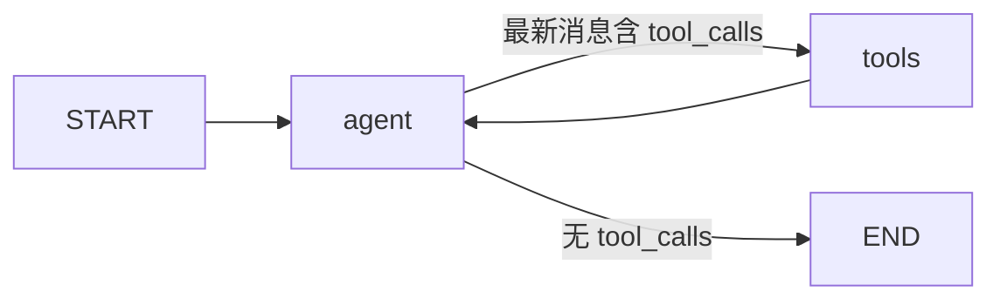
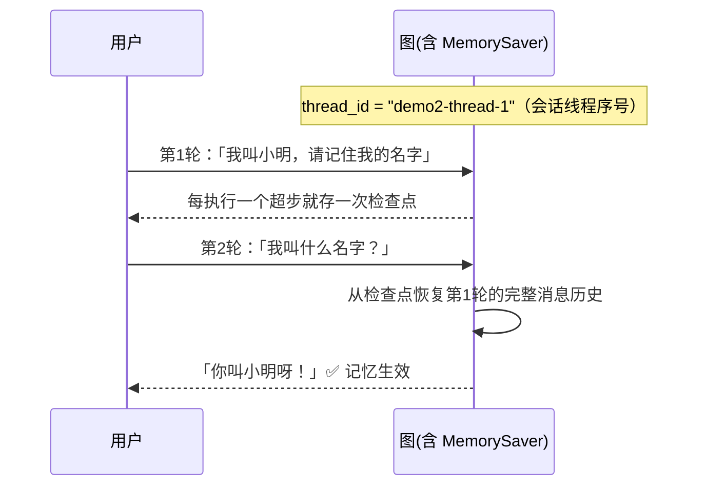
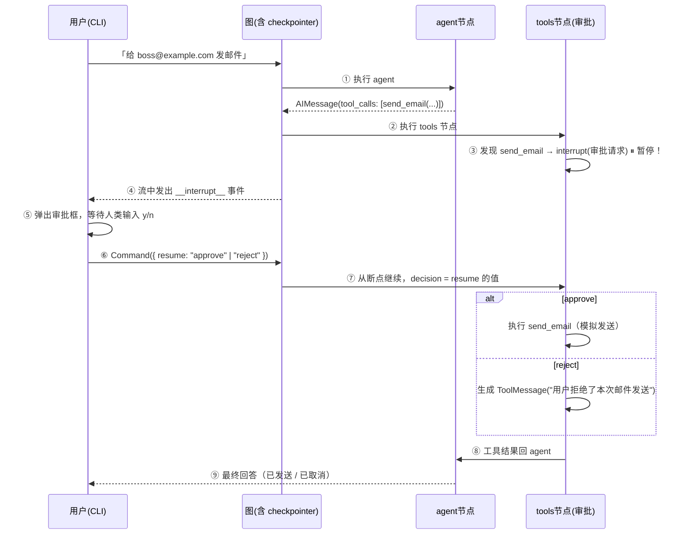
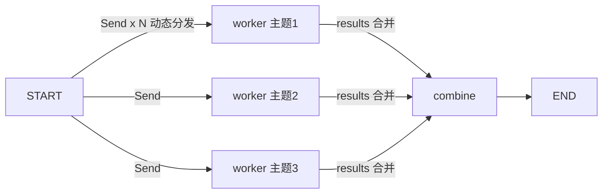

# 🤖 LangGraph.js Agent 搭建学习 Wiki

> 基于 `D:\code\agent` demo 项目编写。目标：读完这份文档，你能看懂任何 LangGraph.js 项目，
> 并能从零搭出自己的 Agent。
>
> 配套阅读：代码里每个文件都有详细中文注释，建议「文档 + 源码 + 运行观察」三者对照学习。
>
> 端到端运行时编排（请求 → 选图 → 工具 / 审批 → SSE → 压缩）见
> [`agent-orchestration.md`](agent-orchestration.md)。

***

## 目录

1. [一分钟总览](#1-一分钟总览)
2. [核心概念（配代码实例）](#2-核心概念配代码实例)
3. [模块功能详解](#3-模块功能详解)
4. [调用链分析（5 个 Demo 的完整执行流程）](#4-调用链分析5-个-demo-的完整执行流程)
5. [使用方法](#5-使用方法)
6. [从 Demo 到自己搭建 Agent](#6-从-demo-到自己搭建-agent)
7. [常见坑与排查](#7-常见坑与排查)
8. [概念速查表](#8-概念速查表)
9. [架构治理与生产化计划](#9-架构治理与生产化计划)

***

## 1. 一分钟总览

### 1.1 这是什么

一个用 **LangGraph.js（v1.4.9）+ TypeScript** 搭建的 **Agent Web 应用**（可正常使用），
同时内置 **5 个学习示例**作为「事例选择」：
新建对话默认使用**通用 Agent**（`src/agent/general.ts`：需求理解 → 澄清 →
ReAct 工具循环 + 多轮记忆 + 高风险审批 + 结果反思 + 📎 文件上下文，按产品逻辑组装）；
示例则刻意保持教学形态，用于观察特定图结构的运行方式。

| 类型 | 文件 | 概念 | 一句话说明 |
|------|------|------|-----------|
| 通用 Agent | `src/agent/general.ts` | 产品化组合（默认） | 需求理解 / 澄清 + ReAct + 记忆 + 审批 + 反思 |
| Agent profile | `src/agent/profile.ts` | 能力边界 | 工具 allowlist、审批策略、会话 kind → profile 派生 |
| 共享编排 | `src/agent/workflow.ts` | 图内前置/后置节点 | `analyze → clarify? → agent ⇄ tools → review` |
| 1 | `src/agent/basic.ts` | State / Node / Edge / 条件边 / 工具循环 | 亲手搭一张最基础的 ReAct 图 |
| 2 | `src/agent/memory.ts` | Checkpointer / thread_id | 给同一张图加上多轮记忆 |
| 3 | `src/agent/hitl.ts` | interrupt / Command.resume | 高风险操作（发邮件）执行前人工审批 |
| 4 | `src/agent/multi.ts` | 子图 / Supervisor 路由 | 多个 Agent 组成团队协作 |
| 5 | `src/agent/parallel.ts` | Send / 自定义 State / reducer | 并行 map-reduce：动态分发、汇聚结果 |

> 示例 1~4 同时出现在 Web 界面与 CLI 中；示例 5 目前仅 CLI（`npm run demo:5`）。

### 1.2 项目结构

```
<项目根目录>\
├── .env / .env.example   # 网关配置（baseURL / API_KEY / MODEL），.env 已 gitignore
├── package.json          # npm scripts：web / desktop / demo:1~5 / models / start / typecheck
├── tsconfig.json         # ES2022 / NodeNext / strict
├── README.md             # 快速开始
├── docs/agent-wiki.md    # 本文件
├── scripts/
│   └── list-models.ts    # npm run models：查询网关支持的模型列表
├── Dockerfile / docker-compose.yml  # 单实例容器部署（/data 数据卷，§3.19）
├── desktop/
│   └── main.cjs          # Electron 桌面端：子进程托管 Web 服务 + 窗口加载（§3.14）
└── src/
    ├── config.ts         # 统一读取 .env 配置
    ├── llm.ts            # 模型工厂：多协议（OpenAI/Responses/Anthropic/Gemini）接入任意网关
    ├── tools.ts          # 4 个自定义工具（zod 定义参数）
    ├── tools-rag.ts      # retrieve_docs：外部 RAG 知识检索工具（§3.13）
    ├── agent/            # profile + 共享工作流 + 通用/房产 Agent + 5 个示例的图定义
    ├── cli.ts            # CLI 入口：交互菜单 + token 流式 + 节点日志 + 审批交互
    └── server/           # Web 界面（参考 ZCode 聊天 UI）
        ├── index.ts      # node:http 服务：静态页面 + SSE 接口 + 探针 + 信号处理
        ├── health.ts     # /healthz 存活 + /readyz 就绪探针（§3.19）
        ├── lifecycle.ts  # 在途请求统计 + 优雅退出（§3.19）
        ├── logging.ts    # 结构化日志（stdout JSON + 密钥打码 + LOG_LEVEL）
        ├── stream.ts     # LangGraph 原始流事件 → 前端友好事件（token/工具卡/审批）的翻译层
        ├── mock.ts       # 未配置 API_KEY 时的模拟模型（事件协议与真实图一致）
        ├── sessions.ts   # 内存会话存储（每会话一张图 + 绑定 thread_id）
        ├── settings.ts   # 多供应商管理（增/删/改/切换 + context_length 缓存）
        ├── projects.ts   # 项目文件夹（本地目录 / 云端 Git 仓库 clone + 会话分组）
        ├── files.ts      # 文件上下文（项目/远程文件夹/本地上传，路径授权防穿越）
        ├── rag.ts        # 外部 RAG 接入：契约客户端 + 入库/检索 + 登记表（§3.13）
        ├── events.ts     # SSE 事件协议定义
        └── public/       # 前端：index.html / style.css / app.js + modules/（原生 ESM，零构建）
```

### 1.3 运行方式（3 秒上手）

```bash
npm run web           # 打开 Web 聊天界面（http://localhost:3000，推荐）
docker compose up -d --build   # 或容器部署（先设 AUTH_TOKEN，见 docs/deployment.md）
npm run desktop       # Electron 桌面端（原生窗口，端口 3123）
npm run demo:1        # 运行 Demo 1（带默认示例问题）
npx tsx src/cli.ts 1 "你的自定义问题"   # 带自定义问题
npx tsx src/cli.ts 5 "咖啡, 露营, 极光" # Demo 5 自定义主题列表
npm start             # 弹出菜单选择 Demo
```

***

## 2. 核心概念（配代码实例）

> 这是整个 wiki 最重要的一节。LangGraph 的全部概念只有 8 个，用「搭积木」理解：
> **状态**是数据，**节点**是处理步骤，**边**是连接，**工具**是模型的手脚，
> **检查点**是记忆，**interrupt** 是刹车，**子图**是乐高积木，**Send** 是并行分叉。

### 2.1 State（状态）—— 节点之间传递的数据

**一句话**：图每次执行时，在各个节点之间传递的一个数据对象。节点只能返回「对状态的修改」，由 reducer 合并进状态。

```ts
// src/agent/basic.ts
import { MessagesAnnotation } from "@langchain/langgraph";

async function agentNode(state: typeof MessagesAnnotation.State) {
  const response = await model.invoke(state.messages); // 读取当前状态
  return { messages: [response] };                      // 返回状态修改
}
```

- 这里用的是官方预置的 `MessagesAnnotation`：里面只有 `messages` 一个字段（消息列表）。
- 返回 `{ messages: [response] }` 不是「覆盖」，而是「追加」——因为 `messages` 自带追加型 reducer。
- 自定义状态用 `Annotation` 声明，例如：`{ steps: Annotation<number> }`、`{ notes: Annotation<string>({ reducer: (a,b)=>b }) }`。

### 2.2 Node（节点）—— 一个处理步骤

**一句话**：节点就是「输入 state，输出 state 修改」的 async 函数。模型调用、工具执行、业务逻辑都可以是节点。

```ts
async function agentNode(state) {
  return { messages: [await model.invoke(state.messages)] };  // 让模型思考
}

async function toolsNode(state) {
  // 执行模型要求的工具调用
  return { messages: toolResults };
}
```

### 2.3 Edge（边）与 Conditional Edge（条件边）

**一句话**：边决定执行顺序。普通边无条件直达；条件边是一个「看当前状态决定去哪」的函数。

```ts
graph
  .addEdge(START, "agent")                      // 静态边：从起点无条件到 agent
  .addEdge("tools", "agent")                    // 静态边：工具执行完必须回到 agent
  .addConditionalEdges("agent", toolsCondition) // 条件边：看 agent 的输出决定下一步
```

`toolsCondition` 是官方预置的路由函数，逻辑就是：

```ts
function toolsCondition(state) {
  const last = state.messages.at(-1);
  return last?.tool_calls?.length ? "tools" : END;  // 有工具调用→去执行；否则→结束
}
```

**这就是 ReAct 循环的核心**：agent 思考 → 要调工具就去 tools → 拿到结果回 agent → 再思考……直到不再调工具，直接给最终回答。

### 2.4 ToolNode 与工具（Tool）

**一句话**：工具是给模型「调用」的普通函数；`ToolNode` 是官方预置的「执行工具」节点，会把模型请求的工具挨个执行，结果转成 `ToolMessage` 追加进消息历史。

```ts
// src/tools.ts —— 用 zod 声明参数，模型才能知道怎么调用
export const calculator = tool(
  async ({ expression }) => `计算结果：${expression} = ...`,
  {
    name: "calculator",
    description: "计算数学表达式，支持 + - * / 和括号",
    schema: z.object({ expression: z.string() }),   // ← 参数 schema 是关键
  }
);

// src/agent/basic.ts —— 两个关键动作：
const model = createChatModel().bindTools(tools);   // ① 把工具「绑」到模型上
.addNode("tools", new ToolNode(tools))              // ② 用 ToolNode 执行工具
```

### 2.5 Checkpointer（检查点）—— 记忆

**一句话**：`compile({ checkpointer })` 之后，图每执行完一个超步就把状态存一份快照；同一 `thread_id` 的多次调用共享这些快照，于是 Agent「记住了」之前的对话。

```ts
// src/agent/memory.ts —— 和 basic.ts 的唯一区别：
import { MemorySaver } from "@langchain/langgraph";

const checkpointer = new MemorySaver();            // 内存版（进程退出即忘）
graph.compile({ checkpointer });

// 调用时带上 thread_id（会话线程序号）
await graph.invoke(input, { configurable: { thread_id: "demo2-thread-1" } });
await graph.invoke(input, { configurable: { thread_id: "demo2-thread-1" } }); // 同线程序号 → 有记忆
```

### 2.6 interrupt / Command —— 人工介入（刹车）

**一句话**：`interrupt()` 在节点内部「暂停」图的执行，把状态和请求原样抛给外部（如 CLI）；外部人类做出决定后，用 `Command({ resume: 决定 })` 把决定「喂」回暂停处，图从断点继续。

```ts
// src/agent/hitl.ts —— 执行高风险工具前暂停
const decision = interrupt<"approve" | "reject">({
  type: "approval",
  toolName: call.name,
  description: `向 ${call.args.to} 发送邮件...`,
});
// decision 就是外部通过 Command({ resume }) 传回的值

// 外部恢复（src/cli.ts）
await graph.invoke(new Command({ resume: decision }), { configurable: { thread_id } });
```

需求澄清复用同一机制，只是载荷与恢复值不同（`src/agent/workflow.ts`）：

```ts
const choice = interrupt<ClarificationRequest, string>({
  type: "clarification",
  question: "先看哪个城市？",
  options: [{ id: "A", label: "北京" }, { id: "B", label: "上海" }],
  allowCustom: true,
});
```

> ⚠️ interrupt 依赖 checkpointer 保存「暂停时的状态」，所以 HITL 必须配 checkpointer。

### 2.7 Subgraph（子图）—— 乐高积木

**一句话**：一张编译好的图可以直接当成另一个图的「节点」用。多个 Agent 各是一张子图，由主管图编排，就是多 Agent 协作。

```ts
// src/agent/multi.ts —— 每个员工是一张独立编译好的图
const researcherGraph = new StateGraph(MessagesAnnotation)
  .addNode("agent", researcherAgentNode)
  .addNode("tools", new ToolNode(researchTools))
  ...编译...

// 主管图把子图当节点注册
new StateGraph(MessagesAnnotation)
  .addNode("supervisor", supervisorNode)
  .addNode("researcher", researcherGraph)   // ← 子图就是普通节点
  ...
```

> 注意：子图与父图用同一个 `MessagesAnnotation` 时，**状态天然互通**——子图往 `messages` 里追加的内容，父图直接能看到。

### 2.8 Send（动态分发）与自定义 State / Reducer —— 并行 map-reduce

**一句话**：条件边的路由函数除了返回节点名，还可以返回 `new Send("节点", 私有输入)` 的数组——有几个元素就并行执行几个该节点实例；配合自定义 State 的 reducer（合并规则），实现 fan-out（分发）→ fan-in（汇聚）的 map-reduce 模式。

```ts
// src/agent/parallel.ts —— 自定义 State：完全不用 MessagesAnnotation！
const ParallelState = Annotation.Root({
  subjects: Annotation<string[]>({ reducer: (_o, n) => n }),      // 覆盖式
  results: Annotation<string[]>({                                  // ★ 追加式：
    reducer: (old, updated) => old.concat(updated),                //   并行 worker 各写一条，
    default: () => [],                                             //   reducer 自动合并 → fan-in
  }),
});

// worker 收到的不是整个 State，而是 Send 发来的「私有输入」{ subject }
async function workerNode(input: { subject: string }) {
  return { results: [`「${input.subject}」：${await makeSlogan(input.subject)}`] };
}

// 分发函数：返回 Send[] = 动态 fan-out（有 3 个主题就并行跑 3 个 worker）
function dispatch(state) {
  return state.subjects.map((subject) => new Send("worker", { subject }));
}

graph
  .addConditionalEdges(START, dispatch)  // START 也能接条件边做分发
  .addEdge("worker", "combine")          // 所有 worker 完成后自动进入 combine（超步屏障）
```

**关键认知**：
- reducer 是并行安全的唯一正确姿势——并行节点**永远不要直接覆盖**共享字段，只返回增量，让 reducer 合并；
- fan-in 不需要手写「等待逻辑」：LangGraph 的超步（superstep）屏障保证 combine 一定在全部 worker 完成后才执行；
- Demo 1~4 的条件边返回的是「节点名字符串」，一次只去一个地方；Send 返回的是「任务包」，同一节点可同时跑 N 份。

***

## 3. 模块功能详解

### 3.1 `src/config.ts` — 配置管理

**职责**：从 `.env` 读取网关的三件套 `BASE_URL` / `API_KEY` / `MODEL`（外加协议与思考等级），集中管理，全局唯一配置入口。

```ts
export const config = {
  baseURL: process.env.BASE_URL ?? "https://tokenrhythm.studio/v1",
  apiKey: process.env.API_KEY ?? "",
  model: process.env.MODEL ?? "deepseek-v4-flash",
  protocol: process.env.AI_PROTOCOL ?? "openai",   // openai / openai-responses / anthropic / gemini
  reasoning: { dialect: "auto", level: "default" }, // 思考等级：方言 + 档位（见 5.4.1）
};
export function assertConfig(): void { /* 缺 Key 时打印提示并退出 */ }
```

**为什么独立成模块**：换供应商/模型只改 `.env`（Web 端则写 `.web-config.json` 覆盖），
所有业务代码零改动（这是「配置与逻辑分离」的示范）。注意 `config` **不是常量**：
Web 设置页切换「供应商 × 模型」时会实时改写它，建图时（`llm.ts`）读到的永远是当前值。

### 3.2 `src/llm.ts` + `src/reasoning.ts` — 模型工厂与思考等级适配

**职责**：唯一创建 Chat 模型的地方，同时负责把「思考等级」翻译成各协议认识的字段。

```ts
new ChatOpenAI({
  model: config.model,
  apiKey: config.apiKey,
  temperature,                       // 0 = 尽量确定性输出
  maxRetries: 2,                     // 网关偶发 503，让 SDK 自动重试
  modelKwargs: { reasoning_effort: "high" },   // ★ 思考档位原样进请求体
  configuration: { baseURL: config.baseURL },  // ★ 接入任意 OpenAI 兼容网关
});
```

**关键点**：

- `configuration.baseURL` 指向任意 OpenAI Chat Completions 兼容地址（中转站、vLLM、
  Ollama 的 OpenAI 兼容层都行），不需要供应商专属 SDK；
- 四种协议（openai / openai-responses / anthropic / gemini）在这里分派到对应的
  LangChain 客户端，图代码（`agent/*.ts`）完全不感知差异；
- **思考等级的分离设计**：`reasoning.ts` 只描述「某家供应商怎么划分思考等级」
  （方言 → 档位 → 归一化参数），`llm.ts` 只负责「归一化参数 → 客户端字段」。
  想接入新供应商，在 `reasoning.ts` 里加一个方言即可，其余代码零改动。

### 3.3 `src/tools.ts` — 工具库

**职责**：定义 4 个工具，示范工具的四种形态：

| 工具               | 参数                   | 形态示范                         |
| ---------------- | -------------------- | ---------------------------- |
| `calculator`     | `expression: string` | 纯函数工具（正则白名单 + Function 安全求值） |
| `getCurrentTime` | 无参数                  | 空 schema `z.object({})` 的工具  |
| `getWeather`     | `city: string`       | 模拟外部 API（真实项目换成天气服务调用）       |
| `sendEmail`      | `to/subject/body`    | 「高风险操作」，在 Demo 3 中需要审批       |

同时导出：

- `demoTools`：工具数组，方便一次性绑定；
- `toolsByName`：`name → 工具` 的映射，Demo 3 手动执行工具时按名字查找。

### 3.4 `src/agent/basic.ts` — Demo 1：亲手搭 ReAct 图

**职责**：不借助 prebuilt 的 `createReactAgent`，用最原始的 API 搭出「思考 → 工具 → 思考」循环，是理解一切的基础。

```ts
export function createBasicGraph() {
  return new StateGraph(MessagesAnnotation)
    .addNode("agent", agentNode)                    // ① 思考节点
    .addNode("tools", new ToolNode(tools))          // ② 工具节点
    .addEdge(START, "agent")                        // ③ 从哪开始
    .addConditionalEdges("agent", toolsCondition)   // ④ 要不要调工具？
    .addEdge("tools", "agent")                      // ⑤ 调完必须回来继续想
    .compile();                                     // ⑥ 编译后才能调用
}
```

### 3.5 `src/agent/memory.ts` — Demo 2：加记忆

**职责**：与 basic.ts 图结构**完全相同**，唯一区别是 `compile({ checkpointer })`。一个词：`compile` 时多传一个参数。用来对比「有/无记忆」的行为差异。

### 3.6 `src/agent/hitl.ts` — 审批工具节点工厂 + Demo 3

**职责**：`createApprovalToolsNode({ tools, approvalDescriptions })` 在 tools 节点里手动实现
工具执行循环，遇到当前 profile 登记的高风险工具就 `interrupt()` 暂停；Demo 3 用
`demoApprovals` 只审批 `send_email`。

```ts
const toolsNode = createApprovalToolsNode({
  tools,                       // 当前图允许的全部工具（fail-closed allowlist）
  approvalDescriptions,        // 当前 profile 的高风险工具 → 审批文案
});

// tools 节点内部：
for (const call of lastMessage.tool_calls ?? []) {
  const toolFn = toolMap.get(call.name);
  if (!toolFn) {
    // 跨域 / 伪造调用：返回 ToolMessage，不执行、不中断
    continue;
  }
  if (approvalDescriptions[call.name]) {
    const decision = interrupt({ type: "approval", toolName, description, args });
  }
  // approve → 执行；reject → 生成拒绝结果
}
```

对外还导出：

- `ApprovalRequest`（interrupt 载荷的类型，CLI 据此渲染审批框）；
- `buildResumeCommand(decision)` → `new Command({ resume: decision })`。

### 3.7 `src/agent/multi.ts` — Demo 4：Supervisor 团队

**职责**：主管 + 两个员工（研究员、作家），员工各是一张子图。主管用「虚拟工具」`delegate` 做决策——模型发出 `delegate(member: "researcher")` 就路由到研究员，不再分派就 END。

```ts
async function routeFromSupervisor(state) {
  const call = state.messages.at(-1)?.tool_calls?.[0];
  if (call?.name === "delegate") return call.args.member;  // 路由到对应员工
  return END;                                               // 任务完成，收工
}
```

**设计亮点**：`delegate` 工具永远不会真正执行（没有对应的 tools 节点），它的作用只是「让模型用工具调用的形式表达分派意图」，条件边拦截后直接路由。

### 3.8 `src/agent/parallel.ts` — Demo 5：并行 map-reduce

**职责**：输入一组主题，为每个主题**并行**调用一次模型生成宣传语（map），全部完成后由汇总节点整合成一段文案（reduce）。是全项目唯一**不用 MessagesAnnotation** 的图。

三个教学点：
- `Annotation.Root` 自定义 State 字段与各自的 reducer（覆盖式 / 追加式）；
- 条件边返回 `Send[]`（而非节点名）实现动态 fan-out，worker 收到的是「私有输入」；
- `addEdge("worker", "combine")` 的 fan-in 由超步屏障自动保证，无需手写等待。

另导出 `parseSubjects()`：解析用户传入的逗号分隔主题列表（默认「人工智能, 量子计算, 航天探索」，上限 6 个防滥用）。

### 3.9 `src/cli.ts` — 统一入口（怎么把图「用起来」）

**职责**：菜单选择、token 级流式输出、逐节点可视化日志、人工审批交互。对学习最重要的四个机制：

1. **双模式流式观察**（Demo 1~4）：`graph.stream(input, { streamMode: ["updates", "messages"] })` 同时订阅两种粒度——`messages` 是 token 级增量（思考过程灰色逐字显示 + 回答打字机效果），`updates` 是节点级更新（`🔧 工具请求` / `📦 工具返回`）。CLI 会跳过 updates 里的 AI 正文，避免与 token 流重复。
2. **子图回显去重**：子图完成事件会把整个消息历史回显一遍，CLI 按「消息 id 去重」只打印真正新增的消息（`collectUpdateLines`）。
3. **审批交互**：`streamGraph` 检测到 `__interrupt__` 事件就返回暂停信息，`demo3` 弹审批框，用户回答后用 `Command({ resume })` 继续。
4. **Demo 5 故意不开 token 流式**：多个并行 worker 的 token 会交错输出，用「节点完成」视角反而更能看清并行结构（这本身就是个流式并发的教学点）。

另外 `LineReader` 类处理了「管道输入（`echo ... | npm run demo:2`）」场景，EOF 时优雅退出。

### 3.10 `scripts/list-models.ts` — 查模型

**职责**：请求 `{BASE_URL}/models`，打印网关全部模型（上下文长度、是否支持工具/推理、价格），并校验 `.env` 里的 MODEL 是否在列表内。**这是排查「HTTP 400 无响应体」的第一工具**。

### 3.11 `package.json` — 命令总览

| 命令 | 作用 |
|------|------|
| `npm run web` | 启动 Web 聊天界面（http://localhost:3000） |
| `npm run desktop` | Electron 桌面端（原生窗口托管 Web 服务，端口 3123） |
| `npm run demo:1` ~ `demo:5` | CLI 运行对应示例（1~4 带 token 流式输出） |
| `npx tsx src/cli.ts N "参数"` | 带自定义问题/主题运行（N=1~5） |
| `npm start` | 交互菜单 |
| `npm run models` | 查询网关模型列表 |
| `npm run typecheck` | TypeScript 类型检查（tsc --noEmit） |

> 用 `tsx` 直接运行 TS，不需要编译步骤；`tsconfig.json` 保持 `noEmit`，类型检查单独跑。

### 3.12 `src/server/` — Web 聊天界面（参考 ZCode）

**职责**：给 4 个 Demo 套上一个 ZCode 风格的聊天界面 —— 流式回答、工具调用卡片、
Human-in-the-loop 审批按钮、多会话侧栏。**零前端框架、零构建步骤**（原生 HTML/CSS/JS + SSE），
服务端也只用 `node:http`，不引入 Express。

**工具调用抽屉**（app.js `mountToolCard` 一族）：一个助手块里连续调用 ≥ 2 个工具时，
全部工具卡自动收进「🔧 N 个工具调用 · 全部完成 / N 个运行中… / N 个失败」折叠条，
点击展开/收起；流式与 journal 历史回放共用同一条 `mountPart` 挂载路径，回放自动重建；
审批 / 澄清卡片不进抽屉（用户必须看见）。

```
浏览器 (public/)                       服务端 (index.ts)
┌─────────────────────────┐   POST /api/chat   ┌──────────────────────────┐
│ app.js  ── fetch SSE ──▶│ ── graph.stream ──▶│ 4 个 Demo 的图（agent/）  │
│  ▸ 渲染 AgentEvent      │ ◀── data: {...} ── │          or               │
│  ▸ 流式 Markdown        │     (SSE 事件帧)    │ mock.ts（无 KEY 时）      │
│  ▸ 工具卡 / 审批按钮    │                    └──────────────────────────┘
└─────────────────────────┘
```

关键设计（详见各文件头注释）：

- **服务端结构（Phase 3 拆分）**：`index.ts` 只负责 server 创建、认证/同源/安全头、
  静态分发兜底、**集中路径 dispatch**、404/500 与启动加载；请求体读取与 413 排水收在
  `http-body.ts`，静态文件收在 `static.ts`，各业务域 handler 收在 `routes/*.ts`
  （chat / config / sessions / external / projects / files / rag / estate）。
  新增接口照 §6 检查单插一条 `if` 分支，不要往 index.ts 里堆业务；
- **前端结构（Phase 3 拆分）**：`app.js` 以原生 ESM 引入 `modules/format.js`
  （Markdown 渲染 / token 与字节格式化 / 图标映射 / 图片与链接白名单，纯函数）
  与 `modules/ui-dialog.js`（全局错误横幅 + 页面内 alert/confirm/prompt 队列），
  `index.html` 用 `<script type="module">`。`static.ts` 白名单只额外放开
  `modules/` 一层子目录，其余多级路径一律 404（防穿越）；
- **事件翻译层 `stream.ts`**：`streamMode: ["messages","updates"]` 的原始事件形状复杂
  （`[mode, payload]` 元组、子图回显整段历史），统一翻译成 7 种 `AgentEvent`
  （node / token / tool_call / tool_result / interrupt / ai_message / error）。
  内容只认 messages 模式，updates 只取「节点名 + interrupt + 兜底消息」，按消息 id 去重；
  默认工作流的 `analyze / clarify / review` 是内部节点，token 与整段消息会被过滤，
  只保留节点徽章和 interrupt（见 §3.20）；
- **会话绑定 `sessions.ts`**：每个会话一张图实例，Demo 2/3 的 `thread_id` 绑定会话 id，
  多轮记忆与 interrupt 状态因此得以延续；
- **在线配置 `settings.ts`（多供应商）**：设置页（⚙）可添加任意多个供应商档案
  （名称 + BASE_URL + API Key + 模型），列表中「启用」一键切换，顶栏 ▾ 也有快捷菜单。
  配置分三层：`.env` < `.web-config.json`（保存的供应商列表 + activeId，gitignore）< 运行中内存。
  切换/修改启用中的供应商 → 配置版本号 +1，**已有会话在下次发消息时自动重建图**
  （Demo 2/3 的记忆随之重置）；Key 只回传掩码，编辑时留空 = 保持不变；
  旧版单供应商配置文件会自动迁移；首次启动无文件时从 `.env` 播种一个默认档案；
- **模型在建图时创建**：各 agent 图文件的 `createChatModel()` 都在 `createXxxGraph()` 工厂内
  调用（而非模块加载时），这是「改配置能对新会话生效」的前提；
- **模拟模式 `mock.ts`**：未配置 `API_KEY` 时自动接管「模型决策」（脚本编排，工具结果仍真实执行），
  事件协议与真实图完全一致 —— 没有Key 也能完整体验 UI 的大部分交互；
  但 mock 不经过 `workflow.ts`，不会产生需求澄清，也不能恢复澄清；
- **用量与容量条 `stream.ts` / `settings.ts`**：网关返回的 `usage`
  （`usage_metadata`，兼容旧 `tokenUsage` 形状）被翻译成 `usage` 事件 ——
  `input_tokens` ≈ 当时整段对话的上下文大小，`input_token_details.cache_read`
  是提示词缓存命中；前端汇总为输入框上方的「上下文容量条 + 缓存命中」，
  分母（窗口长度）= 供应商设置里**手动填写的上下文窗口**（优先），
  否则取网关 `/models` 的 `context_length`（服务端按供应商缓存，
  启动/切换供应商时后台刷新；两者都没有时容量条只显示 token 数）。
  每个助手回合末尾还展示 `↑ 输入 · ↓ 输出 · 缓存 N%` 小字。模拟模式下由 `mock.ts`
  合成同协议的假用量（轮次越多上下文越大、命中率递增）；
- **图片与多模态 `files.ts`**：上传/拖拽/粘贴的图片以 dataURL 暂存，
  供应商模型的 `modality: "vision"`（设置里勾选「多模态」）时，
  发送会组装成 OpenAI 兼容的 `image_url` 内容块随消息进入图；
  纯文本模型附加图片会在发送前被 400 拦截并提示改用多模态模型；
- **文件上下文 `files.ts`**：📎 给消息附加文件，三种来源 ——
  ① **项目文件夹**（仓库根，默认授权）；
  ② **远程文件夹**（输入服务器上的绝对路径显式授权后可浏览，⚠ 会把目录暴露给网页端，仅限可信环境）；
  ③ **本地上传**（云端部署时服务器没有用户的本机文件，浏览器选文本文件上传到内存暂存区）。
  前端只传「引用」（路径 / uploadId），内容由服务端在发送时读取并校验
  （授权前缀校验防穿越、二进制拒绝、单文件超长截断），再以
  `--- 附件 N: 名 ---` 边界拼进用户消息，因此 4 个 Demo 的图与 mock 无需任何改动；
- **输入辅助 `app.js`**：输入框以「行首或空白后的 `/` / `@`」识别触发器，避免正文邮箱误触。
  `@` 走 `POST /api/fs/search`（`files.ts:searchFiles`，最多 20 条、跳过依赖/密钥文件），
  选中后复用附件 chips，不把路径文本塞进消息；`/` 菜单当前只有「压缩上下文」。
- **上下文压缩 `compaction.ts`**：`POST /api/sessions/:id/compact` 取最近最多 40 轮、
  80k 字符送模型摘要（无 Key / 失败时退回本地摘录），成功后重建图并换新 `threadId`，
  下一轮由 `takeContextSummary()` 一次性注入摘要。外部 Agent、待审批会话拒绝压缩；
  旧 transcript 仍保留用于回放，所以 UI 会额外显示一张“压缩摘要”提示卡。
- **项目文件夹 `projects.ts`**：参考 ZCode 的「项目 ▾」—— 侧栏可选项目，
  会话按项目分组、新建对话归属当前项目。项目分两类并用样式区分：
  **💻 本地**（服务器磁盘目录）与 **☁️ 云端**（Git 仓库地址，添加时
  `git clone --depth 1` 到 `.setting/cloud/` 缓存并注册为可浏览根，
  菜单里 ⟳ = `git pull`，删除 = 撤销授权并清缓存，其会话迁移到默认项目）。
  列表持久化在 `.web-config.json` 的 `projects/activeProjectId` 字段，
  启动时校验目录仍在才恢复；
- **审批 / 澄清交互**：`interrupt` 事件（`approval` 或 `clarification` 载荷）→
  前端渲染批准/拒绝或选项/自定义输入 → `POST /api/resume`（`{decision}` 或 `{choice}`）→
  服务端 `Command({ resume })` 继续被暂停的图（与 CLI 的 Demo 3 同一条路径）；
- **多协议模型工厂 `llm.ts`**：供应商档案带 `protocol` 字段（openai / openai-responses /
  anthropic / gemini），`createChatModel` 据此返回 `ChatOpenAI(useResponsesApi)` /
  `ChatAnthropic` / `ChatGoogleGenerativeAI` —— 四个客户端都是 LangChain
  `BaseChatModel`，图的代码不感知协议差异。注意思考型模型（deepseek-flash 等）：
  Anthropic 系流式用量分散在 message_start / message_delta 两个分片（首片 output=0、
  末片 input=0），`stream.ts` 按节点累积合并；员工汇报须以 ToolMessage 写回（见 multi.ts），
  否则「最后一条 assistant 消息缺 reasoning_content」会被网关 400。
- **外部 Agent 接入 `external.ts`**：在「新建对话」弹窗粘贴一个 Git 仓库地址即可把
  第三方 agent 工具（如 deepseek-harness）接入工作台 —— 服务端 clone 到
  `.setting/agents/`，按 **`agent.json` 清单 → package.json bin/main → 常见入口文件**
  的顺序自动识别启动方式（识别不出就手填一条命令），注册为会话类型 `external`。
  该类会话不走 LangGraph：每条消息启动一次子进程（`{{prompt}}` 占位符替换或 stdin
  传 `{"message":…}`），stdout 按块转成 `token` 事件复用同一条 SSE 通道，
  非 0 退出展示 stderr 尾部；180s 超时，「停止」= kill 子进程。
  `passCredentials: true` 才把网关配置注入子进程环境（默认不传）。
  ⚠ 接入即运行第三方代码，只加可信仓库。注册表持久化在 `.web-config.json`
  的 `externalAgents` 字段（经 `config-store.ts` 与 providers/projects 合并写入，
  修复了此前保存供应商会抹掉项目列表的隐患）。

### 3.13 `src/server/rag.ts` + `src/tools-rag.ts` — 外部 RAG 知识库

**设计立场**：工作台不内置向量库、不算 embedding —— 检索与入库全部委托一个
**外部 RAG 服务**（其内部通常是向量库 + OpenAI 兼容 /embeddings）。本侧只有
一个 HTTP 客户端（`rag.ts`）＋ 一个工具（`tools-rag.ts`）＋ 面板 UI，接入即插即拔。

**通用 HTTP 契约**（外部服务按此实现，字段名宽松解析：hits/results、text/content 都认）：

```txt
POST {RAG_URL}/ingest  {collection, documents:[{id,name,text,meta}]}  → 切块+embedding+入库
POST {RAG_URL}/search  {collection, query, topK}                      → {hits:[{text,score,name?}]}
POST {RAG_URL}/reset   {collection}                                   → 清空集合
POST {RAG_URL}/delete  {collection, ids}                              → 可选，删单个文档
Header: Authorization: Bearer <key>（可留空）
```

**数据流（两层入口、两层出口）**：
- 入库①：侧栏「📚 知识库」面板选项目/文件夹「全量入库」——`ingestFolder`
  扫描授权目录的文本文件（白名单扩展名；跳过 dotfiles / `*lock*` / 二进制；
  ≤300 文件、单文件 300k 字符、每请求 ≤10 文档且 ≤600k 字符分批）；
- 入库②：`/api/chat` 处理消息时把 📎 **文本附件自动顺手入库**
  （`ingestChatAttachments`，best-effort：失败只 warn，绝不影响对话）；
- 出口①：通用 Agent 的 `retrieve_docs` 工具 —— 调 `searchRag`，返回
  `{query, hits:[{name,text,score,source}], excerpt, note}` JSON（模型读全文，
  前端按同一 JSON 渲染「命中来源」卡片；未配置 / 服务挂了 → 友好错误 JSON，
  不抛异常不炸对话轮）；
- 出口②：面板上的检索测试框。

**关键实现点**：
- 配置 + 花名册持久化在 `.web-config.json` 的 `rag` 键
  （`{baseURL, apiKey, collection, topK, docs:{id→{name,bytes,at,source}}}`）——
  docs 只是「我们送进去过什么」的本地登记，真实索引在外部服务；
- `loadRag` 支持惰性自动加载（`ensureLoaded`）：任何进程内入口（含一次性脚本）
  都不必依赖服务启动时的显式加载；
- *实战坑*：`getRagPublic` 改成 async 后，路由内所有调用点都要 `await`，
  否则 `JSON.stringify(Promise)` 得到 `{}`（注册表一度「凭空消失/翻倍」）。

### 3.14 `desktop/main.cjs` — Electron 桌面端

**策略**：桌面端 = 原生窗口 + 托管已有 Web 服务，前后端逻辑零改动。

- 启动：以子进程拉起 `npx tsx src/server/index.ts`（独立端口 3123，
  与 `npm run web` 的 3000 互不打架；Windows 上 `.cmd` 必须 `shell:true`）；
- 就绪探测：轮询 `GET /api/config` 直到可连接（≤90s）才 `new BrowserWindow()`；
- 窗口：`ready-to-show` 再显示避免白屏；`backgroundColor` 预置深色；外部链接
  `setWindowOpenHandler` 交给系统浏览器；
- 退出：`window-all-closed` → **同步等待** `taskkill /pid <pid> /T /F` 完成，
  杀干净 npx→node→tsx 子进程树（孤儿 tsx 会继续占用端口，这就是必须 /T 的原因）；
  若用异步 `spawn` 发完 taskkill 就退出 Electron，子进程树会残留（桌面实测踩坑）；
- 单实例锁：二次启动 `requestSingleInstanceLock` 失败即退出并聚焦已有窗口；
- **无白标题栏**：Windows 以 `titleBarStyle:"hidden" + titleBarOverlay` 隐藏系统标题栏，
  右上角三枚窗口控制键由原生绘制、颜色跟随应用深浅主题 —— 链路是
  `preload.cjs` 暴露 `window.desktop.setOverlayTheme(dark)` → ipcMain 调
  `win.setTitleBarOverlay`；前端 `body.in-desktop` 标记驱动 CSS：
  `#topbar` 设为 `-webkit-app-region:drag`（窗口拖拽/双击最大化），右上 padding 152px
  给原生控制键让位，顶栏内按钮一律 `no-drag`。浏览器直接访问 `npm run web` 无标记、零影响。

---

### 3.15 `src/server/estate.ts` + `src/tools-estate.ts` + `src/agent/estate.ts` — 房产 Agent（贝壳官方 AI）

**设计立场**：贝壳能力由官方 `beike` CLI（LianjiaTech/beike-ai-platform）提供，
工作台只做「子进程包装 + JSON 解析 + 错误兜底 + 工具 schema」；(indexPath) 不引入贝壳私有
协议 / npm SDK —— CLI 是官方唯一承诺稳定的接口。

**三段结构**：

| 文件 | 职责 | 关键设计 |
|---|---|---|
| `server/estate.ts` | CLI 客户端 | `runBeikeRaw`（spawn，90s 超时，BEIKE_SOURCE 固定 beike_skill）→ `parseBeikeJson`（优先整体 JSON.parse，坏了取最外层大括号）→ `BeikeOutcome{ok,action,data?,raw?,error?}`；`CLI_UPGRADE_REQUIRED/-32001` **不自动重装**（Phase 1：人工确认 → 面板点「安装 CLI」）；Nominatim geocode 串行队列 ≥1.1s + 内存缓存（遵守 1 req/s） |
| `tools-estate.ts` | 工具 schema | 7 个 zod 工具（`house_search/lookup/market/map/agents/appoint/contact`），`extractListings` 松散键名映射（贝壳返回字段不保证稳定）；工具永不 throw 穿透图，失败返回 `{error}` 中文说明 |
| `agent/estate.ts` | 图 | 与 `general.ts` 共用 `workflow.ts`（需求理解 / 澄清 / ReAct / 反思），只换工具与系统提示词 —— 顾问式找房流程 7 条规则（搜索门槛 / resolve 消歧 / 地图对比 / 材料前置 / 禁编造 ID / 高风险复述 / 口径声明） |

**关键常量**（city 名尽量存表）：`BEIKE_RUN_TIMEOUT_MS=90_000`、`GEOCODE_MIN_INTERVAL_MS=1_100`（1 req/s 限流留余量）、`GEOCODE_MAX_ITEMS=6`、`MAX_RESULT_CHARS=26_000`。贝壳 Key 的保存（Phase 1 重写）：工作台直接写官方凭证文件 `~/.beike/BEIKE_MCP_API_KEY`（0o600），再跑 `beike doctor`（免费、只探 /mcp 工具清单不耗模型配额）判定「Key 有效」，回显一律经 `redactSecret` 首尾保留 4 位掩码 —— **Key 不再进 argv**（进程列表可被同机其它用户读到）。

**子进程边界（T1-4）**：`runBeikeRaw` 已改走 `subprocess.ts runControlled` —— stdout 头部
4MB、stderr 尾部 64KB、超时/中止树杀；安装链路（T1-6）只信任 HTTPS host 白名单，下载
缓冲溢出即拒，校验 sha256 后经 `.part` 临时名原子改名，tar 用 `%WINDIR%\System32\tar.exe`
绝对路径；安装动作写审计（URL/version/sha256）。

**高风险操作**：`house_appoint`（预约带看）、`house_contact`（加微信）已登记 hitl.ts 的
`APPROVAL_TOOLS` —— 它们会把真实请求发给贝壳侧的真实经纪人，必须人工批准后执行。

**契约外发现**：贝壳返回字段名不固定（`priceTitle/price/bodyPrice…`），所以工具侧一律
松散解析再归一；CLI 输出虽是单行 JSON，中文在某些版本带 BOM/转义差异，解析失败时会把
原始 stdout 尾部 500 字符放进 `error` 便于排查。

---

### 3.16 `src/server/{auth,http-guard,subprocess,audit}.ts` — Phase 1 安全与运行基建

| 文件 | 职责 | 关键设计（踩过的坑在 §7.3） |
|---|---|---|
| `auth.ts` | Bearer 认证 | 惰性读 env（防 ESM 早求值）；token 比 sha256 摘要 + `timingSafeEqual`（防时序侧信道）；401 统一文案 + `Connection: close` |
| `http-guard.ts` | 请求层防线 | `checkSameOrigin`（`Sec-Fetch-Site: cross-site` / `Origin` 不符 → 403，即使带令牌也拒——防恶意页面借浏览器自动携带凭证）；`SECURITY_HEADERS`（nosniff / no-referrer / X-Frame-Options / CSP）；`shedRequestBodyAfterResponse` 拒绝路径排水（**空 body 的 GET 不能 destroy**，会在响应 flush 前带 RST） |
| `subprocess.ts` | 受控运行器 | `runControlled` 统一 stdin/超时/abort/输出上限（stdout 头部 4MB、stderr 尾部 64KB、超限树杀），`killProcessTree`（win32 `taskkill /T /F`、unix detached 组杀）；`realRunner` 可替换 → 测试不碰真进程 |
| `audit.ts` | 审计日志 | `writeAudit(ev, detail)` fire-and-forget 自吞异常；append-only NDJSON 到 `.setting/audit.ndjson`；`AUDIT_MAX_BYTES=1MB` 超限尾部截断重写；事件族：`external.*`、`beike.install/upgradeDeclined` |

**external.ts 配套**（Phase 1 硬化）：启动命令进入 `EXTERNAL_COMMAND_ALLOWLIST`（node /
npm / npx / pnpm / pnpx / yarn / python* 裸名）或必须 resolve 在该 Agent 的 clone 目录内；
同并发上限 `MAX_CONCURRENT_EXTERNAL_RUNS=2`；`passCredentials`（把网关 Key 注入子进程环境）
默认关闭，开启必须带 `confirmCredentials:true` —— 前端右键卡片二次确认。全部注册/变更/
运行事件走 audit.ts。

---

### 3.17 `src/server/{config-store,session-store,limits}.ts` — Phase 2 本地可靠性基建

| 文件 | 职责 | 关键设计 |
|---|---|---|
| `config-store.ts` | `.web-config.json` 原子存储 | 写入「`.tmp` + fsync + rename」（Windows rename 抖动重试一次）；`.bak` 滚动备份 + 启动自动抢救（双坏降级 `{}` 不崩服务）；跨进程文件锁 `.web-config.lock`（O_EXCL 创建，**存活判断只能靠时间戳** —— `process.kill(pid,0)` 在 Windows 对在在/否/无权限一律 EPERM，纯 pid 探测不可靠）；`schemaVersion=2` 注入向后兼容 |
| `session-store.ts` | 会话 journal | append-only NDJSON `.setting/sessions.ndjson`（gitignore）；事件：`session`（upsert，**白名单挑字段**——Session 含编译图/内存结构严禁整只序列化）、`approval`（pending 全量 payload）、`decided`（approve / reject / answered，一次性转移）、`delete`、`turn`（user + events）；坏行跳过告警；`JOURNAL_MAX_BYTES=2MB` 超限快照重写 + 轮转 `.1`；启动 `replaySessions()` 回放进内存 |
| `limits.ts` | 并发/节流闸 | `acquireSessionSlot`（同会话唯一回答流）、`assertChatInterval`（1.5s）、`runWithLimit`（按 key 的全局桶，满即中文报错不排队）；chat/resume 都过槽位闸，贝壳 CLI 过 `runWithLimit("beike-cli", 2)` |

**sessions.ts 启动回放配套**（Phase 2）：`restoreSessions()` 把 journal 回放成内存会话
（图按 kind 重建为空态 checkpointer）；`pendingApproval` 仍为 `status=pending` 的会话标
`resumeUnavailable` —— resume 一律 400 中文引导「重新发起」（绝不静默重复执行还能改
世界的操作，也不重放已失效的澄清）；带历史轮次的会话标 `resumeUninjected` —— 首条真图消息前自动注入「最近
12 轮的上文摘录」一次性续命（`buildPrehistoryNote`，纯工具轮跳过，demo1/4 无记忆图不注入）。

**坑（踩过的）**：
- `done` 由 `runGraphEvents` 产出、`streamToClient` finally 再兜底补发；主循环收到
  `done` 时只在**没有新 interrupt** 的情况下清空内存 `pendingApproval`，否则会把
  等待用户恢复的审批/澄清误清掉；
- resume 的 `recordDecision` 只在恢复流没有产生新 interrupt 时调用；正常完成的 done
  会先清内存，onDone 在其后执行，所以不能靠内存状态判断（journal 侧 decided 幂等）。

---

### 3.18 `tests/` + `.github/workflows/ci.yml` — Phase 3 测试与 CI

**设计立场**：只用 Node 内置 `node:test`（零新增测试依赖），`tsx --test` 直跑 TS；
文件分层对应风险面：

| 目录 | 覆盖 |
|---|---|
| `tests/unit/` | 纯函数与内存状态：前端 Markdown/URL 白名单（`modules/format.js`）、`limits.ts` 并发闸、`files.ts` 路径授权/跳目录/二进制、`buildPrehistoryNote` 注入语义、`restoreSessions` 的 pending 恢复语义、`workflow.ts` 澄清/反思图、`stream.ts` 内部节点过滤、日志打码/级别、lifecycle 退出状态机、子进程超时/输出上限 |
| `tests/integration/` | 起临时服务端（mock 模式）：healthz/readyz 形状、`X-Request-Id`、config、会话创建、chat SSE、transcript 回放、审批 pending/恢复、`resume` 错误路径、`/compact`、文件搜索、404/400、静态页面与 ESM 模块 MIME |
| `tests/security/` | 跨站 POST 403、malformed JSON 400、请求体超限 413、Bearer 认证 401、探针免认证、静态目录穿越 |
| `tests/helpers/server.ts` | 临时服务端托管：系统分配端口、`API_KEY=""` 强制 mock、`SESSIONS_FILE` / `WEB_CONFIG_FILE` / `AUDIT_FILE` 指向临时目录（**不碰真实 journal、配置与审计**）、`LOG_LEVEL=error` 降噪、`taskkill /T` 杀进程树（Linux 自动退回 `proc.kill()`） |

```bash
npm test        # tsx --test --test-concurrency=1 tests/...（串行，避免多服务抢资源）
```

**CI（`.github/workflows/ci.yml`）**：push/PR 到 main 时跑 `npm ci` → `npm run typecheck`
→ 前端/桌面 `node --check` → `npm test`；`npm audit` 作为 advisory（continue-on-error，
不阻塞合并）。CI 不读真实 `.env`（测试侧强制 mock + 临时配置）。

**测试钩子（生产默认行为不变）**：
- `SESSIONS_FILE`：覆盖 journal 路径（`session-store.ts` 模块加载时读取）；
- `WEB_CONFIG_FILE`：覆盖 `.web-config.json` 路径（`config-store.ts`）；
- `AUDIT_FILE`：覆盖审计文件路径（`audit.ts`，Phase 4 补）；
- 三者都是「设了才生效」的环境变量，供 e2e 隔离数据；正常启动不设置即走仓库默认路径。

---

### 3.19 `health.ts` + `lifecycle.ts` + `logging.ts` + Docker — Phase 4 部署与可观测性

**设计立场**：不引入日志/部署框架；探针、退出、日志都保持「一个文件一个职责」，
且核心状态机（lifecycle）做成工厂以便离线单测。

| 文件 | 职责 | 关键设计（坑见 §7.3） |
|---|---|---|
| `server/health.ts` | 探针 | `/healthz` 只证明事件循环活着，永远 200；`/readyz` 检查配置目录 + journal 目录可写（`mkdir` + `W_OK`，带 1.5s 超时）且未在关闭中，否则 503；两者免认证，只回 `{ok, version, uptimeSeconds, ...}`，不含路径/供应商/Key |
| `server/lifecycle.ts` | 优雅退出 | `createLifecycle()` 工厂：`beginRequest/endRequest` 在途计数、`registerSse` 连接表、`shutdown(deps)` 注入 `closeServer/closeIdle/closeAll/flush/exit`；先给 SSE 写 `shutdown` 帧再 abort；等在途归零（默认 10s）→ flush → 退出码 0/1；重复 shutdown 幂等 |
| `server/logging.ts` | 结构化日志 | stdout 一行 JSON；固定字段 `time/level/event` 放在业务字段**之后**（防覆盖）；`redact` 按字段名打码 + 长文本/数组/深度截断；`LOG_LEVEL` 运行时读取，非法值回退 `info` |
| `server/audit.ts` | 审计增强 | 新增 `AUDIT_FILE` 测试钩子与 `flushAudit()`；认证失败记 `auth_rejected`（只记 requestId/method/path，不带 token）；配置变更（`config.*`）、HITL 决定（`hitl.decided`）、项目授权（`project.authorized`）也落审计，均不带 Key/URL/工具参数 |
| `server/session-store.ts` | journal 增强 | 写入任务进 `pendingWrites`，`flushJournal()` 循环等到清空（flush 期间新产生的写入也能等到） |
| `server/index.ts` | 入口接线 | 每请求 `X-Request-Id`；handler `finally` 统一记 `http_request`（静态 debug、API info，避免 SSE abort 时 `res.close` 抢跑）；关闭中非探针请求回 503；`SIGINT/SIGTERM/SIGBREAK` → lifecycle；`EADDRINUSE` 中文提示 + 退出码 1 |
| `Dockerfile` / `docker-compose.yml` | 单实例部署 | `node:22-slim` 多阶段；`npm ci --ignore-scripts`（跳过 electron 下载）；非 root `node`；`/data` 卷统一放配置/journal/审计；`CMD node --import tsx ...` 让 node 作 PID 1 收信号；compose 强制 `AUTH_TOKEN`、`init: true`、`stop_grace_period: 15s`、内置 healthcheck |
| `docs/deployment.md` | 运维文档 | Docker 启动、环境变量表、探针语义、退出流程、日志/审计、Nginx/Caddy SSE 配置、桌面端打包评估、单实例边界 |

**SSE 退出帧**：`AgentEvent` 新增 `{type:"shutdown", message}`；`routes/chat.ts` 把
连接登记进 lifecycle。退出时 lifecycle 直接往 `res` 写一帧再 abort，前端
`app.js` 的 `handleEvent` 显示顶部常驻提示 —— 客户端能区分「服务重启」与「网络故障」。

**为什么 node 直接作 PID 1**：`npm run web` / npx 包装层不会把 SIGTERM 转发给
node 子进程，容器停止时只能等宽限期结束吃 SIGKILL，journal/audit 可能丢尾部。
Dockerfile 用 `CMD ["node", "--import", "tsx", ...]`，信号直达应用。

**当前边界**：会话、限流闸、SSE 表都在进程内，`data/` 只能给一个实例用；
多副本/共享存储属于 Phase 5。桌面端仍是开发壳（Windows 退出用 `taskkill /F`，
不触发优雅退出），打包评估结论见 `docs/deployment.md` §7。

### 3.20 `src/agent/workflow.ts` — 产品默认编排（需求理解 / 澄清 / 反思）

**设计立场**：把「执行前理解、执行后检查」做成图内节点，而不是散落在路由或
prompt 里；`general.ts` / `estate.ts` 各自导出 profile，避免两套编排漂移。

```text
START → analyze → clarify? → agent ⇄ tools → review → END
                         ↑                    │
                         └── 不通过且未修订 ──┘
```

| 节点 | 职责 | 关键约束 |
|---|---|---|
| `analyze` | 判断最新请求是否明确，生成 `requirementBrief` | 坏 JSON / 模型异常默认“明确继续”；只问会实质改变结果的信息 |
| `clarify` | `interrupt({ type:"clarification", question, options, allowCustom })` | 2–4 个互斥选项；服务端 `/api/resume {choice}`；选项 id 映射成可读标签；答案同时写入 `clarificationHistory` |
| `agent` | 绑定工具的 ReAct 节点 | 通过 `context-builder.ts` 组装稳定 system、内部注记与投影后的消息窗口；工具结果按 profile 预算裁剪 |
| `tools` | 由 `createApprovalToolsNode({ tools, approvalDescriptions })` 创建 | 只执行当前 profile 的工具；跨域调用 fail-closed |
| `review` | 对照需求与最近工具结果，检查最终回答 | 明确失败才回炉，最多三次（`MAX_REVIEW_REVISIONS`）；坏 JSON 默认通过 |

**关键坑**：

- `analyze` / `clarify` / `review` 的模型输出是内部 JSON，不能进入对话正文；
  `server/stream.ts` 按节点名 `INTERNAL_LLM_NODES` 过滤 token 与完整消息，
  改节点名必须同步改过滤集合；
- 澄清答案不写入图的 `messages`，而是并入 `requirementBrief` 并保存到
  `clarificationHistory`，供后续轮次的 `analyze` / `agent` 参考；`turnHistory`
  只记一条带括号的审计轮次（回放时可见），不会作为新的用户指令重复喂给模型；
- `reviewFeedback` 只作为下一轮 `agent` 的 system 注记，不写进 `messages`，
  防止内部批评被当成用户可见历史；
- 图状态字段的 reducer 必须兼容 `undefined`，否则中断恢复时旧 checkpoint 缺字段会报错；
- `createWorkflowGraph(profile, models?)` 支持注入 `WorkflowModels`，单测用
  `FakeListChatModel` / 脚本化模型跑通「澄清 → resume → 反思回炉」整图，
  不消耗真实 API。

**当前边界**：只有默认 `agent` 与 `estate` 使用；Demo 1–5、外部 Agent、mock
模式都不经过这张图。mock 不会产生澄清，也不能恢复澄清。

### 3.21 `src/agent/profile.ts` + `approvals.ts` — Agent 能力隔离

**职责**：profile 只描述「这个 Agent 允许什么」，不执行 IO；`workflow.ts` 只消费
profile，不判断具体业务名。

| 字段 | 作用 |
|---|---|
| `id` / `displayName` | `general` / `estate`，用于会话身份与 UI |
| `systemPrompt` | 当前 Agent 的角色与业务规则 |
| `tools` | 唯一执行 allowlist；建图时转成 local `Map`，同名工具直接报错 |
| `approvalDescriptions` | 高风险工具名 → 审批文案；未登记工具直接执行 |
| `analystGuidance` / `reviewerGuidance` | 可选领域规则，追加到 analyze / review prompt |
| `contextPolicy` | 最近消息数与单条工具结果字符预算；general / estate 可不同 |

隔离规则：

- `general`：基础工具 + 开发工具 + `retrieve_docs`；禁止任何 `house_*`；
- `estate`：贝壳工具 + `calculator` / `get_current_time`；禁止开发、RAG、邮件工具；
- 模型伪造跨域 tool call 时，执行节点返回
  `当前 Agent 不支持工具「X」，未执行。`，不执行、不进入审批；
- 会话 `agentProfileId`、每轮 `TurnRecord.agentProfileId`、journal 与
  `hitl.decided` 审计都携带执行域；旧 journal 按 `kind` 派生；
- 未来租房需要 RAG 时，必须显式加入 estate profile，不能从通用注册表隐式获得。

### 3.22 `src/agent/context-builder.ts` — 上下文投影与观测

**设计立场**：prompt 分区、最近消息窗口和工具结果裁剪都做成纯函数，既能单测，
也不会修改 checkpoint / journal 中的原始历史。UI 仍能展示完整工具结果，模型只读预算内投影。

| 能力 | 行为 |
|---|---|
| Prompt 分层 | profile system prompt + 需求 brief / 澄清历史 / 反思反馈的内部 system 注记 |
| 最近窗口 | 每个 profile 配置 `maxRecentMessages`；不会从 ToolMessage 中间切断 tool call/result |
| 工具预算 | `maxToolResultChars`；terminal 优先保留尾部错误，其它工具保留头部 |
| 原文保留 | 只 clone 投影后的 `ToolMessage`，原 checkpoint、transcript 与前端卡片不变 |
| 轮次观测 | `TurnRecord.turnId` 贯穿 journal / transcript；`agent_turn_started/finished` 记录 profile、状态、耗时，debug 级记录 step/tool 开始与结束 |
| 日志隐私 | 结构化日志不记录用户消息、工具参数或完整工具输出，只记 id、名称、状态和计数 |
| 图片投影 | `computer_screenshot` 的多模态内容块（text + image_url）整体保留、不做字符截断 —— 截断 base64 等于毁掉整张图 |

### 3.23 `src/agent/permission.ts` + `src/tools-computer.ts` — 会话权限模式与电脑控制

**permission.ts（纯函数闸门）**：会话级权限模式的单一事实来源，三种裁决 ——
`readonly`（登记审批的工具 = 改世界操作，一律 `deny`）、`approve`（默认，`interrupt` 审批）、
`auto`（全部 `run`）。判定基准**复用 profile 的 `approvalDescriptions`**，刻意不维护第二份
「只读禁用清单」：会改世界的操作必然登记审批，两份清单迟早漂移。

链路：前端输入框上方 🛡 chip → `POST /api/sessions/:id/permission` →
`Session.permissionMode`（journal `permission` 事件持久化，重启延续；旧 journal 缺字段按
`approve` 兼容）→ `chat.ts` 把它交给 `runGraphEvents` → `graph.stream({ configurable.permission_mode })`
→ LangGraph 把 configurable 透传给节点函数第二参数 → `hitl.ts` 执行节点逐 call 裁决；
`workflow.ts` 的 agent 节点同时把权限说明注入 system 注记（readonly 时明确告诉模型别发起写调用）。
切权限**不需要重建图** —— 全程走 configurable，对下一条消息立即生效。

**tools-computer.ts（零依赖 Computer Use，仅 Windows）**：五个工具全部经
`powershell.exe` 调 .NET / user32.dll 实现，不引入 robotjs 类原生依赖：

| 工具 | 实现 | 审批 |
|---|---|---|
| `computer_screenshot` | `CopyFromScreen` + 等比缩到最长边 1280 + JPEG(q72)；多模态模型收到 image_url 内容块 | 直接执行（只读） |
| `computer_click` | `SetCursorPos` + `mouse_event` down/up（双击两次、右键 RIGHTDOWN/UP） | ✅ |
| `computer_type` | 纯 ASCII 走 SendKeys（转义后）；中文等走 `Set-Clipboard` + Ctrl+V（会覆盖剪贴板，描述已注明） | ✅ |
| `computer_key` | 组合键解析成 SendKeys 语法（ctrl `^` / alt `%` / shift `+`；不支持徽标键） | ✅ |
| `computer_scroll` | `mouse_event(0x0800)`，dwData = ±120×行数（P/Invoke 签明 int，负值按补码传） | ✅ |

两个关键实现坑：

- **PS5.1 GBK 控制台**：中文参数内联脚本必乱码。统一 `-EncodedCommand`（脚本 UTF-16LE →
  base64），从根上绕开编码问题，脚本本身保持全英文；
- **多模态工具结果**：LangChain `tool()` 会把非字符串返回值 `JSON.stringify` 成文本，
  图片内容块会因此丢失。`computer_screenshot` 继承 `StructuredTool` 并**覆写 `invoke()`**
  直接返回内容块数组，`hitl.ts` 的 `invokeTool` 对数组原样透传成 `ToolMessage.content`；
  SSE 的 `tool_result` 事件与 journal 回放只取其中的 text 块（`contentText` 拍平），
  base64 不进前端不进 journal。

### 3.24 `src/agent/subagent.ts` + `src/tools-team.ts` — 多智能体协同（委派子 Agent）

**形态**：子 Agent = 工具。主 Agent（general）调 `delegate_agent({ profile, task })`，
内部用目标 profile 的 workflow 子图后台跑完任务书，结果文本截断 4000 字符作为 ToolMessage
回填 —— 是 Demo 4（supervisor）/ Demo 5（并行 map-reduce）概念的产品化。

阶段 1 的三条安全默认：

| 默认 | 实现 |
|---|---|
| 子 Agent 强制只读 | `runSubagent` 固定 `permission_mode:"readonly"` 传子图 configurable，写操作全部被权限闸门拒绝（§3.23）；写需求由主 Agent 自己走完整审批链 |
| 深度 = 1 | `subagentProfileOf` 剔除子 profile 的 `delegate_agent` 工具，子 Agent 无法再委派，防递归套娃与配额失控 |
| 黑盒交互 | 子图在工具函数内运行，`interrupt` 无法冒泡：澄清 interrupt / 超时（180s）/ 空产出 一律转「模型可读中文错误」，主 Agent 重试或接手，绝不静默挂死 |

上下文隔离：每次委派独立 `threadId` + 全新 MemorySaver，子 Agent 只看到任务书（外加追加的
「不要请求澄清、按合理假设继续」分析规则），主会话只看到结果文本 —— 双向不污染。

实现坑：

- **import 环**：general.ts 挂载 delegate 工具（import tools-team），而 tools-team 要按
  profileId 取 generalProfile / estateProfile —— 静态 import 会成环。工具函数内用
  **动态 `await import()`**（模块缓存无性能损耗）在运行时取 profile；
- 委派本身登记审批（`delegate_agent` → 「委派 xx 子 Agent 执行：…（一次委派 = 多轮模型调用）」），
  复用 §3.23 权限三档：readonly 拒 / approve 卡 / auto 直通；
- estate 不挂 delegate（域纯粹，不反向委派）—— 工具隔离测试断言。

阶段边界（后续）：同轮多委派并行（tools 节点 Promise.all）、子 Agent token 流转发前端、
审批冒泡（需图节点式改造）、子 Agent usage 并入主会话容量条。

### 3.25 `src/checkpoint.ts` — 持久化检查点（重启不丢模型记忆）

**问题**：产品图原先每图自建 `MemorySaver` —— 进程一停，thread 的多轮上下文就没了；
journal 只回放出「对话记录」（给人回放），模型记忆降级为摘录注入（最近 12 轮拼接），
长对话重启后体验断崖。这是「实际可用」的第一劝退点。

**方案**：继承官方 `MemorySaver` 做 `PersistentSaver` —— 序列化完全复用父类
`serde`（`dumpsTyped`/`loadsTyped`，消息类 ↔ 字节的兼容由官方包维护），本文件只做
「把已序列化字节 base64 后追加 NDJSON」（`.setting/checkpoints.ndjson`，gitignore；
测试钩子 `CHECKPOINT_FILE` 照抄 `SESSIONS_FILE` 模式）：

| 机制 | 实现 |
|---|---|
| 落盘 | `put`/`putWrites`/`deleteThread` 各自 override：先自序列化 → `super.*` 落内存 → 串行写链（promise 链保行序 = 调用序）追加行；失败自吞只告警（不打断回答流，与 journal 同立场） |
| 回放 | 启动 `ensureCheckpointsLoaded()` 逐行走**同一条** `super.*` 内存路径（含 putWrites 去重语义），状态与原进程严格一致；坏行（硬杀半行）跳过告警 |
| 收敛 | 磁盘 = 调用序日志 + 回放走同一实现 ⇒ 两个进程生命对同一 thread 的状态收敛 |
| 防膨胀 | 删会话 / `/compact` 换线程时 `deleteThread` 落 delete 行；超 24MB 时 `compactNow()` 按行过滤重写：每 (thread, ns) 只留最近 10 个检查点（id 字典序 = 时间序），delete 过的线程整组丢弃。过滤只认本文件行格式，不碰 MemorySaver 内部结构 |

**为什么不引 `@langchain/langgraph-checkpoint-sqlite`**：它带 `better-sqlite3` 原生模块
（Windows / Electron 部署与零依赖红线冲突），而 MemorySaver 内部本来就是 serde 字节三元组
（`storage[thread][ns][id] = [ckptBytes, metaBytes, parentId]`）——「文件镜像」这个装饰器
把自实现的序列化/并发两大风险全部消掉了，约 250 行零依赖解决。

**接入点与语义变化**：

- `createWorkflowGraph(profile, models?, { checkpointer })` 默认挂共享 `getCheckpointSaver()`
  单例；`subagent.ts` 显式传自建 `MemorySaver`（一次性执行不落盘）；demo 2/3 教学形态不变；
- `restoreSessions()`：`saver.hasThread(threadId)` 判定 —— 有检查点的会话不再注入
  journal 摘录（同一历史不进两遍上下文），无检查点的（旧数据/demo/mock 轮）维持摘录降级；
- **改配置不再失忆**：`rebuildIfStale` 重建图共享同一 saver，记忆保留在原线程；
  唯一例外是「挂着未决审批时重建」—— 删持久线程（interrupt 残留不可与新输入续用，
  等价旧行为）；
- 审批中断态跨重启：检查点层已具备恢复数据（checkpoint + writes 都在盘上），
  但上层维持「明确拒绝重复执行」（§3.17 T2-3 策略），后续再评估放开。

**踩坑**：默认文件路径是「模块文件位置回退到仓库根」—— `checkpoint.ts` 在 `src/` 顶层
只回退一层，`session-store.ts` 在 `src/server/` 要回退两层；照抄时多退了一层，
文件悄悄写去了 `src/.setting/`（服务照常工作，极难察觉）。相对仓库根定位一律以
**本文件自身位置**起算。

### 3.26 `src/memory-store.ts` + `src/tools-memory.ts` — 跨会话长期记忆（F1）

**问题**：F0 解决了「同一会话跨重启」，但每个**新会话**仍是白纸 —— 用户偏好
（「回答结论先行」）、项目事实（「测试用 npm test」）每次都要重新交代。

**三件套**：

| 层 | 实现 |
|---|---|
| 存储（`memory-store.ts`，src 顶层） | `.setting/memories.json` 小白名单（上限 200 条 × 500 字）：内存权威 + 每次变更**全量原子重写**（temp+rename，config-store 模式）—— 与 journal/checkpoint 的大日志 append 方案刻意不同，规模小不值得 compact 复杂度；同 key 保存 = 覆盖更新（id 稳定）；坏文件降级空记忆不炸服务；测试钩子 `MEMORIES_FILE` |
| 工具（`tools-memory.ts`） | `memory_save({key, content})`（中文错误文本返回，不 throw 穿透图）/ `memory_recall({query})`（分词 OR 匹配，注入 30 条之外的补充通道）。只写自家记忆文件 → 不登记审批，三档权限全直通 |
| 注入（workflow agentNode） | `memoryNoteForPrompt()` 每轮动态拼进第二条 system 注记（context-builder 的 notes 机制）——**不落 checkpoint**，长会话不累积重复占预算；新会话 / 重启后第一轮即生效 |

**边界**：general 挂两工具 + 系统提示规则（「用户说以后都…时立即 memory_save」）；
estate 不挂（域纯粹）；**子 Agent 剔除**（`subagentProfileOf` 的排除名单加了
memory_save/recall —— 后台黑盒任务无权写用户长期记忆，防污染）。
管理面板：顶栏 🧠 弹窗（列表 / 手动添加更新 / 删除），API
`GET/POST /api/memories`、`DELETE /api/memories/:id`（routes/memories.ts）。

**验收（真实 DeepSeek）**：会话 A 说「以后回答结论先行、简洁」→ 模型真实调用
memory_save → 新会话 B 问「LangGraph 是什么」→ 第一句即结论、两句话收束；
🧠 面板新增 / 删除 / Esc 关闭全通过。

---

## 4. 调用链分析（5 个 Demo 的完整执行流程）

> 这一节是「学会了」的关键：把每一轮对话在图里怎么流动看明白。
> 以下时序均来自本项目实测运行日志（缩写展示）。

### 4.1 Demo 1：基础 ReAct 的调用链



**执行步骤**（输入「北京天气 + 计算 (12+7)\*3」）：

```
① START → agent 节点
     model.invoke(历史消息) → 模型决定调用工具
     → AIMessage(tool_calls: [get_weather({city:北京}), calculator({expression:"(12+7)*3"})])

② 条件边 toolsCondition 判断：有 tool_calls → 路由到 "tools"

③ tools 节点（ToolNode）逐个执行：
     get_weather  → ToolMessage("「北京」当前 26°C，晴转多云。")
     calculator   → ToolMessage("计算结果：(12+7)*3 = 57")

④ 静态边 tools → agent：带着工具结果回到 agent 再想一次

⑤ agent 节点再次 invoke：这次看到了工具结果，不再调工具
     → AIMessage(最终回答：北京天气 + 计算结果)

⑥ 条件边：无 tool_calls → END，图结束
```

**实测日志**（`npm run demo:1`）：

```
── 节点执行: agent ──
   🔧 [agent] 模型请求调用工具: get_weather({"city":"北京"}), calculator({"expression":"(12+7)*3"})
── 节点执行: tools ──
   📦 [tools] 工具返回: 「北京」当前 26°C，晴转多云。
   📦 [tools] 工具返回: 计算结果：(12+7)*3 = 57
── 节点执行: agent ──
   🤖 [agent] 两个问题都搞定了：1. 北京天气：26°C 晴转多云。2. 计算：(12+7)*3 = 57
```

**要点**：模型一次可以请求多个工具（并行）；工具结果以 `ToolMessage` 回到消息历史，agent 下一轮才能「看到结果并总结」。这就是 ReAct（Reasoning + Acting）循环。

### 4.2 Demo 2：记忆的调用链

图结构与 Demo 1 相同，区别在「多次调用之间」：



**实测日志**（`npm run demo:2`，两轮对话）：

```
第1轮  🤖 [agent] 好的，小明！我已经记住你的名字了。😊
第2轮  🤖 [agent] 你叫**小明**呀！😄
```

**要点**：LLM 本身无状态。记忆 = 每次执行完把状态（含全部消息）存下来，下次用同一 `thread_id` 时从检查点恢复。换一个 `thread_id` 就是全新会话。

### 4.3 Demo 3：人工审批的调用链



**实测日志**（批准路径，`npm run demo:3`）：

```
── 节点执行: agent ──
   🔧 [agent] 模型请求调用工具: send_email({"to":"boss@example.com","subject":"项目进度汇报",...})
⏸️  图已暂停，等待人工审批（输入 y / 是 批准，n / 否 拒绝）：
  工具: send_email
  请求: 向 boss@example.com 发送邮件，主题「项目进度汇报」
  👤 你的决定: ✅ 批准，继续执行
   🤖 最终回答: 邮件已成功发送 ✅
```

**要点**：

- `interrupt()` 的返回值 = 外部 `Command({ resume: X })` 传回的 X，这是「图内 ↔ 图外」通信的通道；
- interrupt 必须在节点内调用，且必须有 checkpointer（暂停点需要持久化）；
- 拒绝路径同样自然：把「用户拒绝了」作为工具结果消息，agent 会据此给出得体的最终回答——模型不需要知道审批的存在。

### 4.4 Demo 4：Supervisor 多 Agent 的调用链

```mermaid
flowchart LR
  START --> supervisor
  supervisor -->|delegate(member=researcher)| researcher
  supervisor -->|delegate(member=writer)| writer
  supervisor -->|"无 delegate 调用"| END
  researcher --> supervisor
  writer --> supervisor
```

**执行步骤**（任务：「查北京天气，写一首四行诗」）：

```
① supervisor 节点：主管模型绑定「虚拟工具 delegate」
     → delegate({task: "查询北京天气...", member: "researcher"})

② 条件边 routeFromSupervisor：取最新消息的 tool_calls[0]
     → 返回 "researcher" → 路由到研究员子图

③ researcher 子图（自己就是一张 ReAct 图）内部循环：
     agent → get_weather → 工具结果 → 研究总结 → 结束子图
     研究总结写进共享的 messages 状态

④ 静态边 researcher → supervisor：主管看到研究结果，继续决策
     → delegate({task: "写四行诗...", member: "writer"})

⑤ writer 子图执行：无工具的 agent 节点，直接产出诗

⑥ 静态边 writer → supervisor：主管看到诗，认为任务完成
     → 不再调用 delegate → 直接给最终汇总 → 条件边返回 END
```

**实测日志**（`npm run demo:4`，缩写）：

```
── 节点执行: supervisor ──
   🔧 [supervisor] 模型请求调用工具: delegate({task:"查询北京今天（当前）的天气...", member:"researcher"})
── 节点执行: researcher ──
   🔧 [researcher] 模型请求调用工具: get_weather({"city":"北京"})
   📦 [researcher] 工具返回: 「北京」当前 26°C，晴转多云。
   🤖 [researcher] 好的，研究员已查得北京天气信息如下：26°C，晴转多云。...
── 节点执行: writer ──
   🤖 [writer] **《北京晴转多云》** 天光淡去浮云生，暖风拂面过京城。...
✅ Demo 4 完成
```

**要点**：

- 「虚拟工具」路由是 Supervisor 模式的经典实现：不用结构化输出、不用手写分类器，模型天然会用工具调用来表达「把活派给谁」；
- 子图与父图共享 `MessagesAnnotation` → 员工的工作成果自动出现在主管视野里；
- 结束条件写在主管的系统提示里（「任务完成就直接回答，不要再调用 delegate」），条件边据此收工；
- 防死循环：LangGraph 默认有递归上限（25 个超步），超限抛 `GraphRecursionError`。

### 4.5 Demo 5：并行 map-reduce 的调用链



**执行步骤**（主题：人工智能 / 量子计算 / 航天探索）：

```
① START 的条件边调用 dispatch(state)
     → 返回 3 个 Send("worker", {subject}) → 动态创建 3 个并行任务

② 3 个 worker 实例同时执行（互不等待）
     每个 worker 只收到自己的私有输入 { subject }，调用模型写一句宣传语
     → 各自返回 { results: ["「主题」：宣传语"] }

③ 超步屏障：3 个 worker 全部完成后，reducer 把三份 results 合并成一个数组

④ combine 节点执行：此时 state.results 已是完整列表
     → 调用模型把 3 条宣传语整合成一段文案 → 写入 state.summary

⑤ END
```

**实测日志**（`npm run demo:5`）：

```
🧪 主题列表: 人工智能、量子计算、航天探索

   ⚙️  [worker] 「量子计算」：量子跃迁，算见未来
   ⚙️  [worker] 「航天探索」：摘一颗星，回应千年的仰望
   ⚙️  [worker] 「人工智能」：以人工，致智能

   📝 [combine] 汇总文案：
从「以人工，致智能」到「量子跃迁，算见未来」，再到「摘一颗星，回应千年的仰望」……

⏱️  总耗时 64.3s（3 个 worker 并行执行）
✅ Demo 5 完成
```

**要点**：
- worker 的完成顺序是乱的（量子计算先回来）——并行执行的真实面貌；
- 每个 worker 只返回增量 `{ results: [一条] }`，靠 reducer 自动合并，**绝不直接覆盖共享字段**；
- combine 不需要任何「等待/计数」逻辑——超步屏障天然保证它看到的是全部结果。


***

## 5. 使用方法

### 5.1 快速开始

```bash
cd D:\code\agent
npm install
cp .env.example .env        # 填入 BASE_URL / API_KEY / MODEL（已填好可用配置）
npm run models              # ① 先确认网关支持的模型（防 400）
npm run demo:1              # ② 跑第一个 Demo
```

### 5.2 交互方式对照

| 想做什么            | 命令                                                |
| --------------- | ------------------------------------------------- |
| 跑 Demo 1 的默认问题  | `npm run demo:1`                                  |
| 跑 Demo 1 的自定义问题 | `npx tsx src/cli.ts 1 "帮我算一下 (5+3)*2"`            |
| Demo 2 / 3 多轮对话 | `npm run demo:2` / `demo:3`（输入 exit/quit/q/退出 结束） |
| Demo 5 自定义主题    | `npx tsx src/cli.ts 5 "咖啡, 露营, 极光"`（逗号/顿号分隔，最多 6 个） |
| 管道批量输入（自动化测试）   | `printf '问题1\n问题2\nexit\n' \| npm run demo:2`     |
| 菜单模式            | `npm start`                                       |
| 查模型             | `npm run models`                                  |
| 类型检查            | `npm run typecheck`                               |

### 5.3 推荐练习问题

| Demo | 练习问题                             | 观察点                          |
| ---- | -------------------------------- | ---------------------------- |
| 1    | 「北京天气怎么样？顺便算 (12+7)\*3」          | 一次请求调用两个工具的并行行为；灰色思考里能看到模型决定并行调用 |
| 1    | 「现在几点了？」                         | 无参数工具                        |
| 1    | 「上海呢？」（不带城市名追问）                  | ⚠️ 无记忆时模型没有上下文               |
| 2    | 先「我叫小明」，再「我叫什么？」                 | 记忆生效的直观证明（思考过程会引用上一轮内容）     |
| 2    | 换 thread\_id 再问                  | 新会话无记忆                       |
| 3    | 「给 <boss@example.com> 发邮件，主题：周报」 | 分别输入 y / n，对比两条路径            |
| 3    | 先拒绝，再问「邮件发出去了吗？」                 | Agent 能理解审批结果并正确回答           |
| 4    | 「查北京天气，写一首四行诗」                   | 主管 → 研究员 → 作家 完整流转；最终思考里能看到主管判断「任务完成、不再分派」 |
| 4    | 「直接写一首关于秋天的诗」                    | 主管直接派给 writer，不经过 researcher |
| 5    | `npx tsx src/cli.ts 5 "奶茶, 吉他, 深夜"` | worker 完成顺序是乱的（并行的真实面貌）      |
| 5    | 把 parallel.ts 的主题改成 6 个再跑          | 观察耗时随并行度变化，而非成倍增长           |

### 5.4 更换供应商 / 模型

两种方式，任选其一：

**① 改 `.env`（CLI 与首次启动的默认值）**：只改三行，业务代码零改动：

```ini
BASE_URL=https://你的网关/v1     # 任意 OpenAI Chat Completions 兼容地址
API_KEY=sk-xxx
MODEL=deepseek-v4-flash          # 必须是 npm run models 列出的 id
```

也支持本地模型：Ollama 开启 OpenAI 兼容层（`http://localhost:11434/v1`）、vLLM、LM Studio 同理。

**② 在 Web 界面里管理（推荐，可挂多个供应商 × 多个模型）**：右上角 ⚙ 设置 →
添加供应商（BASE_URL + Key + 协议）→ 在它的「模型列表」里点「获取列表」把网关返回的模型
逐个加进来（`.web-config.json` 持久化，优先于 `.env`）。

- **一个供应商 = 一套网关凭据**，下面可以挂任意多个模型；每个模型有自己的
  显示名 / 多模态开关 / 上下文窗口 / 思考等级；
- 保存供应商成功后设置弹窗自动关闭；模型上下文窗口等参数在模型行「编辑」里配置，
  点「保存模型」后持久化，重新打开设置仍可继续修改；
- **顶栏 ▾ 是模型选择器**：按供应商分组列出全部模型，点一行就切换
  （旧版每个供应商只能存一个模型，同一网关的第二个模型没有入口 —— 现在不会了）；
- 切换后**新建会话立即生效**，已有会话在下一条消息时自动切换
  （带 checkpoint 的会话记忆会重置，等价于重启服务）。

### 5.4.1 思考等级（reasoning / thinking）怎么设

「让模型想多久」在各家 API 里长得完全不一样，所以本项目把它抽象成
**方言（划分方式）+ 档位**，档位跟着模型保存，顶栏 ▾ 里可以一键切换：

| 方言 | 请求字段 | 档位 |
|---|---|---|
| OpenAI 强度档 | `reasoning_effort` | none / minimal / low / medium / high / xhigh / max |
| 智谱 GLM | `thinking.type` | enabled / disabled（只有两态） |
| DeepSeek | `thinking.type` + `reasoning_effort` | 关闭 / 开启 / minimal→max |
| Anthropic 预算 | `thinking.budget_tokens` | 2k / 8k / 16k / 32k |
| Anthropic 输出强度 | `output_config.effort` | low / medium / high / xhigh / max |
| Gemini 预算 / 等级 | `thinkingConfig.thinkingBudget` / `thinkingLevel` | 0 / -1 / 1024 / 8192 / 24576；LOW / MEDIUM / HIGH |
| 通义千问 | `enable_thinking` + `thinking_budget` | 开 / 关 / 1k / 8k / 32k |

**实现要点**（`src/reasoning.ts` + `src/llm.ts`）：

- 档位默认是**「供应商默认」= 不发送任何参数**，所以不认识这些字段的中转站不会被塞奇怪参数；
- 方言默认 **auto**：按 BASE_URL 主机、模型名前缀、协议自动推断，设置页会显示推断结果；
- **协议优先**：Anthropic / Gemini 原生接口的思考参数与 OpenAI 系完全不同，
  自动推断会优先落在对应协议自己的方言上；手动配错时设置页给 ⚠ 提示，
  `llm.ts` 做近似换算（`reasoning_effort` ↔ `budget_tokens` / `thinkingLevel`）而不是静默丢弃；
- OpenAI Chat Completions 走 `modelKwargs` 透传（原样进请求体），
  Responses API 转成 `reasoning.effort`，Anthropic / Gemini 走各自客户端的构造参数；
- 想验证某家网关到底认哪些思考参数，写个几十行的探针脚本打几个请求即可
  （本仓库的 `.setting/probe-reasoning-levels.mjs` 就是这样确认 DeepSeek 档位的：
  带 Key 的脚本都放在已 gitignore 的 `.setting/` 下，不进仓库）。

### 5.5 观察与调试技巧

- **看模型思考**：Demo 1~4 的灰色 `💭 思考` 就是 `streamMode: "messages"` 的 `reasoning_content` 增量——你能亲眼看到模型如何决定调用哪个工具、主管何时判断任务完成；
- **看执行流程**：`🔧/📦` 日志即「每节点更新」，等于 `streamMode: "updates"` 的可视化；
- **看原始事件**：临时写 `for await (const ev of await graph.stream(input, { streamMode: ["messages","updates"] })) console.log(ev)`——v1 数组模式输出 `[模式名, 载荷]` 二元组；
- **看状态快照**：`graph.getState({ configurable: { thread_id } })` 可查看检查点里的完整状态；
- **单步调试**：`streamMode: "updates"` 下每个事件就是图的一个超步，和日志一一对应。

***

## 6. 从 Demo 到自己搭建 Agent

> 学习闭环：看懂 4 个 demo 后，按下面的「最小模板 + 扩展路线」搭你自己的 Agent。

### 6.1 最小可用模板（复制即用）

```ts
// my-agent.ts
import { StateGraph, START, END, MessagesAnnotation } from "@langchain/langgraph";
import { ToolNode, toolsCondition } from "@langchain/langgraph/prebuilt";
import { tool } from "@langchain/core/tools";
import { z } from "zod";
import { createChatModel } from "./src/llm.js";   // 复用本项目的模型工厂

// ① 定义你的工具
const myTool = tool(async ({ x }) => `翻倍结果：${x * 2}`, {
  name: "double",
  description: "把数字翻倍",
  schema: z.object({ x: z.number() }),
});

// ② 模型绑定工具
const model = createChatModel().bindTools([myTool]);

// ③ 定义节点
async function agentNode(state: typeof MessagesAnnotation.State) {
  return { messages: [await model.invoke(state.messages)] };
}

// ④ 搭图（和 Demo 1 完全一样的骨架）
export function createMyAgent() {
  return new StateGraph(MessagesAnnotation)
    .addNode("agent", agentNode)
    .addNode("tools", new ToolNode([myTool]))
    .addEdge(START, "agent")
    .addConditionalEdges("agent", toolsCondition)
    .addEdge("tools", "agent")
    .compile();
}

// ⑤ 调用
const result = await createMyAgent().invoke({
  messages: [{ role: "user", content: "把 21 翻倍" }],
});
console.log(result.messages.at(-1).content);
```

### 6.2 扩展路线（对应 5 个 demo）

| 你的需求           | 参考     | 做法                                                                        |
| -------------- | ------ | ------------------------------------------------------------------------- |
| 多轮记忆           | Demo 2 | `compile({ checkpointer: new MemorySaver() })` + 每次调用带同一 `thread_id`      |
| 高风险操作人工把关      | Demo 3 | tools 节点里对特定工具 `interrupt()`，外部 `Command({ resume })`                     |
| 复杂任务拆给多个 Agent | Demo 4 | 每个 Agent 编译成子图，主管图 `addNode` 注册 + 条件边路由                                   |
| 批量子任务并行处理      | Demo 5 | 条件边返回 `Send[]` 分发 + 自定义 State 的追加型 reducer 汇聚                              |
| 换记忆存储          | 查文档    | `SqliteSaver` / `PostgresSaver`（`@langchain/langgraph-checkpoint-*`）实现持久化 |
| 生产级快速搭建        | 查文档    | prebuilt 的 `createReactAgent`（一行搭 ReAct），原理同 Demo 1                       |

### 6.3 设计 Agent 的四步心法

1. **画流程图**：先在纸上画出「状态流转图」，标出每个节点、条件分支；
2. **定状态**：节点之间需要传递什么数据 → 设计 State 字段；
3. **写节点**：每个节点是一个独立函数，只做一件事；
4. **接边**：先接静态边跑通，再加条件边做分支，最后上 checkpointer/interrupt 增强。

***

## 7. 常见坑与排查

### 7.1 网关相关

| 现象                                 | 原因                               | 解决                                    |
| ---------------------------------- | -------------------------------- | ------------------------------------- |
| `HTTP 400` 且无响应体                   | 模型名不在网关支持列表（如 `gpt-4o-mini`）     | `npm run models` 看列表，改 `.env` 的 MODEL |
| `HTTP 503 SERVICE_BUSY`            | 网关并发过高（本项目网关很频繁）                 | 重试即可；`llm.ts` 已配 `maxRetries: 2`      |
| 输出夹杂 `<｜begin▁of▁sentence｜>` 等特殊标记 | deepseek 系模型的 tokenizer 特殊 token | 换 `glm-5` / `kimi-k2.5` 等模型           |

### 7.2 LangGraph v1 API 差异（网上 0.x 教程不适用）

- `graph.stream(input, options)` 是**两参签名**：`streamMode`、`configurable` 都合并进 options，没有第三个参数；
- 数组 streamMode（`["messages","updates"]`）输出 `[模式名, 载荷]` 二元组；单个 `"updates"` 输出 `{节点名: 更新}`；
- 检查点类叫 **`MemorySaver`**（不是 `InMemorySaver`）；prebuilt 助手是 **`createReactAgent`**（不是 `createAgent`）；
- `interrupt()` 的暂停信息出现在 updates 载荷的 **`__interrupt__`** 键里；
- 工具 schema 用 **zod v4**：`z.object({...})`；
- **updates 数组的两种含义**：普通节点更新只含该节点**新增**的消息；子图完成事件回显**完整历史**。去重只能按「消息 id」，不能用「数组位置/计数」（本项目踩过：计数游标导致 tools 节点的第一条结果被吞）；
- 开启 messages 流模式后，updates 里的消息可能是 **`AIMessageChunk`**——v1 中它与 `AIMessage` **没有继承关系**，`instanceof AIMessage` 判不出来，需要两个都判断。

### 7.3 行为类

| 现象                        | 原因与解决                                                         |
| ------------------------- | ------------------------------------------------------------- |
| Demo 4 子图完成事件回显整段历史       | 子图完成更新 = 完整状态快照。CLI 已按「消息 id 去重」处理；自己打印日志时同样处理               |
| 条件边路由不到 "tools"           | `toolsCondition` 默认找名为 `"tools"` 的节点；改名需自定义路由函数               |
| interrupt 不生效 / resume 报错 | 检查 `compile({ checkpointer })` 是否配置、resume 时 `thread_id` 是否一致 |
| 模型不调用工具                   | 检查 `bindTools` 是否执行、工具 `description` 是否清晰（模型靠描述决定何时调用）        |
| 图不结束死循环                   | 默认 25 超步递归上限，超限抛 `GraphRecursionError`；在系统提示里明确「何时收手」         |
| RAG 登记「翻倍 / 凭空消失」         | `getRagPublic` 为 async 后路由忘 `await`，`JSON.stringify(Promise)` 得 `{}`（§3.13 实战坑） |
| 桌面端起不来 / 端口被占用             | 孤儿 tsx 进程占着 3123：退出时必须**同步等待** `taskkill /pid X /T /F` 完成；用 `spawn` 异步发完就 `app.quit()` 会留下 npx→tsx→node 树（桌面实测踩到，改 `execFileSync` 后复测无孤儿）。手动排查 `tasklist \| findstr tsx` 后结束进程，或换 `DESKTOP_PORT` |
| 检索报「路径未授权」                | RAG 入库沿用 files.ts 授权模型：只能扫描项目根 / 已添加的文件夹（云端 Git 项目先 ⟳ pull）    |
| 贝壳工具结果里全是 `{error:"…"}`    | 三排查：① `where beike` 确认 CLI 在 PATH 或 `.setting/beike/` 已解压；② Key 过期（面板重新保存）；③ 用 `beike doctor` 看官方诊断输出 |
| 贝壳 CLI 甩 `-32001`           | 官方 `CLI_UPGRADE_REQUIRED`：工作台不再自动下载执行新版本（Phase 1），请在「找房工具」面板手动点「安装 CLI」显式确认后重试   |
| 房产会话地图空白 / 点位缺              | Nominatim 限流 1 req/s：候选 ≤6 且串行；地址太口语（如「望京那种小区」）解析失败属预期，列为「未定位」；换官方小区名重试 |
| e2e 测试后真实配置丢失               | 测试前把 `.web-config.json` 移开时**必须先建好备份目录再 unlink**（本仓库实测翻车：备份写盘失败但原文件已删，只能靠 `.env` 重新播种） |
| 413 客户端只见 ECONNRESET         | 超限响应后直接 destroy socket 会带 RST，把已发出的 413 一起冲掉（客户端拿不到状态码）。对策「丢弃式排水」：继续读完剩余 body 再关 + 攻击流总量上限兜底。**另两个坑（5.6 测试实锤）**：① 响应头别带 `Connection: close` —— node:http 会在「响应结束 + 请求体没读完」时自行 destroy，同样发 RST；② 排水完用 `socket.end()` 发 FIN，不要 `destroy()`（Windows 上带未读数据 destroy 会 RST）。**验收方式**：node:http 客户端在 Windows loopback 上偶发 ECONNRESET（还没读到响应头），curl/浏览器正常；自动化测试用**裸 TCP 先读响应再断开**才稳定 |
| 测试后端口被神秘进程占用                 | 测试脚本里 `child.kill()` 只杀 cmd 壳（npx 包装），tsx 孙进程变孤儿长期占端口（0.0.0.0 和 127.0.0.1 会**同端口并存**，`netstat` 看着两个都怪）。对策：拿到 child.pid 就直接 `taskkill /pid X /T /F`，并按 port+LISTENING 过滤 netstat 只看绑定向 |
| spec 请求返回 401 但浏览器已在用        | 服务端开了 `AUTH_TOKEN`：浏览器首次访问会弹框收令牌存 localStorage；命令行/脚本调试要自己带 `Authorization: Bearer <token>` 头 |
| file:// 仓库 clone「成功」但 agent 不带命令 | `git init` 后没 commit 的空仓库，对 `git clone file://...` 会**静默成功**（exit 0 + warning），clone 出来是空目录 → 发现不到 agent.json。测试仓库要先 commit 再让服务接入 |
| 外部 Agent 子进程一启动就 exit 1      | agent.json 同时声明了 `{{prompt}}` 占位与读 stdin：占位模式下服务端 stdio[0] 是 `ignore`（不开 stdin 管道），读 stdin 直接收 end 抛错 —— 两种模式**二选一** |
| journal 里会话行突然巨大 / 回放拿到怪对象 | `journalSession` 直接传了整个 Session 对象 —— 里面带编译图（`CompiledStateGraph`）等内部结构。**必须白名单挑字段**序列化（§3.17） |
| 重启后审批卡片能点但拒绝「重复执行」         | 设计如此（Phase 2）：图的 interrupt 状态不跨进程恢复，resume 闸一律 400 引导重新发起，而不是静默把高危操作再跑一遍 |
| 测试里「新 server 行为像旧代码」       | `killServer` 后**立即**重启：taskkill 异步生效 + 孤儿进程占端口 → 新进程 EADDRINUSE 崩，请求静默打到旧进程。测试必须「等端口真空再重启」（fetch 探测 /api/sessions 直到不通），孤儿先按端口查 PID 补杀 |
| `process.kill(pid, 0)` 判断进程是否存活总是 throw EPERM | Windows 不可靠（存在/不存在/无权限都可能是 EPERM）。存活判断改用**时间戳**（如 config-store 文件锁：超过 `LOCK_STALE_MS` 视为死进程遗留可接管） |
| 坏 JSON 请求返回 500（而不是 400） | 路由里 `JSON.parse(await readBody(req))` 的 `SyntaxError` 直接冒到入口顶层 catch，被归为服务端故障。入口集中处理：`SyntaxError → 400「请求体不是合法的 JSON」`（5.6 测试发现并修复） |
| 跑完自动化测试后侧栏多出陌生会话 | 测试进程用了真实 `.setting/sessions.ndjson` / `.web-config.json`。测试钩子 `SESSIONS_FILE` / `WEB_CONFIG_FILE` 指向临时目录（§3.18），生产默认路径不变 |
| 前端拆 `modules/` 后页面白屏、`/modules/*.js` 404 | `static.ts` 原来是「单层文件名」白名单（`^[\w.-]+$`），带 `/` 的子路径全被拒。拆 ESM 时同步放开**唯一字面量前缀** `modules/`，并把 `index.html` 的 `<script>` 改成 `type="module"`（否则 import 语法直接报错）；校验脚本要断言脚本 MIME 是 `text/javascript`，MIME 错了模块脚本会被浏览器拒绝执行 |
| 持久化文件写到 `src/.setting/` 而不是仓库根 `.setting/` | 「模块位置回退到仓库根」的层数因文件所在目录而异：`session-store.ts` 在 `src/server/` 回退两层，`checkpoint.ts` 在 `src/` 只回退**一层** —— 照抄多退了，服务照常工作但文件悄悄换了位置。默认路径一律以**本文件自身位置**起算并写明层数 |
| 前端全局函数搬进 module 后错误横幅失效 | `showFatalBanner` 连同 `window "error" / "unhandledrejection"` 监听一起被搬走时，监听器容易漏在旧文件里被删掉。搬迁检查单：函数体 + 初始化/绑定代码（事件监听、IIFE）必须整组移动 |
| 点 📎 附件按钮「没反应」/ 文件选择器不出现 | `#fs-mask` 只有 `hidden` 切换，没有 `position:fixed; inset:0; display:grid; z-index`，弹窗被排到文档流末尾，事件其实已触发。给 `#fs-mask` / `#estate-mask` 补遮罩样式（与 `#kb-mask` 同层），别只查 JS 事件 |
| 房产数据源面板只有文字、没有窗体 | 遮罩修好后 `#estate-modal` 仍只有 `width`，没有背景/边框/圆角/内边距，内容直接浮在暗色遮罩上。补齐 `background/border/border-radius/padding/max-height/overflow`，与 `#kb-modal` 保持同一套窗体语义 |
| `docker stop` 很慢、最后被 SIGKILL，journal 可能丢尾部 | `npm run web` / npx 包装层收不到或不会转发 SIGTERM 给 node 子进程。Dockerfile 必须 `CMD ["node","--import","tsx",...]` 让 node 作 PID 1；compose 的 `stop_grace_period` 要大于应用内 10s 排空超时 |
| 容器首次启动 `/data/web-config.json` 变成空目录 | 把**不存在的宿主机文件** bind mount 到容器路径时，Docker 会创建目录而不是文件。正确做法：挂载 `./data:/data`，用 `WEB_CONFIG_FILE=/data/web-config.json` 指向卷内文件（本项目镜像默认即如此） |
| 镜像构建卡在 electron 下载 | `npm ci` 会跑 devDependencies 的 postinstall（electron 要下几百 MB 二进制）。Web 镜像用 `npm ci --ignore-scripts`；tsx/esbuild 靠平台可选包仍可运行 |
| `/readyz` 在只读 rootfs 下一直 503 | 探针会 `mkdir -p` + `W_OK` 检查配置/journal 目录。K8s `readOnlyRootFilesystem` 时必须把 `/data` 挂成可写卷，否则不是误报而是真实不可用 |
| 测试跑完后 `.setting/audit.ndjson` 多出 `auth_rejected` | Phase 4 给认证失败加了审计；测试若只隔离 journal/配置，事件会写进开发者真实审计文件。`tests/helpers/server.ts` 必须同时注入 `AUDIT_FILE` 指向临时目录 |
| 按 Esc 关弹窗报 `uiDialogFinish is not defined` | `ui-dialog.js` 拆分后，全局 keydown 仍调用模块私有函数。模块只导出公开入口，`app.js` 改调 `cancelActiveDialog()`；静态测试同时断言 app 不得引用 `uiDialogFinish` |
| Windows 下测不到优雅退出 | Windows 上 `process.kill(pid, "SIGTERM")` 会直接终止进程，`taskkill /F` 也不触发 JS 处理器；桌面端退出正因如此不走 flush。验收用 lifecycle 单测 + Linux 容器 `docker stop` 观察 `server_stopped` 日志 |
| 健康检查从文本 `ok` 改成 JSON 后旧断言/探针失败 | `/healthz` 现在回 `{ok,version,uptimeSeconds}`（`/readyz` 同族）。编排器只看 HTTP 状态码最稳；自动化测试要同步改为解析 JSON，别继续断言 `body === "ok"` |
| Docker 日志里混入人类横幅 / 非 JSON | 启动横幅、无认证警告、配置抢救提示原来无条件 `console.*`，采集器逐行 `JSON.parse` 会报错。人类提示只在 `stdout/stderr.isTTY` 时输出；配置恢复/启动失败等改走 `log("info"/"warn"/"error", event)`，容器 `docker logs` 才能保持纯 NDJSON |
| 子进程超时返回 `code=1` 而非文档写的 `-1`，单测还莫名多等 5 秒 | `taskkill` 后 `close` 事件带回真实退出码，覆盖了终止时写的 `-1`；同时强杀兜底 `setTimeout(5s)` 没在 close 时清掉，Node 事件循环被拖住。对策：异常终止统一 `code:-1`（调用方看 `killedBy`），`done()` 里同时 `clearTimeout` 正常超时 timer 与强杀兜底 timer |
| computer use 中文参数打进来的全是乱码 / 动作错乱 | PS5.1 控制台默认 GBK：中文内联脚本 + `SendKeys` 直发非 ASCII 都不可靠。对策：PowerShell 全走 `-EncodedCommand`（UTF-16LE → base64）；中文文本改 `Set-Clipboard` + Ctrl+V；SendKeys 特殊字符（`+^%~()[]{}{}`）必须大括号转义（§3.23） |
| 多模态工具结果到模型那里变成一串 JSON 文本 | LangChain `tool()` 对非字符串返回值做 `JSON.stringify`，image_url 内容块被拍扁成字符串、模型看不到图。对策：继承 `StructuredTool` 覆写 `invoke()` 直接返回内容块数组，执行节点（`hitl.invokeTool`）对数组原样透传 |
| 权限切了但会话行为没变 | 权限模式经 `graph.stream({ configurable.permission_mode })` 传入，对**下一条**消息生效；配置重建（rebuildIfStale）与权限无关，不要去重建图。demo / 外部 Agent 会话没有执行图，权限 chip 前端直接隐藏 |
| 思考模型多轮回炉/工具轮报 `400 reasoning_content must be passed back` | DeepSeek 等 thinking 网关校验「请求里末条 assistant（含 tool 消息序列中的）必须带 reasoning_content」，而 @langchain/openai 序列化必丢弃它。已修两处：①回炉草稿在 context-builder 投影时全部弹出、并入 system 注记（请求以 HumanMessage 结尾，连续多版草稿都要弹）；②复杂历史（连续 assistant + tool_calls 混合）仍可能触发网关深层校验 —— 规避：把思考等级切「关闭思考」（thinking.type=disabled，实测彻底消失），或换非思考模型。与 multi.ts 的 supervisor 包装 ToolMessage 是同一个坑的三张面孔 |

***

## 8. 概念速查表

| 概念               | 一句话                             | Demo | 代码位置                                                |
| ---------------- | ------------------------------- | ---- | --------------------------------------------------- |
| State            | 节点间传递的数据对象                      | 全部   | `MessagesAnnotation`                                |
| Node             | 处理步骤（async 函数）                  | 全部   | `basic.ts` 的 `agentNode`                            |
| Edge             | 节点连线，决定顺序                       | 全部   | `.addEdge(...)`                                     |
| Conditional Edge | 看状态选下一步的路由函数                    | 1、4  | `.addConditionalEdges(...)` / `routeFromSupervisor` |
| Tool / ToolNode  | 模型可调用的函数 / 执行工具的内置节点            | 1、4  | `tools.ts` / `new ToolNode(...)`                    |
| ReAct 循环         | 思考→工具→思考…直到回答                   | 1    | `basic.ts` 全图                                       |
| Checkpointer     | 状态快照，图获得记忆                      | 2    | `compile({ checkpointer })`                         |
| thread\_id       | 会话线程序号，同号共享记忆                   | 2、3  | `configurable: { thread_id }`                       |
| interrupt        | 节点内暂停图，等外部决定                    | 3    | `hitl.ts`                                           |
| Command(resume)  | 把外部决定送回暂停处                      | 3    | `buildResumeCommand` / `cli.ts`                     |
| Subgraph         | 编译好的图当节点用                       | 4    | `multi.ts`                                          |
| Supervisor       | 主管 agent 用虚拟工具路由                | 4    | `multi.ts`                                          |
| Annotation.Root  | 自定义 State 字段（非消息型状态）            | 5    | `parallel.ts` `ParallelState`                       |
| Reducer          | 并行写同一字段时的合并规则（追加/覆盖）            | 5    | `reducer: (old, updated) => old.concat(updated)`    |
| Send             | 条件边返回任务包，同节点并行跑 N 份             | 5    | `new Send("worker", { subject })`                   |
| map-reduce       | fan-out 并行处理 → 超步屏障 → fan-in 汇总 | 5    | `parallel.ts` 全图                                    |
| streamMode       | 流的输出粒度（updates/messages/values） | CLI  | `cli.ts` `streamGraph`                              |

***

> 💡 **下一步建议**：按 [6.1 最小模板](#61-最小可用模板复制即用) 把 `my-agent.ts` 写出来，
> 套一个你自己的工具（比如查数据库、调公司 API），跑通后再逐步加记忆、审批、多 Agent。
> 遇到报错先看 [第 7 节](#7-常见坑与排查)——本项目的坑基本就是 Agent 开发的通用坑。


***

## 9. 架构治理与生产化路线（结论摘要）

学习 Demo 与长期运行服务的安全边界不同：Web 一旦脱离 `127.0.0.1`，认证、CSRF、
子进程限额、状态恢复、审计和部署探针就变成必选项。治理按阶段推进，节奏是
「先默认安全与本地可靠 → 拆模块、补 CI → 评估多实例（含数据库/持久化 checkpointer
是否引入新依赖的决策门）」；公开的文档位（README / 本 wiki）只沉淀**功能层面的
结论**（见 §3 安全基建小节、§7 踩坑表），逐条弱点清单与阶段计划在内部工作目录
维护，不入仓库。

**已落地**：Phase 0（只监听本机 / 请求体限量）、Phase 1（Bearer 认证 / 跨站防线 /
安全头 / 外部命令白名单 / 子进程限额 / 审计 / 贝壳安装加固）、Phase 2（配置原子
落盘 + 备份抢救、会话 journal 重启恢复、审批状态机与 resume 引导、历史上文注入、
并发节流闸 —— §3.17）、Phase 3（服务端 index.ts → `routes/*.ts` 拆分、前端通用件
`public/modules/` 原生 ESM、`tests/` 三档测试 + `npm test`、GitHub Actions CI —— §3.18）、
Phase 4（`/healthz` + `/readyz` 探针、SIGINT/SIGTERM 优雅退出与 SSE `shutdown` 帧、
结构化日志 + journal/audit flush、Docker/compose 与部署文档 —— §3.19），并已在
Docker 28.5.1 实测镜像构建、healthcheck、`docker stop` 优雅退出与纯 NDJSON 日志。

**部分执行**：Phase 5 的自动化试点子集（硬杀重启后的会话恢复、配置损坏 `.bak`
恢复、日志检索、60 请求资源冒烟）。**未执行**：3 天连续运行、真实反向代理/公网
链路、子进程超时注入，以及多实例/共享存储（需要产品决策、依赖评审与连续运行
观测；当前会话、限流、SSE 连接表都在单进程内，`data/` 只能给一个实例用）。
