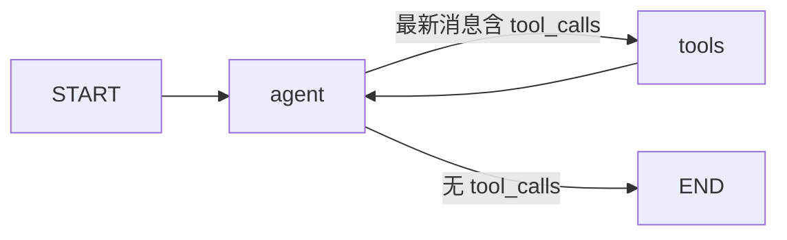
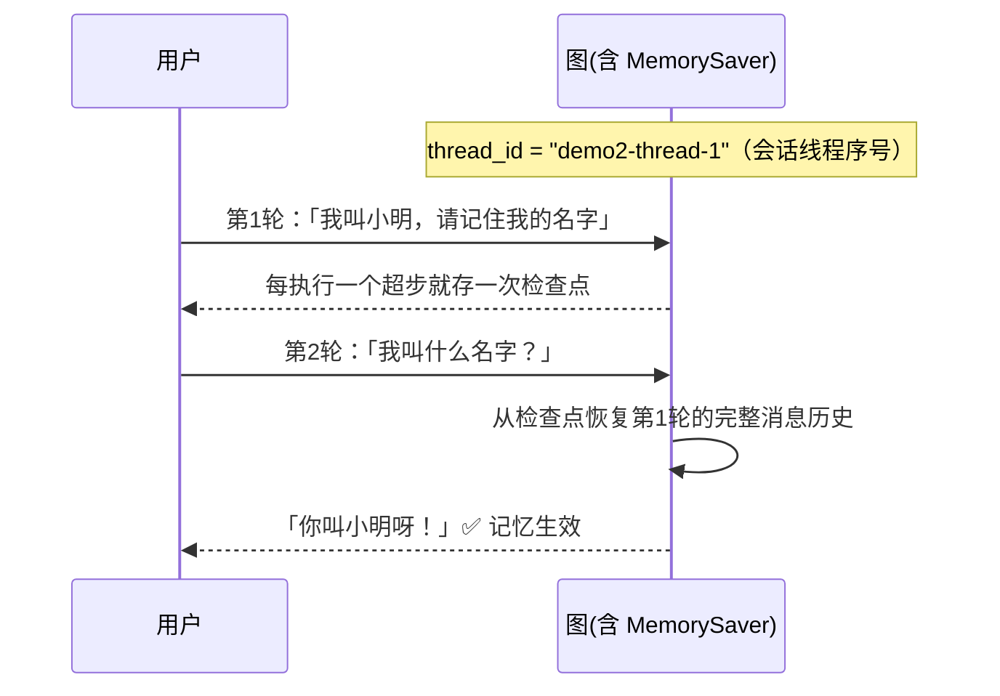
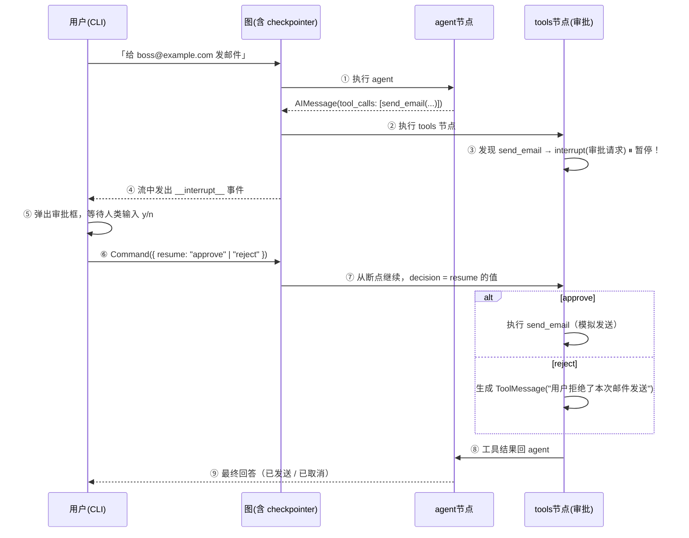
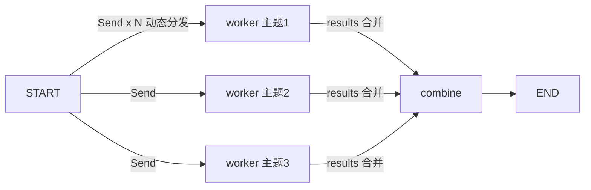

# 🤖 agentatlas 工程 Wiki

> 基于 `D:\code\agent` 的 agentatlas 项目编写。目标：读完这份文档，你能看懂本项目的 LangGraph.js 编排，
> 并能从零搭出自己的 Agent。
>
> 配套阅读：代码里每个文件都有详细中文注释，建议「文档 + 源码 + 运行观察」三者对照学习。
>
> 端到端运行时编排（请求 → 选图 → 工具 / 审批 → SSE → 压缩）见
> [agent-orchestration.md](agent-orchestration.md)。

后续 Hook、电脑操作、岗位获取与简历投递的规划见 [agentatlas-roadmap.md](agentatlas-roadmap.md)。

***

## 目录

1. [一分钟总览](#1-一分钟总览)
2. [核心概念（配代码实例）](#2-核心概念配代码实例)
3. [模块功能详解](#3-模块功能详解)
4. [调用链分析（5 个 Demo 的完整执行流程）](#4-调用链分析5-个-demo-的完整执行流程)
5. [使用方法](#5-使用方法)
6. [从 Demo 到自己搭建 Agent](#6-从-demo-到自己搭建-agent)
7. [常见坑与排查](#7-常见坑与排查)
8. [概念速查表](#8-概念速查表)
9. [架构治理与生产化计划](#9-架构治理与生产化计划)

***

## 1. 一分钟总览

### 1.1 这是什么

一个用 **LangGraph.js（v1.4.9）+ TypeScript** 搭建、正在持续完善自托管能力的 **Agent Web 应用**，
同时内置 **5 个学习示例**作为「事例选择」：
新建对话默认使用**通用 Agent**（`src/agent/general.ts`：需求理解 → 澄清 →
ReAct 工具循环 + 多轮记忆 + 高风险审批 + 结果反思 + 📎 文件上下文，按产品逻辑组装）；
示例则刻意保持教学形态，用于观察特定图结构的运行方式。

| 类型 | 文件 | 概念 | 一句话说明 |
|------|------|------|-----------|
| 通用 Agent | `src/agent/general.ts` | 产品化组合（默认） | 需求理解 / 澄清 + ReAct + 记忆 + 审批 + 反思 |
| Agent profile | `src/agent/profile.ts` | 能力边界 | 工具 allowlist、审批策略、会话 kind → profile 派生 |
| 共享编排 | `src/agent/workflow.ts` | 图内前置/后置节点 | `analyze → clarify? → agent ⇄ tools → review` |
| 1 | `src/agent/basic.ts` | State / Node / Edge / 条件边 / 工具循环 | 亲手搭一张最基础的 ReAct 图 |
| 2 | `src/agent/memory.ts` | Checkpointer / thread_id | 给同一张图加上多轮记忆 |
| 3 | `src/agent/hitl.ts` | interrupt / Command.resume | 高风险操作（发邮件）执行前人工审批 |
| 4 | `src/agent/multi.ts` | 子图 / Supervisor 路由 | 多个 Agent 组成团队协作 |
| 5 | `src/agent/parallel.ts` | Send / 自定义 State / reducer | 并行 map-reduce：动态分发、汇聚结果 |

> 示例 1~4 同时出现在 Web 界面与 CLI 中；示例 5 目前仅 CLI（`npm run demo:5`）。

### 1.2 项目结构

```
<项目根目录>\
├── .env / .env.example   # 网关配置（baseURL / API_KEY / MODEL），.env 已 gitignore
├── package.json          # npm scripts：web / desktop / demo:1~5 / models / start / typecheck
├── tsconfig.json         # ES2022 / NodeNext / strict
├── README.md             # 快速开始
├── docs/agent-wiki.md    # 本文件
├── scripts/
│   └── list-models.ts    # npm run models：查询网关支持的模型列表
├── Dockerfile / docker-compose*.yml # 单实例容器部署（/data 数据卷，§3.19）
├── desktop/
│   ├── main.ts           # Electron 主进程：子进程托管 Web 服务 + 窗口加载（§3.14）
│   ├── startup.ts        # 端口选择、就绪探测与页面加载重试（可独立单测）
│   ├── preload.ts        # 渲染进程最小桥，构建时编成 preload.cjs
│   └── build/            # 构建产物（npm run build:desktop 生成，gitignore）
└── src/
    ├── config.ts         # 统一读取 .env 配置
    ├── product.ts        # 产品名与对外客户端身份（UA / MCP clientInfo）
    ├── llm.ts            # 模型工厂：多协议（OpenAI/Responses/Anthropic/Gemini）接入任意网关
    ├── reasoning-passthrough.ts # 思考型网关的 reasoning_content 回传（§3.42）
    ├── tools.ts          # 4 个自定义工具（zod 定义参数）
    ├── tools-rag.ts      # retrieve_docs：外部 RAG 知识检索工具（§3.13）
    ├── workflow-plan.ts  # 自主执行流程领域状态与规划提示词（§3.53）
    ├── tools-plan.ts     # update_workflow_plan 内部受控工具（§3.53）
    ├── tools-job.ts      # 求职岗位工具：job_collect / job_query / job_enrich / job_summary / job_diagnose（§3.47）
    ├── memory/           # 长期记忆领域层：Provider / Slot / local store / search / import-export（§3.26）
    ├── memory-store.ts   # 旧 API 兼容门面，内部委托 Memory Slot
    ├── agent/            # profile + 共享工作流 + 通用/房产/求职 Agent + 5 个示例的图定义
    ├── routing/          # 多 Agent 路由决策层：规则 / 向量 / 决策模型 / 守卫（§3.45，默认关闭）
    ├── cli.ts            # CLI 入口：交互菜单 + token 流式 + 节点日志 + 审批交互
    └── server/           # Web 界面（参考 ZCode 聊天 UI）
        ├── index.ts      # node:http 服务：静态页面 + SSE 接口 + 探针 + 信号处理
        ├── job.ts / job-browser.ts / job-model.ts / job-workbook.ts # 求职 Agent 编排、采集、规则与 XLSX（§3.47）
        ├── job-selectors.json / job-selectors.ts / job-dom.ts      # 选择器候选链、本地覆盖、结构推断（§3.47）
        ├── job-cards.ts / job-health.ts / job-diagnose.ts           # 卡片解析、健康分级与站点诊断（§3.47）
        ├── health.ts     # /healthz 存活 + /readyz 就绪探针（§3.19）
        ├── lifecycle.ts  # 在途请求统计 + 优雅退出（§3.19）
        ├── parent-watchdog.ts # 桌面端父进程消失后自动退出（§3.14）
        ├── logging.ts    # 结构化日志（stdout JSON + 密钥打码 + LOG_LEVEL）
        ├── stream.ts     # LangGraph 原始流事件 → 前端友好事件（token/工具卡/审批）的翻译层
        ├── mock.ts       # 未配置 API_KEY 时的模拟模型（事件协议与真实图一致）
        ├── sessions.ts   # 内存会话存储（每会话一张图 + 绑定 thread_id）
        ├── settings.ts   # 多供应商管理（增/删/改/切换 + context_length 缓存）
        ├── projects.ts   # 项目文件夹（本地目录 / 云端 Git 仓库 clone + 会话分组）
        ├── files.ts      # 文件上下文（项目/远程文件夹/本地上传，路径授权防穿越）
        ├── rag.ts        # 外部 RAG 接入：契约客户端 + 入库/检索 + 登记表（§3.13）
        ├── memory-http.ts # Generic / Hindsight HTTP Memory Provider
        ├── memory-distillation.ts # 对话结束后的自动记忆沉淀
        ├── memory-maintenance.ts # TTL 后台维护
        ├── memory-observability.ts # 记忆指标 sink
        ├── events.ts     # SSE 事件协议定义
        └── public/       # ★ 前端构建产物（tsc 编译 src/client/**.ts，gitignore）
  client/               # 前端源码（TypeScript）：main + core/modules/render/stream/views/actions
```

### 1.3 运行方式（3 秒上手）

```bash
npm run web           # 打开 Web 聊天界面（http://localhost:3000，推荐）
docker compose up -d --build   # 或容器部署（先设 AUTH_TOKEN，见 docs/deployment.md）
npm run desktop       # Electron 桌面端（原生窗口，端口 3123）
npm run demo:1        # 运行 Demo 1（带默认示例问题）
npx tsx src/cli.ts 1 "你的自定义问题"   # 带自定义问题
npx tsx src/cli.ts 5 "咖啡, 露营, 极光" # Demo 5 自定义主题列表
npm start             # 弹出菜单选择 Demo
```

***

## 2. 核心概念（配代码实例）

> 这是整个 wiki 最重要的一节。LangGraph 的全部概念只有 8 个，用「搭积木」理解：
> **状态**是数据，**节点**是处理步骤，**边**是连接，**工具**是模型的手脚，
> **检查点**是记忆，**interrupt** 是刹车，**子图**是乐高积木，**Send** 是并行分叉。

### 2.1 State（状态）—— 节点之间传递的数据

**一句话**：图每次执行时，在各个节点之间传递的一个数据对象。节点只能返回「对状态的修改」，由 reducer 合并进状态。

```ts
// src/agent/basic.ts
import { MessagesAnnotation } from "@langchain/langgraph";

async function agentNode(state: typeof MessagesAnnotation.State) {
  const response = await model.invoke(state.messages); // 读取当前状态
  return { messages: [response] };                      // 返回状态修改
}
```

- 这里用的是官方预置的 `MessagesAnnotation`：里面只有 `messages` 一个字段（消息列表）。
- 返回 `{ messages: [response] }` 不是「覆盖」，而是「追加」——因为 `messages` 自带追加型 reducer。
- 自定义状态用 `Annotation` 声明，例如：`{ steps: Annotation<number> }`、`{ notes: Annotation<string>({ reducer: (a,b)=>b }) }`。

### 2.2 Node（节点）—— 一个处理步骤

**一句话**：节点就是「输入 state，输出 state 修改」的 async 函数。模型调用、工具执行、业务逻辑都可以是节点。

```ts
async function agentNode(state) {
  return { messages: [await model.invoke(state.messages)] };  // 让模型思考
}

async function toolsNode(state) {
  // 执行模型要求的工具调用
  return { messages: toolResults };
}
```

### 2.3 Edge（边）与 Conditional Edge（条件边）

**一句话**：边决定执行顺序。普通边无条件直达；条件边是一个「看当前状态决定去哪」的函数。

```ts
graph
  .addEdge(START, "agent")                      // 静态边：从起点无条件到 agent
  .addEdge("tools", "agent")                    // 静态边：工具执行完必须回到 agent
  .addConditionalEdges("agent", toolsCondition) // 条件边：看 agent 的输出决定下一步
```

`toolsCondition` 是官方预置的路由函数，逻辑就是：

```ts
function toolsCondition(state) {
  const last = state.messages.at(-1);
  return last?.tool_calls?.length ? "tools" : END;  // 有工具调用→去执行；否则→结束
}
```

**这就是 ReAct 循环的核心**：agent 思考 → 要调工具就去 tools → 拿到结果回 agent → 再思考……直到不再调工具，直接给最终回答。

### 2.4 ToolNode 与工具（Tool）

**一句话**：工具是给模型「调用」的普通函数；`ToolNode` 是官方预置的「执行工具」节点，会把模型请求的工具挨个执行，结果转成 `ToolMessage` 追加进消息历史。

```ts
// src/tools.ts —— 用 zod 声明参数，模型才能知道怎么调用
export const calculator = tool(
  async ({ expression }) => `计算结果：${expression} = ...`,
  {
    name: "calculator",
    description: "计算数学表达式，支持 + - * / 和括号",
    schema: z.object({ expression: z.string() }),   // ← 参数 schema 是关键
  }
);

// src/agent/basic.ts —— 两个关键动作：
const model = createChatModel().bindTools(tools);   // ① 把工具「绑」到模型上
.addNode("tools", new ToolNode(tools))              // ② 用 ToolNode 执行工具
```

### 2.5 Checkpointer（检查点）—— 记忆

**一句话**：`compile({ checkpointer })` 之后，图每执行完一个超步就把状态存一份快照；同一 `thread_id` 的多次调用共享这些快照，于是 Agent「记住了」之前的对话。

```ts
// src/agent/memory.ts —— 和 basic.ts 的唯一区别：
import { MemorySaver } from "@langchain/langgraph";

const checkpointer = new MemorySaver();            // 内存版（进程退出即忘）
graph.compile({ checkpointer });

// 调用时带上 thread_id（会话线程序号）
await graph.invoke(input, { configurable: { thread_id: "demo2-thread-1" } });
await graph.invoke(input, { configurable: { thread_id: "demo2-thread-1" } }); // 同线程序号 → 有记忆
```

### 2.6 interrupt / Command —— 人工介入（刹车）

**一句话**：`interrupt()` 在节点内部「暂停」图的执行，把状态和请求原样抛给外部（如 CLI）；外部人类做出决定后，用 `Command({ resume: 决定 })` 把决定「喂」回暂停处，图从断点继续。

```ts
// src/agent/hitl.ts —— 执行高风险工具前暂停
const decision = interrupt<"approve" | "reject">({
  type: "approval",
  toolName: call.name,
  description: `向 ${call.args.to} 发送邮件...`,
});
// decision 就是外部通过 Command({ resume }) 传回的值

// 外部恢复（src/cli.ts）
await graph.invoke(new Command({ resume: decision }), { configurable: { thread_id } });
```

需求澄清复用同一机制，只是载荷与恢复值不同（`src/agent/workflow.ts`）：

```ts
// 一张卡可打包多道题（最多 4 道）：缺多项信息时一次问完，比来回追问四轮体验好得多
const choice = interrupt<ClarificationRequest, string>({
  type: "clarification",
  questions: [{
    id: "q1",
    question: "先看哪个城市？",
    options: [{ id: "A", label: "北京" }, { id: "B", label: "上海" }],
    allowCustom: true,
  }],
});
```

> ⚠️ interrupt 依赖 checkpointer 保存「暂停时的状态」，所以 HITL 必须配 checkpointer。

### 2.7 Subgraph（子图）—— 乐高积木

**一句话**：一张编译好的图可以直接当成另一个图的「节点」用。多个 Agent 各是一张子图，由主管图编排，就是多 Agent 协作。

```ts
// src/agent/multi.ts —— 每个员工是一张独立编译好的图
const researcherGraph = new StateGraph(MessagesAnnotation)
  .addNode("agent", researcherAgentNode)
  .addNode("tools", new ToolNode(researchTools))
  ...编译...

// 主管图把子图当节点注册
new StateGraph(MessagesAnnotation)
  .addNode("supervisor", supervisorNode)
  .addNode("researcher", researcherGraph)   // ← 子图就是普通节点
  ...
```

> 注意：子图与父图用同一个 `MessagesAnnotation` 时，**状态天然互通**——子图往 `messages` 里追加的内容，父图直接能看到。

### 2.8 Send（动态分发）与自定义 State / Reducer —— 并行 map-reduce

**一句话**：条件边的路由函数除了返回节点名，还可以返回 `new Send("节点", 私有输入)` 的数组——有几个元素就并行执行几个该节点实例；配合自定义 State 的 reducer（合并规则），实现 fan-out（分发）→ fan-in（汇聚）的 map-reduce 模式。

```ts
// src/agent/parallel.ts —— 自定义 State：完全不用 MessagesAnnotation！
const ParallelState = Annotation.Root({
  subjects: Annotation<string[]>({ reducer: (_o, n) => n }),      // 覆盖式
  results: Annotation<string[]>({                                  // ★ 追加式：
    reducer: (old, updated) => old.concat(updated),                //   并行 worker 各写一条，
    default: () => [],                                             //   reducer 自动合并 → fan-in
  }),
});

// worker 收到的不是整个 State，而是 Send 发来的「私有输入」{ subject }
async function workerNode(input: { subject: string }) {
  return { results: [`「${input.subject}」：${await makeSlogan(input.subject)}`] };
}

// 分发函数：返回 Send[] = 动态 fan-out（有 3 个主题就并行跑 3 个 worker）
function dispatch(state) {
  return state.subjects.map((subject) => new Send("worker", { subject }));
}

graph
  .addConditionalEdges(START, dispatch)  // START 也能接条件边做分发
  .addEdge("worker", "combine")          // 所有 worker 完成后自动进入 combine（超步屏障）
```

**关键认知**：
- reducer 是并行安全的唯一正确姿势——并行节点**永远不要直接覆盖**共享字段，只返回增量，让 reducer 合并；
- fan-in 不需要手写「等待逻辑」：LangGraph 的超步（superstep）屏障保证 combine 一定在全部 worker 完成后才执行；
- Demo 1~4 的条件边返回的是「节点名字符串」，一次只去一个地方；Send 返回的是「任务包」，同一节点可同时跑 N 份。

***

## 3. 模块功能详解

### 3.1 `src/config.ts` — 配置管理

**职责**：从 `.env` 读取网关的三件套 `BASE_URL` / `API_KEY` / `MODEL`（外加协议与思考等级），集中管理，全局唯一配置入口。

```ts
export const config = {
  baseURL: process.env.BASE_URL ?? "https://tokenrhythm.studio/v1",
  apiKey: process.env.API_KEY ?? "",
  model: process.env.MODEL ?? "deepseek-v4-flash",
  protocol: process.env.AI_PROTOCOL ?? "openai",   // openai / openai-responses / anthropic / gemini
  reasoning: { dialect: "auto", level: "default" }, // 思考等级：方言 + 档位（见 5.4.1）
};
export function assertConfig(): void { /* 缺 Key 时打印提示并退出 */ }
```

**为什么独立成模块**：换供应商/模型只改 `.env`（Web 端则写 `.web-config.json` 覆盖），
所有业务代码零改动（这是「配置与逻辑分离」的示范）。注意 `config` **不是常量**：
Web 设置页切换「供应商 × 模型」时会实时改写它，建图时（`llm.ts`）读到的永远是当前值。

### 3.2 `src/llm.ts` + `src/reasoning.ts` — 模型工厂与思考等级适配

**职责**：唯一创建 Chat 模型的地方，同时负责把「思考等级」翻译成各协议认识的字段。

```ts
new ChatOpenAI({
  model: config.model,
  apiKey: config.apiKey,
  temperature,                       // 0 = 尽量确定性输出
  maxRetries: 2,                     // 网关偶发 503，让 SDK 自动重试
  modelKwargs: { reasoning_effort: "high" },   // ★ 思考档位原样进请求体
  configuration: { baseURL: config.baseURL },  // ★ 接入任意 OpenAI 兼容网关
});
```

**关键点**：

- `configuration.baseURL` 指向任意 OpenAI Chat Completions 兼容地址（中转站、vLLM、
  Ollama 的 OpenAI 兼容层都行），不需要供应商专属 SDK；
- 四种协议（openai / openai-responses / anthropic / gemini）在这里分派到对应的
  LangChain 客户端，图代码（`agent/*.ts`）完全不感知差异；
- **思考等级的分离设计**：`reasoning.ts` 只描述「某家供应商怎么划分思考等级」
  （方言 → 档位 → 归一化参数），`llm.ts` 只负责「归一化参数 → 客户端字段」。
  想接入新供应商，在 `reasoning.ts` 里加一个方言即可，其余代码零改动；
- **会话级传输头**：`createChatModel(temperature, { sessionId })` 支持传稳定
  会话 ID。对 `opencode.ai` 网关自动发送 `x-opencode-session` 与项目 User-Agent；
  Web 端传 `Session.threadId`，配置重建和重启恢复保持不变，`/compact` 后切换新线程。
  注意 LangChain 会覆盖自定义 `User-Agent`，所以实现里在最终 fetch 边界再次写入，
  回归测试见 `tests/unit/llm-transport.test.ts`。

### 3.3 `src/tools.ts` — 工具库

**职责**：定义 4 个工具，示范工具的四种形态：

| 工具               | 参数                   | 形态示范                         |
| ---------------- | -------------------- | ---------------------------- |
| `calculator`     | `expression: string` | 纯函数工具（正则白名单 + Function 安全求值） |
| `getCurrentTime` | 无参数                  | 空 schema `z.object({})` 的工具  |
| `getWeather`     | `city: string`       | 模拟外部 API（真实项目换成天气服务调用）       |
| `sendEmail`      | `to/subject/body`    | 「高风险操作」，在 Demo 3 中需要审批       |

同时导出：

- `demoTools`：工具数组，方便一次性绑定；
- `toolsByName`：`name → 工具` 的映射，Demo 3 手动执行工具时按名字查找。

### 3.4 `src/agent/basic.ts` — Demo 1：亲手搭 ReAct 图

**职责**：不借助 prebuilt 的 `createReactAgent`，用最原始的 API 搭出「思考 → 工具 → 思考」循环，是理解一切的基础。

```ts
export function createBasicGraph() {
  return new StateGraph(MessagesAnnotation)
    .addNode("agent", agentNode)                    // ① 思考节点
    .addNode("tools", new ToolNode(tools))          // ② 工具节点
    .addEdge(START, "agent")                        // ③ 从哪开始
    .addConditionalEdges("agent", toolsCondition)   // ④ 要不要调工具？
    .addEdge("tools", "agent")                      // ⑤ 调完必须回来继续想
    .compile();                                     // ⑥ 编译后才能调用
}
```

### 3.5 `src/agent/memory.ts` — Demo 2：加记忆

**职责**：与 basic.ts 图结构**完全相同**，唯一区别是 `compile({ checkpointer })`。一个词：`compile` 时多传一个参数。用来对比「有/无记忆」的行为差异。

### 3.6 `src/agent/hitl.ts` — 审批工具节点工厂 + Demo 3

**职责**：`createApprovalToolsNode({ tools, approvalDescriptions })` 在 tools 节点里手动实现
工具执行循环，遇到当前 profile 登记的高风险工具就 `interrupt()` 暂停；Demo 3 用
`demoApprovals` 只审批 `send_email`。

```ts
const toolsNode = createApprovalToolsNode({
  tools,                       // 当前图允许的全部工具（fail-closed allowlist）
  approvalDescriptions,        // 当前 profile 的高风险工具 → 审批文案
});

// tools 节点内部：
for (const call of lastMessage.tool_calls ?? []) {
  const toolFn = toolMap.get(call.name);
  if (!toolFn) {
    // 跨域 / 伪造调用：返回 ToolMessage，不执行、不中断
    continue;
  }
  if (approvalDescriptions[call.name]) {
    const decision = interrupt({ type: "approval", toolName, description, args });
  }
  // approve → 执行；reject → 生成拒绝结果
}
```

对外还导出：

- `ApprovalRequest`（interrupt 载荷的类型，CLI 据此渲染审批框）；
- `buildResumeCommand(decision)` → `new Command({ resume: decision })`。

### 3.7 `src/agent/multi.ts` — Demo 4：Supervisor 团队

**职责**：主管 + 两个员工（研究员、作家），员工各是一张子图。主管用「虚拟工具」`delegate` 做决策——模型发出 `delegate(member: "researcher")` 就路由到研究员，不再分派就 END。

```ts
async function routeFromSupervisor(state) {
  const call = state.messages.at(-1)?.tool_calls?.[0];
  if (call?.name === "delegate") return call.args.member;  // 路由到对应员工
  return END;                                               // 任务完成，收工
}
```

**设计亮点**：`delegate` 工具永远不会真正执行（没有对应的 tools 节点），它的作用只是「让模型用工具调用的形式表达分派意图」，条件边拦截后直接路由。

### 3.8 `src/agent/parallel.ts` — Demo 5：并行 map-reduce

**职责**：输入一组主题，为每个主题**并行**调用一次模型生成宣传语（map），全部完成后由汇总节点整合成一段文案（reduce）。是全项目唯一**不用 MessagesAnnotation** 的图。

三个教学点：
- `Annotation.Root` 自定义 State 字段与各自的 reducer（覆盖式 / 追加式）；
- 条件边返回 `Send[]`（而非节点名）实现动态 fan-out，worker 收到的是「私有输入」；
- `addEdge("worker", "combine")` 的 fan-in 由超步屏障自动保证，无需手写等待。

另导出 `parseSubjects()`：解析用户传入的逗号分隔主题列表（默认「人工智能, 量子计算, 航天探索」，上限 6 个防滥用）。

### 3.9 `src/cli.ts` — 统一入口（怎么把图「用起来」）

**职责**：菜单选择、token 级流式输出、逐节点可视化日志、人工审批交互。对学习最重要的四个机制：

1. **双模式流式观察**（Demo 1~4）：`graph.stream(input, { streamMode: ["updates", "messages"] })` 同时订阅两种粒度——`messages` 是 token 级增量（思考过程灰色逐字显示 + 回答打字机效果），`updates` 是节点级更新（`🔧 工具请求` / `📦 工具返回`）。CLI 会跳过 updates 里的 AI 正文，避免与 token 流重复。
2. **子图回显去重**：子图完成事件会把整个消息历史回显一遍，CLI 按「消息 id 去重」只打印真正新增的消息（`collectUpdateLines`）。
3. **审批交互**：`streamGraph` 检测到 `__interrupt__` 事件就返回暂停信息，`demo3` 弹审批框，用户回答后用 `Command({ resume })` 继续。
4. **Demo 5 故意不开 token 流式**：多个并行 worker 的 token 会交错输出，用「节点完成」视角反而更能看清并行结构（这本身就是个流式并发的教学点）。

另外 `LineReader` 类处理了「管道输入（`echo ... | npm run demo:2`）」场景，EOF 时优雅退出。

### 3.10 `scripts/list-models.ts` — 查模型

**职责**：请求 `{BASE_URL}/models`，打印网关全部模型（上下文长度、是否支持工具/推理、价格），并校验 `.env` 里的 MODEL 是否在列表内。**这是排查「HTTP 400 无响应体」的第一工具**。

### 3.11 `package.json` — 命令总览

| 命令 | 作用 |
|------|------|
| `npm run web` | 启动 Web 聊天界面（http://localhost:3000） |
| `npm run desktop` | Electron 桌面端（原生窗口托管 Web 服务，端口 3123） |
| `npm run demo:1` ~ `demo:5` | CLI 运行对应示例（1~4 带 token 流式输出） |
| `npx tsx src/cli.ts N "参数"` | 带自定义问题/主题运行（N=1~5） |
| `npm start` | 交互菜单 |
| `npm run models` | 查询网关模型列表 |
| `npm run typecheck` | TypeScript 类型检查（tsc --noEmit） |

> 用 `tsx` 直接运行 TS，不需要编译步骤；`tsconfig.json` 保持 `noEmit`，类型检查单独跑。

### 3.12 `src/server/` — Web 聊天界面（参考 ZCode）

**职责**：给 4 个 Demo 套上一个 ZCode 风格的聊天界面 —— 流式回答、工具调用卡片、
Human-in-the-loop 审批按钮、多会话侧栏。**零前端框架、零打包器**（TypeScript 经 tsc
一比一编译成浏览器原生 ESM + SSE），
服务端也只用 `node:http`，不引入 Express。

**工具调用卡片**（app.js `mountToolCard` / `groupToolCallsIfNeeded`）：每次调用先按事件顺序
生成内联卡片，标题直接显示工具名、参数首行和运行状态。某个 `tools` 节点前紧邻的工具卡
达到 3 个才折叠进该批次的「🔧 tools」分组；1–2 个保持平铺。分组摘要必须列出工具名与重复
次数（如 `list_dir ×3 · read_file`），不能只显示“N 个工具调用”而隐藏具体内容；展开后卡片
仍按原顺序可见。流式与 journal 历史回放共用同一条 `mountPart` 挂载路径。

```
浏览器 (public/)                       服务端 (index.ts)
┌─────────────────────────┐   POST /api/chat   ┌──────────────────────────┐
│ main.ts ── fetch SSE ──▶│ ── graph.stream ──▶│ 4 个 Demo 的图（agent/）  │
│  ▸ 渲染 AgentEvent      │ ◀── data: {...} ── │          or               │
│  ▸ 流式 Markdown        │     (SSE 事件帧)    │ mock.ts（无 KEY 时）      │
│  ▸ 工具卡 / 审批按钮    │                    └──────────────────────────┘
└─────────────────────────┘
```

关键设计（详见各文件头注释）：

- **服务端结构（Phase 3 拆分）**：`index.ts` 只负责 server 创建、认证/同源/安全头、
  静态分发兜底、**集中路径 dispatch**、404/500 与启动加载；请求体读取与 413 排水收在
  `http-body.ts`，静态文件收在 `static.ts`，各业务域 handler 收在 `routes/*.ts`
  （chat / config / sessions / external / projects / files / rag / estate）。
  新增接口照 §6 检查单插一条 `if` 分支，不要往 index.ts 里堆业务；
- **前端结构（TypeScript 化，无打包器）**：源码在 `src/client/`，按职责分目录 ——
  `core/`（state 唯一可变状态源、dom、api）、`modules/`（纯函数与协议类型）、
  `render/`（parts 部件 / messages 块）、`stream/`（SSE 消费 / 一轮对话生命周期）、
  `composer/`（输入框菜单）、`views/`（各业务视图）、`actions/`（审批、压缩）。
  `npm run build:client` 用 tsc 输出到 `src/server/public/`（构建产物 gitignore）。
  前端可引第三方库（图表 / 图标 / 语法高亮 / Markdown），但只接受浏览器可直接加载的
  ESM、许可证宽松、且登记在 `AGENTS.md §2.1`（含实测体积）；禁止 UI 框架与打包器。
  引入方式：esbuild 把库打成自包含 ESM 放 `public/vendor/`，应用代码用 import map
  解析裸名（`chart.js` → `/vendor/chart.js`），tsc 照旧从 `node_modules` 读类型。
  `index.html` 用 `<script type="module">`。`static.ts` 白名单放一层子目录
  （`core/ composer/ render/ stream/ views/ actions/ modules/`，引入图表后加 `vendor/`），
  其余多级路径一律 404（防穿越）；
- **事件翻译层 `stream.ts`**：`streamMode: ["messages","updates"]` 的原始事件形状复杂
  （`[mode, payload]` 元组、子图回显整段历史），统一翻译成归一化的 `AgentEvent`
  （node / reasoning / token / tool_call / tool_result / interrupt / workflow_plan /
  clarification_note / usage / task_usage / ai_message / error）。完整定义见 `server/events.ts`，前端
  `stream/events.ts` 的 switch 尾部有 `never` 断言强制穷尽。
  内容只认 messages 模式，updates 只取「节点名 + interrupt + 兜底消息」，按消息 id 去重；
  默认工作流的 `analyze / clarify / review` 是内部节点，正文 token 与整段消息会被过滤，
  但供应商原生 `reasoning_content` / thinking block 会作为 `reasoning` 事件保留，
  供用户按需展开（见 §3.20）；
  其中 `clarification_note` 只在无头模式出现（§3.43），`task_usage` 每轮一条、
  位于最后一条 `usage` 之后 `done` 之前，是下游 token 统计的权威口径；
- **会话绑定 `sessions.ts`**：每个会话一张图实例，Demo 2/3 的 `thread_id` 绑定会话 id，
  多轮记忆与 interrupt 状态因此得以延续；
- **在线配置 `settings.ts`（多供应商）**：侧栏左下设置页（⚙）可添加任意多个供应商档案
  （名称 + BASE_URL + API Key + 模型）。「模型与供应商」使用主从布局：左栏选供应商，
  右栏显示该供应商的模型、启停和编辑操作；新增与编辑连接使用独立模态，关闭后可立即切换
  供应商，不再用右侧详情的“创建态”覆盖选中态；顶栏 ▾ 仍保留快捷切换。
  配置分三层：`.env` < `.web-config.json`（保存的供应商列表 + activeId，gitignore）< 运行中内存。
  切换/修改启用中的供应商 → 配置版本号 +1，**已有会话在下次发消息时自动重建图**
  （Demo 2/3 的记忆随之重置）；Key 只回传掩码，编辑时留空 = 保持不变；
  旧版单供应商配置文件会自动迁移；首次启动无文件时从 `.env` 播种一个默认档案；
- **模型在建图时创建**：各 agent 图文件的 `createChatModel()` 都在 `createXxxGraph()` 工厂内
  调用（而非模块加载时），这是「改配置能对新会话生效」的前提；
- **模拟模式 `mock.ts`**：未配置 `API_KEY` 时自动接管「模型决策」（脚本编排，工具结果仍真实执行），
  事件协议与真实图完全一致 —— 没有Key 也能完整体验 UI 的大部分交互；
  但 mock 不经过 `workflow.ts`，不会产生需求澄清，也不能恢复澄清；
- **用量与容量条 `stream.ts` / `settings.ts`**：网关返回的 `usage`
  （`usage_metadata`，兼容旧 `tokenUsage` 形状）被翻译成 `usage` 事件 ——
  `input_tokens` ≈ 当时整段对话的上下文大小，`input_token_details.cache_read`
  是提示词缓存命中；前端汇总为输入框上方的「当前会话上下文容量条 + 缓存命中」，命中率统一保留一位小数。
  服务端在每个 `usage` 事件里携带目标模型窗口容量。前端参考 ZCode 的 context meter：
  历史主请求的 `input` used 按会话保留（output 只作明细，不重复计入上下文）；
  分母是窗口扣除输出预留与安全余量后的输入预算；历史投影按 token 预算从新到旧装入，
  不再受固定 32 条 / 48k 字符限制。切换供应商 / 模型时只同步更新预算，
  不清空历史，下一轮 usage 到达后再用真实 token 校正。目标窗口不足时会参考 ZCode
  的切换守门：先压缩当前上下文并保留完整聊天记录，再切换模型。窗口长度优先级：手动设置 →
  网关 `/models` 的 `context_length` → 默认 200k。每个助手回合末尾还展示
  `↑ 输入 · ↓ 输出 · 缓存 N%` 小字。模拟模式下由 `mock.ts`
  合成同协议的假用量（轮次越多上下文越大、命中率递增）；
- **图片与多模态 `files.ts`**：上传/拖拽/粘贴的图片以 dataURL 暂存，
  供应商模型的 `modality: "vision"`（设置里勾选「多模态」）时，
  发送会组装成 OpenAI 兼容的 `image_url` 内容块随消息进入图；
  纯文本模型附加图片会在发送前被 400 拦截并提示改用多模态模型；
- **文件上下文 `files.ts`**：📎 给消息附加文件，三种来源 ——
  ① **项目文件夹**（仓库根，默认授权）；
  ② **远程文件夹**（输入服务器上的绝对路径显式授权后可浏览，⚠ 会把目录暴露给网页端，仅限可信环境）；
  ③ **本地上传**（云端部署时服务器没有用户的本机文件，浏览器选文本文件上传到内存暂存区）。
  前端只传「引用」（路径 / uploadId），内容由服务端在发送时读取并校验
  （授权前缀校验防穿越、二进制拒绝、单文件超长截断），再以
  `--- 附件 N: 名 ---` 边界拼进用户消息，因此 4 个 Demo 的图与 mock 无需任何改动；
- **输入辅助 `composer/menu.ts`**：输入框以「行首或空白后的 `/` / `@`」识别触发器，避免正文邮箱误触。
  `@` 走 `POST /api/fs/search`（`files.ts:searchFiles`，最多 20 条、跳过依赖/密钥文件），
  选中后复用附件 chips，不把路径文本塞进消息；`/` 菜单当前只有「压缩上下文」。
- **上下文压缩 `compaction.ts`**：`POST /api/sessions/:id/compact` 取最近最多 40 轮、
  80k 字符送模型摘要（无 Key / 失败时退回本地摘录），成功后重建图并换新 `threadId`，
  下一轮由 `takeContextSummary()` 一次性注入摘要。外部 Agent、待审批会话拒绝压缩；
  旧 transcript 仍保留用于回放，所以 UI 会额外显示一张“压缩摘要”提示卡。
  compact 结果同时写 journal（新 `threadId`、摘要、前后字符数、最后覆盖轮次）；摘要注入后
  写 `contextInjected`，重启恢复不会重复注入，也不会退回已删除的旧线程。
- **项目文件夹 `projects.ts`**：参考 ZCode 的「项目 ▾」—— 侧栏可选项目，
  会话按项目分组、新建对话归属当前项目。项目分两类并用样式区分：
  **💻 本地**（服务器磁盘目录）与 **☁️ 云端**（Git 仓库地址，添加时
  `git clone --depth 1` 到 `.setting/cloud/` 缓存并注册为可浏览根，
  菜单里 ⟳ = `git pull`，删除 = 撤销授权并清缓存，其会话归入「未归属」）。
  本地目录通过系统目录选择框取得绝对路径：Electron 走主进程 `dialog.showOpenDialog`，
  Web 模式走本机服务端 `POST /api/projects/pick-directory`；无桌面会话时才显式降级为手动路径。
  菜单额外提供「不选择项目」：侧栏只展示内部 `default` 的未归属会话，新会话也不会继承
  上一次选中的项目；映射集中在 `client/modules/project-view.ts`，避免筛选和创建语义漂移。
  列表持久化在 `.web-config.json` 的 `projects/activeProjectId` 字段，
  启动时校验目录仍在才恢复；项目列表为空时，首屏与「新建对话」直接进入主区
  Agent 选择页，通用 / 房产 Agent 固定排在示例前，旧未归属会话仍可从侧栏恢复；
- **审批 / 澄清交互**：`interrupt` 事件（`approval` 或 `clarification` 载荷）→
  前端渲染批准/拒绝或选项/自定义输入 → `POST /api/resume`（`{decision}` 或 `{choice}`）→
  服务端 `Command({ resume })` 继续被暂停的图（与 CLI 的 Demo 3 同一条路径）。
  resume 轮在 `turnHistory` 标记 `continuation`，前端复用原助手块；
  `modules/chat-flow.js` 同时迁移旧缓存里的连续助手块，保证一个用户回合只有一个头像。
  审批完成后卡片默认折叠为「工具名 + 已批准/已拒绝」摘要行，点击可展开；
  审批参数使用 `overflow-wrap:anywhere`，超长命令 / URL / JSON 不会撑破容器；
- **多协议模型工厂 `llm.ts`**：供应商档案带 `protocol` 字段（openai / openai-responses /
  anthropic / gemini），`createChatModel` 据此返回 `ChatOpenAI(useResponsesApi)` /
  `ChatAnthropic` / `ChatGoogleGenerativeAI` —— 四个客户端都是 LangChain
  `BaseChatModel`，图的代码不感知协议差异。注意思考型模型（deepseek-flash 等）：
  Anthropic 系流式用量分散在 message_start / message_delta 两个分片（首片 output=0、
  末片 input=0），`stream.ts` 按节点累积合并；员工汇报须以 ToolMessage 写回（见 multi.ts），
  否则「最后一条 assistant 消息缺 reasoning_content」会被网关 400。
- **外部 Agent 接入 `external.ts`**：在「新建对话」弹窗粘贴一个 Git 仓库地址即可把
  第三方 agent 工具（如 deepseek-harness）接入工作台 —— 服务端 clone 到
  `.setting/agents/`，按 **`agent.json` 清单 → package.json bin/main → 常见入口文件**
  的顺序自动识别启动方式（识别不出就手填一条命令），注册为会话类型 `external`。
  该类会话不走 LangGraph：每条消息启动一次子进程（`{{prompt}}` 占位符替换或 stdin
  传 `{"message":…}`），stdout 按块转成 `token` 事件复用同一条 SSE 通道，
  非 0 退出展示 stderr 尾部；180s 超时，「停止」= kill 子进程。
  `passCredentials: true` 才把网关配置注入子进程环境（默认不传）。
  ⚠ 接入即运行第三方代码，只加可信仓库。注册表持久化在 `.web-config.json`
  的 `externalAgents` 字段（经 `config-store.ts` 与 providers/projects 合并写入，
  修复了此前保存供应商会抹掉项目列表的隐患）。

### 3.13 `src/server/rag.ts` + `src/tools-rag.ts` — 外部 RAG 知识库

**设计立场**：agentatlas 不内置向量库、不算 embedding —— 检索与入库全部委托一个
**外部 RAG 服务**（其内部通常是向量库 + OpenAI 兼容 /embeddings）。本侧只有
一个 HTTP 客户端（`rag.ts`）＋ 一个工具（`tools-rag.ts`）＋ 面板 UI，接入即插即拔。

**通用 HTTP 契约**（外部服务按此实现，字段名宽松解析：hits/results、text/content 都认）：

```txt
POST {RAG_URL}/ingest  {collection, documents:[{id,name,text,meta}]}  → 切块+embedding+入库
POST {RAG_URL}/search  {collection, query, topK}                      → {hits:[{text,score,name?}]}
POST {RAG_URL}/reset   {collection}                                   → 清空集合
POST {RAG_URL}/delete  {collection, ids}                              → 可选，删单个文档
Header: Authorization: Bearer <key>（可留空）
```

**数据流（两层入口、两层出口）**：
- 入库①：侧栏「📚 知识库」面板选项目/文件夹「全量入库」——`ingestFolder`
  扫描授权目录的文本文件（白名单扩展名；跳过 dotfiles / `*lock*` / 二进制；
  ≤300 文件、单文件 300k 字符、每请求 ≤10 文档且 ≤600k 字符分批）；
- 入库②：`/api/chat` 处理消息时把 📎 **文本附件自动顺手入库**
  （`ingestChatAttachments`，best-effort：失败只 warn，绝不影响对话）；
- 出口①：通用 Agent 的 `retrieve_docs` 工具 —— 调 `searchRag`，返回
  `{query, hits:[{name,text,score,source}], excerpt, note}` JSON（模型读全文，
  前端按同一 JSON 渲染「命中来源」卡片；未配置 / 服务挂了 → 友好错误 JSON，
  不抛异常不炸对话轮）；
- 出口②：面板上的检索测试框。

**关键实现点**：
- 配置 + 花名册持久化在 `.web-config.json` 的 `rag` 键
  （`{baseURL, apiKey, collection, topK, docs:{id→{name,bytes,at,source}}}`）——
  docs 只是「我们送进去过什么」的本地登记，真实索引在外部服务；
- `loadRag` 支持惰性自动加载（`ensureLoaded`）：任何进程内入口（含一次性脚本）
  都不必依赖服务启动时的显式加载；
- *实战坑*：`getRagPublic` 改成 async 后，路由内所有调用点都要 `await`，
  否则 `JSON.stringify(Promise)` 得到 `{}`（注册表一度「凭空消失/翻倍」）。

### 3.14 `desktop/main.ts` + `desktop/startup.ts` — Electron 桌面端

**策略**：桌面端 = 原生窗口 + 托管已有 Web 服务，前后端逻辑零改动。

**源码与产物**：源码是 TypeScript（`main.ts` + `startup.ts` + `preload.ts`），`npm run build:desktop`
编译到 `desktop/build/`（gitignore）。主进程编成 ESM 的 `main.js`（`package.json` 是
`"type":"module"`）；preload 因 sandbox 只支持 CommonJS，单独用 `module: CommonJS`
再编一轮并改名 `preload.cjs`。构建末尾自检 `main.js`、`startup.js`、`preload.cjs` 都在，缺一个就失败退出 ——
缺 `preload.cjs` 时桌面端白屏且 `window.desktop` 失效，而进程本身不报错。

- 启动：首选 3123（与 `npm run web` 的 3000 互不打架）；若被孤儿进程占用，
  先用真实 bind 探测顺延到下一可用端口；再直接用 Electron 自带 Node 执行本地 tsx CLI，
  去掉 npx→cmd 中间层；子进程同时收到 `ELECTRON_PARENT_PID`，用于父进程消失自检；
- 就绪探测：轮询 `GET /api/config`，仅 2xx 算就绪（≤90s）；探测期间子进程退出会立即失败；
- 窗口：服务就绪后创建 BrowserWindow，`loadURL` 对瞬时断连做有限退避重试，成功后才显示；外部链接
  `setWindowOpenHandler` 交给系统浏览器；
- 退出：`window-all-closed` → **同步等待** `taskkill /pid <pid> /T /F` 完成，
  杀干净 Electron-as-Node→tsx 子进程树；Web 服务另带父进程看门狗，主进程被系统直接
  终止时也会在 1.5 秒内优雅退出，不依赖 Electron 是否来得及执行 `before-quit`；
- 单实例锁：二次启动 `requestSingleInstanceLock` 失败即退出并聚焦已有窗口；
- **无白标题栏**：Windows 以 `titleBarStyle:"hidden" + titleBarOverlay` 隐藏系统标题栏，
  右上角三枚窗口控制键由原生绘制、颜色跟随应用深浅主题 —— 链路是
  `preload.cjs` 暴露 `window.desktop.setOverlayTheme(dark)` → ipcMain 调
  `win.setTitleBarOverlay`；前端 `body.in-desktop` 标记驱动 CSS：
  `#topbar` 设为 `-webkit-app-region:drag`（窗口拖拽/双击最大化），右上 padding 152px
  给原生控制键让位，顶栏内按钮一律 `no-drag`。浏览器直接访问 `npm run web` 无标记、零影响。

---

### 3.15 `src/server/estate*.ts` + `src/tools-estate.ts` + `src/agent/estate.ts` — 房产 Agent（贝壳官方 AI，插件入口：设置 → 插件 → CLI，可启停）

**设计立场**：贝壳能力由官方 `beike` CLI（LianjiaTech/beike-ai-platform）提供，
工作台只做「子进程包装 + JSON 解析 + 错误兜底 + 工具 schema」；(indexPath) 不引入贝壳私有
协议 / npm SDK —— CLI 是官方唯一承诺稳定的接口。

**四段结构**：

| 文件 | 职责 | 关键设计 |
|---|---|---|
| `server/estate-result.ts` | 富结果归一化 | 从贝壳 detail / material 的文本块中提取 `楼栋经纬度` / `小区经纬度`、`小区名称`、别名与 https 图片 URL（楼栋可用时优先，隐私隐藏时退回小区中心点），输出稳定 `location{lat,lng,embedUrl,links}` / `images[]` 契约；坐标按国内常见的「经度,纬度」解析并校验范围，原始 `data` 仍保留给模型，归一字段只用于可靠渲染 |
| `server/estate.ts` | CLI 客户端 | `runBeikeThrottled`（全局并发 1、相邻启动 ≥1.5s，覆盖 analyze / 业务查询）→ `runBeikeRaw`（spawn，90s 超时，BEIKE_SOURCE 透传宿主真实来源（缺省 unknown））→ `parseBeikeJson`（优先整体 JSON.parse，坏了取最外层大括号）→ `BeikeOutcome{ok,action,data?,raw?,error?,stopAgent?}`；`invalid cli request` / 401 等认证失败会触发登录门禁，只准备静态 `building.ke.com/?action=get-key&source=${BEIKE_LOGIN_SOURCE}` 登录链接；手动入口只在系统默认浏览器打开一次，不执行会自行开页签的 `beike login`，不自动点击、不代扫、不后台换票；回调页由贝壳官方自身处理，用户点击页面 Key 右侧“复制”后回填剪贴板，服务端拒绝 `****` 掩码；`saveBeikeKey` 先跑 doctor，若 doctor 误报则按 CLI 同款请求头调用官方 `/mcp` 的 `tools/list` 做业务复验（`initialize` 不校验业务权限，不能作为放行依据）；凭证文件指纹变化或新 Key 通过校验后自动解禁；连续 2 次认证/业务失败熔断 60 秒；`CLI_UPGRADE_REQUIRED/-32001` **不自动重装**（人工确认 → 面板点「安装 CLI」）；Nominatim geocode 串行队列 ≥1.1s + 内存缓存（遵守 1 req/s） |
| `tools-estate.ts` | 工具 schema | 7 个 zod 工具（`house_search/lookup/market/map/agents/appoint/contact`），`extractListings` 松散键名映射（贝壳返回字段不保证稳定）；`house_lookup(detail/material)` 直接返回归一化后的 `location/images`；`house_map` 接受可选的 `lat/lng`，优先复用贝壳精确坐标而不是重新 geocode；登录失效返回 `{authRequired,loginUrl,loginOpened,stopAgent}`，`workflow.ts` 收到 `stopAgent:true` 后不再回模型重试，而是进入 `stopNotice` 节点生成确定的登录/处理指引；工具卡自动展开并显示「需要登录」 |
| `agent/estate.ts` | 图 | 与 `general.ts` 共用 `workflow.ts`（需求理解 / 澄清 / ReAct / 反思），只换工具与系统提示词 —— 顾问式找房流程（搜索门槛 / resolve 消歧 / 地图与材料作为默认交付 / 精确坐标复用 / 分间面积缺失时标待核实 / 禁编造 ID / 高风险复述 / 口径声明）；前端把地图与户型图聚合为最终结论附件，挂到最后一条回答下方；工具卡与 tools 分组保持折叠，只保留执行轨迹 |

**关键常量**（city 名尽量存表）：`BEIKE_CLI_CONCURRENCY=1`、`BEIKE_CLI_MIN_INTERVAL_MS=1_500`、`BEIKE_BREAKER_FAILURES=2`、`BEIKE_BREAKER_COOLDOWN_MS=60_000`、`BEIKE_RUN_TIMEOUT_MS=90_000`、`BEIKE_MCP_URL=https://building.ke.com/mcp`、`GEOCODE_MIN_INTERVAL_MS=1_100`（1 req/s 限流留余量）、`GEOCODE_MAX_ITEMS=6`、`MAX_RESULT_CHARS=26_000`。贝壳 Key 的保存（Phase 1 重写）：agentatlas 直接写官方凭证文件 `~/.beike/BEIKE_MCP_API_KEY`（0o600），再跑 `beike doctor`（免费、只探 /mcp 工具清单不耗模型配额）判定「Key 有效」，新 Key 先暂存并跑 doctor，失败时恢复旧凭证，回显一律经 `redactSecret` 首尾保留 4 位掩码 —— **Key 不再进 argv**（进程列表可被同机其它用户读到）。登录只访问 HTTPS + `building.ke.com` 精确 host；一次点击只打开一次系统浏览器，不做自动点击、轮询或代填登录票据。

**子进程边界（T1-4）**：`runBeikeRaw` 已改走 `subprocess.ts runControlled` —— stdout 头部
4MB、stderr 尾部 64KB、超时/中止树杀；安装链路（T1-6）把 Node `win32/x64` 映射为官方 manifest 的 `windows/amd64`，并逐跳校验 GitHub Release 重定向；只信任 HTTPS host 白名单，下载
缓冲溢出即拒，校验 sha256 后经 `.part` 临时名原子改名，tar 用 `%WINDIR%\System32\tar.exe`
绝对路径；安装动作写审计（URL/version/sha256）。

**高风险操作**：`house_appoint`（预约带看）、`house_contact`（加微信）已登记 hitl.ts 的
`APPROVAL_TOOLS` —— 它们会把真实请求发给贝壳侧的真实经纪人，必须人工批准后执行。

**结论附件**：`client/modules/conclusion-media.ts` 只做纯数据聚合（详情地图优先、点位与图片去重），`client/render/conclusion-media.ts` 在最终文本落盘后挂载地图和图片；流式途中、后续工具调用或回答被重写时自动撤下旧附件。工具组不再因为 `estate-rich` 自动展开。

**契约外发现**：贝壳返回字段名不固定（`priceTitle/price/bodyPrice…`），所以工具侧一律
松散解析再归一；CLI 输出虽是单行 JSON，中文在某些版本带 BOM/转义差异，解析失败时会把
原始 stdout 尾部 500 字符放进 `error` 便于排查。详情中的楼栋经纬度可能因隐私被隐藏，但
小区经纬度通常仍可用；这时必须使用小区坐标出图并明确粒度，不能退化成“地图未定位”。

---

### 3.16 `src/server/{auth,http-guard,subprocess,audit}.ts` — Phase 1 安全与运行基建

| 文件 | 职责 | 关键设计（踩过的坑在 §7.3） |
|---|---|---|
| `auth.ts` | Bearer 认证 | 惰性读 env（防 ESM 早求值）；token 比 sha256 摘要 + `timingSafeEqual`（防时序侧信道）；401 统一文案 + `Connection: close` |
| `http-guard.ts` | 请求层防线 | `checkSameOrigin`（`Sec-Fetch-Site: cross-site` / `Origin` 不符 → 403，即使带令牌也拒——防恶意页面借浏览器自动携带凭证）；`SECURITY_HEADERS`（nosniff / no-referrer / X-Frame-Options / CSP）；`shedRequestBodyAfterResponse` 拒绝路径排水（**空 body 的 GET 不能 destroy**，会在响应 flush 前带 RST） |
| `subprocess.ts` | 受控运行器 | `runControlled` 统一 stdin/超时/abort/输出上限（stdout 头部 4MB、stderr 尾部 64KB、超限树杀），`killProcessTree`（win32 `taskkill /T /F`、unix detached 组杀）；`realRunner` 可替换 → 测试不碰真进程 |
| `audit.ts` | 审计日志 | `writeAudit(ev, detail)` fire-and-forget 自吞异常；append-only NDJSON 到 `.setting/audit.ndjson`；`AUDIT_MAX_BYTES=1MB` 超限尾部截断重写；事件族：`external.*`、`beike.*`、`browser.opened/closed/idleClosed/requestBlocked` |

**external.ts 配套**（Phase 1 硬化）：启动命令进入 `EXTERNAL_COMMAND_ALLOWLIST`（node /
npm / npx / pnpm / pnpx / yarn / python* 裸名）或必须 resolve 在该 Agent 的 clone 目录内；
同并发上限 `MAX_CONCURRENT_EXTERNAL_RUNS=2`；`passCredentials`（把网关 Key 注入子进程环境）
默认关闭，开启必须带 `confirmCredentials:true` —— 前端右键卡片二次确认。全部注册/变更/
运行事件走 audit.ts。

---

### 3.17 `src/server/{config-store,session-store,limits}.ts` — Phase 2 本地可靠性基建

| 文件 | 职责 | 关键设计 |
|---|---|---|
| `config-store.ts` | `.web-config.json` 原子存储 | 写入「`.tmp` + fsync + rename」（Windows rename 抖动重试一次）；`.bak` 滚动备份 + 启动自动抢救（双坏降级 `{}` 不崩服务）；跨进程文件锁 `.web-config.lock`（O_EXCL 创建，**存活判断只能靠时间戳** —— `process.kill(pid,0)` 在 Windows 对在在/否/无权限一律 EPERM，纯 pid 探测不可靠）；`schemaVersion=2` 注入向后兼容 |
| `session-store.ts` | 会话 journal | append-only NDJSON `.setting/sessions.ndjson`（gitignore）；事件：`session`（upsert，**白名单挑字段**——Session 含编译图/内存结构严禁整只序列化）、`approval`（pending 全量 payload）、`decided`（approve / reject / answered，一次性转移）、`delete`、`turn`（user + events）；坏行跳过告警；`JOURNAL_MAX_BYTES=2MB` 超限快照重写 + 轮转 `.1`；启动 `replaySessions()` 回放进内存 |
| `limits.ts` | 并发/节流闸 | `acquireSessionSlot`（同会话唯一回答流）、`assertChatInterval`（1.5s）、`runWithLimit`（按 key 的全局桶，满即中文报错不排队）；chat/resume 都过槽位闸，贝壳 CLI 过 `ResourceGauge("beike", 1)`，相邻启动至少间隔 1.5 秒 |

**sessions.ts 启动回放配套**（Phase 2）：`restoreSessions()` 把 journal 回放成内存会话
（图按 kind 重建为空态 checkpointer）；`pendingApproval` 仍为 `status=pending` 的会话标
`resumeUnavailable` —— resume 一律 400 中文引导「重新发起」（绝不静默重复执行还能改
世界的操作，也不重放已失效的澄清）；带历史轮次的会话标 `resumeUninjected` —— 首条真图消息前自动注入「最近
12 轮的上文摘录」一次性续命（`buildPrehistoryNote`，纯工具轮跳过，demo1/4 无记忆图不注入）。

**坑（踩过的）**：
- `done` 由 `runGraphEvents` 产出、`streamToClient` finally 再兜底补发；主循环收到
  `done` 时只在**没有新 interrupt** 的情况下清空内存 `pendingApproval`，否则会把
  等待用户恢复的审批/澄清误清掉；
- resume 的 `recordDecision` 只在恢复流没有产生新 interrupt 时调用；正常完成的 done
  会先清内存，onDone 在其后执行，所以不能靠内存状态判断（journal 侧 decided 幂等）。

---

### 3.18 `tests/` + `.github/workflows/ci.yml` — Phase 3 测试与 CI

**设计立场**：只用 Node 内置 `node:test`（零新增测试依赖），`tsx --test` 直跑 TS；
文件分层对应风险面：

| 目录 | 覆盖 |
|---|---|
| `tests/unit/` | 纯函数与内存状态：前端 Markdown/URL 白名单（`modules/format.js`）、`limits.ts` 并发闸、`files.ts` 路径授权/跳目录/二进制、`buildPrehistoryNote` 注入语义、`restoreSessions` 的 pending 恢复语义、`workflow.ts` 澄清/反思图、设置页结构、插件入口、供应商独立弹窗与主从布局（`settings-page.test.ts`）、使用统计双窗口、usage 去重与 M 格式（`settings-page.test.ts` / `stats.test.ts` / `format.test.ts`）、插件类型、启停状态与 profile 工具收敛（`plugin-registry.test.ts` / `plugin-controls.test.ts`）、审批恢复单头像与长命令换行、思考过程默认折叠、工具调用按批次阈值折叠（`chat-flow.test.ts`）、OpenCode 会话传输头（`llm-transport.test.ts`）、`stream.ts` 内部节点正文过滤与 reasoning 提取、审批/自主权限矩阵与风险审查器（`permission.test.ts` / `tool-risk.test.ts` / `tool-isolation.test.ts`）、日志打码/级别、lifecycle 退出状态机、子进程超时/输出上限 |
| `tests/integration/` | 起临时服务端（mock 模式）：healthz/readyz 形状、`X-Request-Id`、config、会话创建、chat SSE、transcript 回放、审批 pending/恢复、`resume` 错误路径、`/compact`、文件搜索、404/400、静态页面与 ESM 模块 MIME |
| `tests/security/` | 跨站 POST 403、malformed JSON 400、请求体超限 413、Bearer 认证 401、探针免认证、静态目录穿越 |
| `tests/helpers/server.ts` | 临时服务端托管：系统分配端口、`API_KEY=""` 强制 mock、`SESSIONS_FILE` / `WEB_CONFIG_FILE` / `AUDIT_FILE` 指向临时目录（**不碰真实 journal、配置与审计**）、`LOG_LEVEL=error` 降噪、`taskkill /T` 杀进程树（Linux 自动退回 `proc.kill()`） |

```bash
npm test        # tsx --test --test-concurrency=1 tests/...（串行，避免多服务抢资源）
```

**CI（`.github/workflows/ci.yml`）**：push/PR 到 main 时跑 `npm ci` → `npm run typecheck`
→ 构建产物校验（前端 + 桌面端）→ `npm test`；
`npm audit` 作为 advisory（continue-on-error，
不阻塞合并）。CI 不读真实 `.env`（测试侧强制 mock + 临时配置）。

**测试钩子（生产默认行为不变）**：
- `SESSIONS_FILE`：覆盖 journal 路径（`session-store.ts` 模块加载时读取）；
- `WEB_CONFIG_FILE`：覆盖 `.web-config.json` 路径（`config-store.ts`）；
- `AUDIT_FILE`：覆盖审计文件路径（`audit.ts`，Phase 4 补）；
- 三者都是「设了才生效」的环境变量，供 e2e 隔离数据；正常启动不设置即走仓库默认路径。

---

### 3.19 `health.ts` + `lifecycle.ts` + `logging.ts` + Docker — Phase 4 部署与可观测性

**设计立场**：不引入日志/部署框架；探针、退出、日志都保持「一个文件一个职责」，
且核心状态机（lifecycle）做成工厂以便离线单测。

| 文件 | 职责 | 关键设计（坑见 §7.3） |
|---|---|---|
| `server/health.ts` | 探针 | `/healthz` 只证明事件循环活着，永远 200；`/readyz` 检查配置目录 + journal 目录可写（`mkdir` + `W_OK`，带 1.5s 超时）且未在关闭中，否则 503；两者免认证，只回 `{ok, version, uptimeSeconds, ...}`，不含路径/供应商/Key |
| `server/lifecycle.ts` | 优雅退出 | `createLifecycle()` 工厂：`beginRequest/endRequest` 在途计数、`registerSse` 连接表、`shutdown(deps)` 注入 `closeServer/closeIdle/closeAll/flush/exit`；先给 SSE 写 `shutdown` 帧再 abort；等在途归零（默认 10s）→ flush → 退出码 0/1；重复 shutdown 幂等 |
| `server/logging.ts` | 结构化日志 | stdout 一行 JSON；固定字段 `time/level/event` 放在业务字段**之后**（防覆盖）；`redact` 按字段名打码 + 长文本/数组/深度截断；`LOG_LEVEL` 运行时读取，非法值回退 `info` |
| `server/audit.ts` | 审计增强 | 新增 `AUDIT_FILE` 测试钩子与 `flushAudit()`；认证失败记 `auth_rejected`（只记 requestId/method/path，不带 token）；配置变更（`config.*`）、HITL 决定（`hitl.decided`）、项目授权（`project.authorized`）也落审计，均不带 Key/URL/工具参数 |
| `server/session-store.ts` | journal 增强 | 写入任务进 `pendingWrites`，`flushJournal()` 循环等到清空（flush 期间新产生的写入也能等到） |
| `server/index.ts` | 入口接线 | 每请求 `X-Request-Id`；handler `finally` 统一记 `http_request`（静态 debug、API info，避免 SSE abort 时 `res.close` 抢跑）；关闭中非探针请求回 503；`SIGINT/SIGTERM/SIGBREAK` → lifecycle；`EADDRINUSE` 中文提示 + 退出码 1 |
| `Dockerfile` / compose | 单实例部署 | `node:24.14.0` 固定 digest；builder / production-deps / runtime 三层；非 root `node`；`/data` 统一数据卷；生产 compose 只读根文件系统、`cap_drop: ALL`、`no-new-privileges`、固定 digest、`init: true`、`stop_grace_period: 15s`、内置 healthcheck |
| `docs/deployment.md` | 运维入口 | 快速自托管、上线 checklist、TLS、备份恢复、升级回滚、监控、runbook、故障排查与支持边界 |

**SSE 退出帧**：`AgentEvent` 新增 `{type:"shutdown", message}`；`routes/chat.ts` 把
连接登记进 lifecycle。退出时 lifecycle 直接往 `res` 写一帧再 abort，前端
`stream/events.ts` 的 `handleEvent` 显示顶部常驻提示 —— 客户端能区分「服务重启」与「网络故障」。

**为什么 node 直接作 PID 1**：`npm run web` / npx 包装层不会把 SIGTERM 转发给
node 子进程，容器停止时只能等宽限期结束吃 SIGKILL，journal/audit 可能丢尾部。
Dockerfile 用 `CMD ["node", "--import", "tsx", ...]`，信号直达应用。

**当前边界**：会话、限流闸、SSE 表都在进程内，`data/` 只能给一个实例用；
多副本/共享存储不属于当前支持范围。桌面端仍是开发壳（Windows 退出用 `taskkill /F`，
不触发优雅退出），生产交付以 Web + Docker 为准。

### 3.20 `src/agent/workflow.ts` — 产品默认编排（需求理解 / 澄清 / 反思）

**设计立场**：把「执行前理解、执行后检查」做成图内节点，而不是散落在路由或
prompt 里；`general.ts` / `estate.ts` 各自导出 profile，避免两套编排漂移。

```text
START → analyze → clarify? → agent ⇄ tools → review → END
                         ↑                    │
                         └── 不通过且未修订 ──┘
```

| 节点 | 职责 | 关键约束 |
|---|---|---|
| `analyze` | 判断最新请求是否明确，生成 `requirementBrief` | 坏 JSON / 模型异常默认“明确继续”；只问会实质改变结果的信息；缺多项信息时放进同一个 `questions` 数组一次问完（上限 4 道） |
| `clarify` | `interrupt({ type:"clarification", questions:[{ id, question, options, allowCustom }] })` | 每题 2–4 个互斥选项、选项 id 只在本题内唯一；服务端 `/api/resume {choice}`；单题回传选项 id 由服务端映射成可读标签，多题回传「题面：答案」拼装文本，答案统一写入 `clarificationHistory`；旧单问载荷（顶层 `question`+`options`）由前端归一化兼容 |
| `agent` | 绑定工具的 ReAct 节点 | 通过 `context-builder.ts` 组装稳定 system、内部注记与投影后的消息窗口；工具结果按 profile 预算裁剪 |
| `tools` | 由 `createApprovalToolsNode({ tools, approvalDescriptions })` 创建 | 只执行当前 profile 的工具；跨域调用 fail-closed |
| `review` | 对照需求与最近工具结果，检查最终回答 | 明确失败才回炉，普通模式最多三次（`MAX_REVIEW_REVISIONS`）；坏 JSON 默认通过；连续模式换用「任务完成闸」判据（见下） |

**连续工作模式（请求级 `continuous: true` → 图状态 `continuousMode`）**：产品入口是内置命令 `/goal <任务>`（`client/modules/goal.ts` 纯函数解析；`composer/goal.ts` 把命令转成 **Goal 徽标模式**——textarea 无法局部高亮前缀，徽标承载命令语义、正文只放任务文本，手打前缀经输入事件自动转换，发送层读 `goalDraft` 决定 continuous；标记按会话记在 `state.continuousTurns` 并持久化，普通消息清除、resume 重传以延续超步放宽）。反思不通过就持续回炉，直到反思通过 / 空转熔断 / 请求异常 / 用户中止。四个设计决定：

- 标记在 `analyze` 从请求 `configurable` 读一次后**写入图状态**而不是每次读 config——审批 resume 走同一线程检查点，图状态还在，`/api/resume` 不用重传该标记；
- 回炉上限从 3 放宽到 `MAX_CONTINUOUS_REVISIONS = 1000`（保险丝），真正的防失控机制是**空转熔断**：`review` 记录上次反思时的消息总数（`lastReviewMessageCount`），两次反思之间没有任何新工具消息（`idleReviewRounds`）连续计满 `MAX_IDLE_REVIEW_ROUNDS = 3` 就结束回合——任务真在推进时每轮都有工具结果，计数每轮清零；计数器在 `analyze` 的 fallback 里随新回合归零，防止上一轮的空转计数泄漏到下一轮造成提前熔断；
- 判据切到 `CONTINUOUS_REVIEW_PROMPT`：从「回答是否够好」换成「目标动作是否执行完并验证」，feedback 必须是下一步行动指令而不是文风建议；
- 超步保险丝单独放宽：`stream.ts` 对 `continuous` 请求用 `CONTINUOUS_RECURSION_LIMIT = 20000` 而不是 `AGENT_RECURSION_LIMIT = 1000`——一个回炉周期 ≈ 3-6 超步，小时级任务按 1000 会先撞 GraphRecursionError；`/api/resume` 由前端重传 `continuous` 延续放宽（图状态里的 `continuousMode` 只驱动循环，不决定这个上限）；
- 连续请求在图输入里前置一条 `GOAL_MODE_NOTE` 注记（`routes/chat.ts`）：反思闸会拦「提前收尾」，但第一轮就让模型知道规则能省一次回炉；不改会话权限，高风险操作照常审批。

**关键坑**：

- `analyze` / `clarify` / `review` 的模型输出是内部 JSON，不能进入对话正文；
  `server/stream.ts` 按节点名 `INTERNAL_LLM_NODES` 过滤正文 token 与完整消息，但原生
  `reasoning_content` / thinking block 仍以 `reasoning` 事件保留；改节点名必须同步改过滤集合；
- 思考 content block 必须同时从正文提取里排除（`type=thinking|reasoning`、`thought=true`），
  否则 Anthropic / Gemini 的思考文本会把最终回答污染；前端用原生 `<details>` 默认折叠，
  不设置 `open`，点击 summary 才展开，内容用 `textContent` 防止注入；
- 澄清答案不写入图的 `messages`，而是并入 `requirementBrief` 并保存到
  `clarificationHistory`，供后续轮次的 `analyze` / `agent` 参考；`turnHistory`
  只记一条带括号的审计轮次（回放时可见），不会作为新的用户指令重复喂给模型；
- `reviewFeedback` 只作为下一轮 `agent` 的 system 注记，不写进 `messages`，
  防止内部批评被当成用户可见历史；
- 图状态字段的 reducer 必须兼容 `undefined`，否则中断恢复时旧 checkpoint 缺字段会报错；
- `createWorkflowGraph(profile, models?)` 支持注入 `WorkflowModels`，单测用
  `FakeListChatModel` / 脚本化模型跑通「澄清 → resume → 反思回炉」整图，
  不消耗真实 API。

**当前边界**：只有默认 `agent` 与 `estate` 使用；Demo 1–5、外部 Agent、mock
模式都不经过这张图。mock 不会产生澄清，也不能恢复澄清。

### 3.21 `src/agent/profile.ts` + `approvals.ts` — Agent 能力隔离

**职责**：profile 只描述「这个 Agent 允许什么」，不执行 IO；`workflow.ts` 只消费
profile，不判断具体业务名。

| 字段 | 作用 |
|---|---|
| `id` / `displayName` | `general` / `estate`，用于会话身份与 UI |
| `systemPrompt` | 当前 Agent 的角色与业务规则 |
| `tools` | 唯一执行 allowlist；建图时转成 local `Map`，同名工具直接报错 |
| `approvalDescriptions` | 高风险工具名 → 审批文案；未登记工具直接执行 |
| `analystGuidance` / `reviewerGuidance` | 可选领域规则，追加到 analyze / review prompt |
| `contextPolicy` | 最近消息数与单条工具结果字符预算；general / estate 可不同 |

隔离规则：

- `general`：基础工具 + 开发工具 + `retrieve_docs`；禁止任何 `house_*`；
- `estate`：贝壳工具 + `calculator` / `get_current_time`；禁止开发、RAG、邮件工具；
- 模型伪造跨域 tool call 时，执行节点返回
  `当前 Agent 不支持工具「X」，未执行。`，不执行、不进入审批；
- 会话 `agentProfileId`、每轮 `TurnRecord.agentProfileId`、journal 与
  `hitl.decided` 审计都携带执行域；旧 journal 按 `kind` 派生；
- 未来租房需要 RAG 时，必须显式加入 estate profile，不能从通用注册表隐式获得。

### 3.22 `src/agent/context-builder.ts` — 上下文投影与观测

**设计立场**：prompt 分区、最近消息窗口和工具结果裁剪都做成纯函数，既能单测，
也不会修改 checkpoint / journal 中的原始历史。UI 仍能展示完整工具结果，模型只读预算内投影。

| 能力 | 行为 |
|---|---|
| Prompt 分层 | profile system prompt + 需求 brief / 澄清历史 / 反思反馈的内部 system 注记 |
| 窗口预算 | `src/context-window.ts` 是唯一口径：窗口 → 输出预留 → 安全余量 → 输入预算；不再用固定 48k 字符/32 条消息卡上下文 |
| 最近窗口 | 从最新消息往前按 token 预算装入；`maxRecentMessages` 仅保留极端防线，不会从 ToolMessage 中间切断 tool call/result |
| 工具预算 | `maxToolResultChars`；terminal 优先保留尾部错误，其它工具保留头部 |
| 原文保留 | 只 clone 投影后的 `ToolMessage`，原 checkpoint、transcript 与前端卡片不变 |
| 轮次观测 | `TurnRecord.turnId` 贯穿 journal / transcript；`agent_turn_started/finished` 记录 profile、状态、耗时，debug 级记录 step/tool 开始与结束 |
| 日志隐私 | 结构化日志不记录用户消息、工具参数或完整工具输出，只记 id、名称、状态和计数 |
| 图片投影 | `computer_screenshot` 的多模态内容块（text + image_url）整体保留、不做字符截断 —— 截断 base64 等于毁掉整张图 |

### 3.23 `src/agent/permission.ts` + `src/tools-computer.ts` — 会话权限模式与电脑控制

**permission.ts（纯函数闸门）**：会话级权限模式的单一事实来源，四种裁决 ——
`readonly`（登记审批的工具 = 改世界操作，一律 `deny`）、`approve`（默认，`interrupt` 审批）、
`autonomous`（登记项返回 `assess`，先交给 AI 风险审查）、`auto`（全部 `run`）。判定基准**复用 profile 的 `approvalDescriptions`**，刻意不维护第二份
「只读禁用清单」：会改世界的操作必然登记审批，两份清单迟早漂移。

链路：前端输入框上方 🛡 chip → `POST /api/sessions/:id/permission` →
`Session.permissionMode`（journal `permission` 事件持久化，重启延续；旧 journal 缺字段按
`approve` 兼容）→ `chat.ts` 把它交给 `runGraphEvents` → `graph.stream({ configurable.permission_mode })`
→ LangGraph 把 configurable 透传给节点函数第二参数 → `hitl.ts` 执行节点逐 call 裁决；
`workflow.ts` 的 agent 节点同时把权限说明注入 system 注记（readonly 时明确告诉模型别发起写调用）。
切权限**不需要重建图** —— 全程走 configurable，对下一条消息立即生效。

**tool-risk.ts（自主模式风险评估）**：`createToolRiskAssessor(createChatModel(...))` 为每个
已登记的工具调用发起一次**不绑定工具**的审查模型请求，输入包含工具名、审批描述、参数和
当前用户意图；只接受严格 JSON 的 `{"highRisk":boolean,"reason":"..."}`。明确低风险才直接
执行，高风险则 `interrupt` 并生成审批卡，卡上附 `riskReason`。超时（15s）、异常、坏 JSON、
缺字段一律 fail-closed 按高风险处理。`createWorkflowGraph` 默认创建审查模型，测试可通过
`options.riskAssessor` 注入假评估器。审查调用的 usage 通过 ToolMessage 的隐藏元数据回传到
`stream.ts`，因此会进入统计与上下文计量；节点因 interrupt 恢复而重放时，同 thread + tool call
的风险结果在内存中复用，避免重复调用分类模型和重复计费。

**tools-computer.ts（零依赖 Computer Use，仅 Windows）**：五个工具全部经
`powershell.exe` 调 .NET / user32.dll 实现，不引入 robotjs 类原生依赖：

| 工具 | 实现 | 审批 |
|---|---|---|
| `computer_screenshot` | `CopyFromScreen` + 等比缩到最长边 1280 + JPEG(q72)；多模态模型收到 image_url 内容块 | 直接执行（只读） |
| `computer_click` | `SetCursorPos` + `mouse_event` down/up（双击两次、右键 RIGHTDOWN/UP） | ✅ |
| `computer_type` | 纯 ASCII 走 SendKeys（转义后）；中文等走 `Set-Clipboard` + Ctrl+V（会覆盖剪贴板，描述已注明） | ✅ |
| `computer_key` | 组合键解析成 SendKeys 语法（ctrl `^` / alt `%` / shift `+`；不支持徽标键） | ✅ |
| `computer_scroll` | `mouse_event(0x0800)`，dwData = ±120×行数（P/Invoke 签明 int，负值按补码传） | ✅ |

两个关键实现坑：

- **PS5.1 GBK 控制台**：中文参数内联脚本必乱码。统一 `-EncodedCommand`（脚本 UTF-16LE →
  base64），从根上绕开编码问题，脚本本身保持全英文；
- **多模态工具结果**：LangChain `tool()` 会把非字符串返回值 `JSON.stringify` 成文本，
  图片内容块会因此丢失。`computer_screenshot` 继承 `StructuredTool` 并**覆写 `invoke()`**
  直接返回内容块数组，`hitl.ts` 的 `invokeTool` 对数组原样透传成 `ToolMessage.content`；
  SSE 的 `tool_result` 事件与 journal 回放只取其中的 text 块（`contentText` 拍平），
  base64 不进前端不进 journal。

**插件启停边界（`src/plugin-state.ts` + `server/plugin-settings.ts`）**：设置 → 插件页的五个开关统一写入 `.web-config.json` 的 `plugins.enabled`，`GET /api/plugins` 返回状态、`PATCH /api/plugins/:id` 切换单项。写入失败不改内存状态；切换成功后 `bumpConfigVersion()`，已有会话下一条消息重建图，确保工具 allowlist 与审批表同步收敛。RAG / 贝壳 / 求职默认开启以兼容旧配置，Browser Use / Computer Use 默认关闭；关闭 Browser Use 会同步关闭所有浏览器上下文，非 Windows 平台会直接拒绝启用 Computer Use。关闭后旧图即使仍持有工具引用，工具入口也会 fail-closed，不会触达外部服务、浏览器或 PowerShell。
### 3.24 生产级多 Agent：配置化身份 + 主 Agent 动态赋权

**形态**：子 Agent = 主 Agent 的一次有界委派工具。设置页只管理子代理身份、用途说明、启停和模型，并提供搜索、状态筛选、模型可用性与启停状态聚合；
每次调用 `delegate_agent({ agent, task, prompt, tools })` 时，主 Agent 必须显式赋予专项提示词和工具子集。

```text
设置 → 子代理
  ├─ id / 名称 / 用途说明 / 启停
  └─ 模型：inherit 当前主对话 或 fixed(providerId, modelId)

主 Agent workflow
  └─ delegate_agent
       ├─ 权限四档裁决（委派本身是审批项）
       ├─ 校验启停、模型可用性、工具是否在安全目录
       ├─ 组装一次性子 Profile：prompt + selected tools + approvals
       ├─ 独立 threadId / MemorySaver 跑同一 workflow 子图
       └─ 返回 text / model / durationMs / toolsUsed / usage，ToolMessage 回填主会话
```

| 约束 | 实现 |
|---|---|
| 模型 | 默认继承当前主对话「供应商 × 模型」；固定模型必须真实存在，失效时 fail-closed |
| 提示词 | 不写死在配置页；由主 Agent 每次传入 `prompt` |
| 工具 | 由主 Agent 从 `delegation-catalog.ts` 选择；未知、停用或不安全工具拒绝 |
| 深度 | `delegate_agent` 永不进入工具目录，子 Profile 再剔除一次，最大深度固定 1 |
| 记忆 | `memory_save` / `memory_recall` 不可委派，长期记忆由主 Agent 收口 |
| 审批 | 默认模式先展示子代理、任务、工具列表和提示词摘要；批准后子代理在独立上下文自动执行已授权工具 |
| 取消 | 父请求 `AbortSignal` 透传到子图模型与工具调用，没有 180s 等业务级硬超时 |
| 隔离 | 子图消息、threadId、MemorySaver 全部独立；父子对话历史不互相灌入 |
| 观测 | 委派卡展示实际模型、耗时、toolsUsed、可用 usage；子 Agent 内部 token 仍不实时流向主 SSE |

配置持久化在 `.web-config.json` 的 `subagents`；CRUD 由 `server/subagent-settings.ts` 串行写盘并写审计。
`GET /api/subagents`、`POST /api/subagents`、`PATCH/DELETE /api/subagents/:id` 驱动设置页。
配置变更后 `bumpConfigVersion()`，已有会话下一条消息重建图，主 Agent 看到的子代理目录与工具目录同步更新。

实现注意：

- 模型工厂使用冻结快照（`model-runtime.ts`），并发子代理固定不同供应商时不会改写全局 `config`；
- 设置页只允许 `inherit` / `fixed` 两种模式，固定模型在供应商/模型被删除后显示「不可用」；
- 同一轮多个可直通委派仍由 tools 节点 `Promise.all` 并发，审批类保持一次一张卡；
- 子代理没有实时人工交互，澄清请求会转成可重试错误，不能静默挂死。

### 3.25 `src/checkpoint.ts` — 持久化检查点（重启不丢模型记忆）

**问题**：产品图原先每图自建 `MemorySaver` —— 进程一停，thread 的多轮上下文就没了；
journal 只回放出「对话记录」（给人回放），模型记忆降级为摘录注入（最近 12 轮拼接），
长对话重启后体验断崖。这是「实际可用」的第一劝退点。

**方案**：继承官方 `MemorySaver` 做 `PersistentSaver` —— 序列化完全复用父类
`serde`（`dumpsTyped`/`loadsTyped`，消息类 ↔ 字节的兼容由官方包维护），本文件只做
「把已序列化字节 base64 后追加 NDJSON」（`.setting/checkpoints.ndjson`，gitignore；
测试钩子 `CHECKPOINT_FILE` 照抄 `SESSIONS_FILE` 模式）：

| 机制 | 实现 |
|---|---|
| 落盘 | `put`/`putWrites`/`deleteThread` 各自 override：先自序列化 → `super.*` 落内存 → 串行写链（promise 链保行序 = 调用序）追加行；失败自吞只告警（不打断回答流，与 journal 同立场） |
| 回放 | 启动 `ensureCheckpointsLoaded()` 逐行走**同一条** `super.*` 内存路径（含 putWrites 去重语义），状态与原进程严格一致；坏行（硬杀半行）跳过告警 |
| 收敛 | 磁盘 = 调用序日志 + 回放走同一实现 ⇒ 两个进程生命对同一 thread 的状态收敛 |
| 防膨胀 | 删会话 / `/compact` 换线程时 `deleteThread` 落 delete 行；超 24MB 时 `compactNow()` 按行过滤重写：每 (thread, ns) 只留最近 10 个检查点（id 字典序 = 时间序），delete 过的线程整组丢弃。过滤只认本文件行格式，不碰 MemorySaver 内部结构 |

**为什么不引 `@langchain/langgraph-checkpoint-sqlite`**：它带 `better-sqlite3` 原生模块
（Windows / Electron 部署与零依赖红线冲突），而 MemorySaver 内部本来就是 serde 字节三元组
（`storage[thread][ns][id] = [ckptBytes, metaBytes, parentId]`）——「文件镜像」这个装饰器
把自实现的序列化/并发两大风险全部消掉了，约 250 行零依赖解决。

**接入点与语义变化**：

- `createWorkflowGraph(profile, models?, { checkpointer })` 默认挂共享 `getCheckpointSaver()`
  单例；`subagent.ts` 显式传自建 `MemorySaver`（一次性执行不落盘）；demo 2/3 教学形态不变；
- `restoreSessions()`：`saver.hasThread(threadId)` 判定 —— 有检查点的会话不再注入
  journal 摘录（同一历史不进两遍上下文），无检查点的（旧数据/demo/mock 轮）维持摘录降级；
- **改配置不再失忆**：`rebuildIfStale` 重建图共享同一 saver，记忆保留在原线程；
  同一供应商内切换模型同样 bump 配置版本，旧会话下一条消息换新模型但不换 thread；
  唯一例外是「挂着未决审批时重建」—— 删持久线程（interrupt 残留不可与新输入续用，
  等价旧行为）；
- 审批中断态跨重启：检查点层已具备恢复数据（checkpoint + writes 都在盘上），
  但上层维持「明确拒绝重复执行」（§3.17 T2-3 策略），后续再评估放开。

**踩坑**：默认文件路径是「模块文件位置回退到仓库根」—— `checkpoint.ts` 在 `src/` 顶层
只回退一层，`session-store.ts` 在 `src/server/` 要回退两层；照抄时多退了一层，
文件悄悄写去了 `src/.setting/`（服务照常工作，极难察觉）。相对仓库根定位一律以
**本文件自身位置**起算。

### 3.26 `src/memory/*` + `src/tools-memory.ts` — 生产级长期记忆

**问题**：checkpoint 只解决同一会话连续性；用户偏好、项目事实和纠错需要跨会话保存。旧本地实现虽已 scope 隔离，但仍是单 JSON 全量重写，缺少自动沉淀、语义召回、TTL 与大规模存储。

**分层**：

```text
Agent / tools / routes
        │
        ▼
memory/slot.ts（统一门面：能力、降级、注入预算、指标）
        │
        ├── providers/local.ts（默认）
        │      ├── local-store.ts（内存索引、串行变更、保留策略）
        │      ├── local-events.ts（manifest / scope 事件 / 快照代际）
        │      ├── local-search.ts（确定性词法排序）
        │      └── lifecycle.ts（TTL / stale / archive）
        ├── semantic.ts + vector-index.ts（可选 Embedding / RRF）
        └── server/memory-http.ts（Generic / Hindsight）
```

| 层 | 关键约束 |
|---|---|
| `src/memory/provider.ts` | 纯领域契约；记录含状态、类别、置信度、TTL、来源与替代关系 |
| `src/memory/scope.ts` | `general` / `estate` / `job` 强隔离；工具闭包注入 scope，模型不能自选 |
| `src/memory/providers/local-events.ts` | `.setting/memory-store` v3；scope 分目录追加事件；压缩生成新快照并原子切 manifest |
| `src/memory/providers/local-store.ts` | v1/v2 → v3 迁移；损坏 manifest fail-closed；单进程串行变更；active/history 按 scope 限额 |
| `src/memory/lifecycle.ts` | active 到期转 stale；宽限期后 archived；candidate 不注入 |
| `src/memory/semantic.ts` | OpenAI 兼容 `/embeddings`；词法 + 向量 RRF；超时 / 坏响应 / 维度不符自动降级 |
| `src/server/memory-distillation.ts` | 对话成功后异步自动沉淀；smart 只自动激活高置信非身份项；HTTP Provider 跳过 |
| `src/tools-memory.ts` | 模型仍只见 `memory_save` / `memory_recall`，不能传 scope |
| `src/agent/workflow.ts` | 每轮注入个性化上下文，并按最后用户消息召回当前 profile 的 active 记忆；动态注记不写 checkpoint |

**v3 存储**：

```text
.setting/memory-store/
  manifest.json
  scopes/local--general/snapshot-*.json
  scopes/local--general/events-*.ndjson
  scopes/local--general/index/vectors.json
```

- 变更先 append 事件，达到 500 条阈值或关停冲刷时生成新快照代际。
- manifest 最后原子切换；崩溃前保留旧视图，崩溃后最多留下可回收孤儿文件。
- usage 命中只在内存累计，1 秒合并后随快照落盘，避免每轮重写。
- 旧 `memories.json` 迁移后保留 `.v2-backup`，迁移失败不删除原文件。
- 5 万条基准（10k active + 40k history）：写入约 1s、恢复约 0.7s、词法检索均值约 32ms（Windows 本机实测）。

**自动沉淀与生命周期**：

- `off` / `confirm` / `smart`；默认 smart，但每轮仅处理明确记忆信号。
- 每轮最多 3 条、每小时 20 条；secret 永久拒绝，PII 默认拒绝，identity 永远人工确认。
- candidate 可确认或拒绝；确认同主题时旧 active 转 superseded 并记录 `replacedBy`。
- 偏好 / 项目事实 / 纠错 / 身份分别 180 / 120 / 365 / 365 天到期；stale 默认 30 天后归档。
- 读取时和 6 小时后台维护都会推进状态。

**Agent 边界**：

- general 挂 `memory_save` / `memory_recall`，使用 `general` scope。
- estate / job 默认不挂记忆工具；自动沉淀仍只能写各自 scope。
- 子 Agent 继续剔除记忆工具。
- 外部 HTTP Provider 不参与自动沉淀，除非未来具备统一 candidate / confirm 契约。

**API 与设置页**：

- `GET /api/memories`、`DELETE /api/memories/:id`、导出 / 导入；手动 `POST /api/memories` 已移除。
- `GET /api/memories/candidates`、`POST /api/memories/:id/confirm|reject`。
- `POST /api/memory/reindex`、`POST /api/memory/embedding/test`。
- 设置页包含个性化上下文、Provider、HTTP、自动沉淀、生命周期、Embedding、索引状态、候选确认 / 拒绝和条目管理。
- 个性化上下文作为 `memory.personalization` 独立保存，默认启用；正文非空时每轮进入 system 注记，不参与记忆召回、候选或条目列表。
- API Key 只回掩码；空值保留旧 Key，显式清除才删除。

**备份与观测**：

- 备份递归包含 `memory-store/` 全部文件，manifest 记录相对路径、大小、SHA-256 与 schemaVersion=3。
- 指标新增 distillation candidate / auto-saved / model-failed、lifecycle maintenance failed。
- 指标和日志不记录正文、查询词、URL、Authorization 或 Key。
- `/api/diagnostics` 展示 v3 状态；Embedding / HTTP 故障只降级，不影响 `/readyz`。

详细契约见 [`docs/memory-slot.md`](memory-slot.md)。
### 3.27 `src/server/routes/stats.ts` — 使用统计（F2）

**问题**：每轮 usage 事件从第一天起就写进 journal，但原页面只按“最后 30 个出现的日期”
拼条，既没有明确的 7/30 天口径，也没有趋势图。

**链路**：`GET /api/stats` → `buildStats(listSessions(), generatedAt?)` 纯函数聚合内存
turnHistory（journal 回放后同样在内存，重启不丢统计）→ 前端设置页「使用统计」分区渲染。
响应固定包含 `ranges: ["7d", "30d"]`，每个区间都有 `totals / byDay / byModel / byHour / toolCalls / health / topSessions`；
服务端按本地自然日生成完整日桶（含今天），无数据日期补零，时间轴不会因空格而断裂。

**窗口与聚合语义**：7 天 = 今天及之前 6 个自然日；30 天 = 今天及之前 29 个自然日。
`totals` 只统计窗口内轮次和真实模型调用；`sessions` 是窗口内有轮次的去重会话数；
`totals.modelCalls` 与 `byModel.calls` 都按实际 API 调用计，不再按 journal 里的 usage
事件条数计。同一次流式调用会重复产出累计 usage 快照，新事件用稳定的 `usage.callId`
归并并取各 token 字段最终值；旧 journal 没有 callId，则按连续 `model/input/output/cache`
签名去重。`byDay.cacheReadTokens` 单列缓存读取量；`delegate_agent` 的 tool_call 计委派次数。
**落盘口径（P0）**：SSE 仍可逐片推送 usage 以保持界面实时，但 `completeTurnRecord()`
在写 journal 前会按 `callId` 只保留最终快照（旧数据按连续签名）；internal 调用保留用于
成本统计，只从前端上下文容量条排除。轮次的 token/reasoning 相邻分片在 journal 内合并，
reasoning 单轮最多落 20k 字符；超过 3000 事件上限时写 `storage`（原始数、丢弃数、上限、
合并数），不再静默 `slice(-3000)`。

**前端图表**：`views/stats/{index,kpi,charts,tables}.ts` 四模块分工；Chart.js 由
`import("../../vendor/chart.js")` 动态加载，主设置页与核心会话不进入其启动闭包。六张图分别为
每日 Token 混合图、模型占比、模型调用对比、24 小时活动、缓存命中率趋势、工具调用 Top；
每张图有 ResizeObserver、PNG 导出和主题重建。图表库加载失败时用 `toolCalls / byHour / byDay`
数据表降级。`stats-refresh` 使用 8 秒超时与请求序号，防止旧响应覆盖新选择。

**协议改动（§5.3 流程）**：usage 事件带可选 `model` 与 `callId` —— `model` 由 stream.ts
（一次流取一次 `getActiveModelLabel()`）+ mock.ts（固定「模拟模式」）提供；`callId` 在每次
节点切换或工具返回后的新模型请求开始时生成。stats 按 `model ?? "未知模型"` 分桶，并优先按
`callId` 归并同一调用的分片。

### 3.28 会话归档（F3）：导出 / 搜索 / 批量清理

三件事都挂在既有链路上，无新存储：

| 能力 | 实现 |
|---|---|
| 导出 | `GET /api/sessions/:id/export`（routes/sessions.ts）→ Markdown 附件：标题头（kind/创建时间/轮数/权限模式）+ 每轮「用户原话 + 工具调用摘要（结果截 300 字）+ 助手回答」；中文文件名走 RFC 5987（`filename*=UTF-8''…` + ASCII 兜底名） |
| 搜索 | 侧栏搜索框纯前端过滤：标题必查，本浏览器缓存的会话块（state.blocks）参与匹配；没有缓存到的会话按标题兜底 —— 不加后端搜索接口，保持零开销 |
| 批量清理 | `POST /api/sessions/cleanup {daysBefore}`：删除创建超 N 天的会话，内部走 `deleteSession`（journal delete 行 + 持久检查点线程同步清理）+ audit 记条数；路由顺序上必须放在 `sessionMatch` 分支之前（`cleanup` 不能被当成会话 id） |

侧栏会话项的操作按钮统一收进 `.s-actions` 横向 flex 容器，标题与元信息固定预留
56px；导出和删除不再各自 `position:absolute; right:8px`。按钮默认透明但仍保留 Tab
焦点，`:focus-within` 时显形；`hover:none` / `pointer:coarse` 设备常显。

坑：IAB 自动化里 `fill("")` 清空搜索框可能不触发 input 事件（真实键盘退格路径
正常）——自动化清空输入框要用原生 value setter + `InputEvent`，产品代码无此问题。

### 3.29 `src/server/backup.ts` — 数据备份与恢复（F9，可用性主线收尾）

**问题**：journal / 检查点 / 记忆 / 配置散在 `.setting/` 与仓库根
`.web-config.json` —— 换机、误删、升级前没有一键带走全部状态的办法。

**设计**：可检目录快照（`memory-store/` 保真嵌套结构）+ manifest.json：
`.setting/backups/backup-<yyyyMMdd-HHmmss-SSS>/`。

| 机制 | 实现 |
|---|---|
| 备份集 | journal / 持久检查点 / 长期记忆 / 供应商配置 / 审计日志 —— 各 store 导出 path getter（`journalPath` / `checkpointFilePath` / `memoryStoreDir` / `SETTINGS_FILE` / `auditFilePath`），env 钩子隔离后路径随之变化；**不存在的文件不造空文件** |
| 创建 | `createBackup()`：先 flush 全部在途写入（journal / checkpoint / memory usage / audit）再递归拷贝 —— 「恢复前快照」也拿到完整状态 |
| 恢复 | `restoreBackup(name)`：名字白名单 `^backup-\d{8}-\d{6}(-\d+)*$`（纯数字段，天然防路径穿越）→ 先自动快照当前态 → 逐文件 temp+rename 原子写回 → **只动磁盘不动内存单例，必须重启生效**（内存 journal/配置会把旧态写回去） |
| 前端 | 设置页「模型与供应商」底部区块（列表 / 创建 / 恢复按钮 + uiConfirm 重启提示）；audit 记 `backup.created` / `backup.restored` |

**踩坑（实测）**：备份名只到秒 → 「恢复前快照」与原备份同秒同名 → `mkdir
recursive` 不报错，**快照把破坏态覆盖进刚建的备份目录**，恢复出来的就是坏数据
且测试几乎不可能从断言上发现（restored 列表完全正常）。修法：名字带毫秒段 +
`manifest.json` 存在性探测追加序号段。

**安全**：备份含 API Key 明文 —— 目录在 gitignore 内 + README/前端 hint 双重
警示「妥善保管、不要外发」。

---

## 4. 调用链分析（5 个 Demo 的完整执行流程）

> 这一节是「学会了」的关键：把每一轮对话在图里怎么流动看明白。
> 以下时序均来自本项目实测运行日志（缩写展示）。

### 4.1 Demo 1：基础 ReAct 的调用链



**执行步骤**（输入「北京天气 + 计算 (12+7)\*3」）：

```
① START → agent 节点
     model.invoke(历史消息) → 模型决定调用工具
     → AIMessage(tool_calls: [get_weather({city:北京}), calculator({expression:"(12+7)*3"})])

② 条件边 toolsCondition 判断：有 tool_calls → 路由到 "tools"

③ tools 节点（ToolNode）逐个执行：
     get_weather  → ToolMessage("「北京」当前 26°C，晴转多云。")
     calculator   → ToolMessage("计算结果：(12+7)*3 = 57")

④ 静态边 tools → agent：带着工具结果回到 agent 再想一次

⑤ agent 节点再次 invoke：这次看到了工具结果，不再调工具
     → AIMessage(最终回答：北京天气 + 计算结果)

⑥ 条件边：无 tool_calls → END，图结束
```

**实测日志**（`npm run demo:1`）：

```
── 节点执行: agent ──
   🔧 [agent] 模型请求调用工具: get_weather({"city":"北京"}), calculator({"expression":"(12+7)*3"})
── 节点执行: tools ──
   📦 [tools] 工具返回: 「北京」当前 26°C，晴转多云。
   📦 [tools] 工具返回: 计算结果：(12+7)*3 = 57
── 节点执行: agent ──
   🤖 [agent] 两个问题都搞定了：1. 北京天气：26°C 晴转多云。2. 计算：(12+7)*3 = 57
```

**要点**：模型一次可以请求多个工具（并行）；工具结果以 `ToolMessage` 回到消息历史，agent 下一轮才能「看到结果并总结」。这就是 ReAct（Reasoning + Acting）循环。

### 4.2 Demo 2：记忆的调用链

图结构与 Demo 1 相同，区别在「多次调用之间」：



**实测日志**（`npm run demo:2`，两轮对话）：

```
第1轮  🤖 [agent] 好的，小明！我已经记住你的名字了。😊
第2轮  🤖 [agent] 你叫**小明**呀！😄
```

**要点**：LLM 本身无状态。记忆 = 每次执行完把状态（含全部消息）存下来，下次用同一 `thread_id` 时从检查点恢复。换一个 `thread_id` 就是全新会话。

### 4.3 Demo 3：人工审批的调用链



**实测日志**（批准路径，`npm run demo:3`）：

```
── 节点执行: agent ──
   🔧 [agent] 模型请求调用工具: send_email({"to":"boss@example.com","subject":"项目进度汇报",...})
⏸️  图已暂停，等待人工审批（输入 y / 是 批准，n / 否 拒绝）：
  工具: send_email
  请求: 向 boss@example.com 发送邮件，主题「项目进度汇报」
  👤 你的决定: ✅ 批准，继续执行
   🤖 最终回答: 邮件已成功发送 ✅
```

**要点**：

- `interrupt()` 的返回值 = 外部 `Command({ resume: X })` 传回的 X，这是「图内 ↔ 图外」通信的通道；
- interrupt 必须在节点内调用，且必须有 checkpointer（暂停点需要持久化）；
- 拒绝路径同样自然：把「用户拒绝了」作为工具结果消息，agent 会据此给出得体的最终回答——模型不需要知道审批的存在。

### 4.4 Demo 4：Supervisor 多 Agent 的调用链

```mermaid
flowchart LR
  START --> supervisor
  supervisor -->|delegate(member=researcher)| researcher
  supervisor -->|delegate(member=writer)| writer
  supervisor -->|"无 delegate 调用"| END
  researcher --> supervisor
  writer --> supervisor
```

**执行步骤**（任务：「查北京天气，写一首四行诗」）：

```
① supervisor 节点：主管模型绑定「虚拟工具 delegate」
     → delegate({task: "查询北京天气...", member: "researcher"})

② 条件边 routeFromSupervisor：取最新消息的 tool_calls[0]
     → 返回 "researcher" → 路由到研究员子图

③ researcher 子图（自己就是一张 ReAct 图）内部循环：
     agent → get_weather → 工具结果 → 研究总结 → 结束子图
     研究总结写进共享的 messages 状态

④ 静态边 researcher → supervisor：主管看到研究结果，继续决策
     → delegate({task: "写四行诗...", member: "writer"})

⑤ writer 子图执行：无工具的 agent 节点，直接产出诗

⑥ 静态边 writer → supervisor：主管看到诗，认为任务完成
     → 不再调用 delegate → 直接给最终汇总 → 条件边返回 END
```

**实测日志**（`npm run demo:4`，缩写）：

```
── 节点执行: supervisor ──
   🔧 [supervisor] 模型请求调用工具: delegate({task:"查询北京今天（当前）的天气...", member:"researcher"})
── 节点执行: researcher ──
   🔧 [researcher] 模型请求调用工具: get_weather({"city":"北京"})
   📦 [researcher] 工具返回: 「北京」当前 26°C，晴转多云。
   🤖 [researcher] 好的，研究员已查得北京天气信息如下：26°C，晴转多云。...
── 节点执行: writer ──
   🤖 [writer] **《北京晴转多云》** 天光淡去浮云生，暖风拂面过京城。...
✅ Demo 4 完成
```

**要点**：

- 「虚拟工具」路由是 Supervisor 模式的经典实现：不用结构化输出、不用手写分类器，模型天然会用工具调用来表达「把活派给谁」；
- 子图与父图共享 `MessagesAnnotation` → 员工的工作成果自动出现在主管视野里；
- 结束条件写在主管的系统提示里（「任务完成就直接回答，不要再调用 delegate」），条件边据此收工；
- 防死循环：LangGraph 用递归上限保护超步循环；本项目 CLI / Web / 子 Agent 入口统一设为 1000，超限抛 `GraphRecursionError`。

### 4.5 Demo 5：并行 map-reduce 的调用链



**执行步骤**（主题：人工智能 / 量子计算 / 航天探索）：

```
① START 的条件边调用 dispatch(state)
     → 返回 3 个 Send("worker", {subject}) → 动态创建 3 个并行任务

② 3 个 worker 实例同时执行（互不等待）
     每个 worker 只收到自己的私有输入 { subject }，调用模型写一句宣传语
     → 各自返回 { results: ["「主题」：宣传语"] }

③ 超步屏障：3 个 worker 全部完成后，reducer 把三份 results 合并成一个数组

④ combine 节点执行：此时 state.results 已是完整列表
     → 调用模型把 3 条宣传语整合成一段文案 → 写入 state.summary

⑤ END
```

**实测日志**（`npm run demo:5`）：

```
🧪 主题列表: 人工智能、量子计算、航天探索

   ⚙️  [worker] 「量子计算」：量子跃迁，算见未来
   ⚙️  [worker] 「航天探索」：摘一颗星，回应千年的仰望
   ⚙️  [worker] 「人工智能」：以人工，致智能

   📝 [combine] 汇总文案：
从「以人工，致智能」到「量子跃迁，算见未来」，再到「摘一颗星，回应千年的仰望」……

⏱️  总耗时 64.3s（3 个 worker 并行执行）
✅ Demo 5 完成
```

**要点**：
- worker 的完成顺序是乱的（量子计算先回来）——并行执行的真实面貌；
- 每个 worker 只返回增量 `{ results: [一条] }`，靠 reducer 自动合并，**绝不直接覆盖共享字段**；
- combine 不需要任何「等待/计数」逻辑——超步屏障天然保证它看到的是全部结果。


***

## 5. 使用方法

### 5.1 快速开始

```bash
cd D:\code\agent
npm install
cp .env.example .env        # 填入 BASE_URL / API_KEY / MODEL（已填好可用配置）
npm run models              # ① 先确认网关支持的模型（防 400）
npm run demo:1              # ② 跑第一个 Demo
```

### 5.2 交互方式对照

| 想做什么            | 命令                                                |
| --------------- | ------------------------------------------------- |
| 跑 Demo 1 的默认问题  | `npm run demo:1`                                  |
| 跑 Demo 1 的自定义问题 | `npx tsx src/cli.ts 1 "帮我算一下 (5+3)*2"`            |
| Demo 2 / 3 多轮对话 | `npm run demo:2` / `demo:3`（输入 exit/quit/q/退出 结束） |
| Demo 5 自定义主题    | `npx tsx src/cli.ts 5 "咖啡, 露营, 极光"`（逗号/顿号分隔，最多 6 个） |
| 管道批量输入（自动化测试）   | `printf '问题1\n问题2\nexit\n' \| npm run demo:2`     |
| 菜单模式            | `npm start`                                       |
| 查模型             | `npm run models`                                  |
| 类型检查            | `npm run typecheck`                               |

### 5.3 推荐练习问题

| Demo | 练习问题                             | 观察点                          |
| ---- | -------------------------------- | ---------------------------- |
| 1    | 「北京天气怎么样？顺便算 (12+7)\*3」          | 一次请求调用两个工具的并行行为；灰色思考里能看到模型决定并行调用 |
| 1    | 「现在几点了？」                         | 无参数工具                        |
| 1    | 「上海呢？」（不带城市名追问）                  | ⚠️ 无记忆时模型没有上下文               |
| 2    | 先「我叫小明」，再「我叫什么？」                 | 记忆生效的直观证明（思考过程会引用上一轮内容）     |
| 2    | 换 thread\_id 再问                  | 新会话无记忆                       |
| 3    | 「给 <boss@example.com> 发邮件，主题：周报」 | 分别输入 y / n，对比两条路径            |
| 3    | 先拒绝，再问「邮件发出去了吗？」                 | Agent 能理解审批结果并正确回答           |
| 4    | 「查北京天气，写一首四行诗」                   | 主管 → 研究员 → 作家 完整流转；最终思考里能看到主管判断「任务完成、不再分派」 |
| 4    | 「直接写一首关于秋天的诗」                    | 主管直接派给 writer，不经过 researcher |
| 5    | `npx tsx src/cli.ts 5 "奶茶, 吉他, 深夜"` | worker 完成顺序是乱的（并行的真实面貌）      |
| 5    | 把 parallel.ts 的主题改成 6 个再跑          | 观察耗时随并行度变化，而非成倍增长           |

### 5.4 更换供应商 / 模型

两种方式，任选其一：

**① 改 `.env`（CLI 与首次启动的默认值）**：只改三行，业务代码零改动：

```ini
BASE_URL=https://你的网关/v1     # 任意 OpenAI Chat Completions 兼容地址
API_KEY=sk-xxx
MODEL=deepseek-v4-flash          # 必须是 npm run models 列出的 id
```

也支持本地模型：Ollama 开启 OpenAI 兼容层（`http://localhost:11434/v1`）、vLLM、LM Studio 同理。

**② 在 Web 界面里管理（推荐，可挂多个供应商 × 多个模型）**：侧栏左下 ⚙ 设置 → 模型与供应商 →
添加供应商（BASE_URL + Key + 协议）→ 在它的「模型列表」里点「获取列表」把网关返回的模型
逐个加进来（`.web-config.json` 持久化，优先于 `.env`）。

- **一个供应商 = 一套网关凭据**，下面可以挂任意多个模型；每个模型有自己的
  显示名 / 多模态开关 / 上下文窗口 / 思考等级；
- 保存供应商成功后返回 agentatlas；模型上下文窗口等参数在模型行「编辑」里配置，留空自动读网关，未知时默认 200k，
  点「保存模型」后持久化，重新打开设置仍可继续修改；
- **输入框上方的模型 chip 是唯一模型选择器**：按供应商分组列出全部模型，点一行就切换
  （旧版每个供应商只能存一个模型，同一网关的第二个模型没有入口 —— 现在不会了）；
- 切换后**新建会话立即生效**，已有会话在下一条消息时自动切换
  （带 checkpoint 的会话记忆会重置，等价于重启服务）；
- OpenCode Go 的 `x-opencode-session` 由服务端自动注入，同一会话各节点和
  压缩摘要共用 `threadId`，不需要在设置页手工配置请求头。

### 5.4.1 思考等级（reasoning / thinking）怎么设

「让模型想多久」在各家 API 里长得完全不一样，所以本项目把它抽象成
**方言（划分方式）+ 档位**，档位跟着模型保存，顶栏 ▾ 里可以一键切换：

| 方言 | 请求字段 | 档位 |
|---|---|---|
| OpenAI 强度档 | `reasoning_effort` | none / minimal / low / medium / high / xhigh / max |
| 智谱 GLM-5.3 | `reasoning_effort` | low / high / max（不支持关闭） |
| DeepSeek | `reasoning_effort` | none / low / high / max（原生值） |
| Anthropic 预算 | `thinking.budget_tokens` | 2k / 8k / 16k / 32k |
| Anthropic 输出强度 | `output_config.effort` | low / medium / high / xhigh / max |
| Gemini 预算 / 等级 | `thinkingConfig.thinkingBudget` / `thinkingLevel` | 0 / -1 / 1024 / 8192 / 24576；LOW / MEDIUM / HIGH |
| 通义千问 | `enable_thinking` + `thinking_budget` | 开 / 关 / 1k / 8k / 32k |

**实现要点**（`src/reasoning.ts` + `src/llm.ts`）：

- 档位默认是**「供应商默认」= 不发送任何参数**，所以不认识这些字段的中转站不会被塞奇怪参数；
- 方言默认 **auto**：按 BASE_URL 主机、模型名前缀、协议自动推断，设置页会显示推断结果；
- **协议优先**：Anthropic / Gemini 原生接口的思考参数与 OpenAI 系完全不同，
  自动推断会优先落在对应协议自己的方言上；手动配错时设置页给 ⚠ 提示，
  `llm.ts` 做近似换算（`reasoning_effort` ↔ `budget_tokens` / `thinkingLevel`）而不是静默丢弃；
- OpenAI Chat Completions 走 `modelKwargs` 透传（原样进请求体），
  Responses API 转成 `reasoning.effort`，Anthropic / Gemini 走各自客户端的构造参数；
- 想验证某家网关到底认哪些思考参数，写个几十行的探针脚本打几个请求即可
  （本仓库的 `.setting/probe-reasoning-levels.mjs` 就是这样确认 DeepSeek 档位的：
  带 Key 的脚本都放在已 gitignore 的 `.setting/` 下，不进仓库）。

### 5.5 观察与调试技巧

- **看模型思考**：Demo 1~4 的灰色 `💭 思考` 就是 `streamMode: "messages"` 的 `reasoning_content` 增量——你能亲眼看到模型如何决定调用哪个工具、主管何时判断任务完成；
- **看执行流程**：`🔧/📦` 日志即「每节点更新」，等于 `streamMode: "updates"` 的可视化；
- **看原始事件**：临时写 `for await (const ev of await graph.stream(input, { streamMode: ["messages","updates"] })) console.log(ev)`——v1 数组模式输出 `[模式名, 载荷]` 二元组；
- **看状态快照**：`graph.getState({ configurable: { thread_id } })` 可查看检查点里的完整状态；
- **单步调试**：`streamMode: "updates"` 下每个事件就是图的一个超步，和日志一一对应。

***

## 6. 从 Demo 到自己搭建 Agent

> 学习闭环：看懂 4 个 demo 后，按下面的「最小模板 + 扩展路线」搭你自己的 Agent。

### 6.1 最小可用模板（复制即用）

```ts
// my-agent.ts
import { StateGraph, START, END, MessagesAnnotation } from "@langchain/langgraph";
import { ToolNode, toolsCondition } from "@langchain/langgraph/prebuilt";
import { tool } from "@langchain/core/tools";
import { z } from "zod";
import { createChatModel } from "./src/llm.js";   // 复用本项目的模型工厂

// ① 定义你的工具
const myTool = tool(async ({ x }) => `翻倍结果：${x * 2}`, {
  name: "double",
  description: "把数字翻倍",
  schema: z.object({ x: z.number() }),
});

// ② 模型绑定工具
const model = createChatModel().bindTools([myTool]);

// ③ 定义节点
async function agentNode(state: typeof MessagesAnnotation.State) {
  return { messages: [await model.invoke(state.messages)] };
}

// ④ 搭图（和 Demo 1 完全一样的骨架）
export function createMyAgent() {
  return new StateGraph(MessagesAnnotation)
    .addNode("agent", agentNode)
    .addNode("tools", new ToolNode([myTool]))
    .addEdge(START, "agent")
    .addConditionalEdges("agent", toolsCondition)
    .addEdge("tools", "agent")
    .compile();
}

// ⑤ 调用
const result = await createMyAgent().invoke({
  messages: [{ role: "user", content: "把 21 翻倍" }],
});
console.log(result.messages.at(-1).content);
```

### 6.2 扩展路线（对应 5 个 demo）

| 你的需求           | 参考     | 做法                                                                        |
| -------------- | ------ | ------------------------------------------------------------------------- |
| 多轮记忆           | Demo 2 | `compile({ checkpointer: new MemorySaver() })` + 每次调用带同一 `thread_id`      |
| 高风险操作人工把关      | Demo 3 | tools 节点里对特定工具 `interrupt()`，外部 `Command({ resume })`                     |
| 复杂任务拆给多个 Agent | Demo 4 | 每个 Agent 编译成子图，主管图 `addNode` 注册 + 条件边路由                                   |
| 批量子任务并行处理      | Demo 5 | 条件边返回 `Send[]` 分发 + 自定义 State 的追加型 reducer 汇聚                              |
| 换记忆存储          | 查文档    | `SqliteSaver` / `PostgresSaver`（`@langchain/langgraph-checkpoint-*`）实现持久化 |
| 生产级快速搭建        | 查文档    | prebuilt 的 `createReactAgent`（一行搭 ReAct），原理同 Demo 1                       |

### 6.3 设计 Agent 的四步心法

1. **画流程图**：先在纸上画出「状态流转图」，标出每个节点、条件分支；
2. **定状态**：节点之间需要传递什么数据 → 设计 State 字段；
3. **写节点**：每个节点是一个独立函数，只做一件事；
4. **接边**：先接静态边跑通，再加条件边做分支，最后上 checkpointer/interrupt 增强。

***

## 7. 常见坑与排查

### 7.1 网关相关

| 现象                                 | 原因                               | 解决                                    |
| ---------------------------------- | -------------------------------- | ------------------------------------- |
| `HTTP 400` 且无响应体                   | 模型名不在网关支持列表（如 `gpt-4o-mini`）     | `npm run models` 看列表，改 `.env` 的 MODEL |
| `HTTP 503 SERVICE_BUSY`            | 网关并发过高（本项目网关很频繁）                 | 工作流层默认自动重试 10 次；持续失败时检查网关负载 |
| 输出夹杂 `<｜begin▁of▁sentence｜>` 等特殊标记 | deepseek 系模型的 tokenizer 特殊 token | 换 `glm-5` / `kimi-k2.5` 等模型           |
| 多步任务从第 2 次模型调用起必现 `400 The reasoning_content in the thinking mode must be passed back to the API` | `@langchain/openai` 出站序列化丢弃 `additional_kwargs.reasoning_content`（fetch 拦截实测确认） | 已由 `reasoning-passthrough.ts` 在 fetch 层补字段（§3.42）；网关反过来拒绝该字段时自动关闭回传并重试一次 |
| 并发调用时请求恰好在 ~10 秒后返回 400 | 供应商并发闸 `ResourceGauge` 排队超时默认 10s，旧代码又把资源繁忙统一翻成 400 | 已改为 `ResourceBusyError` → **429 + Retry-After**（§3.44）；可用 `MODEL_CONCURRENCY_PER_PROVIDER` / `MODEL_QUEUE_WAIT_MS` 调整 |
| 批量 / 无头调用拿到空回答 | 需求澄清 `interrupt()` 挂起等人工，无人应答即任务被弃 | 请求带 `"headless": true`（§3.43）：自动采用首个候选假设继续，并发出 `clarification_note` 事件 |
| 路由规则在中文请求上几乎从不触发快速路径 | 关键词多为 2–4 字，按 `raw/40` 线性归一化后单次命中只有 0.175 | 改用饱和曲线 `1−e^(−raw/5)`（§3.45）：1 次命中 0.75 交模型层，2 次命中 0.94 直接派发 |
| 用户点一次路由选项，子代理却跑了两次 | `interrupt()` 在 resume 时会让**节点从头重跑**；询问与派发放同一节点就会重复执行 | 拆成 `routeAsk` / `dispatch` 两个节点（§3.45），派发节点里不含任何 `interrupt()` |
| 路由派发绕过了高风险审批 | 程序化派发不经 `delegate_agent`，那条路径的审批不会触发 | 派发只授予**只读工具**（无审批文案者）；写操作由子代理写进「超出范围」，主 Agent 走原审批流程（§3.45） |
| 多配一个子代理后所有请求都变成「不确定」 | 直接用 `p_max` 当置信度，选项越多 `p_max` 越低 | 用按选项数归一化的 `confidence = (k·p_max−1)/(k−1)`（§3.45 守卫 G2） |
| 新建求职会话却变成了通用 Agent | `routes/sessions.ts` 有一份独立的 kind 白名单，漏加新 kind 会被静默降级成 `"agent"` | 新增会话类型时必须同时改 `sessions.ts`、`session-store.ts`（两处各有一份 `SessionKind`）与 `routes/sessions.ts` 的白名单（§3.47） |
| 求职采集能跑但模型说「缺少参数」却给了泛泛的 schema 报错 | zod 把 `city`/`salaryMin` 等设为必填，模型漏传时框架直接抛 `Invalid input: expected number`，模型读不懂 | 关键字段设为 optional，由工具返回「还缺目标岗位方向、期望月薪区间」这类可操作提示（§3.47） |
| 求职 Agent 又要求填写 Skill 根目录/Python | 早期实现把外部 job-hunter CLI 当成产品依赖，Skill 升级、Python 3.10 与 DrissionPage 都会影响可用性 | 执行流程已内化到 `job-browser.ts` / `job-model.ts` / `job-workbook.ts`；设置页只保留浏览器、数据目录和平台登录（§3.47） |
| 智联/BOSS 采集时被 Security Verification 拦住 | 站点对无头浏览器和短时间访问启用人机校验 | 采集默认使用可见浏览器窗口，用户可完成一次验证；导航带随机间隔与冷却，校验页会作为平台警告返回，不伪装成 0 条正常结果 |
| 求职采集后立刻补详情被站点风控 | 采集每个关键词 1-2 次请求，补详情逐条打开岗位页；混跑会突破短时间请求阈值 | `job_collect` 只抓列表；补详情必须单独调 `job_enrich`，两者间隔几分钟（§3.47） |
| 站点改版后采集静默返回 0 条，和真实没岗位/被风控分不清 | 旧适配器把四平台选择器硬编码在各处，容器失效没有统一诊断证据 | `job_diagnose` 按卡片数 + 字段填充率给出 OK/降级/结构变更/被风控；异常时保存 HTML/PNG 快照并推断候选（§3.47） |
| 自动推断的选择器把下次采集改坏 | 推断结果只代表当前页面，盲写会污染长期配置 | 采集只在内存临时覆盖并重试；永久固化必须 `apply=true` 且候选在真实页面 `verified=true`，写前留 `.bak` 并记 `learned`（§3.47） |
| BOSS 诊断偶发显示薪资 0/15、被误判结构变更 | BOSS 虚拟列表周期性重渲染，元素引用等待后失效 | 卡片解析紧跟取元素；页面文案探测用 300ms 短超时；整批薪资为空时重新取卡片解析一次（§3.47） |
| 澄清卡标题紧贴卡片左上角、文字顶着边框 | 澄清卡没套 `.approval-body`（审批卡靠它给内边距），早期版本直接把标题塞进 `.approval-card`，自身又没有 padding | `.clarify-head` / `.clarify-list` / `.clarify-foot` 各自带内边距（§3.48）；`chat-flow.test.ts` 有守门断言 |
| 多题澄清卡里点一个选项，其它题的输入框失去焦点 | 选中后整卡 `renderClarificationCard()` 重绘，DOM 全换掉 | 选中态就地改 DOM（`syncSelection()`），只刷新进度与按钮可用性（§3.48） |
| 多题答复提交后模型答非所问 | 只拼了答案没带题面，模型不知道「青岛；前端；15-25K」每项对应什么 | 多题提交拼成「题面：答案；题面：答案」（§3.48）；单题仍回传选项 id 保持旧协议 |
| 4 题各填长答案后，最后一题的答复被切半 | 拼装文本超过 `/api/resume` 的 2000 字上限，服务端静默 `slice` | 拼装时按题均分预算逐题截断（§3.48） |
| 求职会话没有权限切换入口（工具审批本身正常） | 「哪些 kind 有 Agent 执行力」的判断散落四处各写一份 `kind === "agent" \|\| kind === "estate"`，加求职 Agent 时只改了联合类型与建图分支 | 统一走 `isAgentKind()`（服务端 `server/sessions.ts`、前端 `client/modules/session-kind.ts`）；`session-kinds.test.ts` 扫描源码禁止再手写双值白名单（§3.49） |
| 求职会话压缩后旧 checkpoint 线程不清理、重启后多轮记忆丢失 | 同一处 `agent \|\| estate` 白名单在 `compaction.ts` 与 `hasSessionMemory()` 里各写了一份，都漏了 job | 同上，改为 `isAgentKind()`（§3.49） |
| 审批卡出现后切到别的会话再回来，「批准并执行」点不动且毫无反馈 | ① `addInterrupt` 只挂卡片不解流占用，`state.streams[sid]` 要等 SSE 尾部才清；② `decideApproval` 首行遇到流占用直接 `return`，静默失败 | interrupt 到达即 `releaseStreamAfterInterrupt()` 解除本轮流占用；收尾按**流对象身份**删除（不能按 ablock，否则会误删 resume 新登记的那条）；被挡住时 `toast` 明确告诉用户该等什么或点停止（§3.49） |
| 求职 Agent 有独立会话，却在「设置 → 子代理」里找不到 | 会话形态（`kind`）与子代理（`subagent`）是两套机制；种子 `DEFAULT_SUBAGENTS` 只有 general / estate | 种子加 job 条目 + 领域下拉与表单透传（§3.50）；只加种子会让子代理拿不到求职领域提示词 |
| 审批卡已弹出，上方工具卡却写着「运行中」，像是命令先跑了 | 工具卡创建即带 `running` 类；审批是 `interrupt()` 在 `invokeTool` **之前**的闸门，此时工具一次都没执行 | `addInterrupt` 给对应卡片打 `awaitingApproval`，显示「⏸ 待审批」+ 琥珀色边框，批准后清标（§3.50） |
| e2e 点完设置类开关立刻 `reload`，断言新状态丢失 | `saveLocal()` 是 300ms 防抖写 localStorage，测试在写入前就刷新了页面 | 测试先 `waitForFunction` 等 localStorage 落盘再 reload；产品侧与其他偏好（projectView 等）口径一致，不为测试改产品节奏 |
| composer 斜杠菜单里 ↓ 能移动高亮、Enter 却选不中 | `ui/menu.ts` 的**文档级 capture 键盘导航**（焦点即选中模型）与 composer 的 active-index 模型打架：capture 把焦点从 textarea 搬进菜单按钮，composer 的键处理从此收不到事件；菜单按钮只挂 `onmousedown` 没有 click，Enter 落在按钮上等于落空 | composer 菜单传 `keyboard: false` 关掉浮动菜单的焦点导航，方向键/Enter 全部走 `handleComposerKeydown`（焦点留在输入框）。给 `openFloatingMenu` 加开关时曾把条件注册写成「条件 + 无条件」两行并存，探针抓到 `onKeydown` 仍在跑才定位 |
| Goal 徽标退格删不掉 | 空 textarea 按 Backspace 不产生 input 事件，挂在 input 上的退出逻辑永远不跑；反过来「input 里见空值就退出」又会在前缀剥掉后的瞬时空档把「/goal 后继续打字」打断 | 退出只挂 keydown（`handleGoalKeydown`：空输入 + 退格）；input 事件只负责剥前缀转徽标，不看空值。e2e 必须用 `keyboard.type` 逐字输入 —— `fill()` 一次性赋值测不出逐字节奏的坑 |

### 7.2 LangGraph v1 API 差异（网上 0.x 教程不适用）

- `graph.stream(input, options)` 是**两参签名**：`streamMode`、`configurable` 都合并进 options，没有第三个参数；
- 数组 streamMode（`["messages","updates"]`）输出 `[模式名, 载荷]` 二元组；单个 `"updates"` 输出 `{节点名: 更新}`；
- 检查点类叫 **`MemorySaver`**（不是 `InMemorySaver`）；prebuilt 助手是 **`createReactAgent`**（不是 `createAgent`）；
- `interrupt()` 的暂停信息出现在 updates 载荷的 **`__interrupt__`** 键里；
- 工具 schema 用 **zod v4**：`z.object({...})`；
- **updates 数组的两种含义**：普通节点更新只含该节点**新增**的消息；子图完成事件回显**完整历史**。去重只能按「消息 id」，不能用「数组位置/计数」（本项目踩过：计数游标导致 tools 节点的第一条结果被吞）；
- 开启 messages 流模式后，updates 里的消息可能是 **`AIMessageChunk`**——v1 中它与 `AIMessage` **没有继承关系**，`instanceof AIMessage` 判不出来，需要两个都判断。

### 7.3 行为类

| 现象                        | 原因与解决                                                         |
| ------------------------- | ------------------------------------------------------------- |
| Demo 4 子图完成事件回显整段历史       | 子图完成更新 = 完整状态快照。CLI 已按「消息 id 去重」处理；自己打印日志时同样处理               |
| 条件边路由不到 "tools"           | `toolsCondition` 默认找名为 `"tools"` 的节点；改名需自定义路由函数               |
| interrupt 不生效 / resume 报错 | 检查 `compile({ checkpointer })` 是否配置、resume 时 `thread_id` 是否一致 |
| 模型不调用工具                   | 检查 `bindTools` 是否执行、工具 `description` 是否清晰（模型靠描述决定何时调用）        |
| 图不结束死循环                   | 图运行统一使用 1000 超步保护；业务层不设置任务总时长、工具次数或模型次数上限。审批、澄清与工具等待不设自动超时，只有单次模型供应商请求超时/重试耗尽才报错中断 |
| 模型网关瞬断导致长任务中途终止 | 408/429/5xx、请求超时与网络错误默认自动重试 10 次；每次失败、最终失败与重试成功都会产出 `model_retry` 事件，前端默认折叠并显示重试次数 / 总请求次数 / 失败原因。400、认证失败和用户取消不重试 |
| RAG 登记「翻倍 / 凭空消失」         | `getRagPublic` 为 async 后路由忘 `await`，`JSON.stringify(Promise)` 得 `{}`（§3.13 实战坑） |
| 子代理报「工具不在当前可分配目录」 | 主 Agent 给了未知、已停用或被禁止递归/记忆写入的工具名；到设置 → 插件确认能力已启用，并让主 Agent 只从委派工具描述里的目录选择 |
| 子代理固定模型显示「不可用」 | 原供应商或模型已删除/改名；编辑子代理重新选择，或改回「继承当前主对话模型」 |
| 子代理继承了错误模型 | 继承绑定的是创建父图时冻结的当前模型；切换模型后需等该会话下一条消息重建图，再发起委派 |
| 子代理取消后仍有残留任务 | 父请求 `AbortSignal` 会传入子图；若使用自定义工具绕过 `invoke(..., { signal })`，工具实现必须自己消费取消信号 |
| 桌面端起不来 / 端口被占用             | 现启动链路会先探测端口并自动顺延；服务由 Electron 自带 Node 直接运行 tsx，主进程消失后 Web 服务看门狗会在 1.5 秒内退出。正常退出仍用 `taskkill /pid X /T /F` 同步清理；页面加载失败会退避重试，不再停在 `ERR_CONNECTION_REFUSED` 错误页。极端残留可 `tasklist \| findstr electron` 清理或设置 `DESKTOP_PORT` |
| 检索报「路径未授权」                | RAG 入库沿用 files.ts 授权模型：只能扫描项目根 / 已添加的文件夹（云端 Git 项目先 ⟳ pull）    |
| `beike login` 输出链接后报 `'source' 不是内部或外部命令` | Windows CLI 通过 `cmd /c start` 打开含 `&source=` 的 URL，未转义时 `source` 被当成第二条命令；这是 CLI 启动链接的 Windows 引号 bug。agentatlas 不依赖它打开页面，而是用参数数组启动同一官方 URL |
| `beike doctor` 报 Key 无效但业务实际可用 | 不能再用 MCP `initialize` 兜底：官方初始化阶段可能不校验业务权限，会制造假阳性。agentatlas 现在按 CLI 同款 `X-Beike-Cli-Version` / `X-Beike-Session-Id` 请求头调用 `tools/list`，只有返回工具清单才接受 Key；否则保留 doctor 失败原因并提示重新登录 |
| 贝壳返回 `invalid cli request` / 401 或登录卡 | 这是 Key 失效，不是参数错误。服务会展开登录卡、在本轮插入确定的登录步骤说明并熔断后续 CLI 调用；用户手动打开官方登录页，扫码后复制页面 Key，到「设置 → 插件 → 找房数据源」保存。登录链接与 CLI 环境变量必须使用同一个宿主来源；未设置时回退官方 `unknown`。不要伪造调用方：实测贝壳 MCP 会按 User-Agent 中调用方标识限制 Key，同一枚 WorkBuddy Key 在 `workbuddy/WorkBuddy` UA 下 `tools/list` 成功，在 `codex/Codex Desktop` 或 generic `beike-cli` 下均返回 `invalid cli request`。因此 WorkBuddy Key 应留在 WorkBuddy 内使用，或向贝壳申请当前客户端可用 Key。新 Key 通过业务校验后门禁自动解除。登录页直接使用官方 `building.ke.com` 地址，一次点击应只出现一个页签；若出现两个，需确认是否仍在运行旧服务进程（旧实现会先跑 `beike login` 再打开同一 URL）。贝壳官方 `/auth/callback` 现在已恢复为正常页面；应使用系统默认浏览器手动扫码并点击页面 Key 右侧的「复制」。页面只显示 `r33s...****...` 掩码，手动选中掩码会得到无效 Key；app 提供「从剪贴板读取」并由服务端拒绝掩码。若再次出现 `Not Found`，先停止重试并等待贝壳修复，不要用自动化浏览器、脚本点击或后台换票绕过风控 |
| 怀疑调用过快触发贝壳风控 | 历史实现允许 2 个贝壳 CLI 并发，且每轮还会附加 `analyze` 上报，认证异常时可能形成重复请求。现在 analyze / 业务查询共用并发 1 队列、相邻启动间隔 1.5 秒；未验证 Key 前不发 analyze，连续 2 次失败熔断 60 秒。登录阶段只用系统浏览器打开一次，不预点击、不代扫；出现验证页时停止 10-30 分钟，不使用换 IP、伪装 UA 或脚本重试规避 |
| 安装贝壳 CLI 报「暂无 win32/x64」或 `unexpected redirect` | 官方 manifest 使用 `windows/amd64`，不是 Node 的 `win32/x64`；GitHub Release 下载会 302 到 `release-assets.githubusercontent.com`。安装器现做平台名映射，并逐跳重新校验重定向 host |
| `keRiskControl.js` 连接 `127.0.0.1:31234` 等 WebSocket 失败 | 贝壳官方风控脚本会探测本机风控组件；普通浏览器没有这些本地服务时失败是预期噪声，与登录失败无因果关系 |
| 官方登录页扫码后仍返回 `errno=400 invalid request` / 凭证获取失败 | 属于贝壳后台凭证发放或账号授权状态问题。更新 CLI、清理浏览器 Cookie、更换网络只能作为排查，不能由 agentatlas 重置后台凭证；持续失败时保留扫码截图与时间，到贝壳官方 issue / 支持渠道申请后台重置 |
| 贝壳 CLI 甩 `-32001`           | 官方 `CLI_UPGRADE_REQUIRED`：agentatlas 不再自动下载执行新版本（Phase 1），请在「找房工具」面板手动点「安装 CLI」显式确认后重试   |
| Browser Use 显示「未找到 Chrome / Edge」 | 服务端只驱动系统浏览器、不自动下载；安装 Chrome/Edge 后重新打开插件页，或设置 `BROWSER_USE_EXECUTABLE_PATH` 指向可执行文件。生产容器需自行安装/挂载浏览器 |
| Browser Use 工具返回内网地址被拒 | 默认防 SSRF；只有用户明确要求访问本机/局域网服务时才在 `browser_open` 中设 `allowLocalhost=true`。子资源请求同样受限制 |
| 右侧 Browser Use 面板空白 | 先确认插件已启用、当前会话仍存在且浏览器未被空闲回收；`/api/browser/status` 看 activeSessions，404 时让 Agent 重新 `browser_open` |
| 房产会话地图空白 / 点位缺              | 先看详情是否已有 `小区经纬度`：旧版本只把它留在原始文本里，随后 `house_map` 又让 Nominatim 猜中文地址，因而常返回 0 个点。现在 `estate-result.ts` 直接归一 `location`，详情卡立即出图；`house_map` 也接受 `lat/lng`，不再二次 geocode。只有地址确实无坐标时才列「未定位」 |
| 房产调研完成后看不到地图 / 户型图      | 户型图 URL 在 material 的嵌套 JSON 字符串中，旧版本未归一为 `images[]`，前端只能看到裸文本。现在最终回答落盘后由 `refreshConclusionMedia` 统一挂载地图与图片；工具卡默认折叠且不再承载媒体。若原始数据确实没有图片/坐标才如实说明 |
| 房产任务反思反复不通过 / 流程最终 failed | 常见原因是模型做完最后一步却忘了 `update_workflow_plan`，留下唯一 `in_progress`；反思节点因此反复回炉。现在反思已判定结果满足需求时，会在没有 pending / failed 的前提下自动封口唯一 active 步骤，并保留「结果反思确认已完成」证据；真正未执行的步骤仍不会被放行 |
| e2e 测试后真实配置丢失               | 测试前把 `.web-config.json` 移开时**必须先建好备份目录再 unlink**（本仓库实测翻车：备份写盘失败但原文件已删，只能靠 `.env` 重新播种） |
| 413 客户端只见 ECONNRESET         | 超限响应后直接 destroy socket 会带 RST，把已发出的 413 一起冲掉（客户端拿不到状态码）。对策「丢弃式排水」：继续读完剩余 body 再关 + 攻击流总量上限兜底。**另两个坑（5.6 测试实锤）**：① 响应头别带 `Connection: close` —— node:http 会在「响应结束 + 请求体没读完」时自行 destroy，同样发 RST；② 排水完用 `socket.end()` 发 FIN，不要 `destroy()`（Windows 上带未读数据 destroy 会 RST）。**验收方式**：node:http 客户端在 Windows loopback 上偶发 ECONNRESET（还没读到响应头），curl/浏览器正常；自动化测试用**裸 TCP 先读响应再断开**才稳定 |
| 测试后端口被神秘进程占用                 | 测试脚本里 `child.kill()` 只杀 cmd 壳（npx 包装），tsx 孙进程变孤儿长期占端口（0.0.0.0 和 127.0.0.1 会**同端口并存**，`netstat` 看着两个都怪）。对策：拿到 child.pid 就直接 `taskkill /pid X /T /F`，并按 port+LISTENING 过滤 netstat 只看绑定向 |
| spec 请求返回 401 但浏览器已在用        | 服务端开了 `AUTH_TOKEN`：浏览器首次访问会弹框收令牌存 localStorage；命令行/脚本调试要自己带 `Authorization: Bearer <token>` 头 |
| file:// 仓库 clone「成功」但 agent 不带命令 | `git init` 后没 commit 的空仓库，对 `git clone file://...` 会**静默成功**（exit 0 + warning），clone 出来是空目录 → 发现不到 agent.json。测试仓库要先 commit 再让服务接入 |
| 外部 Agent 子进程一启动就 exit 1      | agent.json 同时声明了 `{{prompt}}` 占位与读 stdin：占位模式下服务端 stdio[0] 是 `ignore`（不开 stdin 管道），读 stdin 直接收 end 抛错 —— 两种模式**二选一** |
| journal 里会话行突然巨大 / 回放拿到怪对象 | `journalSession` 直接传了整个 Session 对象 —— 里面带编译图（`CompiledStateGraph`）等内部结构。**必须白名单挑字段**序列化（§3.17） |
| 重启后审批卡片能点但拒绝「重复执行」         | 设计如此（Phase 2）：图的 interrupt 状态不跨进程恢复，resume 闸一律 400 引导重新发起，而不是静默把高危操作再跑一遍 |
| 测试里「新 server 行为像旧代码」       | `killServer` 后**立即**重启：taskkill 异步生效 + 孤儿进程占端口 → 新进程 EADDRINUSE 崩，请求静默打到旧进程。测试必须「等端口真空再重启」（fetch 探测 /api/sessions 直到不通），孤儿先按端口查 PID 补杀 |
| `process.kill(pid, 0)` 判断进程是否存活总是 throw EPERM | Windows 不可靠（存在/不存在/无权限都可能是 EPERM）。存活判断改用**时间戳**（如 config-store 文件锁：超过 `LOCK_STALE_MS` 视为死进程遗留可接管） |
| 坏 JSON 请求返回 500（而不是 400） | 路由里 `JSON.parse(await readBody(req))` 的 `SyntaxError` 直接冒到入口顶层 catch，被归为服务端故障。入口集中处理：`SyntaxError → 400「请求体不是合法的 JSON」`（5.6 测试发现并修复） |
| 跑完自动化测试后侧栏多出陌生会话 | 测试进程用了真实 `.setting/sessions.ndjson` / `.web-config.json`。测试钩子 `SESSIONS_FILE` / `WEB_CONFIG_FILE` 指向临时目录（§3.18），生产默认路径不变 |
| 深色主题下图表/强调色变黑 | CSS 变量自引用会让声明失效，旧 SVG 的 fill 与 Chart.js 颜色都会回退黑色。对策：每个主题定义终端颜色值；`toggleTheme()` 派发 `themechange`，图表销毁后从 `getComputedStyle` 重读语义 token 再重建 |
| 前端拆 `modules/` 后页面白屏、`/modules/*.js` 404 | `static.ts` 原来是「单层文件名」白名单（`^[\w.-]+$`），带 `/` 的子路径全被拒。拆 ESM 时同步放开**唯一字面量前缀** `modules/`，并把 `index.html` 的 `<script>` 改成 `type="module"`（否则 import 语法直接报错）；校验脚本要断言脚本 MIME 是 `text/javascript`，MIME 错了模块脚本会被浏览器拒绝执行 |
| 持久化文件写到 `src/.setting/` 而不是仓库根 `.setting/` | 「模块位置回退到仓库根」的层数因文件所在目录而异：`session-store.ts` 在 `src/server/` 回退两层，`checkpoint.ts` 在 `src/` 只回退**一层** —— 照抄多退了，服务照常工作但文件悄悄换了位置。默认路径一律以**本文件自身位置**起算并写明层数 |
| 前端全局函数搬进 module 后错误横幅失效 | `showFatalBanner` 连同 `window "error" / "unhandledrejection"` 监听一起被搬走时，监听器容易漏在旧文件里被删掉。搬迁检查单：函数体 + 初始化/绑定代码（事件监听、IIFE）必须整组移动 |
| 点 📎 附件按钮「没反应」/ 文件选择器不出现 | `#fs-mask` 只有 `hidden` 切换，没有 `position:fixed; inset:0; display:grid; z-index`，弹窗被排到文档流末尾，事件其实已触发。给 `#fs-mask` / `#estate-mask` 补遮罩样式（与 `#kb-mask` 同层），别只查 JS 事件 |
| 房产数据源面板只有文字、没有窗体 | 遮罩修好后 `#estate-modal` 仍只有 `width`，没有背景/边框/圆角/内边距，内容直接浮在暗色遮罩上。补齐 `background/border/border-radius/padding/max-height/overflow`，与 `#kb-modal` 保持同一套窗体语义 |
| `docker stop` 很慢、最后被 SIGKILL，journal 可能丢尾部 | `npm run web` / npx 包装层收不到或不会转发 SIGTERM 给 node 子进程。Dockerfile 必须 `CMD ["node","--import","tsx",...]` 让 node 作 PID 1；compose 的 `stop_grace_period` 要大于应用内 10s 排空超时 |
| 容器首次启动 `/data/web-config.json` 变成空目录 | 把**不存在的宿主机文件** bind mount 到容器路径时，Docker 会创建目录而不是文件。正确做法：挂载 `./data:/data`，用 `WEB_CONFIG_FILE=/data/web-config.json` 指向卷内文件（本项目镜像默认即如此） |
| 镜像构建卡在 electron 下载 | `npm ci` 会跑 devDependencies 的 postinstall（electron 要下几百 MB 二进制）。Web 镜像用 `npm ci --ignore-scripts`；tsx/esbuild 靠平台可选包仍可运行 |
| `/readyz` 在只读 rootfs 下一直 503 | 探针会 `mkdir -p` + `W_OK` 检查配置/journal 目录。K8s `readOnlyRootFilesystem` 时必须把 `/data` 挂成可写卷，否则不是误报而是真实不可用 |
| 测试跑完后 `.setting/audit.ndjson` 多出 `auth_rejected` | Phase 4 给认证失败加了审计；测试若只隔离 journal/配置，事件会写进开发者真实审计文件。`tests/helpers/server.ts` 必须同时注入 `AUDIT_FILE` 指向临时目录 |
| 按 Esc 关弹窗报 `uiDialogFinish is not defined` | `ui/dialog.ts` 拆分后，全局 keydown 仍调用模块私有函数。模块只导出公开入口，入口改调 `cancelActiveDialog()`；静态测试同时断言 app 不得引用 `uiDialogFinish` |
| 工具执行后闪烁蓝光标不消失 | 文本 part 在工具/节点边界仍保留 `streaming=true`；`ai_message` 兜底也误标为流式。现在 tool/node/interrupt/reasoning 边界统一封口并重渲染，完整消息直接 `streaming=false` |
| 上下文条突然从 27k 降到 1.9k、缓存率消失 | review / analyze / 自主风险审查的独立小模型调用覆盖了主 Agent usage。usage 事件新增 `node/internal`，前端忽略内部调用，并按每个用户回合的主 Agent 峰值恢复容量与缓存 |
| 读取历史会话时容量条有时消失 | 本地已有 transcript 时旧逻辑直接跳过服务端回放，也不恢复 usage。现在始终拉 transcript 补 usage；正文已有则只重放 usage，不重建 DOM |
| 新建空会话仍显示上一会话的上下文与缓存 | 新建会话只重绘消息区，没有刷新容量条，旧 DOM 保持可见。现在会话视图切换统一调用 `updateContextBar()`，没有 usage 的新会话立即隐藏容量条 |
| Electron 导出会话出现白框 | `window.open('/api/.../export')` 被同源窗口处理器允许后变成一个下载导航窗口。改为 `authFetch` 获取 Blob、`a.download` 下载，不创建新窗口 |
| 自主审批重复循环 / 页面出现原始风险 JSON | tools 节点里风险审查模型的正文混入 messages 流；且相同工具参数使用不同 call id 会重复评估。现在 tools 节点正文过滤、同类风险 JSON 兜底过滤，完全重复的工具调用复用本轮结果；不再按 12 次固定业务上限截断，长任务可继续执行不同步骤，运行层保留 1000 超步的应急保护 |
| 自主模式放行后审计链缺 `hitl.decided` | 风险模型判低风险时原来只执行工具、不写安全日志。现在 ToolMessage 带 `riskDecision=auto`，流翻译层产出 `risk_decision`，服务端统一写 `hitl.decided(decision=auto, source=tool-risk, reason)`；参数不落审计 |
| usage 快照在 journal 中成百上千次重复 | 流式调用每片都落 usage，长工具轮把同一累计快照写满事件上限。现在 journal 投影按 callId 保留终值，旧无 id 数据只消连续重复；SSE 实时容量条不受影响 |
| 3000 事件截断后上下文突然变小且无从复盘 | 原逻辑直接 `slice(-3000)`。现在保留尾部时写 `storage.eventLimit/droppedEvents/originalEvents`，同时量化 token/reasoning 合并量 |
| 工具 JSON `ok:false` 仍显示绿色完成 | 工具返回值原先一律标 success。现在统一识别顶层 `ok:false`/非空 `error` 为 `isError`；同参数连续两次确定性失败后第三次熔断，超时/限流/5xx 不熔断 |
| 上下文容量卡在固定 20k 左右，换大窗口模型也不增长 | 历史投影曾同时受 32 条消息与 48k 字符硬顶约束，模型窗口只用于 UI 分母。现在统一走 `context-window.ts` 的 token 预算；超出部分压成旧史摘要、历史大图占位，完整历史仍保留；compact 状态持久化，重启不丢摘要 |
| 会话项右侧导出与删除按钮重叠成一个图标 | 两个按钮都继承同一个 `.s-del` 绝对定位（`right:8px`）。改为 `.s-actions` flex 容器只定位一次，按钮用 `.s-action` 常态参与布局；回归测试断言按钮本体不得再各自绝对定位 |
| Windows 下测不到优雅退出 | Windows 上 `process.kill(pid, "SIGTERM")` 会直接终止进程，`taskkill /F` 也不触发 JS 处理器；桌面端退出正因如此不走 flush。验收用 lifecycle 单测 + Linux 容器 `docker stop` 观察 `server_stopped` 日志 |
| 健康检查从文本 `ok` 改成 JSON 后旧断言/探针失败 | `/healthz` 现在回 `{ok,version,uptimeSeconds}`（`/readyz` 同族）。编排器只看 HTTP 状态码最稳；自动化测试要同步改为解析 JSON，别继续断言 `body === "ok"` |
| MCP 测试跑完全部用例却不退出（CI 超时） | 子进程被杀后 Node 侧 `ChildProcess` 仍持有 stdio 的 Socket 句柄。① close 回调必须只删「自己那条」连接（重连竞态下按 id 无条件删会抹掉新连接）；② 等 `close` 事件真正到达；③ `destroy()` stdout/stderr/stdin 三流并 `unref()`。单文件跑正常、全量跑才挂 —— 因为 `node --test` 多文件同进程 |
| MCP server stdout 打了非 JSON 日志 | MCP 协议规定日志走 stderr、stdout 只走协议流。遇到非 JSON 行只能丢弃并记 `mcp_stdout_non_json` 告警 —— 否则解析器会把日志当成协议消息 |
| 设置页 MCP「测试连接」点了没反应 | 测试要 spawn 子进程并等 initialize 握手（npx 冷启动可达数十秒），旧实现只在请求结束后把结果写到面板底部，按钮禁用态又没有任何视觉样式，用户等到一半就认为按钮坏了。对策：点击即刻把按钮改成「测试中…」+ 旋转图标 + 内联「正在测试连接…」，结果（通过/失败、工具数或错误原因）就地显示在按钮左侧并按 server 缓存，列表重渲染后仍可见 |
| 技能/命令「改了设置页但斜杠菜单没变」 | 前端把命令清单缓存在 composer 模块里。保存/删除后必须重新 `GET /api/commands` 刷新缓存，否则要刷新整页才看得到 |
| 上传技能后不自动加载 | 先确认技能处于启用状态；无 `triggers` 时用技能名称/标识兜底匹配，仍不命中就在设置页补充触发词（支持逗号或 YAML 列表） |
| 技能目录写到了 `src/.setting/skills/` | 与 checkpoint 同一个坑：`src/` 顶层文件回退**一层**到仓库根（`join(MODULE_DIR, "..", ".setting", "skills")`）。照抄 `src/server/` 下文件的两层写法会多退一层 |
| 工具并发后「结果串到别的工具上」 | 并发完成顺序 ≠ 发起顺序。必须按原始 `tool_calls` 下标回填 ToolMessage，否则模型把 A 的结果当成 B 的 |
| 前端 TS 化后页面白屏、控制台报 `Failed to load module script` | `src/server/public/` 是构建产物且已 gitignore —— 直接 `npm run web` 会读到空目录。`web`/`test`/`desktop` 都挂了 `pre*` 钩子自动构建，但**直接用 `npx tsx src/server/index.ts` 启动**会绕过它，必须先 `npm run build:client` |
| 后端单测因 `src/client/**` 报类型错 | 测试改了 import 指向 TS 源码后，`tsconfig.json`（后端）也会把前端源码纳入检查。两套配置都要过：`tsc --noEmit`（含 tests）与 `tsc -p tsconfig.client.json --noEmit`（浏览器环境、`lib: DOM`）—— 后者才是前端真正的类型门 |
| 拆 `app.js` 后结构断言测试全红 | 一批测试用正则匹配源码文本（思考卡必须 default collapsed 等）。拆分后应改读 `tests/helpers/client-source.ts` 的 `readClientSource()`，并在断言里写 TS 签名（`(view: string): void`），别继续匹配无类型参数列表 |
| 桌面端转 TypeScript 后 preload 失效 | sandbox:true 下 preload **只支持 CommonJS**，而 `package.json` 是 `"type":"module"`。构建必须分两步：主进程编 ESM（`.js`）+ preload 用 `module: CommonJS` 编完改名 `.cjs`（`scripts/build-desktop.ts` 已实现） |
| `tsc` 报 `Option 'moduleResolution=node10' has been removed` | TypeScript 7 移除了 node10 解析模式。CJS 编译直接省略该项（`module: CommonJS` 自带默认），不要在 tsconfig 里显式写 |
| 本地 typecheck 报「找不到模块 electron」 | electron 是 devDependency，`npm ci --ignore-scripts` 只跳过二进制；本地精简安装常缺类型。用 `desktop/electron-ambient.d.ts` 最小声明兜底（真实类型存在时自动优先） |
| CI 上单测报 `ENOTEMPTY: directory not empty, rmdir '/tmp/agent-ckpt-…'`，本地却一直绿 | 检查点落盘是 **fire-and-forget**（写链自吞异常）。测试 `finally` 里直接 `rm` 临时目录时，在途的 `appendFile` 可能后于删除执行，把 ndjson 重新创建出来 → `rmdir` 撞 ENOTEMPTY（先删文件、后删空目录的两步语义）。Windows 上通常侥幸赢下这场竞速，Linux CI 上稳定输。对策：`finally` 里**先 `await saver.flush()`** 再 `rm`（每个在使用的 saver 实例都要等，不只是最后一个）|
| Docker 日志里混入人类横幅 / 非 JSON | 启动横幅、无认证警告、配置抢救提示原来无条件 `console.*`，采集器逐行 `JSON.parse` 会报错。人类提示只在 `stdout/stderr.isTTY` 时输出；配置恢复/启动失败等改走 `log("info"/"warn"/"error", event)`，容器 `docker logs` 才能保持纯 NDJSON |
| 子进程超时返回 `code=1` 而非文档写的 `-1`，单测还莫名多等 5 秒 | `taskkill` 后 `close` 事件带回真实退出码，覆盖了终止时写的 `-1`；同时强杀兜底 `setTimeout(5s)` 没在 close 时清掉，Node 事件循环被拖住。对策：异常终止统一 `code:-1`（调用方看 `killedBy`），`done()` 里同时 `clearTimeout` 正常超时 timer 与强杀兜底 timer |
| computer use 中文参数打进来的全是乱码 / 动作错乱 | PS5.1 控制台默认 GBK：中文内联脚本 + `SendKeys` 直发非 ASCII 都不可靠。对策：PowerShell 全走 `-EncodedCommand`（UTF-16LE → base64）；中文文本改 `Set-Clipboard` + Ctrl+V；SendKeys 特殊字符（`+^%~()[]{}{}`）必须大括号转义（§3.23） |
| 多模态工具结果到模型那里变成一串 JSON 文本 | LangChain `tool()` 对非字符串返回值做 `JSON.stringify`，image_url 内容块被拍扁成字符串、模型看不到图。对策：继承 `StructuredTool` 覆写 `invoke()` 直接返回内容块数组，执行节点（`hitl.invokeTool`）对数组原样透传 |
| 权限切了但会话行为没变 | 权限模式经 `graph.stream({ configurable.permission_mode })` 传入，对**下一条**消息生效；配置重建（rebuildIfStale）与权限无关，不要去重建图。demo / 外部 Agent 会话没有执行图，权限 chip 前端直接隐藏 |
| 思考模型多轮回炉/工具轮报 `400 reasoning_content must be passed back` | DeepSeek 等 thinking 网关校验「请求里末条 assistant（含 tool 消息序列中的）必须带 reasoning_content」，而 @langchain/openai 序列化必丢弃它。已修两处：①回炉草稿在 context-builder 投影时全部弹出、并入 system 注记（请求以 HumanMessage 结尾，连续多版草稿都要弹）；②复杂历史（连续 assistant + tool_calls 混合）仍可能触发网关深层校验 —— 规避：把 DeepSeek 思考等级切到「不思考 (none)」（reasoning_effort=none），或换非思考模型。与 multi.ts 的 supervisor 包装 ToolMessage 是同一个坑的三张面孔 |

***

### 7.4 生产化新增坑

| 现象 | 根因 | 对策 |
|---|---|---|
| 页面一直“加载中”，探针却 200 | 新构建的 `observability/` 未加入静态目录白名单，模块图在首个 import 404 | 静态目录与构建清单同步；集成测试逐个请求构建子目录；E2E 监听 `pageerror` |
| 镜像里 `npm run backup` 找不到脚本 | runtime 只复制 `src/`，漏了运维 CLI | release-check 将 `scripts/data-cli.ts` 列为必需运行资产 |
| Docker smoke 报 `Cannot find module /app/src/memory/slot.js` | runtime 只复制了 `src/agent` 与 `src/server`，漏掉新增的 `src/memory/` | runtime 显式复制每个非 client 的顶层源码目录；release-check 单测枚举目录并在漏拷时失败 |
| Prometheus 无法在 PRODUCTION 抓 `/metrics` | 生产关闭通用 Bearer，而浏览器 Cookie 不能作为 scrape 凭据 | 独立 `METRICS_TOKEN` 只授权 `/metrics`，不能访问 `/api/*` |
| 前端初始化完成前 E2E 点击按钮无效 | `new-chat` 等控件在首屏就可见，事件绑定要等配置/项目/RAG 加载 | 初始化根节点维护 `data-app-ready=loading/true/error`，E2E 只等 ready 后操作 |
| 浏览器 E2E 因缺 ffmpeg 全部失败 | 开启 video，但本地只安装了 Chrome | 默认只采集 trace/screenshot；需要 video 的环境单独安装 Playwright ffmpeg |
| 测试子进程覆盖率显示 0 | Node 原生 test coverage 不合并独立 node:tsx 子进程 | 认证路由用同进程 coverage harness；安全/持久化使用 c8 阈值 |
| Docker 构建上下文带入 `新对话.md` | `.dockerignore` 曾只排除 README | 排除用户会话、`.setting`、`.zcode`、artifacts 与所有本地密钥文件 |
| 新会话能看到另一类 Agent 的记忆 | 旧 `memoryNoteForPrompt()` 没有 scope，workflow 直接读全局记忆 | 记忆记录必须有 `scope`；workflow 按 `profile.id` 取 note；estate 默认不挂记忆工具；v1 数据只迁 `general` |
| 记忆文件坏了后下一次保存把原文覆盖掉 | 只清空内存、没有隔离原文件 | 坏 JSON 先改名 `.corrupt-<timestamp>`，再空记忆启动；未来 schemaVersion fail-closed 不写回 |
| 外部记忆服务挂掉导致聊天整体失败 | HTTP Provider 的异常穿透到 workflow 或 `/readyz` | Slot 捕获检索失败返回 degraded；保存返回中文错误；HTTP 健康不参与 readyz；连续失败熔断 |
| Embedding 失败后明明有词法结果却不注入 | `buildMemoryNote` 把任何 degraded 结果都判空 | 只有 records 为空才跳过；degraded + 词法回退结果继续注入 |
| confirm 模式自动沉淀绕过确认直接写外部服务 | HTTP Provider 没有统一 candidate / confirm 契约，却被当作本地 Provider 调用 | 自动沉淀只在 active Provider=local 时运行；HTTP 模式跳过 |
| v3 manifest 坏掉后保存把整个记忆目录清空 | 加载失败仍允许第一次写入生成空代际 | manifest / 回放错误一律 fail-closed，只读并提示恢复备份 |
| Hindsight 两个 Agent 读到同一组记忆 | 两个 profile 共用 bank | `general` / `estate` bank 必填且不同，配置保存时拒绝共用；scope 仍由服务端注入 |
| 导入到一半留下半批数据 | 导入逐条写文件，后一条校验失败时前面已落盘 | 先整批校验，再通过 `updateLocalRecords` 一次原子写入；替换模式只改当前 scope |
| 记忆指标里出现用户隐私 | 把记忆正文或查询词当标签 | 指标只允许 provider / profile / operation / result 等低基数标签；日志不记录正文、URL、Authorization |
---

## 8. 概念速查表

| 概念               | 一句话                             | Demo | 代码位置                                                |
| ---------------- | ------------------------------- | ---- | --------------------------------------------------- |
| State            | 节点间传递的数据对象                      | 全部   | `MessagesAnnotation`                                |
| Node             | 处理步骤（async 函数）                  | 全部   | `basic.ts` 的 `agentNode`                            |
| Edge             | 节点连线，决定顺序                       | 全部   | `.addEdge(...)`                                     |
| Conditional Edge | 看状态选下一步的路由函数                    | 1、4  | `.addConditionalEdges(...)` / `routeFromSupervisor` |
| Tool / ToolNode  | 模型可调用的函数 / 执行工具的内置节点            | 1、4  | `tools.ts` / `new ToolNode(...)`                    |
| ReAct 循环         | 思考→工具→思考…直到回答                   | 1    | `basic.ts` 全图                                       |
| Checkpointer     | 状态快照，图获得记忆                      | 2    | `compile({ checkpointer })`                         |
| thread\_id       | 会话线程序号，同号共享记忆                   | 2、3  | `configurable: { thread_id }`                       |
| interrupt        | 节点内暂停图，等外部决定                    | 3    | `hitl.ts`                                           |
| Command(resume)  | 把外部决定送回暂停处                      | 3    | `buildResumeCommand` / `cli.ts`                     |
| Subgraph         | 编译好的图当节点用                       | 4    | `multi.ts`                                          |
| Supervisor       | 主管 agent 用虚拟工具路由                | 4    | `multi.ts`                                          |
| Annotation.Root  | 自定义 State 字段（非消息型状态）            | 5    | `parallel.ts` `ParallelState`                       |
| Reducer          | 并行写同一字段时的合并规则（追加/覆盖）            | 5    | `reducer: (old, updated) => old.concat(updated)`    |
| Send             | 条件边返回任务包，同节点并行跑 N 份             | 5    | `new Send("worker", { subject })`                   |
| map-reduce       | fan-out 并行处理 → 超步屏障 → fan-in 汇总 | 5    | `parallel.ts` 全图                                    |
| streamMode       | 流的输出粒度（updates/messages/values） | CLI  | `cli.ts` `streamGraph`                              |

***

> 💡 **下一步建议**：按 [6.1 最小模板](#61-最小可用模板复制即用) 把 `my-agent.ts` 写出来，
> 套一个你自己的工具（比如查数据库、调公司 API），跑通后再逐步加记忆、审批、多 Agent。
> 遇到报错先看 [第 7 节](#7-常见坑与排查)——本项目的坑基本就是 Agent 开发的通用坑。


***

## 9. 架构治理与生产化路线（结论摘要）

项目已补强认证、数据恢复、可观测性、镜像和自动化测试，但产品仍处于 **`pre-1.0` 开发预览阶段**：不少业务功能、真实供应商兼容和长会话场景仍在完善。当前不创建正式 Git tag，也不作生产 SLA 或稳定兼容承诺。

**基础设施与工程化已落地，但产品仍为开发预览**：

- PP0 生产环境硬门禁、目录写探针与 release-check；
- PP1 短期 HttpOnly 会话、续期/注销、失败限流；AES-256-GCM 密钥加密与旧明文迁移；
- PP2 JSON schema migration、NDJSON 坏行隔离、备份 manifest v2、SHA-256、恢复回滚；
- PP3 Prometheus 指标、diagnostics、trace 字段、审计归档、客户端错误摘要；
- PP4 超时、退避、熔断、资源队列、模型并发闸、SSE 心跳与断连取消；
- PP5 builder / production-deps / runtime 多阶段镜像、生产 compose、SBOM、依赖审计、镜像 smoke；
- PP6 架构守门、上一版本 fixture、故障注入、负载基线、浏览器 E2E、关键模块覆盖率；
- PP7 部署、TLS、上线 checklist、备份恢复、升级回滚、监控、runbook、故障排查与支持策略。

当前质量基线见 `README` 与 `.github/workflows/ci.yml`。架构仍保持单写者：会话、限流和 SSE 连接表在进程内，`/data` 只能由一个实例写入。多实例需要共享会话、锁、任务与持久化层，属于后续独立计划，不应通过复制容器强行实现。


### 3.30 `src/server/mcp.ts` + `mcp-tools.ts` — MCP 客户端（F6）

**问题**：想接入外部工具生态（文件系统 / 数据库 / 浏览器类 MCP server），
但官方 `@modelcontextprotocol/sdk` 不在运行时依赖白名单里。

**决策：自实现，不引 SDK。** 本项目真正需要的只有「stdio 传输 + 三个方法」
（initialize / tools/list / tools/call），协议本体是不到 200 行的 JSON-RPC 2.0。
引 SDK 换来的维护便利抵不上突破零依赖红线的代价；代价是协议演进要自己跟，
因此只实现 MCP 最稳定的核心子集。

| 层次 | 文件 | 职责 |
|---|---|---|
| 连接与协议 | `mcp.ts` | spawn 子进程、按行收发 JSON-RPC、请求 id 配对 + 超时、stderr 尾部留存、断线重连、进程树清理 |
| 工具包装 | `mcp-tools.ts` | `mcp__<server>__<tool>` 命名、inputSchema → 宽松 zod、结果文本化、审批文案生成 |
| HTTP | `routes/mcp.ts` | 列表 / 增删改 / 全局暂停 / `.mcp.json` 批量导入 / 测试连接 |
| 前端 | `views/settings-mcp.ts` | 设置页 MCP 分区：完整命令粘贴解析、全局暂停、卡片列表、单服务器启停、连接测试（点击即显示「测试中」，成功/失败结果与工具数就地展示）、JSON 导入与弹窗编辑 |

**设计要点**：

- **命名**：统一 `mcp__<server>__<tool>`（与 ZCode 约定一致），与内置工具不会撞车；
  装配期发现重名直接抛错，不静默覆盖。
- **风险**：MCP 工具做什么无法静态判定 → **默认全部登记审批**（宁严勿松），
  可按 server 关（`requireApproval: false`）；只读权限下同样被拒（复用权限矩阵）。
- **参数 schema**：故意宽松（`z.unknown().optional()` + `passthrough`）。远端 server
  才是参数权威校验者，本地过严会挡掉合法的宽松调用。
- **失败降级**：单个 server 连不上只记日志并跳过，绝不让整个服务起不来；
  工具调用失败返回模型可读中文错误（AGENTS §5.4），不 throw 穿透图。
- **启动命令**：设置页优先接收完整命令（兼容 `$` 提示符和引号），自动拆成 command/args 并推导 id；Windows 下 `npx/npm/pnpm/yarn` 等 `.cmd` shim 通过受控命令解释器启动，避免 `spawn npx ENOENT`。
- **管理面**：全局总开关可暂停所有 MCP 连接与工具注入但保留配置；JSON 导入支持
  `{ "mcpServers": { "<id>": { "command": ..., "args": [...] } } }`，冲突默认不覆盖；
  网页编辑走局部 PATCH，不会清掉导入配置里的 `env` / `cwd`。
- **装配**：agent 层禁止 import `server/*`，所以 `general.ts` 提供
  `setExternalTools()` 注入槽，由 `index.ts` 启动/变更时推进去 —— 最小耦合。

**踩坑（实测）**：MCP 子进程被杀后，Node 侧 `ChildProcess` 句柄仍持有
stdout/stderr 的 Socket，**测试进程会「跑完全部用例却一直不退出」**
（单文件跑正常，全量跑挂到超时）。修法三件套：close 回调只删「自己那条」
（重连竞态下无条件按 id 删会把新连接抹掉）→ 等 `close` 事件真正到达 →
`destroy()` 三个 stdio 流并 `unref()` 子进程。

### 3.31 `src/skills.ts` — 技能库（F4）

**问题**：「这类任务该怎么做」的领域指南写在系统提示词里，永远占上下文；
写成文档又没有加载机制。

**设计**：`.setting/skills/<id>.md` 或标准 `.setting/skills/<id>/SKILL.md` + 极简 frontmatter，**触发词、技能名称与标识命中任一即注入**。新建和修改技能统一使用 `$skill-creator`；设置页只做上传、启停与删除管理。

| 机制 | 实现 |
|---|---|
| 格式 | `---` 包起来的 `name` / `description` / `triggers` / `enabled` + markdown 正文；triggers 支持逗号分隔与 YAML 列表，**坏 frontmatter 降级为「无元数据的纯正文」而不报错** |
| 匹配 | 扫描当前用户消息全文；只匹配 `enabled != false` 的技能；triggers、名称与标识始终参与；计分 = 命中短语数 ×5 + 短语总长度 |
| 预算 | 每轮最多 2 个技能、单个正文上限 4000 字符；不限制技能目录总数和单技能触发词数量；**未命中返回 null = 零 token 开销** |
| 缓存 | 目录签名（文件数 + 最新 mtime）比较，目录没变就不重读文件 |
| 管理 | 设置页「技能」分区：搜索、全部/已启用/已禁用筛选、分页卡片、上传 `.md` / `.markdown`、启停与卡片删除；新建和修改走 `$skill-creator`，避免手写 frontmatter 与标准技能目录分叉 |
| 示例 | `scripts/example-skills/` 两个打样：写提交信息、排查端口占用 |

**为什么技能是安全的**：它只是**文档**，永不执行。这与 MCP（跑外部程序）和
自定义命令（只填提示词模板）一起构成「三种扩展机制」的清晰分层。

### 3.32 `src/server/commands.ts` — 用户自定义命令（F5）

**设计**：`.setting/commands.json` 存 `{ name, title, description, template }`，
前端 `/` 菜单里内置命令在前、用户命令在后。

- **选中只把模板填进输入框，不自动发送** —— 用户能看清将要发给模型的确切内容；
- 模板支持 `{{selection}}`（当前输入框内容）与 `{{date}}`；
- 名字白名单 `^[a-z0-9][a-z0-9_-]*$`，且**不能占用内置命令名**（如 `compact`）；
- 上限：50 条 / 单模板 8000 字符；坏数据（缺字段、非法名）静默丢弃不让设置页炸。
- **管理页采用双栏结构**：左侧搜索并选择命令，右侧独立编辑当前命令；支持改名、取消编辑、
  未保存修改确认与字符计数，不再用「同名覆盖」表单承担创建和更新两种动作。
- 创建走 `POST /api/commands`，编辑走 `PUT /api/commands/:name`；删除后仍需重拉
  `/api/commands` 刷新 composer 缓存，斜杠菜单才能立即反映变更。

### 3.33 工具批量并发执行（F8 阶段 2）

**问题**：工具节点原本串行 `for` 循环，模型一轮发起多个独立调用（多个
`delegate_agent`、多个检索）时要排队等。

**设计**：在 `hitl.ts` 的工具节点里分流 ——

| 类别 | 处理 | 理由 |
|---|---|---|
| `deny`（只读模式拒绝） | 进并发批次 | 判定即结论，无副作用 |
| `run`（未登记审批 / auto 模式） | 进并发批次 | 互不依赖，可并行 |
| `interrupt`（需审批） | **逐个串行** | 一次只给用户看一张卡，否则 interrupt 语义打架 |
| `assess`（自主模式） | 先评估，高风险转 interrupt（串行），低风险直接执行 | 评估本身就要调模型，串行更安全 |

**结果保序**：并发完成后按原始 `tool_calls` 下标回填 —— 模型读到的顺序与它发起的
一致（否则「第一个工具的结果」会被标成第二个，模型会张冠李戴）。

**过程可见**：`delegate_agent` 返回结构化 JSON（`agent` / `model` / `durationMs` /
`toolsUsed` / `usage`），前端委派卡在运行中展示目标子代理和授权工具，完成后展示实际模型、耗时、用量与工具轨迹。子 Agent
的完整对话仍是黑盒，但关键执行事实足以让用户判断结论可信度。

### 3.34 `scripts/build-vendor.ts` + `src/client/vendor/*` — 前端依赖隔离与 CSP hash

**问题**：图表 / 图标 / Markdown / 高亮不能整包塞进应用代码，也不能让业务直接依赖 npm
库；同时 `script-src 'unsafe-inline'` 会削弱 XSS 防线。

**设计**：

| 机制 | 实现 |
|---|---|
| 依赖隔离 | 业务只 import `src/client/vendor/*` wrapper；wrapper 里的裸导入由 import map 指向自包含 `*-lib.js` |
| 产物命名 | wrapper 由 tsc 输出为 `chart.js` 等；esbuild 输出为 `chart-lib.js`，刻意不重名，避免互相覆盖 |
| 自包含校验 | esbuild metafile 必须没有任何输出 import；禁止 source map 与清单外文件 |
| CSP | 主题脚本与 import map 使用 SHA-256 hash；构建时重新计算，hash 不同步直接失败 |
| 旧浏览器 | 检测 `HTMLScriptElement.supports("importmap")`，不支持时显示升级提示，不白屏 |
| 静态分发 | 只服务同源、白名单目录、普通文件；拒绝未知扩展、目录列表、符号链接与路径穿越 |

**踩坑**：npm 包名若直接映射到与 wrapper 同名的 `/vendor/chart.js`，tsc 产物与 esbuild
产物会争抢同一路径，甚至形成模块自引用。必须固定为 wrapper 与 `*-lib.js` 双层命名。

### 3.35 `src/client/ui/*` + `styles/tokens.css` — 安全 UI 原语与设计 token

**目标**：让新 UI 默认安全、可访问、可组合，而不是继续复制字符串模板。

| 模块 | 职责 |
|---|---|
| `ui/h.ts` | 只用 `textContent` / 子节点生成 DOM；拒绝 `innerHTML` 与字符串事件 |
| `ui/safe-url.ts` | 统一校验 href / src / xlink:href，挡掉 `javascript:` 与危险 data URL |
| `ui/icon.ts` | 图标先渲染占位，再异步加载 Lucide；加载失败不阻断主界面 |
| `ui/button.ts` / `input.ts` / `field.ts` | 统一变体、loading、label、错误说明与可访问关系 |
| `ui/card.ts` / `empty.ts` | 统一卡片与“为什么空 + 下一步”的空态结构 |
| `styles/tokens.css` | primitive / semantic token、4px 间距、字号、圆角、阴影、焦点环、reduced-motion |
| `ui/dialog.ts` / `ui/menu.ts` / `ui/toast.ts` | 队列与焦点陷阱、统一定位/点外关闭/方向键、可暂停且显式关闭的轻提示 |

约束：`ui/*` 不得 import `core/state`、`core/api` 或任何业务 view；业务模块负责把数据与事件注入原语。

### 3.36 `src/client/styles/*.css` — 无打包器的分层样式与图标水合

**问题**：单文件 2,370 行样式难以定位；emoji 图标在不同操作系统字体、尺寸、颜色不一致。

**设计**：

| 层 | 文件 | 职责 |
|---|---|---|
| token | `tokens.css` | primitive / semantic、主题、间距、字号、圆角、阴影、焦点环 |
| base | `reset.css` / `typography.css` | 文档基线、滚动条、Markdown 排版 |
| layout | `layout.css` / `responsive.css` / `desktop.css` | 侧栏、主区、窄屏与 Electron 拖拽区 |
| surface | `chat.css` / `composer.css` / `settings.css` / `modals.css` / `plugins.css` | 各自业务表面 |
| primitive | `ui.css` | 无业务 UI 原语、Toast、菜单、对话框 |

**图标**：静态 HTML 只输出 `<i class="ui-icon" data-icon="Settings">`；`ui/icon.ts` 在空闲时异步
加载 Lucide 白名单并生成 SVG。加载失败只显示占位，不阻塞核心会话。

**踩坑（实测）**：CSP 的 inline script SHA-256 不能直接哈希源文件里的 CRLF。浏览器会先把
HTML 脚本文本归一化为 LF，再做 hash；构建脚本必须使用 `\r\n? -> \n` 后计算，否则会出现
“hash 常量看起来正确、Chrome 却拒绝 import map、所有图标加载失败”。

### 3.37 主界面信息架构（P2）

- **空会话**：`#empty-session` 提供“审查改动 / 读网页或文件 / 查看用量”三个起步动作；点击只填充
  输入框，用户仍可修改后再发送。
- **面包屑**：顶栏显示「项目 › 会话」，`showChatState()` 从 `projectId` 解析项目名，不把项目归属
  藏在标题里。
- **会话树折叠**：项目分组是树的一级节点，分组头整行可点（`role="button"` + `aria-expanded`，
  Enter/Space 同效）；折叠后子项不渲染，折叠状态只存 key 列表（`state.projCollapsed` →
  `lg-agent-proj-collapsed`），重渲染后由数据还原，未归属组用 `ORPHAN_GROUP_KEY` 独立键；
  搜索时强制展开（分组头加 `.static` 不可折叠），避免命中结果被收起后看似「搜不到」。
- **项目筛选**：侧栏统一调用 `sessionMatchesProjectView(state.projectView, session.projectId)`；`__none__` 视图明确包含内部 `default` 会话，并归入「未归属」分组，不能再用直接字符串比较导致无项目会话消失。
- **侧栏层级**：项目分组下再按“今天 / 昨天 / 更早”分组；时间显示为今天 HH:mm、昨天 HH:mm、
  N 天前或月/日，减少绝对时间阅读成本。
- **阅读保护**：`ui/scroll-to-bottom.ts` 不再让新消息强行抢走滚动位置；离开底部时显示未读累计，
  点击后平滑回到底部并尊重 `prefers-reduced-motion`。
- **并行会话**：`state.streams` 按会话保存 SSE 控制器与助手块；会话 A 后台生成时可直接切到 B\n  继续发送，侧栏用「生成中」标记后台回合。停止按钮只中止当前查看的会话；同一会话仍保持单流与\n  发送节流，避免并发写坏 LangGraph thread。
- **安全 DOM**：消息、项目、会话、新建卡片全部改走 `h()`；Markdown 渲染仍是唯一受控 HTML 边界。

### 3.38 设置页信息架构与表单反馈（P4）

- 左侧导航按 **工作台 / 扩展 / 数据** 分组；设置搜索只过滤导航标题和说明，`/` 聚焦搜索框，
  `Esc` 优先清空搜索而不直接关闭设置页。
- 供应商仍采用“左选供应商、右看模型详情”的主从布局；新增/编辑供应商走独立弹窗，
  不再把创建表单塞进详情列。
- 插件目录按 HTTP / CLI / 内置 / MCP 真实接入类型展示；RAG 保持 HTTP 插件分类，不与 MCP 混用。每张内置插件卡都有启停开关，MCP 仍在独立分区做全局与单 server 启停。
- `ui/field.ts` 提供 `setFieldError/clearFieldError`，记忆、命令等必填表单在控件旁显示错误，
  同步维护 `aria-invalid` 与 `aria-describedby`，底部状态只做整体摘要。
- API Key、RAG Key、找房凭证全部使用 password 控件与显式显示/隐藏按钮；错误和日志不读取输入明文。
- 删除模型、供应商、MCP、技能、命令、记忆等不可恢复动作均经过 `uiConfirm` 二次确认；
  恢复备份前额外说明自动快照与重启要求。

### 3.39 Markdown 净化与代码高亮（P5）

**链路**：流式文本先使用同步安全 fallback，立即显示；同时动态加载
`vendor/markdown.ts`（marked + DOMPurify）。加载完成后仅重绘仍指向原 DOM 的文本部件，避免切会话后旧异步结果写错位置。

- DOMPurify 采用显式标签 / 属性 allowlist，禁 `script/style/iframe/object/embed/form`；
- `afterSanitizeAttributes` 统一校验链接和图片：`javascript:` / `data:text/html` / `http` 图片被删除，
  https 外链补 `target=_blank` 与 `rel="noopener noreferrer"`；
- marked 或 DOMPurify 加载失败时继续使用内置转义 fallback，消息不消失；
- 流式光标改为独立 DOM 节点，Markdown 受控 HTML 边界不再拼接 cursor HTML；
- 用户消息、助手最终总结与压缩摘要都有消息级复制按钮；按钮只在悬停消息时显示纯图标，助手只复制最后一段已完成正文，不包含思考过程、工具参数或审批卡；
- 消息、摘要与代码块共用 `modules/clipboard.ts`：优先 Clipboard API，权限受限时降级到临时 textarea；
- 代码块在流式结束后动态加载 highlight.js，单块添加语言标签与复制按钮；高亮失败仍保留原始代码；
- 长消息仍沿用流式节流，超长代码/内容不会被可选依赖拖垮。

### 3.40 可访问性、性能与发布验收（P6）

**可访问性**

| 检查 | 结果 |
|---|---|
| 静态按钮可访问名称 | 无遗漏（图标按钮均有 `aria-label` / `title`） |
| 表单控件可访问名称 | 无遗漏；关键必填项使用 `aria-invalid` + `aria-describedby` |
| 消息与状态 | 消息流 `role=log` + `aria-live=polite`；连接状态点 `role=status` |
| 键盘 | 设置搜索 `/` 聚焦、Enter 选择、Esc 清空；弹层 Tab 焦点陷阱与关闭后焦点恢复 |
| 动效 | `prefers-reduced-motion`；Toast/卡片/弹窗动画可关闭 |
| 对比度 | 正文与弱化文字均达到 WCAG AA 4.5:1；浅色弱化文字 `#6b7280`、深色 `#8a8a94` |

**性能基线（本机开发环境，headless Chrome）**

- `DOMContentLoaded` 多次采样约 0.19–0.49s；本地服务、无外网模型请求；
- 首屏原生 ESM 保持按目录加载，未把 Chart.js / highlight.js 放进入口启动闭包；
- vendor gzip 体积：Chart.js 69KB、Lucide 4KB、marked 14KB、DOMPurify 12KB、highlight.js 22KB；
- 图表与 Markdown 都是可选动态能力，缺失时分别降级为数据表和基础安全渲染。

**响应式**

- 390px / 768px 页面 `scrollWidth` 与视口一致，无横向页面溢出；
- 390px 设置页导航改为可横向滚动的紧凑 tab，模型添加行自动换行；
- 窄屏隐藏顶部重复的模型供应商切换和状态点，保留输入区模型 chip。

**自动化与视觉证据**：最终 `npm test` 221 / 221；`docs/screenshots/main-empty.png`、`docs/screenshots/stats-dark.png`。
### 3.41 生产化模块总览（PP0–PP7）

| 领域 | 模块 | 关键契约 |
|---|---|---|
| 生产门禁 | `server/production.ts`、`server/release-check.ts` | `PRODUCTION=1` 时密钥、真实模型、目录写探针、非 root、运行面 fail-closed |
| 会话认证 | `server/security/session.ts`、`routes/auth.ts` | HMAC 短期 HttpOnly Cookie、续期、注销、boot nonce、失败限流 |
| 密钥保护 | `server/security/secrets.ts`、`config-store.ts` | AES-256-GCM；旧明文原子迁移；缺 Key / 篡改拒绝启动 |
| 数据迁移 | `server/persistence/migrations.ts`、`ndjson-health.ts` | JSON schema 升级；NDJSON 坏行隔离；未来版本拒绝写入 |
| 备份恢复 | `server/backup.ts`、`scripts/data-cli.ts` | manifest v2、SHA-256、自动快照、保留策略、恢复回滚 |
| 可观测性 | `server/observability/*`、`routes/observability.ts` | Prometheus、diagnostics、requestId/trace、审计归档、客户端错误摘要 |
| 运行韧性 | `server/runtime/*` | 超时、退避、熔断、资源队列、模型并发闸、SSE 心跳 |
| 发布工程 | `Dockerfile`、`docker-compose.production.yml`、`scripts/docker-smoke.ts` | builder / prod-deps / runtime 三层；固定基础镜像 digest；镜像自检 |
| 供应链 | `audit-production.ts`、`write-sbom.ts`、CI | high/critical 阻断、CycloneDX、Trivy advisory、dependency review |
| 自动化验证 | `tests/e2e`、fixture、fault/load/architecture/coverage | 浏览器主链路、旧数据、断连、MCP 死亡、1000 会话、100KB 消息 |

**生产启动顺序**：读生产环境 → 配置迁移 → 设置/扩展加载 → 真实模型与目录门禁 → journal 回放 → HTTP 监听。任何硬门失败只输出结构化错误并退出 1，不进入半可用状态。

**发布镜像顺序**：builder 安装完整依赖并执行 typecheck + client build → production-deps 执行 `npm ci --omit=dev` → runtime 只复制源码、静态产物、生产依赖和 `scripts/data-cli.ts`。运行层不包含 Electron、TypeScript、tests、docs、`.env` 或本地数据。


## 长任务预算与工作台账

- 一个用户目标 + 后续审批/澄清/「继续」属于同一个逻辑任务；`server/task-budget.ts` 按执行片段累计活动时长，审批等待不耗时。
- 运行保护：不限制活动时长、工具次数或模型次数；SSE 连续 120 秒无事件才判定停滞并释放连接，图执行统一保留 1000 超步兜底。
- 每次模型请求注入任务台账：目标、最近补充、已完成工具与关键结论；历史消息被投影省略时仍能跨审批继续。长任务没有业务层执行/调用次数预算，台账只用于避免重复探索。
- 等价只读 terminal 命令会做规范化去重；当前轮大图保留，历史大图转文本占位；网关回显的 tools schema / 超大 output 在 checkpoint 前瘦身。
- checkpoint compact 会按字节复核，并在日志中记录优化前后体积；`/compact` 仍会重建线程并注入摘要。

## 外部评测暴露的四个问题与修复（0.9.0-beta.2）

> 来源：用外部评测框架（external_http 接入）对本仓库跑三数据集无头评测的复盘。
> 四个失分点都不是 Agent 能力问题，而是工程契约问题。

### 3.42 `src/reasoning-passthrough.ts` — 思考型网关的 reasoning_content 回传

**问题**：DeepSeek 等思考型模型在第 2 次模型调用起必现
`400 The reasoning_content in the thinking mode must be passed back to the API`。
单轮调用正常，多步 ReAct（工具调用后再问模型）全灭。

**根因（已用 fetch 拦截实测确认）**：`@langchain/openai` 的入站转换器把
`reasoning_content` 存进 `additional_kwargs`，但出站
`convertMessagesToCompletionsMessageParams` 只序列化 `content` / `tool_calls`，
**整段丢弃该字段**。所以在 LangChain 消息对象上挂什么都带不出去。

**修法**：把注入点放到 HTTP 边界——`llm.ts` 的 fetch 封装在发请求前调
`patchReasoningPayload(body, sessionId)`，按 **tool_call id（优先）或正文完全一致**
从内存记录里找出对应思考文本补回 `messages[].reasoning_content`。

| 环节 | 位置 | 职责 |
|---|---|---|
| 登记 | `agent/workflow.ts` 的 `agentNode` | 每次模型调用前 `rememberHistoryReasoning(context.messages)`，从 checkpoint 消息的 `additional_kwargs` 重建记录（服务重启后自愈） |
| 注入 | `llm.ts` 的 `createReasoningPassthroughFetch` | 只在 `protocol === "openai"` 时挂载；未匹配到记录时返回原字符串，零改动 |
| 兜底 | `model-retry.ts` | 收到 400/422 且错误信息点名 `reasoning_content` 时，`disableReasoningPassthrough(sessionId)` 后重试一次（放弃回传换可用性） |

**设计边界**：
- 只对 Chat Completions 生效；Anthropic / Gemini 的思考走各自结构，Responses API 用
  reasoning item，形状不同不硬套；
- 记录按会话隔离，单会话最多 60 条、单条 16k 字符、最多 200 个会话，不会成为泄漏点；
- 绝不凭空编造思考文本——匹配不到就不补字段。

**验证方式**（零配额）：起本地假网关，第 1 轮返回 `reasoning_content` + tool_call，
第 2 轮检查请求体里 assistant 是否带该字段；未修复时网关可主动回 400 复现。

### 3.43 无头模式与 `clarification_note` / `task_usage` 事件

**问题一（澄清挂起导致零输出）**：批量调用方没有人能回答澄清，
`general` 图的 `clarify` 节点 `interrupt()` 后回合挂起，下游拿到空回答。

**修法**：`POST /api/chat` 支持 `"headless": true`（默认 false，交互行为完全不变）。
经 `stream.ts` 的 `configurable.headless` 传进图，`clarifyNode` 走分支：
采用 `defaultAssumption(request)`（首个候选选项）作为假设继续执行，写入
`requirementBrief`（`【无头模式自动假设】`）、`clarificationHistory` 与 `headlessAssumption` 状态。
事件层把它翻成 `clarification_note`（`question` + `assumption`），让调用方看得到「本该问什么」。

为什么取第一个选项而不是「最保守的」：选项顺序由分析模型按最常见排序，
而这条路径的意义是不让任务掉在地上；真正高风险的动作仍走 HITL 审批
（澄清只决定执行方向，不执行改世界操作）。

**问题二（usage 口径不明确）**：一轮内每次模型调用都发一条 `usage`，
下游取第一条会严重偏小。

**修法**：每轮结束前（最后一条 `usage` 之后、`done` 之前）发一条 `task_usage`，
携带 `inputTokens` / `outputTokens` / `toolCalls` / `modelCalls` / `activeMs`，
取服务端 `taskSnapshot(session)`——它跨审批、跨「继续」累计且已按 `callId` 取峰值去重。
中止/出错时也发（已消耗的 token 是事实）。

### 3.44 并发 400（恒定 10 秒）→ 429

**问题**：3 个会话并发时部分 `/api/chat` 恰好 10002ms 后返回 400，
单发重放同一输入正常。

**根因（已定位并实测复现）**：`server/runtime/model-gate.ts` 的供应商并发闸
`ResourceGauge` 默认容量 5、队列上限 20、**排队超时正好 10_000ms**。
排队超时抛的是普通 `Error`，被 `respondBadRequest` 统一翻成 400——
语义完全错了：这不是客户端请求有错，而是「稍后再试」。

**修法**：
1. 新增 `ResourceBusyError`（带 `retryAfterSeconds`）与 `isResourceBusyError` 守卫；
2. `respondBadRequest` 先判它，命中则回 **429 + `Retry-After`**，body 带 `retryAfterSeconds`；
3. `ResourceGauge.acquireSlot()`：只取槽位、由调用方释放，聊天路由在**登记对话记录之前**
   拿槽位（拒绝时 journal 零痕迹），拿到才开 SSE 流；
4. 容量与排队时间可配：`MODEL_CONCURRENCY_PER_PROVIDER`（默认 5，1–50）、
   `MODEL_QUEUE_WAIT_MS`（默认 10000，0 视作 1 即不排队）。

**踩坑**：一开始把 `runWithModelSlot` 包在 `streamToClient` 外层，结果排队期间
SSE 头还没写、也没有任何事件，客户端看到的是「请求卡住 10 秒然后 400」。
正确顺序是「先拿槽位 → 再登记 → 再开流」，且拒绝路径必须在写响应头之前。

### 3.45 `src/routing/` — 多 Agent 路由决策层

**定位**：把「该由哪个子代理处理这条消息」从主 Agent 的自由发挥，变成一条可解释、
可降级的分层管道。**默认关闭**（`routing.enabled=false`），不开启时图里不出现
`route` 节点，行为与引入前完全一致。

**分层与文件**：

| 层 | 文件 | 职责 |
|---|---|---|
| L1 规则 | `routing/rules.ts` | 关键词命中 + 负向词惩罚 → 0..1 分数 + 快速路径判定 |
| L2 向量 | `routing/vector.ts`（接口）、`server/routing-vector.ts`（实现） | RAG 专用集合 `agent-routing` 检索；未配 RAG 则整层不存在 |
| L3 模型 | `routing/backends/{openai,systemone}.ts` | 两套协议，一个 `DecisionBackend` 接口 |
| 守卫 | `routing/guards.ts` | G1 白名单 / G2 置信度 / G3 分差 / G4 多意图冲突 |
| 编排 | `routing/decide.ts`、`routing/route-step.ts` | 层级顺序、异常降级、图节点入口 |
| 元数据 | `routing/types.ts`、`candidates.ts` | 子代理路由名片与「能否参与竞争」的判定 |

**图上的四个节点**（`agent/workflow.ts`）：

```
analyze → (clarify) → route → { routeAsk → dispatch, dispatch, agent }
                                              ↑
                                    dispatch 报「超出范围」时回到 route（≤1 次）
```

拆成四个节点的原因是 `interrupt()` 会让节点在 resume 时**从头重跑**：
把「询问」和「派发子代理」放在同一节点，用户点一次选项就会跑两遍子代理。

**关键设计点**：

1. **程序化派发只授予只读工具**。`delegate_agent` 这条路径的「委派动作」本身就是
   审批项；路由派发没有这一步，如果连 `write_file` / `terminal` 一起下放，
   等于绕过 AGENTS.md §5.4。需要写操作时子代理把需求写进「超出范围」，由主 Agent
   走审批流程完成。
2. **兜底型 agent 不参与竞争**。`general` 子代理没有关键词也没类别，
   `buildRoutingCandidates` 会把它过滤掉——否则「谁都不合适」就永远无法成立。
3. **置信度必须按选项数归一化**。G2 用的是上游 `confidence`（systemone 协议保证
   是 `(k·p_max−1)/(k−1)`），不是 `p_max`；否则多配一个 agent 就让所有请求
   突然变成「不确定」。
4. **规则分用饱和曲线，不是线性归一化**。中文领域关键词普遍 2–4 字，
   单次命中 raw 只有 7，按 `raw/40` 线性归一化后是 0.175——需要 5 次命中才够
   0.85，快速路径在中文场景等于形同虚设。改用 `1−e^(−raw/5)` 后：
   1 次命中 → 0.75（交模型层），2 次 → 0.94（直接派发），是符合直觉的分档。
5. **跨层不依赖 server**。`routing/*` 不 import `server/*`：RAG 检索与熔断器
   都由 `server/index.ts` 在启动时注入（`configureRoutingVectorFinder` /
   `configureRoutingBreaker`），`architecture.test.ts` 的分层守门因此照常通过。

**事件协议**：新增 `route_decision`（`events.ts` → `stream.ts` 的
`routeDecisionOf` → 前端 `handleEvent` 的 switch → `types-api.ts`），
渲染成 `render/parts.ts` 的 `renderRouteCard()`：默认折叠，展开看候选打分。
`stream.ts` 用 `emittedRouteReasons` 去重——`dispatch` 节点的更新会带旧决策重放。

**给子代理配路由名片**：`SubagentConfig.routing`（`keywords` / `category` /
`suitableFor` / `notSuitableFor` / `domainProfile`），持久化在
`.web-config.json` 的 `subagents[].routing`。旧配置没有该字段时按空名片处理。

**`domainProfile` 修复的既有缺陷**：`buildSubagentProfile()` 原先只用通用
「后台子代理」规则，路由到房产子代理后它不知道贝壳顾问工作流
（首轮只确认城市与方向、搜索门槛、不得编造 houseId）。现在按
`routing.domainProfile` 从 `agent/domain-profile.ts` 取领域提示词，
只继承提示词与领域规则，**工具仍由主 Agent 本次显式授予**。

### 3.46 配置形状：`routing` 键

`.web-config.json` 的 `routing` 键（与 providers / subagents 共存，走 `mergeConfig`）：

```jsonc
{
  "routing": {
    "enabled": false,                    // 默认关闭
    "backend": "openai-compat",          // openai-compat | systemone | rules-only
    "llm": {                             // 仅 openai-compat 用；两字段都 null = 沿用当前模型
      "providerId": null,
      "modelId": null,
      "temperature": 0,
      "structuredOutput": true,
      "maxOutputTokens": 300
    },
    "systemone": {                       // 仅 systemone 后端用
      "baseURL": "",
      "expectedModel": "",
      "apiKey": ""                       // 只进不出，对外快照恒为空串
    },
    "thresholds": {
      "ruleAutoAccept": 0.85,            // 规则层直接派发的最低分
      "ruleMargin": 0.30,                // 规则层 top1−top2
      "vectorAccept": 0.62,              // 向量层相似度门槛
      "modelConfidence": 0.70,           // 模型层置信度（已归一化口径）
      "candidateMargin": 0.15            // 模型层 top1−top2
    },
    "limits": {
      "hierarchicalAbove": 20,           // 超过就分层
      "maxIntents": 50,
      "maxCategories": 6,
      "maxHandoffs": 1,                  // R7：转回不超过 1 次
      "maxPlanDispatches": 8,
      "maxIntentTextChars": 4000
    },
    "decideTimeoutMs": 6000
  }
}
```

**读取处一律兼容字段缺失**：旧配置没有 `routing` 键 → 全部取默认值且 `enabled=false`。
写入只走 `server/routing-settings.ts` 的 `saveRoutingSettings()`（内部 `mergeConfig`），
不做整文件覆写。

**为什么默认 `decideTimeoutMs` 是 6 秒**：API 后端一次路由请求通常 0.3–2 s，
6 s 留足余量。若启用 systemone 的按需加载模式（每次 spawn 冷启动约 5.9 s），
需要在设置页把它调到 15 s，否则 100% 超时。

### 3.47 `src/server/job*.ts` + `agent/job.ts` — 求职岗位 Agent（内置采集流程）

**定位**：把原 [job-hunter](https://github.com/AIR-DUSTER1/job-hunter) 的执行流程内化到第三个
独立 Agent profile（`job`）：需求澄清 → 四平台搜索 → 规则打分 → 外包识别 → 增量合并 →
Excel / HTML 交付。运行时不查找外部 skill、不要求 Python、不调用 `scripts/main.py`。

**分层**：

| 层 | 文件 | 职责 |
|---|---|---|
| profile | `agent/job.ts` | 提示词 + 工具 allowlist + 领域分析/反思规则 |
| 工具 | `tools-job.ts` | `job_collect` / `job_query` / `job_enrich` / `job_summary` / `job_diagnose` |
| 领域规则 | `server/job-model.ts` | 岗位字段、同义词扩展、五维评分、外包识别、增量合并、纯本地查询 |
| 选择器与 DOM | `server/job-selectors.json` / `job-selectors.ts` / `job-dom.ts` | 默认候选链、本地覆盖与 learned、候选链读取、结构推断与快照 |
| 卡片解析 | `server/job-cards.ts` | 四平台 RawCard → JobRecord、智联 Vue 列表、51job sensorsdata |
| 结构诊断 | `server/job-health.ts` / `job-diagnose.ts` | 字段填充率分级、候选真实验证、临时自愈与显式固化 |
| 浏览器执行 | `server/job-browser.ts` | Playwright 持久化 Profile、四平台搜索适配、自愈重试、详情补全、登录等待、导航限速 |
| 编排与存储 | `server/job.ts` | 数据目录、采集/补详情编排、清单 JSON 原子写入 |
| Excel | `server/job-workbook.ts` | 标准库生成最小 OOXML `.xlsx`；状态列带下拉校验 |
| 报告 | `server/job-html.ts` | 与 Excel 同名的自包含 HTML 报告 |
| 路由 | `routes/job.ts` | `GET/PUT /api/job`、`POST /api/job/login`、`POST /api/job/doctor`、`POST /api/job/diagnose` |
| 前端 | `views/job.ts` + `#job-mask` | 浏览器检查、数据目录、平台登录、自检 |

**为什么内化而不是引用 skill**：Skill 目录属于用户可安装/升级的外部文档与代码，作为产品能力交付时
会出现路径配置、Python 版本、第三方包、脚本升级和生命周期不一致等额外故障面。现在岗位模型、
评分规则、平台适配和交付物生成都在应用内，Agent profile 是唯一产品入口。

**关键实现约束**：

1. **持久化浏览器 Profile**：`launchPersistentContext(<dataDir>/.profile)`；登录按钮打开可见浏览器等待扫码，采集时复用同一登录态。
2. **串行访问与导航冷却**：四平台按顺序访问；导航间隔 2–3.5 秒随机抖动，每 8 次导航冷却 7 秒，平台切换再等待 4 秒。
3. **采集与补详情分开**：`job_collect` 只取列表与已有结构化字段，`job_enrich` 再打开岗位页补 JD；避免短时请求过量。
4. **四要素 optional 校验**：岗位方向、城市、薪资、年限由工具返回可操作的中文缺口提示，不让 zod 直接抛难懂的 schema 错误。
5. **增量合并**：岗位链接优先作为主键；旧记录的投递状态、备注不覆盖；本轮未采集的平台原样保留。
6. **同义词在本地面扩展**：Agent/智能体/AI 应用/大模型应用等方向词参与标题评分，不依赖模型临时扩词。
7. **不新增前端依赖**：XLSX 由 `job-workbook.ts` 用标准库构建 ZIP/OOXML；HTML 报告全字段转义，不执行站点内容。
8. **登录不是 Agent 工具**：扫码是交互步骤，只由设置页按钮触发；模型只调采集/查询/补详情。
9. **选择器单一真源**：站点 DOM 候选链只放在 `job-selectors.json`；用户验证后的覆盖写入数据目录 `selectors.json`，不改源码，写前保留 `.bak` 并记录 `learned` 证据。
10. **结构自愈两层**：采集时只做内存临时覆盖并重试一次；永久修复必须由 `job_diagnose` 在真实页面验证 `titleRate/linkRate` 后显式 apply，禁止盲写。
11. **BOSS 虚拟列表**：卡片会在短时间内重渲染；解析紧跟取元素、页面文案探测使用短超时，整批薪资为空时重新取卡片解析一次。

**数据目录结构**：

```
.setting/job-data/
  .profile/             # Chrome/Edge 持久化登录态
  selectors.json        # 用户验证后的选择器覆盖（可选；同目录保留 .bak）
  out/diagnose/         # 结构诊断 JSON、HTML/PNG 快照
  out/最新岗位清单.json  # 权威数据源，含完整岗位字段
  out/岗位清单_<时间>.xlsx
  out/岗位清单_<时间>.html
```

**新增 Agent profile 的接入清单**（本次实际改动点，供后续加第四个 Agent 参考）：

| 位置 | 改动 |
|---|---|
| `agent/profile.ts` | `AgentProfileId` 联合 + `profileIdForKind` + `isAgentProfileId` |
| `memory/provider.ts`、`memory/scope.ts` | `MemoryProfileId` 联合 + 校验函数 |
| `server/memory-config.ts` | `banks` 加键；Hindsight 校验改为「每个 profile 独立且互不相同」 |
| `server/sessions.ts`、`server/session-store.ts` | `SessionKind` 联合（两处各有一份）+ `buildGraph` 分支 + 默认标题 |
| `server/routes/sessions.ts` | 创建会话时接受新 kind（**这个最容易漏**：漏了会被静默降级成 `agent`） |
| `plugin-state.ts`、`client/modules/plugin-registry.ts` | 插件 id + 默认启用 + 卡片元数据 |
| `client/modules/agent-profile.ts`、`client/views/shell.ts` | 展示元数据 + 新建对话页入口 |
| `client/modules/types-api.ts`、`types-ui.ts`、`core/state.ts` | 状态类型与初始值 |
| `tests/unit/architecture.test.ts` | 工具集互不越界的守门用例 |

### 3.48 需求澄清卡：多题一次问完（`agent/workflow.ts` + `client/render/clarify-card.ts`）

**定位**：把「一次只能问一个问题」的澄清卡改成「一张卡最多问 4 道题、答完一次提交」，
解决缺多项信息时要来回追问三四轮的体验问题。

**改动分层**：

| 层 | 文件 | 改动 |
|---|---|---|
| 提示词 | `agent/workflow.ts` 的 `ANALYZE_PROMPT` | 要求缺多项时放进同一个 `questions` 数组一次问全；后一题依赖前一题答案时不要并列 |
| 领域规则 | `agent/general.ts` / `estate.ts` / `job.ts` 的 `analystGuidance` | 各自点明本域常见的「同时缺失」组合（如求职的方向/城市/薪资/年限） |
| 载荷 | `agent/workflow.ts`、`server/events.ts`、`client/modules/types-api.ts` | `ClarificationRequest.questions: [{ id, question, options, allowCustom }]`，选项 id 只在本题内唯一 |
| 归一化 | `client/modules/clarify.ts` | 新旧载荷收敛成一种形状；答案拼装、提交文本截断、进度统计都是纯函数 |
| 渲染 | `client/render/clarify-card.ts` | 逐题作答、就地选中态、进度徽章、全答完才亮提交按钮 |

**交互约定**：

- **单题卡点选项即提交**（沿用旧交互，少一次点击）；多题卡必须显式点「提交答复」，
  且全部答完前按钮禁用 —— 半答提交等于把半个问题丢回给模型。
- **单题回传选项 id**（服务端还能映射成可读标签，历史记录保持「（需求澄清：北京）」同形）；
  多题回传「题面：答案；题面：答案」拼装文本，因为模型只看到一串答案分不清对应关系。
- **自定义输入按需展开**：3–4 题的卡若每题常驻输入框会高到需要滚动，绝大多数用户只点选项。

**关键约束**：

1. 提交文本不超过 2000 字（`/api/resume` 的上限），超限时按题均分预算逐题截断 ——
   不做这个收口，4 题各填 500 字就会被服务端静默 `slice` 把最后一题切半。
2. 选中选项要同时清空本题的自定义输入；输入自定义答案要取消选项高亮。两者互斥，
   同时显示会让人以为答了两遍。
3. 收起自定义输入时放弃未提交的草稿并回退进度，否则「看不见的答案被提交」。
4. 更新选中态必须**就地改 DOM**，不能整卡重绘 —— 重绘会丢其它题输入框的焦点与光标位置。
5. 旧 journal 里的单问载荷（顶层 `question` + `options` + `allowCustom`）必须继续能渲染，
   由 `normalizeClarify()` 统一提升成一道题；服务端类型只声明新形状，避免两处都写兼容分支。

### 3.49 会话类型能力判定：`isAgentKind()` 单一来源

**定位**：回答「这种会话有没有 Agent 执行力」——是否走 workflow 图、是否受权限模式约束、
压缩后是否需要清理旧线程、重启后是否需要注入历史。这个问题此前在四个文件里各写了一份
`kind === "agent" || kind === "estate"`，加求职 Agent 时漏改，一次性暴露出三个缺陷：

| 漏改位置 | 用户可见后果 |
|---|---|
| `client/views/navigation.ts` | 求职会话根本没有权限切换 chip（工具审批仍生效，但用户看不见也切不了） |
| `server/compaction.ts` | 压缩后旧 checkpoint 线程不清理，`checkpoints.ndjson` 无限增长 |
| `server/sessions.ts` 的 `hasSessionMemory()` | 服务重启后求职会话不注入历史，多轮记忆静默丢失 |

**现在两处唯一定义**（不跨层共享，服务端不得 import 客户端模块）：

```ts
// src/server/sessions.ts
const AGENT_KINDS: readonly SessionKind[] = ["agent", "estate", "job"];
export function isAgentKind(kind: SessionKind | null | undefined): boolean { ... }

// src/client/modules/session-kind.ts
export const AGENT_KINDS = ["agent", "estate", "job"] as const satisfies readonly SessionKind[];
export function isAgentKind(kind: SessionKind | null | undefined): kind is AgentKind { ... }
```

**允许的例外**（`session-kinds.test.ts` 的白名单里显式列出）：

- `agent/profile.ts`、`client/modules/agent-profile.ts`：kind → profile 的逐项映射，
  每个 kind 落到不同 profile，本来就必须逐个列出；
- `routing/route-step.ts`：求职会话**有意**不参与子代理路由（领域固定，无需再派）。

**审批按钮「点不动」的成因与对策**（同一轮修复）：

- 成因一：`addInterrupt` 挂出审批卡后没有解除 `state.streams[sid]`，而 `decideApproval`
  的第一行就是「有流就 return」——浏览器拿到 SSE 尾部的时机不可控（代理缓冲、
  `close` 事件竞争），用户正好卡在这个窗口里就会看到按钮毫无反应；
- 成因二：把「被挡住」写成静默 `return`，用户完全无从判断是按钮坏了还是要等；
- 对策：interrupt 到达即 `releaseStreamAfterInterrupt()`（只解除确实属于该块的流）；
  收尾改为按**流对象身份**删除，不能按 `ablock` 比较——resume 复用同一个 `ablock`，
  按块删会把用户新发起的那一轮删掉；被挡住时用 `toast` 说明该等什么或先点停止。

### 3.50 求职子代理与「待审批」工具卡

**求职为什么之前不在子代理列表里**：求职 Agent 最初只做成「会话形态」（`kind: "job"`），
而子代理清单来自 `subagent-state.ts` 的 `DEFAULT_SUBAGENTS` 种子，那里只有 `general`
与 `estate`。两者是**两套独立机制**：

| | 会话形态（kind） | 子代理（subagent） |
|---|---|---|
| 谁在用 | 用户新建对话时选 | 主 Agent 运行时通过 `delegate_agent` 派 |
| 上下文 | 独立会话、独立检查点与记忆 scope | 主会话内的隔离子图，结果回填主 Agent |
| 工具 | profile 的完整 allowlist | 主 Agent 本次显式授予的子集 |

补齐三处才算真正接入（缺任一处都会静默半残）：

1. `subagent-state.ts` 种子加 job 条目，**必须带非空 `routing.keywords`** ——
   空名片等于「不参与路由竞争」（`general` 就是故意留空的兜底型）；
2. `agent/domain-profile.ts` 的 `resolveDomainProfile` 加 job 分支，
   否则派出去的子代理只有通用后台规则，不知道「四项意图必须问清、采集与补详情不可混跑」；
3. `client/index.html` 的领域下拉 + `settings-subagents.ts` 的表单组装都要加 job ——
   后者原本硬编码 `=== "estate"`，选了也会被静默丢成通用提示词。

**「待审批」不等于「运行中」**：工具卡在参数流式阶段一创建就带 `running` 类，
但审批类工具在这一刻**一次都还没执行** —— `interrupt()` 是执行前的闸门
（`hitl.ts` 里 `interrupt()` 之后才 `invokeTool`）。不改文案会让人以为命令已经在跑、
审批只是事后补签。现在 `addInterrupt` 调 `markAwaitingApproval()` 给对应工具卡打标，
卡片显示「⏸ 待审批」+ 琥珀色边框；批准后清标回到执行态，`tool_result` 到达再转完成/失败。

**匹配方式**：审批载荷没有 callId，按工具名取「最近一张尚无结果的同名卡」——
同一轮同名同参调用会被签名去重，不会有多张并存，这个匹配是确定的。

### 3.51 Browser Use：会话右侧实时浏览器

Browser Use 是通用 Agent 的显式插件，默认关闭。它与 `browser_fetch` 的分工是：
后者只抓静态 HTTP 正文；前者启动真实 Chromium，能处理 JS 渲染、登录态和页面交互。

| 层 | 实现 | 关键约束 |
|---|---|---|
| 工具层 | `tools-browser.ts` | `browser_open/snapshot/navigate/scroll` 直接执行；`browser_act` 的 click/type/press/select 进入人工审批；所有工具从 `ToolRunnableConfig.configurable.thread_id` 取会话，禁止全局猜会话 |
| 浏览器层 | `server/browser-use.ts` | 一个聊天线程一个 BrowserContext；最多 3 个并发会话；空闲 10 分钟回收；禁止下载与持久化；密码/文件输入值在快照中打码 |
| URL 安全 | `url-guard.ts` | 只允许 http/https 与 wss（本地显式允许时才可 ws）；默认拒绝环回、私网、链路本地与单标签主机；主文档、子资源和 WebSocket 都逐请求拦截 |
| 画面层 | `views/browser-use.ts` + `browser-use.css` | 工具结果自动打开右侧面板；只轮询认证 API 的 PNG 截图与状态；截图不写 localStorage，切换会话时隐藏，返回原会话恢复 |
| 服务端 API | `/api/browser/status`、`/api/browser/sessions/:id`、`/screenshot`、关闭 POST | 全部走现有认证与同源边界；截图 `no-store`，会话 id 只允许字母数字下划线连字符 |

**浏览器进程边界**：`playwright-core` 动态导入，只驱动系统 Chrome / Edge / Chromium，不下载浏览器。Windows 自动探测 Chrome、Edge，macOS/Linux 探测常见安装路径；容器环境可设置 `BROWSER_USE_EXECUTABLE_PATH`。浏览器不可用时插件可以保持启用，但工具会返回明确的安装提示。

**为什么不直接把 iframe 当浏览器**：跨域 iframe 无法被 Agent 读取或点击，且登录流程没有稳定的 DOM 访问；服务端 BrowserContext + 认证截图既能在 Web 模式工作，也能在 Electron 内保持同一套行为。当前面板面向「观察 + AI 操作」，不是用户手动远程控制浏览器。

**子代理边界**：`browser_*` 固定列入 `NEVER_DELEGABLE`。浏览器有界面、有状态、需要用户审批，只允许主 Agent 操作，避免子代理在父会话看不到的上下文里提交表单。

### 3.52 工具调用分类展示：`client/modules/tool-presentation.ts`

工具卡不再只显示原始函数名和一串 JSON。展示层先把工具归入稳定类别，再根据类别提取
路径、命令、检索词、URL 或任务摘要；原始工具名始终保留，避免“分类清楚但看不出到底调了哪个工具”。

| 类别 | 典型工具 | 参数摘要 |
|---|---|---|
| 文件读取 | `read_file`、`list_dir` | 文件 / 目录路径 |
| 文件写入 | `write_file` | 路径 + 内容字符数 |
| 编辑文件 | `edit_file`、`apply_patch` | 目标路径 |
| 读取图片 | `read_image`、`computer_screenshot` | 图片路径 / 当前屏幕 |
| 运行命令 | `terminal` | 原始命令单行摘要 |
| 文件检索 | `grep_search` | 正则 + 搜索起点 |
| 浏览器 / 网页 | `browser_*`、`browser_fetch` | 动作、URL 或元素 ref |
| 知识 / 记忆 / 子代理 | `retrieve_docs`、`memory_*`、`delegate_agent` | query / key / 子代理与任务 |
| 电脑 / 业务 / MCP | `computer_*`、`house_*`、`job_*`、`mcp__*` | 动作、查询条件或首个有效参数 |

**关键约束**：

1. 分类是**纯函数**，只依赖 `toolName + argsText`，刷新历史记录和离线回放不依赖新增事件字段；
2. 未知工具与 MCP 缺名片时回落到「工具调用」，不能因分类器不认识而隐藏卡片；
3. 分类判断集中在新模块，`render/parts.ts` 不再维护 `TOOL_ICONS` 或按工具名散落判断；
4. 同批超过两个工具时仍折叠成一个 `tools` 分组，但分组内部按类别分区，摘要同时显示
   「类别 × 次数」与「原始工具名 × 次数」；工具名晚到时可原地重新分类；
5. 类别色只用于图标、胶囊和分区标题，运行 / 待审批 / 成功 / 失败继续使用独立状态色，
   不让分类色掩盖风险状态。

**测试**：`tests/unit/tool-presentation.test.ts` 覆盖文件、图片、命令、MCP 与未知工具；
`tests/unit/chat-flow.test.ts` 守分类接线和分组结构；`app.spec.ts` 在真实浏览器里校验
类别、原始工具名与参数摘要。
### 3.53 自主执行流程：从需求理解到可见步骤进度（`workflow-plan.ts` + `tools-plan.ts` + `client/views/workflow-plan.ts`）

**定位**：让 Agent 在理解需求后先形成可验证的执行流程，再按步骤执行；执行过程中把
进度同步到上下文条与模型 / 权限快捷栏上方，而不是把规划结果混进聊天正文或普通工具卡。

**分层**：

| 层 | 实现 | 关键约束 |
|---|---|---|
| 领域状态 | `src/workflow-plan.ts` | 2-8 步、单一 `in_progress`、revision 单调递增；完成后自动收口为 `completed`，有失败步骤则为 `failed` |
| 规划入口 | `src/agent/workflow.ts` 的 `ANALYZE_PROMPT` | 只有复杂任务才产出 plan；简单问答、单次查询保持 `plan:null` |
| 受控推进 | `src/tools-plan.ts` + `planProgress` 节点 | 模型只能通过 `update_workflow_plan` 创建/推进步骤；状态迁移由服务端节点落 checkpoint，不信任模型口述 |
| 流协议 | `src/server/stream.ts` | 产出 `workflow_plan` 快照；`update_workflow_plan` 的 tool_call/tool_result 被过滤，不进入普通工具卡和工具统计 |
| 前端 | `src/client/views/workflow-plan.ts` + `composer.css` | 窗体默认折叠、无计划隐藏；按会话持久化；步骤文本用 `textContent` 写入 |
| 完成守门 | `reviewNode` | 存在 pending / in_progress / failed 步骤时反思不能通过；completed 必须能对应工具结果或明确产出 |

**事件顺序**：

```text
analyze(update) ──workflow_plan(created)──▶ agent
agent(tool_call update_workflow_plan) ──tools──▶ planProgress
planProgress(update) ──workflow_plan(revision+1)──▶ agent
agent(final answer) ──review(pass)──▶ workflow_plan(completed)
```

**为什么把规划做成工具而不是另起一次模型调用**：规划本身要在同一个 ReAct 上下文中
看到工具结果并动态调整；用受控工具复用现有图，不额外增加一次“规划模型”调用，也不会
让内部 JSON 混入用户正文。后台子 Agent 通过 `enablePlanning:false` 关闭流程，避免没有
窗体消费者时浪费 token。

**可观测性**：每个快照只发一次（按 plan id + revision 去重）；SSE 重放、刷新恢复和
多会话并行都使用同一份 `workflow_plan` 事件。Mock 模式在命中「自主规划 / 分步骤」
指令时会生成三段演示流程，便于不配置模型直接验收。

**测试**：`workflow-plan.test.ts` 覆盖状态机与 LangGraph 推进；`stream.test.ts` 覆盖
流程工具过滤；`app.spec.ts` 覆盖窗体位于上下文条上方、默认折叠、无计划隐藏、完成后 3/3 步骤展示。
### 3.54 配置表单公共组件：`client/ui/config-control.ts`

**定位**：把设置页与配置弹窗里的输入框、文本域和下拉框收敛为一个可复用组件层，
避免每个页面复制控件样式、焦点态和可访问性约定。

| 入口 | 用途 |
|---|---|
| `configField({ control, label, hint, error })` | 新表单组合 `field + input`，自动挂公共组件类 |
| `enhanceConfigControl(control)` | 给单个控件幂等补 `ui-config-control` / `ui-config-textarea` |
| `enhanceConfigFields(root)` | 启动时扫描既有静态 HTML，渐进增强所有配置控件 |

**约束**：

1. 搜索框、开关、滑杆和文件选择器不属于配置值控件，不进入组件集合；
2. 公共样式只依赖稳定组件类，页面不再维护 `#settings-page ... .field input` 的超长选择器；
3. 动态表单直接使用 `configField()`，静态表单由 `main.ts` 启动时调用一次 `enhanceConfigFields()`；
4. 控件仍保留原有 id、name、事件绑定和 `aria-describedby`，组件只是增强，不接管业务状态；
5. 公共组件统一提供 38px 最小高度、焦点环、hover、placeholder、disabled 与文本域纵向缩放。

**测试**：`ui-primitives.test.ts` 验证组件类标记；`ui-styles.test.ts` 守护公共样式；
`app.spec.ts` 在真实浏览器检查供应商配置输入的尺寸、边框、背景和焦点环。
