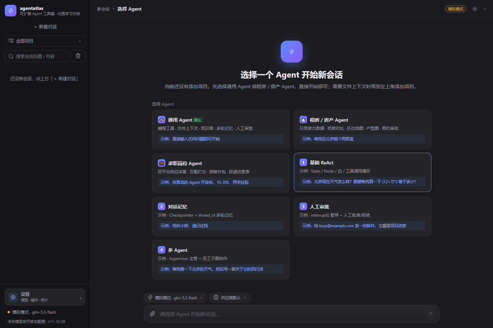

# agentatlas 功能 Wiki

> 当前版本：`0.9.0-beta.20`
> 项目阶段：pre-1.0 开发预览
> 最后更新：2026-11-20

agentatlas 是一个本地优先、可扩展的多 Agent 工作台。它把模型供应商、Agent、工具、审批、项目文件、长期记忆、扩展能力和审计数据放在同一个工作空间中，适合个人开发、团队内部试用和自托管部署。

本文只介绍当前已经交付、可以通过界面或 API 使用的功能。尚未交付的规划项不在此处写成现状。



## 目录

1. [产品定位](#1-产品定位)
2. [启动与入口](#2-启动与入口)
3. [工作台界面](#3-工作台界面)
4. [Agent 类型](#4-agent-类型)
5. [会话与执行流程](#5-会话与执行流程)
6. [权限与审批](#6-权限与审批)
7. [输入、附件与项目](#7-输入附件与项目)
8. [工具与插件](#8-工具与插件)
9. [模型与供应商](#9-模型与供应商)
10. [记忆与个性化](#10-记忆与个性化)
11. [多 Agent、子代理与路由](#11-多-agent子代理与路由)
12. [设置中心](#12-设置中心)
13. [使用统计](#13-使用统计)
14. [安全、数据与多用户](#14-安全数据与多用户)
15. [部署与运维](#15-部署与运维)
16. [外部程序接入](#16-外部程序接入)
17. [常见任务示例](#17-常见任务示例)
18. [能力边界](#18-能力边界)

## 1. 产品定位

agentatlas 的核心目标不是只提供一个聊天框，而是提供一个可以长期使用的 Agent 工作台：

- **Agent 隔离**：通用、房产、求职 Agent 拥有不同工具集、提示词、审批边界和记忆作用域。
- **人工可控**：只读、审批、自主、自动四种会话权限，高风险动作在执行前被拦截。
- **本地优先**：会话、检查点、个性化上下文、长期记忆、审计和备份默认写入本地数据目录。
- **按需扩展**：插件、技能、自定义命令、MCP Server、RAG、Browser Use、Computer Use 和子代理都可以独立配置。
- **可观测**：记录模型用量、工具调用、缓存、任务耗时、失败与中断，并提供 Prometheus 指标和健康探针。

## 2. 启动与入口

### 2.1 环境要求

- Node.js 24 推荐
- npm 11+
- Web 浏览器
- 可选：Docker 24+；Docker 生产镜像已内置无头 Chrome
- 可选：Chrome / Edge，用于 Browser Use 和求职采集
- 使用 Computer Use 时需要 Windows

### 2.2 本地 Web

```bash
npm install
npm run web
```

打开 <http://127.0.0.1:3000>。

如果未配置可用的模型供应商或 API Key，应用会保持供应商列表为空并进入本地 mock 模式。此时仍可体验会话、流式输出、工具调用、执行流程、审批和大部分界面功能。

### 2.3 桌面端与 CLI

```bash
npm run desktop     # Electron 桌面端，默认端口 3123
npm start           # CLI 入口
npm run demo:1      # 内置示例
```

Web 是主要使用界面；桌面端提供本地窗口体验；CLI 适合快速验证和脚本化运行。

## 3. 工作台界面

### 3.1 左侧栏

左侧栏集中处理项目和会话：

- 新建对话
- 项目选择器：全部项目、不选择项目、指定项目
- 按项目、今天、昨天、更早分组显示会话
- 搜索会话标题和当前浏览器缓存中的消息内容
- 清理超过指定天数的旧会话
- 左下角固定设置入口
- 主题切换

### 3.2 顶部与消息区

- 面包屑显示当前项目和会话位置
- 消息流支持流式输出、停止生成、回到底部和未读累计
- 多个会话可以并行生成，切换会话不会弹出全屏等待框
- 消息悬停后可复制用户输入、AI 最终总结或压缩摘要
- 思考过程默认折叠，流式阶段显示「思考中」状态
- 工具调用显示原始工具名、参数摘要和分类；超过两个同类调用会折叠为 tools 组
- 人工审批完成后默认折叠为摘要行，可手动展开详情
- 超长命令、长文本和 Markdown 不会撑破消息容器
- 执行流程窗体位于上下文条和输入控制上方，没有计划时默认隐藏，有计划时默认折叠并同步步骤进度

### 3.3 输入框上方

输入区提供以下工作区能力：

- `/goal <任务>`：进入连续任务模式，任务未完成时继续执行，直到完成、出错或手动停止
- `/`：打开自定义命令和内置输入辅助菜单
- `@`：搜索项目文件并附加到消息
- 附件、项目文件、本地文件和远程文件夹入口
- 权限模式切换：只读 / 审批 / 自主 / 自动
- 模型与思考等级切换
- 当前上下文容量、请求量、缓存和输出均速

## 4. Agent 类型

### 4.1 通用 Agent

通用 Agent 是默认执行者，适合编程、文件分析、网页阅读、知识库检索和自动化任务。

主要能力：

- 读取、搜索和列出项目文件
- 编写文件、执行终端命令并运行构建或测试
- 计算、时间、天气和邮件工具
- RAG 知识库检索
- 静态网页抓取
- Browser Use 浏览器操作
- Computer Use 电脑操作
- MCP 外部工具
- 长期记忆读写和动态子代理委派

通用 Agent 的系统边界明确：文件、终端、浏览器、电脑和 MCP 高风险工具受当前会话权限控制。

### 4.2 租房 / 房产 Agent

房产 Agent 使用独立的房产 Profile、工具和审批边界，适合：

- 按城市、预算、区域、户型和租买方向搜索房源
- 查询房源详情、户型图、地图和经纪人
- 查询行情、成交、政策和学区信息
- 预约看房和联系经纪人
- 生成房源对比表和 Excel 清单

使用前需要在设置中启用「找房数据源」插件，并按页面提示完成贝壳官方登录或授权。登录失效时界面会展开登录卡和下一步说明；Agent 不会静默重试失效的 CLI 接口。

房源结论区可以把房源、价格、户型图、地理位置、VR 入口、面积和坐标组合成表格；同一小区位置会直接复用上一行的地图缩略图。候选超过 12 套时，搜索工具或 `house_export` 会生成 `.xlsx` 对比文件，避免在聊天里堆叠超长表格。

### 4.3 求职 Agent

求职 Agent 内置岗位采集、评分和交付流程，适合：

- 采集 BOSS直聘、智联招聘、前程无忧、猎聘的岗位
- 按岗位匹配、薪资、经验、公司质量和活跃度打分
- 识别外包岗位
- 查询、补详情和生成概览
- 生成画像模板和岗位招呼语
- 导出 Excel 和同名 HTML 报告

当前内置采集支持的城市为：青岛、济南、北京、上海、深圳、杭州、成都。首次使用前，在「设置 → 插件 → 求职岗位」中检查浏览器并登录目标平台。采集、补详情和写回招呼语等外部动作会经过审批或权限闸门。

## 5. 会话与执行流程

### 5.1 新建对话

点击左侧「新建对话」后可以选择：

- 通用 Agent
- 内置房产 Agent
- 内置求职 Agent
- 通过 Git 地址接入的外部 Agent

没有项目时，工作台会直接展示 Agent 选择页，创建后的会话仍会出现在左侧会话树。

### 5.2 一轮对话的基本流程

一次请求通常经过：

```text
接收消息
  -> 需求分析与计划
  -> 必要时澄清
  -> Agent / 工具循环
  -> 高风险操作审批或权限裁决
  -> 结果反思
  -> 流式输出与任务用量落账
```

复杂任务会生成执行步骤，进度在输入框上方的「执行流程」窗体中同步。简单任务没有计划时，该窗体不显示。

### 5.3 澄清

当缺少关键条件时，Agent 会用澄清卡一次询问多个问题。用户完成全部问题后才能提交。

无头调用（`headless: true`）不会挂起等待人工选择，而是采用第一个候选假设继续，并把假设写入 `clarification_note` 事件。

### 5.4 连续任务

在输入框输入：

```text
/goal 完成当前项目生产化检查并修复发现的问题
```

会进入连续执行模式。只有在任务完成、发生不可恢复错误或用户停止时才结束；等价的外部请求字段为 `continuous: true`。

### 5.5 上下文与压缩

- 每个会话维护独立的 LangGraph checkpoint
- 刷新页面后可以从本地会话缓存或 transcript 恢复
- 上下文压缩会生成本地摘录或模型摘要，并重建后续线程
- 上下文条区分当前容量、请求 token、缓存 token 和输出速度
- 新建会话不会继承上一会话的上下文用量显示

### 5.6 会话导出与清理

- 可以从会话菜单导出 Markdown 附件
- 可以按创建时间批量清理旧会话
- 删除会话会同时处理对应的检查点和本地状态

## 6. 权限与审批

每个会话可在输入框上方切换权限：

| 模式 | 行为 |
|---|---|
| 只读 | 只允许只读工具；写文件、执行命令、发消息、控制电脑等动作直接拒绝 |
| 审批 | 默认模式；高风险工具先弹出审批卡，人工批准后执行 |
| 自主 | AI 判断风险，低风险直接执行，高风险才申请人工审批 |
| 自动 | 所有工具直接执行，不再逐项审批；适合完全信任当前会话的场景 |

审批卡会展示工具、参数和风险说明，并位于对应工具卡之前；待审批状态直接提供「批准并执行 / 拒绝」按钮，切换会话再回来也不会丢失操作区。批准、拒绝、自主放行等决定会写入审计链路。Browser Use 的 `browser_act` 和 Computer Use 的点击、输入、按键、滚动等动作都属于高风险动作。

## 7. 输入、附件与项目

### 7.1 项目

项目选择器支持：

- **全部项目**：查看所有已添加项目的会话
- **不选择项目**：使用内部默认工作区，不绑定外部目录
- **指定项目**：绑定本地或云端项目文件夹

添加本地文件夹会调用系统文件夹选择器，而不是让用户手动填写路径。项目可以刷新、切换和删除；删除项目只移除工作台登记，不删除用户原始文件。

### 7.2 文件与远程目录

可以从输入框附加：

- 当前项目文件
- 本地文件上传
- 远程文件夹

该行为受授权根目录、敏感路径和大小限制保护。文件读取支持文本、图片和二进制识别，超长内容会截断并说明。

### 7.3 消息中的 Markdown

消息支持 Markdown、表格、代码块、图片和代码高亮。Markdown 渲染使用安全净化路径，不允许用户内容直接执行 HTML。图表、Markdown 和高亮属于按需加载能力，加载失败不会阻断基础文本显示。

## 8. 工具与插件

### 8.1 工具分类

| 类别 | 典型工具 | 默认行为 |
|---|---|---|
| 文件 | `read_file`、`write_file`、`list_dir`、`grep_search` | 读取类直接执行，写入按权限 |
| 命令 | `terminal` | 审批或按权限裁决 |
| 通用 | `calculator`、时间、天气、邮件 | 只读类直接执行，邮件按审批 |
| 知识库 | `retrieve_docs` | 只读，调用外部 RAG |
| Browser Use | 打开、快照、点击、输入、滚动 | 读取直接执行，写操作审批 |
| Computer Use | 截图、点击、输入、按键、滚动 | 截图只读，动作需审批 |
| MCP | `mcp__<server>__<tool>` | 默认登记审批 |
| 房产 | `house_*` | 查询只读，预约 / 联系经纪人审批 |
| 求职 | `job_*` | 查询只读，采集 / 补详情 / 写回审批 |

工具失败会返回模型可读的中文错误，不会直接把异常穿透成页面崩溃。临时服务故障只对可恢复错误进行有限重试，达到次数后熔断，避免 Agent 无限重复相同调用。

### 8.2 插件

设置 → 插件集中控制以下能力：

- **知识库（RAG）**：HTTP 契约接入外部向量存储和 embedding 服务
- **找房数据源（贝壳）**：CLI 接入贝壳官方找房能力
- **求职岗位（内置采集）**：内置 Chrome / Edge 采集和交付流程
- **浏览器操作（Browser Use）**：在会话右侧打开真实浏览器画面
- **电脑控制（Computer Use）**：Windows 本机截图和桌面操作

插件开关只控制 Agent 是否装配对应工具，不会自动删除已有的 RAG、CLI 或数据配置。Browser Use 和 Computer Use 默认关闭，启用后由通用、房产、求职三个主 Agent 分别显式装配；领域工具与记忆范围不会因此互通。Computer Use 仅支持 Windows。

### 8.3 RAG 知识库

RAG 使用外部 HTTP 服务，不是 MCP：

- `POST /ingest`：文档或文本入库
- `POST /search`：按问题检索
- `POST /reset`：清空集合

设置页支持扫描授权文件夹、粘贴文本、测试检索、清空集合和查看来源。通用 Agent 在需要项目文档、需求说明或团队资料时调用 `retrieve_docs`，并在回答中标注来源；检索不到时如实说明，不编造内容。

### 8.4 Browser Use

启用后，当前 Agent 可以在会话右侧打开浏览器画面，执行：

- 打开网页
- 读取页面快照
- 点击链接或按钮
- 填写表单
- 输入文本、按键和滚动

页面截图和状态通过独立面板显示。写操作必须经过审批或会话权限裁决，且浏览器会话按当前会话隔离。

### 8.5 Computer Use

启用后，当前 Agent 可以操作当前 Windows 桌面：

- 截图
- 点击
- 输入
- 按键
- 滚动

默认关闭，并且所有动作类操作都属于高风险工具。Docker / 容器部署中该能力始终禁用；需要在 Windows 桌面直接控制本机时使用桌面版。坐标和操作前状态由智能体自行确认。

### 8.6 MCP Server

设置 → MCP 服务器支持：

- 全局启用或暂停 MCP 工具
- 添加、编辑、删除 MCP Server
- 从 JSON 配置导入
- 测试连接
- 单个服务器启停
- MCP 工具默认登记审批

MCP 工具会以 `mcp__<server>__<tool>` 命名，避免与内置工具重名。第三方 MCP Server 属于可执行外部代码，必须按最小权限配置。

## 9. 模型与供应商

### 9.1 供应商管理

设置 → 模型与供应商采用左侧供应商、右侧模型详情的布局：

- 新增供应商
- 编辑 Base URL
- 保存 API Key，编辑时留空表示保持原 Key
- 拉取网关模型列表
- 批量勾选网关模型：支持搜索、全选/全不选、只看已选，确认后一次性应用新增与移除
- 添加、编辑和删除模型
- 启停供应商和模型
- 选择默认供应商与模型
- 切换思考等级

API Key 在界面和 API 中只返回掩码；真实 Key 不会出现在日志、诊断接口或公开响应里。

### 9.2 协议与思考等级

支持的模型协议：

- OpenAI Chat Completions
- OpenAI Responses
- Anthropic
- Gemini

思考等级按供应商能力映射为原生参数。DeepSeek、智谱等支持思考能力的模型只展示实际有意义的档位；自定义 JSON 模式用于网关需要的额外字段。供应商切换会重建模型配置，但保留当前会话历史。

### 9.3 Mock 模式

没有可用供应商时：

- 供应商列表为空
- 不伪造默认模型
- 应用进入本地 mock
- 仍可体验会话、流式输出、工具卡、审批和执行流程

## 10. 记忆与个性化

记忆分为三层，不要把它们混为一谈：

| 能力 | 作用 |
|---|---|
| LangGraph checkpoint | 同一会话跨轮次、跨重启恢复图状态 |
| 个性化上下文 | 每轮稳定注入用户背景、协作偏好和输出要求 |
| 长期记忆插槽 | 跨会话保存偏好、项目事实和纠错 |
| RAG | 检索外部知识库 |
| MCP | 接入外部工具 |

### 10.1 个性化上下文

设置 → 记忆与个性化可以填写一段稳定上下文，例如：

```text
我常驻上海，负责产品研发；回答先给结论，复杂任务分步骤说明；默认中文，方案优先保证可维护性。
```

该上下文默认启用并逐轮注入，不需要检索，也不占长期记忆条目。

### 10.2 本地长期记忆

默认使用本地 Provider，按 Agent scope 隔离：

```text
.setting/memory-store/
  scopes/
    local--general/
    local--estate/
    local--job/
```

支持自动沉淀、人工确认、生命周期、词法召回、可选 Embedding 向量召回、导入导出和删除。密钥、令牌、密码、私钥默认拒绝；手机号和身份证号默认不保存，显式允许后才可处理。

### 10.3 HTTP 记忆

可以连接到兼容的 HTTP 记忆服务，配置 Base URL、认证、超时、召回上限和 Agent bank。HTTP 故障会自动降级，不影响主对话完成。远程记忆不可用时，界面会明确显示连接失败原因。

### 10.4 记忆隔离

- 通用 Agent：`general`
- 房产 Agent：`estate`
- 求职 Agent：`job`
- 子代理不直接写长期记忆
- 导入替换只影响当前 scope
- 不使用其他 Agent 的记忆作为隐式上下文

## 11. 多 Agent、子代理与路由

### 11.1 主 Agent 与子代理

设置 → 子代理可以创建专项子代理并配置：

- 名称、描述和可用状态
- 继承当前主对话模型，或固定使用指定模型
- 路由关键词、类别、适用和不适用场景
- 领域提示词：通用、房产或求职
- 主 Agent 本次委派时显式赋予的提示词和工具子集

子代理在独立上下文中执行，结果和工具轨迹回到主会话；主 Agent 继续负责澄清、审批和最终答复。子代理不能递归委派，也不能扩大主 Agent 授予的工具权限。

### 11.2 动态委派

主 Agent 只在任务独立、适合并行或需要隔离上下文时使用 `delegate_agent`。委派会携带完整任务书、专项提示词和最小工具集。能自己完成的小任务不会为了“多 Agent”而强行委派。

### 11.3 路由决策

设置 → 路由决策可以启用规则或模型路由，根据请求内容选择合适的子代理：

- 规则关键词与类别
- 规则置信度和分差阈值
- 模型置信度阈值
- 最大转回次数
- 分层触发的意图数量
- 决策超时
- 路由试跑输入

路由层只负责选择候选 Agent，不绕过目标 Agent 的工具 allowlist、权限和审批边界。

## 12. 设置中心

左下角设置入口打开独立设置页面，左上角有返回按钮。设置页按以下分组管理：

### agentatlas

- 模型与供应商
- 插件
- 子代理
- 路由决策

### 扩展

- 记忆与个性化
- 自定义命令
- 技能
- MCP Server

### 数据

- 使用统计

设置页支持搜索、分组折叠和 `/` 聚焦搜索。所有配置都在服务端校验并持久化，不把密钥写进浏览器可读配置。

### 12.1 自定义命令

自定义命令是可复用的斜杠提示词模板，支持：

- 命令名和菜单标题
- 场景说明
- `{{selection}}` 等模板变量
- 设置页搜索、编辑和删除
- 在输入框 `/` 菜单中即时调用

### 12.2 技能

技能是 Markdown 形式的领域指南，支持：

- 上传 `.md` / `.markdown` 文件
- 解析 frontmatter 名称、描述和触发词
- 在设置页搜索、筛选、编辑、启停和删除
- 命中触发词或名称时自动载入
- 每轮最多载入 2 个技能，技能库总数不设固定上限

技能只影响提示词，不执行代码；需要外部执行能力时使用 MCP、RAG 或插件。

## 13. 使用统计

设置 → 使用统计提供近 7 天和近 30 天两个固定时间窗口：

- 总轮次、输入 token、输出 token、缓存 token
- 有记录会话数、子代理委派次数、模型调用次数
- 按天用量趋势
- 按模型调用和 token 分布
- 24 小时活动分布
- 工具调用 Top N
- 平均轮次耗时、缓存命中率、失败和中断轮次
- 活跃会话排行
- 图表加载失败时的数据表降级

统计从 journal 的 usage 事件聚合；同一个 `callId` 的流式分片会去重，避免调用次数被重复放大。`task_usage` 是一轮任务的累计快照，适合外部统计程序直接消费。

## 14. 安全、数据与多用户

### 14.1 默认安全边界

- 本机直连使用设备静默会话，减少令牌输入
- 远程访问可通过认证和 HTTPS 保护
- 配置中的 API Key、Cookie、Authorization 不进入日志
- 高风险工具必须在 `hitl` 审批边界登记
- 外部 URL 经过 SSRF 防线
- 文件访问先解析授权根，再检查敏感路径、二进制和大小
- 用户内容不直接拼入 HTML

### 14.2 设备与用户隔离

每个设备有独立身份，会话、审批、导出、统计和 Browser Use 状态按设备或 userId 绑定。生产环境开启认证后，不同真实用户的会话和数据互不可见。

`STATE_BACKEND=postgres` 时使用 PostgreSQL 的 `userId + RLS` 数据面，适合多个真实用户共享一个自托管实例。当前 SSE、限流和浏览器会话仍按单实例设计，不等同于多节点集群高可用。

### 14.3 数据目录

默认文件后端包含：

- `web-config.json`：加密配置
- `sessions.ndjson`：会话 journal
- `checkpoints.ndjson`：LangGraph 检查点
- `memory-store/`：长期记忆
- `skills/`：用户技能
- `audit.ndjson`：审计日志
- `backups/`：备份和校验清单

生产前必须配置 `DATA_KEY`、认证、HTTPS、Cookie Secure 和备份策略。

### 14.4 LangSmith 链路追踪

LangSmith 是默认关闭的可选观测能力。开启后，主 Agent 的节点、工具和模型调用会通过 LangChain callback 异步上报到 LangSmith，形成单轮任务的执行瀑布图。

- 配置入口：设置 → 链路追踪
- 默认状态：关闭
- Key：只回显掩码，编辑留空保持，显式勾选清除才删除
- 元数据：`agent_id=agentatlas`、`agent_environment=local`，并附带 sessionId / profileId
- 脱敏：手机号、身份证、银行卡和常见凭据在 Client 上报边界替换
- endpoint：必须使用公网 HTTPS 地址，拒绝 userinfo、loopback 和私有 IP 字面量
- 失败降级：缺少 Key、endpoint 非法或网络失败不会中断主对话

开启即允许对话内容发送到 LangSmith；该能力不替代本地 journal、审计、指标和 `task_usage`。详细说明见 [LangSmith 链路追踪](langsmith-tracing.md)。

## 15. 部署与运维

### 15.1 单实例 Docker

Docker 镜像默认包含与 `playwright-core` 匹配的无头 Chrome，Browser Use 和求职采集可以在容器内运行。也可以用 `minimal` target 构建不含浏览器的精简镜像。

生产运行边界：

- 一个 Web 进程对应一个数据卷
- 生产镜像固定 digest，不使用 `latest`
- 只读根文件系统
- 非 root 用户
- 容器内持久化 `/data`
- 通过 HTTPS 反向代理访问
- 使用 `/healthz`、`/readyz` 和 `/metrics` 观测

### 15.2 PostgreSQL 多用户

`STATE_BACKEND=postgres` 时：

- 管理员连接 `DATABASE_ADMIN_URL` 只用于迁移和 bootstrap
- 应用连接 `DATABASE_URL` 使用低权限角色
- 会话、检查点、项目、设置和审计按 userId 隔离
- RLS 在数据库层兜底
- 备份和恢复必须同时覆盖数据库与文件数据

### 15.3 备份与故障处理

- `npm run backup`：创建备份
- `npm run restore`：恢复备份
- `npm run data:check`：检查配置、journal、checkpoint 和备份
- `/healthz`：进程存活
- `/readyz`：就绪状态和数据写入探针
- `/metrics`：Prometheus 指标

具体步骤见 [部署与运维总览](deployment.md)、[备份与恢复](backup-restore.md)、[安全与 TLS](security-and-tls.md)、[PostgreSQL 多用户与 RLS](postgres-multitenant.md) 和 [运行手册](runbook.md)。

## 16. 外部程序接入

Web 之外，脚本或评测框架可以使用 HTTP + SSE 驱动一轮对话。

### 16.1 建立会话

```bash
curl -X POST http://127.0.0.1:3000/api/sessions \
  -H 'Content-Type: application/json' \
  -d '{"kind":"agent"}'
```

### 16.2 发送消息并读取 SSE

```bash
curl -N -X POST http://127.0.0.1:3000/api/chat \
  -H 'Content-Type: application/json' \
  -d '{"sessionId":"<id>","message":"帮我审查当前改动","headless":true}'
```

请求字段：

| 字段 | 说明 |
|---|---|
| `sessionId` | 会话 id |
| `message` | 用户消息 |
| `files` | 附加文件或项目路径 |
| `headless` | 无人值守模式，澄清采用首个候选假设 |
| `continuous` | 连续执行模式，等价于 `/goal` |

常用事件：

| 事件 | 用途 |
|---|---|
| `usage` | 单次模型调用用量快照 |
| `task_usage` | 一轮任务累计用量，位于最后一条 `usage` 之后、`done` 之前 |
| `clarification_note` | 无头模式自动采用假设时的说明 |
| `approval` / `resume` | 高风险操作的审批与恢复 |
| `workflow_plan` | 执行流程及步骤进度 |

同一会话同一时刻只允许一条流。供应商并发排队超时会返回 HTTP 429 和 `Retry-After`，调用方应按可重试错误处理。

## 17. 常见任务示例

### 审查当前项目

1. 新建通用 Agent 会话。
2. 选择项目。
3. 权限切换为「只读」或「审批」。
4. 输入「审查当前改动，先指出高风险问题，再给出修复建议」。
5. 查看工具卡、执行流程和最终总结。

### 分析项目文档

1. 在设置 → 插件启用知识库。
2. 配置 RAG 地址、集合和可选的 Bearer Key。
3. 在设置页扫描授权文件夹或粘贴文本入库。
4. 回到会话提问，Agent 会自动调用 `retrieve_docs` 并标注来源。

### 找房

1. 新建房产 Agent 会话。
2. 在设置 → 插件中安装或检测贝壳 CLI。
3. 打开官方登录页完成授权，保存 Key。
4. 告诉 Agent 城市、租买方向、预算、区域和户型。
5. 查看房源结论表、地图、户型图和 Excel 对比文件。

### 求职

1. 新建求职 Agent 会话。
2. 在设置 → 插件中检查浏览器并登录招聘平台。
3. 一次提供岗位方向、城市、薪资区间和工作年限。
4. 等待采集、评分和外包识别。
5. 在求职数据目录的 `out/` 查看 Excel 和 HTML 报告。

## 18. 能力边界

- 这是 `0.9.0-beta.20` 开发预览，不是 1.0 稳定版，不提供正式 SLA。
- 文件后端默认是单实例写者模型，不能让多个进程同时写同一个 `/data`。
- PostgreSQL 提供 userId/RLS 多用户隔离，但不等同于多节点集群高可用。
- RAG 依赖外部 HTTP 服务；未配置或服务不可用时，Agent 应如实说明，不能伪造检索结果。
- Browser Use 需要浏览器运行时；Docker 默认镜像已内置无头 Chrome，minimal 镜像不包含。
- Computer Use 仅支持 Windows，默认关闭，动作需要权限和审批。
- 房产 Agent 依赖贝壳官方登录和 CLI；登录失效时应先完成人工登录，不要继续重试失效接口。
- 求职采集依赖目标招聘平台的登录、页面结构和风控状态，平台变化可能导致需要诊断或更新选择器。
- 统一、严密的发布证据和开发设计文档属于内部计划，不随公开 `docs/` 分发。

## 相关文档

- [README](../README.md)
- [记忆与个性化](memory-slot.md)
- [部署与运维总览](deployment.md)
- [快速自托管](self-hosting.md)
- [安全与 TLS](security-and-tls.md)
- [备份与恢复](backup-restore.md)
- [监控与告警](monitoring.md)
- [故障排查](troubleshooting.md)
- [升级与回滚](upgrade-rollback.md)
- [PostgreSQL 多用户与 RLS](postgres-multitenant.md)
- [生产上线 Checklist](production-checklist.md)
- [运行手册](runbook.md)
- [支持策略与已知限制](support.md)
